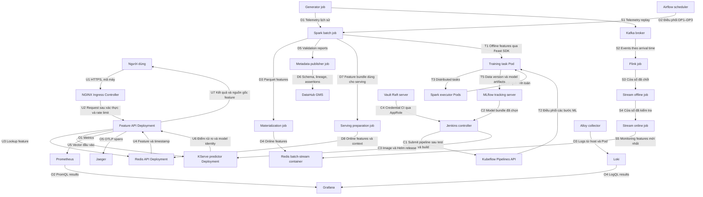

# IoT Maintenance Platform

Nền tảng giám sát máy bơm công nghiệp và dự đoán sự cố trong một giờ tới.

Dự án xử lý dữ liệu cảm biến từ lúc tiếp nhận, làm sạch và tạo đặc trưng đến huấn luyện mô hình và phục vụ dự đoán qua API. Bên cạnh luồng dữ liệu chính là các thành phần quản lý phiên bản, kiểm thử, giám sát và bảo mật để có thể theo dõi một kết quả dự đoán về đúng dữ liệu và mô hình đã tạo ra nó.

Đây là dự án cá nhân trong coursework **Engineering for Data & AI — EDAI K11**, sử dụng dữ liệu mô phỏng.

[Tự chạy demo](docs/demo-walkthrough.md) · [Kiến trúc chi tiết](docs/architecture.md) · [Kết quả kiểm chứng](docs/final-audit.md)

## Mục lục

- [Bài toán](#bài-toán)
- [Kiến trúc hệ thống](#sơ-đồ-triển-khai-hiện-có)
- [Kết quả đã kiểm chứng](#kết-quả-đã-kiểm-chứng)
- [Chạy thử](#chạy-thử)
- [Cấu trúc repository](#cấu-trúc-repository)
- [Tài liệu](#tài-liệu)

## Bài toán

Một máy bơm có thể xuống cấp dần trước khi dừng hoạt động. Nhiệt độ, độ rung, dòng điện và tốc độ quay cung cấp những dấu hiệu để theo dõi quá trình này. Mục tiêu của dự án là đưa các chỉ số đó vào một luồng xử lý có thể kiểm tra được, sau đó trả về điểm rủi ro cho từng máy.

Hệ thống hỗ trợ:

- Tiếp nhận dữ liệu lịch sử và dữ liệu streaming, xử lý bản ghi trùng, đến muộn và thay đổi schema.
- Tạo feature dùng chung cho huấn luyện và dự đoán, có kiểm tra thời điểm dữ liệu thực sự sẵn có.
- Huấn luyện theo thời gian, lưu phiên bản dữ liệu và mô hình, triển khai dự đoán bằng FastAPI và KServe.
- Theo dõi drift, metrics, logs và traces; kiểm soát thay đổi qua CI/CD, A/B testing và các bước rollback.

Nhãn `failure_in_next_1h` chỉ áp dụng khi máy đang hoạt động: sự cố phải bắt đầu trong khoảng một giờ sau thời điểm dự đoán. Máy đang hỏng hoặc bảo trì không được gán cùng mục tiêu dự đoán này. Quy tắc nhãn, timestamp và dữ liệu đến muộn được mô tả trong [data contract](docs/data-contract.md).

## Sơ đồ triển khai hiện có

Lab chạy trên một VM Google Cloud **8 vCPU, 64 GiB RAM**, sử dụng K3s, Docker Compose và một số dịch vụ systemd. Terraform quản lý hạ tầng; Ansible cấu hình môi trường. Các giao diện quản trị được truy cập qua IAP.



Mỗi hộp biểu diễn một dịch vụ hoặc job triển khai; Feast SDK chạy bên trong job/API. Hai Spark executor là các Pod trên cùng VM. Redis của luồng batch/stream và Redis phục vụ API được cấu hình riêng. Xem [kiến trúc chi tiết](docs/architecture.md) để đối chiếu các store và cấu hình của từng luồng.

Các luồng được kiểm chứng ở những lượt chạy riêng. Nguồn 100 GB đã đi qua Bronze/Silver; feature và training dùng tập 60 ngày riêng. Luồng stream sử dụng các cửa sổ Kafka/Flink đã chốt để kiểm ghi vào hai store và replay. Chi tiết A/B, drift Eventing, service mesh và policy gate nằm trong tài liệu của từng thành phần.

## Kết quả đã kiểm chứng

| Hạng mục | Kết quả | Chi tiết |
|---|---|---|
| Xử lý nguồn lớn | 102.447.847.856 byte JSONL không nén; 316,8 triệu dòng Silver duy nhất; 13 kiểm tra Spark đạt | [Full-scale ingest](docs/full-scale-ingest.md) |
| Feature và training | 3.456.000 snapshot trong 60 ngày; 3.132.184 dòng training sau các bước lọc theo protocol | [Feature dataset](docs/medium-feature-dataset.md) |
| Streaming feature | Ghi và replay 5.760 cửa sổ, 57.600 reading của 20 máy qua offline/online store | [Window cohort](docs/window-cohort.md) |
| Phục vụ dự đoán | Demo model phiên bản 6 kiểm 200 máy: 195 dự đoán hợp lệ, 5 máy dừng trả HTTP 409 | [Serving và bàn giao](docs/final-handover.md) |
| Kiểm thử trên PC | 748 test và 314 kiểm tra con đạt; 7 test bỏ qua có ghi lý do; 26 bộ kiểm bằng chứng đạt từ bản clone sạch | [Rà soát final](docs/final-audit.md) |

Coverage, mutation testing, load test và benchmark có workload, cấu hình và báo cáo riêng trong [CI serving](docs/ci-serving.md), [API validation](docs/api-validation.md) và [load test](docs/observed-api-load.md).

Dữ liệu hiện là mô phỏng; điểm rủi ro của mô hình chưa được hiệu chuẩn thành xác suất hỏng trong thực tế. Lab dùng domain và CA riêng, chưa kiểm nghiệm vận hành HA trên nhiều máy. Các kết quả, giới hạn và bằng chứng được đối chiếu theo [rubric final](docs/final-audit-matrix.md).

## Chạy thử

Các lệnh dưới đây chạy từ thư mục gốc của repo, với Python 3.12/3.13. Ví dụ dùng PowerShell 7.

### 1. Tạo và kiểm tra dữ liệu nhỏ

Không cần Docker hoặc VM cho bước này. Generator dùng thư viện chuẩn của Python.

```powershell
$run = "local-$(Get-Date -Format 'yyyyMMdd-HHmmss')"
python -S -m generator generate --config generator/configs/dev.json --output "data/source/$run"
python -S -m generator inspect --source "data/source/$run" --report "outputs/$run/quality.json"
```

Cấu hình mặc định mô phỏng 20 máy trong 48 giờ. Mỗi lần chạy dùng một tên mới để giữ lại dữ liệu và kết quả trước đó. Xem [hướng dẫn generator](docs/day1-generator.md) nếu muốn thay seed, số máy hoặc tỷ lệ lỗi.

### 2. Kiểm tra bằng chứng đã lưu

Bước này cần Python và Git, không cần bật dịch vụ:

```powershell
$tag = Get-Date -Format 'yyyyMMdd-HHmmss'
python -S scripts/audit-final-coursework.py --output "outputs/audit-$tag"
```

Lệnh đối chiếu rubric, kiểm hash và chạy 26 bộ kiểm trên các báo cáo đã lưu. Kết quả nằm trong `verification.json`; các console được giữ cùng thư mục. Đây là kiểm tra kết quả lịch sử, không phải chạy lại toàn bộ pipeline.

### 3. Gọi API trên lab

Khi VM đã sẵn sàng và IAP tunnel đang mở:

```powershell
$tag = Get-Date -Format 'yyyyMMdd-HHmmss'
python -S scripts/demo-feature-api.py --base-url http://127.0.0.1:18082 --output "outputs/demo-$tag"
```

Mở [Swagger UI](http://127.0.0.1:18082/docs) để thử `P-001` và `P-006`. Lệnh demo kiểm cả phép tính dự đoán lẫn các mã lỗi HTTP 409, 404, 422. Feature có thời hạn sử dụng; khi hết hạn, cần materialize lại trước khi dự đoán.

[Hướng dẫn demo](docs/demo-walkthrough.md) có các bước bật lại VM, phục hồi dịch vụ, làm mới feature, mở tunnel và kịch bản trình bày 10 phút. Clone repo chỉ lấy code, cấu hình mẫu và tài liệu; dữ liệu lớn, secrets và trạng thái dịch vụ được giữ riêng trên từng máy.

## Cấu trúc repository

```text
generator/             Mô phỏng telemetry, sự cố, bảo trì và lỗi vận chuyển dữ liệu
pipelines/             Xử lý batch/stream, làm sạch, tổng hợp và kiểm tra thời gian
feature_store/         Feast, offline/online features, materialization và replay
airflow/dags/          Các DAG dữ liệu, materialization và drift monitoring
ml/                    Training, data/model versioning, serving và drift
notebooks/             Notebook huấn luyện và phân tích
services/              FastAPI cho feature, predictor, drift và A/B
models/                Portable model và thông tin phiên bản phục vụ kiểm thử
infra/                 Docker, Helm, Terraform, Ansible, CI và cấu hình bảo mật
scripts/               Các lệnh chạy, vận hành và kiểm chứng
tests/                 Unit, integration, property-based và load tests
docs/                  Thiết kế, hướng dẫn, số đo và bằng chứng
references/coursework/ Đề bài và rubric gốc
```

`data/`, `outputs/`, môi trường Python và secrets không được đưa vào Git.

## Tài liệu

| Chủ đề | Điểm bắt đầu |
|---|---|
| Dữ liệu và nghiệp vụ | [Data contract](docs/data-contract.md) · [ML evaluation protocol](docs/ml-evaluation-protocol.md) |
| Data engineering | [Spark 100 GB](docs/full-scale-ingest.md) · [Airflow và DataHub](docs/orchestration.md) · [Kafka/Flink](docs/day3-streaming.md) |
| Feature store | [Feast](docs/feast-feature-store.md) · [Materialization và TTL](docs/feature-jobs-and-ttl.md) |
| Machine learning | [Notebook](docs/training-notebook.md) · [Distributed training](docs/distributed-training.md) · [Incremental versioning](docs/automatic-ml-versioning.md) |
| Serving và CI/CD | [Feature API](docs/feature-api.md) · [Serving CI](docs/ci-serving.md) · [A/B deployment](docs/ci-ab-deployment.md) |
| Giám sát | [Metrics và traces](docs/api-observability.md) · [Logs](docs/log-discovery.md) · [Drift và retraining](docs/drift-retraining.md) |
| Hạ tầng và bảo mật | [Terraform/Ansible](docs/iac-verification.md) · [Gateway](docs/private-gateway.md) · [Vault](docs/vault.md) · [Service mesh](docs/private-mesh.md) |
| Hai phần mở rộng | [MMD phát hiện thay đổi quan hệ cảm biến](docs/joint-cohort.md) · [OPA kiểm cấu hình triển khai](docs/deployment-policy.md) |
| Bàn giao coursework | [Tự chạy demo](docs/demo-walkthrough.md) · [Rà soát final](docs/final-audit.md) · [Ma trận rubric](docs/final-audit-matrix.md) |

Đề bài và workbook chấm nằm trong [`references/coursework/`](references/coursework/). Các phiên bản, cấu hình chạy và ảnh giao diện được ghi trong tài liệu tương ứng.
