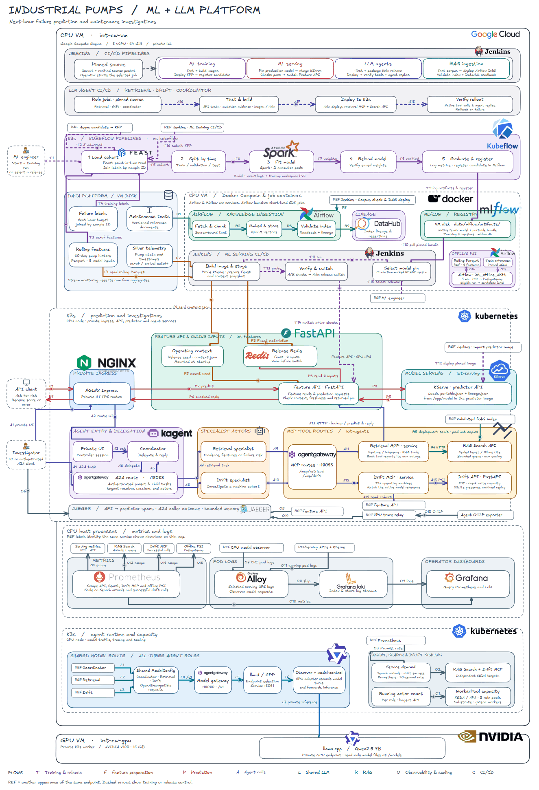

# IoT Maintenance Platform

IoT Maintenance Platform is a predictive maintenance lab for industrial pumps. It processes simulated telemetry, trains a model to estimate next-hour failure risk for operating pumps, and serves predictions through an API. A maintenance assistant retrieves sensor summaries, predictions and relevant maintenance documents.

The simulator generates temperature, vibration, motor current and speed readings, as well as failure and maintenance records. The event schemas and `failure_in_next_1h` training target are defined in the data contract. [Data contract](docs/edai-1/data_contract.md)

## Getting started

From the repository root, run the following in PowerShell with Python 3.12 or 3.13. The development profile generates 48 hours of data for 20 pumps.

```powershell
$run = "local-$(Get-Date -Format 'yyyyMMdd-HHmmss')"
python -S -m generator generate --config generator/configs/dev.json --output "data/source/$run"
python -S -m generator inspect --source "data/source/$run" --report "outputs/$run/quality.json"
```

The generator writes telemetry, a replay file and a manifest to `data/source/$run`. The inspection writes a quality report to `outputs/$run/quality.json`. [Generator guide](generator/README.md)

Live prediction and agent requests require access to the private lab and a fresh serving snapshot. [Lab setup and demo commands](docs/edai-1/operations.md)

## Architecture

### Data Platform

- **Batch.** Airflow starts a Spark job container for each stage. DP1 reads JSONL from the VM disk and writes Bronze Parquet. DP2 writes Silver and Gold. DP3 reads Silver and equipment records from Gold to build eight rolling model inputs and separate next-hour failure labels.
- **Streaming.** Flink consumes recorded deliveries replayed through Kafka and writes four 10-minute monitoring aggregates and audit records to SQLite. Airflow jobs publish retained windows to Parquet and the latest aggregates to Redis.

[Interactive viewer](https://htmlpreview.github.io/?https://github.com/anle0429/iot-maintenance-platform/blob/main/docs/architecture/data-platform-v16.html) · [PNG](docs/architecture/data-platform-v16.png) · [SVG](docs/architecture/data-platform-v16.svg) · [Animated SVG](docs/architecture/data-platform-v16.animated.svg) · [Excalidraw](docs/architecture/data-platform-v16.excalidraw)

<a href="https://htmlpreview.github.io/?https://github.com/anle0429/iot-maintenance-platform/blob/main/docs/architecture/data-platform-v16.html">
<picture>
  <source media="(prefers-reduced-motion: reduce)" srcset="docs/architecture/data-platform-v16.png">
  
</picture>
</a>

### ML and LLM Platform

- **Training and release.** Kubeflow runs Spark logistic regression on a separate 60-day dataset. MLflow registers model versions. Jenkins stages the selected model in KServe and switches the Feature API after release checks pass.
- **Prediction.** Feast materializes the eight model inputs into Redis. The Feature API checks their freshness and reads a prepared operating-state snapshot from Silver before sending eligible requests to KServe.
- **Agents.** The coordinator delegates to specialists. Retrieval tools call the Feature API and the RAG Search API. The drift specialist compares input distributions with the reference for the model in use. The agents use a shared LLM on a private GPU.
- **Monitoring.** Airflow compares a rolling Parquet window with a saved training reference for offline drift. Prometheus scrapes separate RAG Search and Drift MCP metrics.

[Interactive viewer](https://htmlpreview.github.io/?https://github.com/anle0429/iot-maintenance-platform/blob/main/docs/architecture/ml-llm-platform-v19.html) · [PNG](docs/architecture/ml-llm-platform-v19.png) · [SVG](docs/architecture/ml-llm-platform-v19.svg) · [Animated SVG](docs/architecture/ml-llm-platform-v19.animated.svg) · [Excalidraw](docs/architecture/ml-llm-platform-v19.excalidraw)

<a href="https://htmlpreview.github.io/?https://github.com/anle0429/iot-maintenance-platform/blob/main/docs/architecture/ml-llm-platform-v19.html">
<picture>
  <source media="(prefers-reduced-motion: reduce)" srcset="docs/architecture/ml-llm-platform-v19.png">
  
</picture>
</a>

### Deployment

The lab runs on Google Cloud. The CPU VM hosts the data jobs, K3s services and KServe predictor. A private V100 GPU worker runs the language model for the agents. [Deployment topology](docs/images/deployment-runtime.png) · [Operations guide](docs/edai-1/operations.md)

## Recorded results

The large batch ingest, 60-day training run and streaming replay are separate workloads. The results below use simulated pump data.

| Check | Result | Evidence |
|---|---|---|
| Large batch ingest | Processed 102.45 GB of simulated JSONL through Bronze and Silver, yielding 316.8 million unique Silver readings. | [Ingest report](docs/edai-1/full_scale_ingest.md) |
| Training dataset | A separate 60-day simulation produced 3.13 million eligible training rows. | [Dataset report](docs/edai-1/processing_jobs.md#medium-feature-dataset) |
| Model evaluation | The recorded training notebook measured F1 of 0.551 and PR-AUC of 0.615 on the held-out simulated period. | [Notebook results](docs/edai-1/training_notebook.md) |
| Prediction | For 200 pumps, the API returned 195 predictions and rejected the five stopped pumps with HTTP 409. | [Serving report](docs/edai-1/final_handover.md) |
| Agent investigation | A recorded request returned results from both specialists after four successful tool calls. | [Agent validation](docs/edai-2/agent_runtime_validation.md) |

To verify the archived results and source files locally, run the offline audit. [Evidence guide](docs/edai-1/evidence_guide.md)

```powershell
$tag = Get-Date -Format 'yyyyMMdd-HHmmss'
python -B -S scripts/audit-final-coursework.py --output "outputs/audit-$tag"
```

## Repository structure

| Directory | What to find there |
|---|---|
| `generator/`, `pipelines/`, `airflow/` | Pump simulator, Spark and Flink jobs, and Airflow DAGs |
| `feature_store/`, `ml/`, `models/`, `notebooks/` | Feast, training, model metadata and reproducible notebooks |
| `services/`, `agents/` | Prediction, drift, document search and MCP APIs, plus agent configuration |
| `rag/`, `knowledge/`, `llm/`, `llm_observability/` | Document indexing, maintenance text, inference tools and request telemetry |
| `infra/`, `scripts/`, `tools/`, `tests/` | Deployment, operation, local tooling and verification |
| `docs/`, `references/` | Architecture and evidence, plus original specifications |

## Documentation

- [Documentation index](docs/README.md)
- [Data and ML](docs/edai-1/README.md)
- [LLM and agents](docs/edai-2/README.md)
- [Architecture diagrams](docs/diagrams/README.md)
- [Operations](docs/edai-1/operations.md)

## Contributors

- [An Le](https://github.com/anle0429) — project owner.
- [OpenAI Codex](https://developers.openai.com/codex/) — AI assistance with documentation and architecture diagrams.
