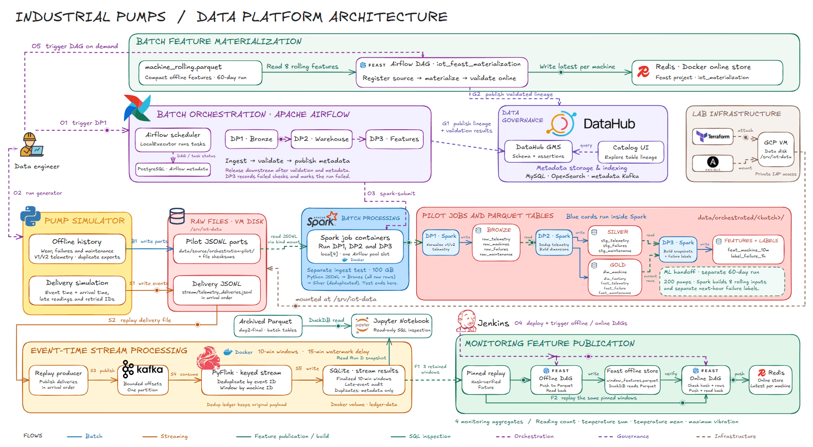

# IoT Maintenance Platform

IoT Maintenance Platform is a predictive maintenance lab for industrial pumps. It uses simulated sensor readings and failure records to estimate the risk that a running pump will fail within the next hour. A maintenance assistant can retrieve the pump's sensor summaries, request a risk score and find relevant passages in the maintenance documents.

[Start the review](docs/README.md) · [Architecture](#architecture) · [Recorded results](#recorded-results) · [Quick start](#quick-start)

## What you can do

| Task | What the system does |
|---|---|
| Process pump telemetry | Spark cleans historical JSONL and writes Parquet tables. Kafka and Flink replay sensor deliveries and compute 10-minute monitoring summaries. [Data platform](#data-platform) |
| Check one pump's failure risk | Send a pump ID. The API checks the operating state and input freshness, then calls KServe and returns a score with its model version. [ML platform](#ml-platform) |
| Investigate a pump or a group of pumps | Ask for a pump's readings, risk score and related documents, or check whether sensor inputs have shifted across a group of pumps. [LLM and agent platform](#llm-and-agent-platform) |

## Business domain

The simulator records temperature, vibration, motor current and speed, along with faults and maintenance. It generates duplicate exports and late or repeated deliveries to test how the pipelines handle them.

For a pump running at 10:00, `failure_in_next_1h` asks whether a failure starts after 10:00 and by 11:00. The model's inputs use information that had arrived by 10:00. Training skips pumps already down and cases with insufficient time to observe the outcome. [Data contract and target definition](docs/edai-1/data_contract.md)

## Architecture

### Data Platform architecture

- **Batch** · Airflow starts a Spark job container for each stage. DP1 reads JSONL from the VM disk and writes Bronze Parquet. DP2 writes Silver and Gold, and DP3 writes model inputs and failure labels.
- **Streaming** · Recorded sensor deliveries → Kafka → Flink → SQLite windows and audit records. Airflow jobs publish retained windows to Parquet for history and Redis for the latest values.

**[Open the zoomable Data Platform diagram](https://htmlpreview.github.io/?https://github.com/anle0429/iot-maintenance-platform/blob/main/docs/architecture/data-platform-v16.html)**

<a href="https://htmlpreview.github.io/?https://github.com/anle0429/iot-maintenance-platform/blob/main/docs/architecture/data-platform-v16.html">
<picture>
  <source media="(prefers-reduced-motion: reduce)" srcset="docs/architecture/data-platform-v16.png">
  
</picture>
</a>

[Static PNG](docs/architecture/data-platform-v16.png) · [Static SVG](docs/architecture/data-platform-v16.svg) · [Animated SVG](docs/architecture/data-platform-v16.animated.svg) · [Editable Excalidraw](docs/architecture/data-platform-v16.excalidraw)

### ML and LLM Platform architecture

- **Train a model** · Historical features and failure labels → Kubeflow and Spark → model version in MLflow.
- **Predict a failure** · Pump ID → Feature API → KServe → checked score, or an error if the request fails validation.
- **Investigate with the assistant** · Question → coordinator and specialists → tool calls for readings, predictions, documents or drift → answer.
- **Monitor offline drift and service load** · Airflow compares a rolling Parquet window with a saved training reference. Prometheus scrapes the RAG Search and Drift MCP metrics separately.

**[Open the zoomable ML and LLM Platform diagram](https://htmlpreview.github.io/?https://github.com/anle0429/iot-maintenance-platform/blob/main/docs/architecture/ml-llm-platform-v19.html)**

<a href="https://htmlpreview.github.io/?https://github.com/anle0429/iot-maintenance-platform/blob/main/docs/architecture/ml-llm-platform-v19.html">
<picture>
  <source media="(prefers-reduced-motion: reduce)" srcset="docs/architecture/ml-llm-platform-v19.png">
  
</picture>
</a>

[Static PNG](docs/architecture/ml-llm-platform-v19.png) · [Static SVG](docs/architecture/ml-llm-platform-v19.svg) · [Animated SVG](docs/architecture/ml-llm-platform-v19.animated.svg) · [Editable Excalidraw](docs/architecture/ml-llm-platform-v19.excalidraw)

### Deployment

The lab runs on Google Cloud. The CPU VM hosts the data jobs, K3s services and KServe predictor. A private V100 GPU worker runs the language model for the agents. [Deployment topology](docs/images/deployment-runtime.png) · [Operations guide](docs/edai-1/operations.md)

## Data platform

| Job | Reads | Writes |
|---|---|---|
| Spark DP1 | Raw JSONL from the VM disk | Bronze Parquet tables |
| Spark DP2 | Bronze tables | Cleaned Silver tables and Gold tables for analysis |
| Spark DP3 | Silver telemetry and event tables, plus current equipment records from Gold | Eight rolling model inputs and a separate table of next-hour failure labels |
| Flink | Kafka deliveries replayed in arrival order | Four monitoring aggregates per 10-minute window and audit records in SQLite |

The eight model inputs built by Spark are stored in Parquet. Feast reads that history for training and loads the latest values into Redis for online use. Flink's monitoring windows track reading count, temperature sum, mean temperature and maximum vibration. Airflow manages the batch jobs and publishes schemas and lineage to DataHub after validation. [Processing jobs](docs/edai-1/processing_jobs.md) · [Storage and feature stores](docs/edai-1/data_storage.md)

### ML platform

Kubeflow runs training on the separate 60-day dataset. A Spark logistic regression model learns from earlier observations and is evaluated on later ones. MLflow records the runs and model versions. Jenkins packages the selected model for KServe and switches the Feature API after release checks pass. [Training notebook and results](docs/edai-1/training_notebook.md) · [Serving release](docs/edai-1/ci_serving.md)

For `POST /v1/machines/P-001:predict`, the Feature API reads eight inputs from Redis and checks a snapshot of the pump's operating state prepared from Silver telemetry. It calls KServe only when the pump is operating and the inputs pass validation. [Prediction API](docs/edai-1/feature_api.md)

### LLM and agent platform

A coordinator sends investigation tasks to two specialists. The retrieval specialist uses tools that call the Feature API for sensor summaries and scores, and the RAG Search API for passages and their sources. The drift specialist checks whether input values across a group of pumps have shifted relative to the reference for the model in use. The agents use those results to write their answers. [Agent request and tool calls](docs/edai-2/agent_runtime_validation.md) · [Document indexing](docs/edai-2/rag_orchestration.md)

## Recorded results

| Check | Result | Evidence |
|---|---|---|
| Large batch ingest | Processed 102.45 GB of simulated JSONL through Bronze and Silver, yielding 316.8 million unique Silver readings. | [Ingest report](docs/edai-1/full_scale_ingest.md) |
| Training dataset | A separate 60-day simulation produced 3.13 million eligible training rows. | [Dataset report](docs/edai-1/processing_jobs.md#medium-feature-dataset) |
| Model evaluation | The recorded training notebook measured F1 of 0.551 and PR-AUC of 0.615 on the held-out simulated period. | [Notebook results](docs/edai-1/training_notebook.md) |
| Prediction | For 200 pumps, the API returned 195 predictions and rejected the five stopped pumps with HTTP 409. | [Serving report](docs/edai-1/final_handover.md) |
| Agent investigation | A recorded request returned results from both specialists after four successful tool calls. | [Agent validation](docs/edai-2/agent_runtime_validation.md) |

## Quick start

### Generate a small dataset

From the repository root, run the following in PowerShell with Python 3.12 or 3.13. The development profile generates 48 hours of simulated data for 20 pumps.

```powershell
$run = "local-$(Get-Date -Format 'yyyyMMdd-HHmmss')"
python -S -m generator generate --config generator/configs/dev.json --output "data/source/$run"
python -S -m generator inspect --source "data/source/$run" --report "outputs/$run/quality.json"
```

Look in `data/source/$run` for the telemetry JSONL files, `stream/telemetry_deliveries.jsonl` for replay, and `manifest.json` for the file inventory. The inspection writes the results of 35 checks to `outputs/$run/quality.json`. [Generator guide](generator/README.md)

### Verify the recording

Run the offline audit to check the archived results and source files. [Evidence guide](docs/edai-1/evidence_guide.md)

```powershell
$tag = Get-Date -Format 'yyyyMMdd-HHmmss'
python -B -S scripts/audit-final-coursework.py --output "outputs/audit-$tag"
```

### Use the live lab

Live prediction and agent requests require access to the private lab and a fresh serving snapshot. [Lab setup and demo commands](docs/edai-1/operations.md)

## Repository structure

| Directory | What to find there |
|---|---|
| `generator/`, `pipelines/`, `airflow/` | Pump simulator, Spark and Flink jobs, and Airflow DAGs |
| `feature_store/`, `ml/`, `models/`, `notebooks/` | Feast, training, model metadata and reproducible notebooks |
| `services/`, `agents/` | Prediction, drift, document search and MCP APIs, plus agent configuration |
| `rag/`, `knowledge/`, `llm/`, `llm_observability/` | Document indexing, maintenance text, inference tools and request telemetry |
| `infra/`, `scripts/`, `tools/`, `tests/` | Deployment, operation, local tooling and verification |
| `docs/`, `references/` | Architecture and evidence, plus original specifications |

## Documentation

| If you want to follow… | Open |
|---|---|
| Data generation, Spark and Flink, feature stores, training and serving | [Data and ML](docs/edai-1/README.md) |
| An agent request through the gateway, tool services and GPU | [LLM and agents](docs/edai-2/README.md) |
| Which diagram to open for each workflow | [Diagram index](docs/diagrams/README.md) |
| Where offline PSI reads data and which metrics drive scaling | [ML and LLM architecture notes](docs/architecture/ml-llm-platform-v19-notes.md) |

[Full documentation index](docs/README.md)

## Contributors

- [An Le](https://github.com/anle0429) — project owner.
- [OpenAI Codex](https://developers.openai.com/codex/) — AI assistance with documentation and architecture diagrams.
