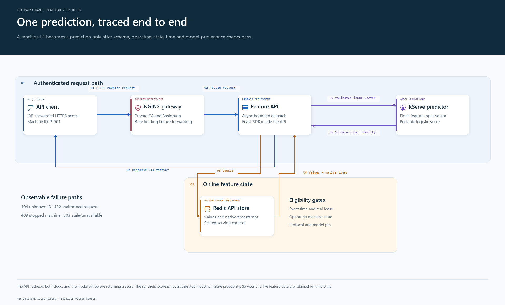
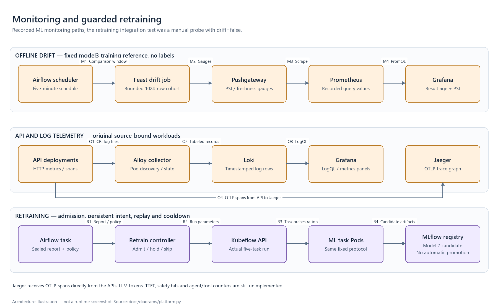

# IoT Maintenance Platform

Sensor data pipelines and failure prediction for industrial pumps.

This project follows pump telemetry from ingestion and validation through feature engineering, model training and API inference. Data and model versions, deployment checks and monitoring records make it possible to trace a prediction back to its inputs.

Built as an individual **Engineering for Data & AI — EDAI K11** coursework project. All equipment records, sensor readings and failure events are simulated.

The selected scope includes **final ML and final LLM/agents**. The recorded lab covers data pipelines, ML serving and an assistant that retrieves machine data, references and drift results through bounded tools. GPU-backed conversations, CI releases, bounded A/B comparisons and [authenticated private UI access](docs/agent-gateway.md) have runtime evidence. Remaining work is listed in the [rubric tracker](docs/final-llm-rubric-tracker.md).

[Demo guide](docs/demo-walkthrough.md) · [Architecture details](docs/architecture.md) · [Verification report](docs/final-audit.md)

## Table of contents

- [Business domain](#business-domain)
- [Architecture](#architecture)
  - [Data platform](#data-platform) · [ML platform](#ml-platform)
  - [System diagram](#system-diagram) · [Monitoring and retraining](#monitoring-and-retraining) · [Deployment](#deployment)
  - [LLM and agent extension](#llm-and-agent-extension)
- [Recorded results](#recorded-results)
- [Quick start](#quick-start)
- [Repository structure](#repository-structure)
- [Documentation](#documentation)

## Business domain

Industrial pumps can show signs of wear before they stop working. Temperature, vibration, motor current and rotational speed provide a history of that process. Maintenance teams need to inspect the latest readings and identify operating machines that may fail soon.

The prediction target is `failure_in_next_1h`: a failure starts in **(t, t + 1 hour]**, for a machine operating at time t. Failed or maintenance-state machines are excluded from this target. Records without enough future observation are not treated as negative examples.

| Data | Purpose | Issues handled |
|---|---|---|
| Machine metadata | Equipment identity, factory and effective-dated attributes | Historical changes and uneven factory sizes |
| Historical telemetry | Temperature, vibration, current and RPM at each observation | Duplicates, schema evolution and skew |
| Streaming telemetry | Arrival-ordered replay of readings through Kafka | Retry duplicates, late events and out-of-order arrival |
| Failure and maintenance events | Failure labels and operating-state history | Downtime, observation boundaries and information availability |

One telemetry row represents one machine at one event time. The platform retains both event and arrival timestamps: a feature must have been available when the prediction was made. See the [data contract](docs/data-contract.md) and [evaluation protocol](docs/ml-evaluation-protocol.md) for the labeling, temporal split and leakage checks.

## Architecture

The data platform produces validated historical features and finalized streaming windows. The ML platform uses those outputs for training and inference. Batch and serving jobs use Feast SDK inside their own processes; offline Parquet files and online Redis instances hold the feature data.


[Editable SVG](docs/images/platform-overview.svg) · [Figure source and regeneration](docs/diagrams/platform.py)

### Data platform

| Component | Responsibility |
|---|---|
| Generator | Simulate pump wear, operating load, maintenance and data-delivery faults using a fixed seed |
| Spark | Run DP1 ingestion, DP2 cleaning and aggregation, and DP3 feature/label preparation |
| Kafka and Flink | Replay telemetry, apply event-time windows and deduplication, and retain finalized windows |
| Airflow | Schedule data pipelines, validation, materialization and drift checks |
| DataHub | Publish schemas, lineage and validation assertions |

Each pipeline validates its outputs before publishing them. Source generation, large-scale Bronze/Silver processing and feature preparation have separate run reports and resource budgets.

### ML platform

| Component | Responsibility |
|---|---|
| Feast SDK and feature jobs | Retrieve historical features, materialize online data and check replay behavior |
| Notebook and Kubeflow Pipelines | Execute the same five ML steps, including training across two Spark executor Pods |
| MLflow | Track training runs, incremental data versions, model artifacts and registry versions |
| FastAPI and KServe | Check feature eligibility, run the selected model and return a score with model and feature provenance |
| Drift jobs and API | Compare input distributions with a fixed reference; control retraining requests with replay and cooldown guards |
| Jenkins and Helm | Test, build and deploy releases, with A/B checks and rollback |

Prometheus, Grafana, Alloy, Loki and Jaeger cover metrics, logs and traces. Security checks include gateway authentication and rate limits, Vault AppRole access, an isolated service-mesh test and an OPA deployment-policy gate.

### System diagram

The figures separate workflow, request and deployment views. Boxes in workflow/request views represent deployable units; Feast SDK remains inside those units. Arrows carry numbered data or control labels. Persisted Parquet handoffs use shared volumes rather than invented job-to-job HTTP services.



[Editable SVG](docs/images/platform-serving.svg)

Batch/stream Redis and API Redis are configured separately. The two executor Pods run on the same physical VM. The diagram summarizes flows verified in separate runs; it does not imply that every job runs concurrently. Streaming store checks replay retained Kafka/Flink windows. The [architecture documentation](docs/architecture.md) includes a [request-to-code walkthrough](docs/architecture.md#follow-the-request-in-code) and a separate [monitoring/retraining view](docs/architecture.md#monitoring-and-retraining).

### Monitoring and retraining



The manual retraining probe used `drift=false` and produced model 7 as a candidate. Its success does not demonstrate a naturally occurring drift alarm or automatic promotion. The fixed model 3 monitoring reference is distinct from the served model 6. [Details](docs/architecture.md#monitoring-and-retraining) · [SVG](docs/images/platform-monitoring.svg)

### Deployment

The Data/ML lab runs on a Google Cloud VM with **8 vCPU and 64 GiB RAM**, separate data and scratch disks, and private administration through IAP. Terraform provisions the infrastructure; Ansible configures the base environment.

| Runtime | Workloads |
|---|---|
| K3s | Feature and drift APIs, KServe, Kubeflow Pipelines, gateway and selected monitoring/security workloads |
| Docker containers | Spark jobs, Kafka/Flink, Airflow, DataHub, MLflow and Jenkins |
| Host services | Prometheus, Grafana, Loki, Alloy and Vault |
| Developer PC | Editing, local generator runs, offline verification and IAP access to the VM |

The gateway uses private lab domains and a private CA. Service-mesh authorization was tested in a separate namespace. Deployment details and recovery procedures are in the [infrastructure report](docs/iac-verification.md) and [demo guide](docs/demo-walkthrough.md).

A separate private **V100 worker** now has [native provisioning, Ansible and inference measurements](docs/gpu-inference.md). It reduced median response time from 18.16 s to 0.56 s on the same-host offload workload. [Real agent execution](docs/gpu-agent-routing.md) now uses that worker through llm-d and bounded tool-turn control.


[Editable SVG](docs/images/platform-deployment.svg)

### LLM and agent extension


llm-d routes agent requests through a bounded tool-turn adapter to the pinned Qwen2.5 7B server on a private V100 worker. The [inference report](docs/llm-inference.md) records a 1-thread/4-thread comparison for the 1.5B prototype; the [GPU experiment](docs/gpu-inference.md) separately measures 7B offload on a V100 worker. The earlier routed 7B checkpoint answers [three reference questions with verified citations](docs/llm-grounding.md). A [six-task Airflow pipeline](docs/rag-orchestration.md) indexes 18 chunks through Feast, checks persisted data and publishes DataHub lineage/assertions. Two [private MCP services](docs/mcp-tools.md) expose machine features, predictions, reference passages and drift assessments, with native rollout/fallback and load reports.

A coordinator delegates machine context and drift analysis to two specialists. The [agent platform](docs/agent-platform.md) uses gVisor templates, versioned registry entries and a shared model configuration. The [scaling experiment](docs/agent-scaling.md) checked 18 coordinator requests and 36 child sessions while all three pools grew from two to four workers and returned to two. Capacity rejections and mixed cold/snapshot startup results are retained in the reports.

The [private gateway](docs/agent-gateway.md) protects the chat and catalog with authentication, TLS and rate controls. Scoped Vault consumers supply credentials; [three CI pipelines](docs/ci-agents.md) test and deploy the services and agents. The recorded notebook and original UI captures let a reviewer follow a complete answer back to actual tool results. [Model/agent dashboards and bounded GPU load](docs/llm-observability.md#use-the-monitoring-views) have native evidence. A [controlled policy window](docs/llm-policy-window.md) reconciles nine pre-inference rejections with request logs and GPU token counters. A [paired 1.5B/7B experiment](docs/llm-model-ab.md) compares latency, token use and four contract cases, including wrong answers. A separate [agent configuration comparison](docs/agent-configuration-ab.md) checks six answers against 18 actual tool events. Other tracked requirements remain open.

An [OPA capability and budget gate](docs/agent-admission-policy.md) checks production agent configuration before deployment. Its native evidence includes an intentionally rejected tool change and three successful agent releases. The [five-class guide](docs/llm-class-design.md) explains how the assistant reaches validated machine data, predictions and reference passages.

The RAG pipeline also [checks corpus embedding distance](docs/rag-corpus-drift.md) before publication. An actual CI run rejected a deliberate change to unrelated topics; the current IoT corpus passed and completed all six Airflow tasks. This four-document check requests review of substantial changes; it does not certify answer quality or safety.

[Try the agent demo](docs/agent-demo.md) · [Learning guide](docs/llm-learning-guide.md) · [LLM tracker](docs/final-llm-rubric-tracker.md) · [Editable SVG](docs/images/platform-llm-plan.svg)

## Recorded results

| Area | Result | Report |
|---|---|---|
| Large-source processing | 102,447,847,856 bytes of uncompressed JSONL; 316.8 million unique Silver rows; 13 Spark checks passed | [Full-scale ingest](docs/full-scale-ingest.md) |
| Feature dataset | 3,456,000 snapshots over 60 days; 3,132,184 training rows after protocol filters | [Feature dataset](docs/medium-feature-dataset.md) |
| Streaming stores | 5,760 windows and 57,600 readings across 20 machines, written and replayed through offline/online stores | [Window cohort](docs/window-cohort.md) |
| Inference | Model version 6 demo: 195 valid predictions and 5 stopped-machine HTTP 409 responses across 200 machines | [Serving handover](docs/final-handover.md) |
| PC verification | Source-bound offline checks validate runtime artifacts, original captures and both final rubric presentations | [Final audit and commands](docs/final-audit.md) |
| CPU LLM inference | Same-workload median response 5.047 → 1.682 s with 1 → 4 threads; actual llm-d routing and a structured tool-selection response | [Inference report](docs/llm-inference.md) |
| Knowledge pipeline | Six actual Airflow tasks, 18 Feast/Milvus chunks, ten persisted quality checks, DataHub lineage and rejected bad-source input | [RAG orchestration](docs/rag-orchestration.md) |
| Grounded generation | Three actual 7B responses with independently verified rankings and source-bound citations; small acceptance set | [Grounding report](docs/llm-grounding.md) |
| MCP tools | Two services with two replicas each, 24 native tool responses, two controlled rollbacks and 2,658 authenticated feature reads without failure | [MCP report](docs/mcp-tools.md) |
| Agent platform foundation | Three Ready gVisor templates, two workers per role and three source-bound catalog entries; complete specialist answers and actual coordinator delegation on the GPU route | [GPU agent checkpoint](docs/gpu-agent-routing.md) |
| Agent elasticity | Three worker pools scaled 2 → 4 → 2; 18 verified parent requests, 36 child sessions and 14 capacity rejections handled; single control VM | [Scaling measurements and original UI](docs/agent-scaling.md) |
| Agent notebook | Seven executed Jupyter cells; two real specialist requests, four successful MCP calls and a 32-machine drift cohort | [Notebook, outputs and source checks](docs/agent-notebook.md) |
| Agent startup | Four matched pairs per role; mixed golden-snapshot timings, with all native samples retained | [Startup report and HA limits](docs/agent-warmup.md) |
| RAG delivery | Successful Jenkins test/build/auto-deploy; six native Airflow tasks, ten Feast quality checks and source-bound DataHub jobs | [RAG CI report and original stages](docs/ci-rag.md) |
| MCP/agent delivery | Three separate successful Jenkins pipelines; fresh API tests, tested images/charts, real tool calls, child sessions and exercised rollback | [Agent CI report and original stages](docs/ci-agents.md) |
| Agent gateway and secrets | Authenticated private UI/catalog, actual TLS and rate checks, scoped Vault consumers and a complete delegated conversation | [Gateway report and original UI](docs/agent-gateway.md) |
| Stream measurement pilot | Three actual router requests, provider-reported usage, original first-output/full-response clocks and replay after database reopening | [Measurements, scope and offline check](docs/llm-observability.md) |
| Observation API canary | Fresh native coverage/mutation gates; nine real GPU-backed request outcomes reconciled with durable facts, logs and counters | [Source-tested canary and original proof](docs/llm-observability.md#source-tested-canary) |
| Active agent telemetry | One complete HTTPS coordinator cohort; three executor roots, four MCP calls and nine model requests reconciled with original Jaeger/counter/usage readbacks | [Private route and native graph](docs/llm-observability.md#trace-an-actual-coordinator-request) |
| LLM monitoring and GPU load | Seven discovered targets; 128 exact CRI/Loki events, 24 matching panel queries and 108 real streamed requests across 1/4-client profiles | [Dashboards, original captures and load reports](docs/llm-observability.md#use-the-monitoring-views) |

The 100 GB run covers source ingestion through Bronze/Silver. Feature engineering and ML use the separate 60-day dataset. API coverage, mutation scores and load-test measurements are recorded with their workloads in [serving CI](docs/ci-serving.md), [API validation](docs/api-validation.md) and [load testing](docs/observed-api-load.md).

These are synthetic-data lab results. The model's score is not a calibrated real-world failure probability, and the deployment has not been tested for high availability across multiple machines. The [final rubric matrix](docs/final-audit-matrix.md) links each requirement to its implementation and evidence.

## Quick start

Run these commands from the repository root with **Python 3.12/3.13**. Examples use **PowerShell 7**.

### Generate a small dataset

This step uses only Python's standard library and does not require Docker or a cloud VM.

```powershell
$run = "local-$(Get-Date -Format 'yyyyMMdd-HHmmss')"
python -S -m generator generate --config generator/configs/dev.json --output "data/source/$run"
python -S -m generator inspect --source "data/source/$run" --report "outputs/$run/quality.json"
```

The default configuration simulates 20 machines over 48 hours. Use a new run name each time to preserve earlier datasets and reports. The [generator guide](docs/day1-generator.md) explains the seed, machine count and fault settings.

### Verify the recorded evidence

This step requires Python and Git, with no running platform services.

```powershell
$tag = Get-Date -Format 'yyyyMMdd-HHmmss'
python -S scripts/audit-final-coursework.py --output "outputs/audit-$tag"
```

The audit checks both source rubrics, payload hashes and 53 offline verifiers. It writes `verification.json` and the verifier consoles to the output directory. It checks recorded results rather than rerunning the pipelines; successful RAG, inference and MCP checks do not mark the full agent track complete. The [GPU agent report](docs/gpu-agent-routing.md) verifies complete specialist answers and actual child delegation. Earlier failed runs remain preserved.

### Call the lab API

With the VM ready and the IAP tunnel open:

```powershell
$tag = Get-Date -Format 'yyyyMMdd-HHmmss'
python -S scripts/demo-feature-api.py --base-url http://127.0.0.1:18082 --output "outputs/demo-$tag"
```

Open [Swagger UI](http://127.0.0.1:18082/docs) and try `P-001` and `P-006`. The demo checks prediction arithmetic, repeat requests and HTTP 409, 404 and 422 responses. Features expire; an expired cache must be refreshed through materialization before inference resumes.

The [demo guide](docs/demo-walkthrough.md) covers VM recovery, feature refresh, port forwarding and a 10-minute presentation. A Git clone contains code, configuration templates and documentation. Large datasets, credentials, Python environments and service state remain local to each machine.

## Repository structure

```text
generator/             Pump simulation, telemetry, maintenance and delivery faults
pipelines/             Batch/stream processing, aggregation and temporal checks
feature_store/         Feast integration, materialization and store replay
airflow/dags/          Data, materialization and drift-monitoring DAGs
ml/                    Training, versioning, serving and drift logic
notebooks/             Training and analysis notebooks
services/              Feature, predictor, drift and A/B APIs
models/                Portable models and version metadata used by checks
infra/                 Docker, Helm, Terraform, Ansible, CI and security config
scripts/               Run, operation and verification commands
tests/                 Unit, integration, property-based and load tests
docs/                  Design, runbooks, measurements and evidence
references/coursework/ Original coursework specification and rubric
```

`data/`, `outputs/`, local Python environments and credentials are excluded from Git.

## Documentation

To review the implementation, start with [one inference request](docs/architecture.md#inference-request), follow its code entry points, then use the [demo guide](docs/demo-walkthrough.md) and [rubric matrix](docs/final-audit-matrix.md) to locate the corresponding runtime evidence.

| Topic | Start here |
|---|---|
| Data and labeling | [Data contract](docs/data-contract.md) · [Evaluation protocol](docs/ml-evaluation-protocol.md) |
| Data engineering | [Spark at 100 GB](docs/full-scale-ingest.md) · [Airflow and DataHub](docs/orchestration.md) · [Kafka/Flink](docs/day3-streaming.md) |
| Feature store | [Feast](docs/feast-feature-store.md) · [Materialization and TTL](docs/feature-jobs-and-ttl.md) |
| ML lifecycle | [Notebook](docs/training-notebook.md) · [Distributed training](docs/distributed-training.md) · [Incremental versioning](docs/automatic-ml-versioning.md) · [Five key classes](docs/ml-class-design.md) |
| Serving and CI/CD | [Feature API](docs/feature-api.md) · [Serving CI](docs/ci-serving.md) · [A/B deployment](docs/ci-ab-deployment.md) |
| Observability | [Metrics and traces](docs/api-observability.md) · [Logs](docs/log-discovery.md) · [Drift and retraining](docs/drift-retraining.md) |
| Infrastructure and security | [Terraform/Ansible](docs/iac-verification.md) · [Gateway](docs/private-gateway.md) · [Vault](docs/vault.md) · [Service mesh](docs/private-mesh.md) |
| Extensions | [MMD for joint sensor drift](docs/joint-cohort.md) · [OPA deployment-policy checks](docs/deployment-policy.md) |
| Coursework review | [Demo walkthrough](docs/demo-walkthrough.md) · [Final audit](docs/final-audit.md) · [Rubric matrix](docs/final-audit-matrix.md) · [ML/LLM source notes](docs/rubric-source.md) |

Maintained runbooks and notebook prose are in English. Original source-language workbooks, screenshots and native logs are preserved as evidence. Runtime versions and configurations are recorded in the relevant reports. The original specification and workbook are under [`references/coursework/`](references/coursework/).

Presentation reference: [Card Fraud Platform](https://github.com/cvinhnguyen/card-fraud-platform/tree/cc34515304815774a5dad6f796683b46c27f93ac). The supplied [coursework rubrics](docs/rubric-source.md) govern requirements; reference repositories are not substituted for them. The figures in this repository are original architecture illustrations, not runtime screenshots.
