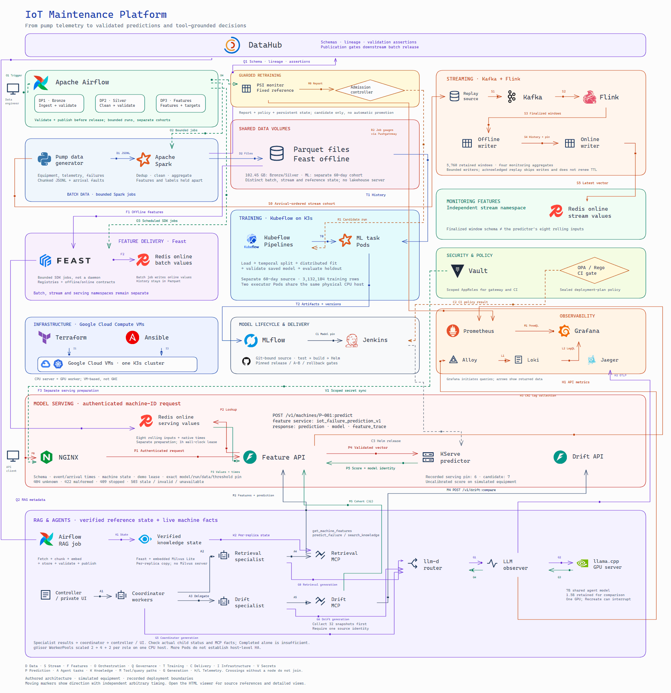
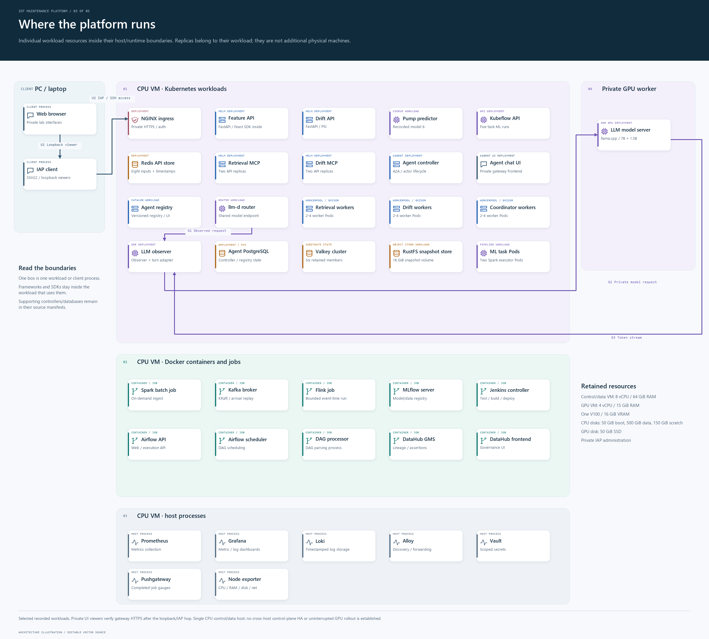

# IoT Maintenance Platform

Data pipelines, failure prediction and tool-grounded answers for industrial pumps.

The platform connects pump telemetry to validated features, versioned models and API predictions. Its agents use the same machine context, technical references and drift diagnostics to investigate equipment health with traceable sources.

The reference deployment uses Google Cloud VMs and K3s, with a GPU-backed model server for agents. Equipment, sensor readings and failure events are simulated for reproducible evaluation.

## Contents

- [Business domain](#business-domain)
- [Architecture](#architecture): [data](#data-platform), [ML](#ml-platform), [LLM and agents](#llm-and-agent-platform), [deployment](#deployment)
- [Recorded results](#recorded-results)
- [Quick start](#quick-start)
- [Repository structure](#repository-structure)
- [Documentation](#documentation)

## Business domain

Maintenance staff need to inspect the condition of an operating pump and identify machines that may fail soon. Temperature, vibration, motor current and RPM provide a history of wear and load; failures and maintenance define when a machine is unavailable.

| Data | Grain | Main issue |
|---|---|---|
| Equipment metadata | Effective-dated machine attributes | Historical changes and uneven factory sizes |
| Telemetry | Machine at event time | Duplicate exports, schema changes, skew and delayed arrival |
| Stream deliveries | One delivery attempt | Retries, out-of-order arrival and late events |
| Failures and maintenance | One recorded onset or intervention interval | Downtime, delayed recording and incomplete future observation |
| Technical references | Versioned authored document/chunk | Retrieval ordering, source identity and corpus changes |

The prediction target is `failure_in_next_1h`: a failure starts in **(t, t + 1 hour]** for a machine operating at t. Features must have arrived by the prediction time. Failed or maintenance-state machines are excluded, and unobserved futures are not treated as negative examples. See the [data contract](docs/data-contract.md) and [evaluation protocol](docs/ml-evaluation-protocol.md).

## Architecture

The system map follows data through batch and stream jobs, feature delivery, training and serving, then into the agent workflow. The detailed views expand request, deployment and observability boundaries. SDKs run inside consuming jobs and APIs; models and references retain their own source identities.

<picture>
  <source media="(prefers-reduced-motion: reduce)" srcset="docs/images/platform-system.png">
  
</picture>

[Excalidraw source](docs/diagrams/platform-system.excalidraw) · [Full-resolution PNG](docs/images/platform-system.png) · [SVG](docs/images/platform-system.svg) · [Interactive viewer](docs/diagrams/architecture.html) · [Five detailed views](docs/diagrams/README.md) · [Architecture](docs/architecture.md)

The animation illustrates direction with arbitrary timing. It is not live traffic or an execution schedule. Reduced-motion visitors receive the static image. Open the HTML viewer from a local clone to pause, change speed, zoom and inspect each arrow's implementation sources. The diagrams remain editable in Excalidraw.

### Data platform

| Stage | Input → output | Implementation / validation |
|---|---|---|
| Source generation | Equipment history → telemetry, failures, maintenance and delivery attempts | [Generator](generator/README.md), [data checks](docs/chunked-generator.md) |
| DP1 | Offline source → Bronze | [Chunk ingestion](pipelines/chunk_source.py), [100 GB run](docs/full-scale-ingest.md) |
| DP2 | Bronze → cleaned Silver and machine/time aggregates | [Batch jobs](pipelines/README.md), [skew comparison](docs/skew-benchmark.md) |
| DP3 | Eligible history → features and separate target records | [Feature protocol](docs/medium-feature-dataset.md), [sample/target validation](docs/assistant-data-validation.md) |
| Streaming | Arrival-ordered Kafka deliveries → finalized Flink windows | [Event-time processing](docs/streaming.md), [store replay](docs/window-cohort.md) |
| Orchestration and governance | Validated outputs → scheduled publication, schemas, lineage and assertions | [Airflow and DataHub](docs/orchestration.md) |

### ML platform

The notebook and Kubeflow pipeline use the same five-step ML workflow. Training uses a temporal split, train-only transformations and a separately recorded evaluation protocol. MLflow links dataset versions, runs and model artifacts. The Feature API retrieves online values, checks eligibility/provenance and calls a pinned KServe model.

| Flow | Main components | Detail |
|---|---|---|
| Training | Feast historical retrieval → validation → temporal split → distributed training → saved-model evaluation | [Notebook](docs/training-notebook.md), [distributed run](docs/distributed-training.md), [five classes](docs/ml-class-design.md) |
| Versioning | Incremental data identities, training runs and model registry | [Data/model versions](docs/automatic-ml-versioning.md) |
| Prediction | Machine ID → Feast online trace → KServe score → versioned response | [Services](services/README.md), [Feature API](docs/feature-api.md) |
| Monitoring | Input drift → guarded retraining request, with replay/cooldown checks | [Drift and retraining](docs/drift-retraining.md) |
| Delivery | Source-bound tests/build → Helm rollout → verification/rollback | [Serving CI](docs/ci-serving.md), [A/B deployment](docs/ci-ab-deployment.md) |

### LLM and agent platform

The retrieval specialist obtains machine features, the model score and cited reference chunks. The drift specialist compares a bounded machine cohort with a pinned reference. The coordinator preserves their returned values and identifiers. There is no physical actuation tool.


[Editable SVG](docs/images/platform-llm-plan.svg) · [LLM platform](docs/llm-platform.md)

| Path | What happens | Evidence |
|---|---|---|
| Reference ingestion | Documents → chunks → pinned embeddings → versioned Feast/Milvus snapshot | [Six-task RAG pipeline](docs/rag-orchestration.md) |
| Agent question | Private UI → coordinator → two specialists → authenticated MCP services | [Complete GPU conversations](docs/gpu-agent-routing.md), [post-restart validation](docs/agent-runtime-validation.md) |
| Generation | Shared ModelConfig → llm-d → observer/tool-turn adapter → llama.cpp on the private V100 | [Inference](docs/llm-inference.md), [GPU experiment](docs/gpu-inference.md) |
| Worker capacity | gVisor SandboxAgents and three WorkerPools, with measured 2 → 4 → 2 scaling | [Scaling](docs/agent-scaling.md), [startup study](docs/agent-warmup.md) |
| Delivery and controls | Separate RAG/retrieval/drift/coordinator releases, scoped credentials and bounded gateway access | [CI/CD](docs/ci-agents.md), [gateway](docs/agent-gateway.md), [Vault](docs/vault-agent-ui.md) |
| Evaluation | Original replies, child/tool histories, token/TTFT telemetry and small paired comparisons | [Monitoring](docs/llm-monitoring-demo.md), [model A/B](docs/llm-model-ab.md), [agent A/B](docs/agent-configuration-ab.md) |

The [warm-up comparison](docs/agent-warmup.md#l26-evidence-boundary) reports mixed startup timings; cloud-cost savings were not measured.

The two researched LLM extensions are [OPA capability/budget admission](docs/agent-admission-policy.md) and [document-weighted corpus MMD review](docs/rag-corpus-drift.md). Each has accepted and intentionally rejected native cases, with its limits documented.

### Deployment

The control/data lab runs on an **8-vCPU / 64-GiB CPU VM**. A separate private **4-vCPU / 15-GiB worker with a 16-GiB V100** serves the LLM. K3s hosts Kubernetes workloads; retained host services and Docker containers supply the remaining components. Administration uses IAP and loopback ports, with authenticated CA-verified HTTPS on the private gateway hop.



[Editable SVG](docs/images/platform-deployment.svg) · [Infrastructure](docs/llm-infrastructure-evidence.md) · [Operations](docs/operations.md)

Each deployment box identifies one selected workload resource; frames mark its host/runtime. Replicas and containers within that resource stay in the same box. Supporting services are detailed in the [runtime configuration](docs/architecture.md#deployment-and-security). The drawings describe the recorded lab and its connection boundaries; they do not establish simultaneous execution or current endpoint readiness. Two executor Pods on one physical CPU host do not establish multi-host high availability.

## Recorded results

| Workload | Recorded result | Report |
|---|---|---|
| Large ingestion | 102,447,847,856 uncompressed JSONL bytes; 316.8 million unique Silver rows; 13 Spark checks | [Full-scale ingest](docs/full-scale-ingest.md) |
| ML feature dataset | Separate 60-day source; 3,456,000 snapshots and 3,132,184 eligible training rows | [Feature dataset](docs/medium-feature-dataset.md) |
| Streaming stores | 5,760 finalized windows / 57,600 unique readings across 20 machines, with replay checks | [Window cohort](docs/window-cohort.md) |
| Native feature serving | Model 6: 195 valid predictions and five stopped-machine HTTP 409 responses across 200 machines | [Serving record](docs/final-handover.md) |
| RAG governance | Six actual Airflow tasks, 18 chunks, ten persisted checks, DataHub lineage and invalid-source rejection | [RAG pipeline](docs/rag-orchestration.md) |
| Complete agent answer | One accepted post-restart parent, two independently checked child tasks, four successful MCP tools and exact model-6 arithmetic | [Runtime validation](docs/agent-runtime-validation.md) |
| MCP API quality | 132 passing cases; 98.03% statement / 90.74% branch coverage; strict mutation result 681/850, with source-bound reuse stated explicitly | [Testing report](docs/mcp-quality-evidence.md) |
| Monitoring/load | 128 exact CRI/Loki events, 24 matching panel queries and 108 streamed requests across 1/4-client profiles | [Native monitoring](docs/llm-monitoring-demo.md) |

The 100 GB workload ends at Bronze/Silver; it is not a claim of training on 100 GB. Scores are uncalibrated and based on simulated equipment. Original failures, wrong answers, mixed startup timings and SDK trace warnings remain in the linked reports. The [117-row requirement map](docs/final-audit-matrix.md) connects code and scoped evidence without awarding a grade.

## Quick start

Run from the repository root with **Python 3.12/3.13** and **Git**. Examples use PowerShell 7.

### Generate a small dataset

This uses Python's standard library and needs no Docker or cloud VM:

```powershell
$run = "local-$(Get-Date -Format 'yyyyMMdd-HHmmss')"
python -S -m generator generate --config generator/configs/dev.json --output "data/source/$run"
python -S -m generator inspect --source "data/source/$run" --report "outputs/$run/quality.json"
```

The development configuration simulates 20 machines over 48 hours. See the [generator guide](generator/README.md) for inputs, outputs and validation boundaries.

### Verify the recording

```powershell
$tag = Get-Date -Format 'yyyyMMdd-HHmmss'
python -B -S scripts/audit-final-coursework.py --output "outputs/audit-$tag"
```

The audit restores the byte-pinned historical receipt bundle into ignored local files, validates both original rubric views and runs **60 offline artifact checks**. It writes the result and original verifier consoles under `outputs/`. No service starts and no model request is sent. To run an individual verifier first, restore once with `python -B -S scripts/unpack-evidence.py`. See [evidence storage](docs/evidence-guide.md).

### Use the live lab

The [operations runbook](docs/operations.md) covers retained CPU/GPU recovery, genuine feature preparation, private access and ML/agent commands. Live requests require that private runtime and an unexpired one-hour feature lease. A Git clone contains no bulk datasets, credentials, service state or LLM weights.

## Repository structure

```text
generator/             Synthetic pump histories and delivery faults
pipelines/             Spark/Flink jobs, temporal contracts and validation
airflow/dags/          Data, feature-materialization and drift DAGs
feature_store/         Feast integration, offline/online delivery and replay
ml/                    Training, model/data versioning and drift logic
services/              Feature, predictor, drift, A/B and MCP APIs
agents/                Agent policy, release contracts and answer acceptance
rag/                   Reference ingestion, retrieval and corpus governance
knowledge/             Authored simulator reference documents
llm/                   Inference evaluation and bounded comparisons
llm_observability/     Request facts, traces, metrics and policy controls
infra/                 Images, Helm, Terraform, Ansible, Jenkins and security
notebooks/             Maintained training and agent notebooks
scripts/               Stable operation and verification entry points
tests/                 Unit, integration, property and load tests
docs/                  Technical reports, runbooks and review indexes
  evidence/            Browsable captures, manifests and selected results
  evidence-archive/    Checked archive of original machine-readable receipts
references/            Original specifications and validation criteria
```

Start with a package's README or the [command index](scripts/README.md). Runtime libraries, command entry points and captured evidence have separate roles. `data/`, `outputs/`, environments and credentials stay outside Git.

## Documentation

The [technical documentation index](docs/README.md) provides a review path through each layer. The [ML tracker](docs/final-rubric-tracker.md), [LLM tracker](docs/final-llm-rubric-tracker.md) and [final audit](docs/final-audit.md) preserve the source requirements and their verification scope.

Maintained prose and code descriptions use English. Original workbooks, native logs and screenshots retain their capture language and bytes. Presentation references: [RecSys-MLops](https://github.com/itsmekhoathekid/RecSys-MLops/tree/6bd6e99f481f2a8d5886d6f0e8356540dc20e135) and [Card Fraud Platform](https://github.com/cvinhnguyen/card-fraud-platform/tree/cc34515304815774a5dad6f796683b46c27f93ac). The diagrams and measurements describe this repository's implementation and the limits of its recorded experiments.

## Contributors

- [An Le](https://github.com/anle0429) — project owner.
- [OpenAI Codex](https://developers.openai.com/codex/) — AI assistance with documentation and architecture diagrams.
