# IoT Maintenance Platform

Coursework EDAI K11: giám sát máy bơm công nghiệp bằng dữ liệu cảm biến mô phỏng và dự đoán sự cố trong một giờ tới. Người dùng đã chọn [rubric final-coursework](docs/final-rubric-tracker.md) làm chuẩn bàn giao; tracker93dòng cũ giữ làm lịch sử.

**Mốc100GB đã kiểm chứng:** [Spark toàn nguồn102.447.847.856byte](docs/full-scale-ingest.md) →323,136triệu Bronze/316,8triệu Silver unique;13checks,45.852tasks/0failed, checksum trước/sau và Spark UI thật. Nguồn đã qua14quy tắc semantic readback. Query JSONL/Parquet cùng workload/ba cặp có median1.740,35/124,69giây; giới hạn cache và máy dùng chung được ghi rõ. Chưa Gold/feature/ML toàn100GB hoặc fullrunner trong Airflow.

[VM Google Cloud](docs/gcp-runtime.md)8vCPU/64GiB, Terraform/Ansible/IAP và HDD/SSD tách riêng đã chạy thật. [Airflow DP1–DP3/DataHub](docs/orchestration.md) đã kiểm pilot riêng:64rules/14bảng, chặn batch lỗi và phục hồi. [Skew benchmark](docs/skew-benchmark.md)17,28triệu Silver rows, ba cặp cùng kết quả, median15,339→8,577giây khi broadcast bảng chính sách nhà máy. Đây là các scope riêng, không thay bằng số đo fullsource.

[Feature60ngày](docs/medium-feature-dataset.md)/[Feast](docs/feast-feature-store.md) có3.456.000snapshots/3.132.184training rows theo protocol cố định; native full retrieval/nhãn và replay/corruption đã kiểm. [Airflow materialization](docs/feast-materialization.md) đã chạy initial/incremental/replay200máy, chặn lùi checkpoint và publish DataHub. [Flink→Feast](docs/stream-feast-push.md) có live push ba cửa sổ, fault/retry và readiness trước source; chưa toàn mini-coursework stream.

[KFP trên cluster bốn bước](docs/kfp-cluster.md) đã PASS với nativeFeast3.132.184dòng; testPR-AUC0,6151/F10,5510 theo protocol giữ nguyên. Modelversion2 và KServe1 là mốc lịch sử ban đầu; hiện serving model6 theo CI bên dưới. [Feature API→Feast→KServe](docs/feature-api.md) giữ bằng chứng200máy/195prediction/5stopped409 và các số đo API/Locust của source cũ. [Notebook 5 bước/6ô](docs/training-notebook.md) và [KFP 5 task/two-executor](docs/distributed-training.md) đã kiểm thật; [incrementaldata/model3](docs/incremental-data-versioning.md) đã liên kết đúng dữ liệu. [Tự động version dữ liệu/model4–5](docs/automatic-ml-versioning.md) đã chạy trong Notebook/KFP. [CI materialization](docs/ci-materialization.md) đã test/build/auto-deploy thật, kiểm initial/incremental/replay đủ200máy và DataHub.

[CI training](docs/ci-training.md) đã Jenkins build2 SUCCESS:22tests, hai image đúng78file, tự triển khai44file ML và chạy KFP đủ5task/hai executor/model6; dữ liệu không đổi tái sử dụng180file/740MB. Sau đó [serving CI8](docs/ci-serving.md) **SUCCESS trênVM/source99d6dcc**:104contracts/208API tests,425statements100%/125of128branches97,66%; mutation hoàn chỉnh parent5 dùng lại có kiểm nguồn1.309/1.582=82,74%. Model6 được export theo production tag của lab, ba image build/probe/import và full cutover200máy PASS. [A/B native1/6](docs/ci-ab-deployment.md) có780trial/40replay không tăng đếm và [Grafana6panel/26giá trị mỗi engine](docs/ab-monitoring.md) có ảnh gốc. Controlled rollback6→1→6 PASS; Locust1/10users598/5.780requests,0fail,P95 7/28ms. Các số đo này là lab mô phỏng trên cùngVM; PSI/mean risk không chứng minh model tốt hơn. Security/gateway và các mục còn thiếu vẫn ở [tracker final](docs/final-rubric-tracker.md).

[Airflow→Kubeflow retrain](docs/drift-retraining.md) đã chạy5task thật/model7candidate,13unit tests, replay/cooldown không tạo thêm training. Manual probe giữ drift=false; reference model3, recipe/split giữ nguyên và chưa tự đổi serving model6. Bộ kiểm độc lập đọc118payload,24PSI từ raw samples,79SparkTaskEnd/0failed, data/model registry và ảnh KFP gốc.

[Làm mới feature sau retrain](docs/active-feature-refresh.md) giữ serving model6: materialize200key thật, seed mới bất biến,195prediction tính lại đúng/5stopped409. Receipt06:33UTC ngày28/10 chỉ chứng minh thời điểm kiểm; demo lease hết sau một giờ và cần prepare mới khi trình bày lại.

[Metrics/traces API trên VM](docs/api-observability.md) đã3API/sáu panel/28giá trị mỗi engine và5trace/15span đúng parent;747client/932SDK requests khớp ledger. Wrapper mới296main+14subtest Linux PASS, coverage74statements/16branches100%, mutation221/250=88,4%. Rollout riêng giữ model6; [Locust wrapper](docs/observed-api-load.md)598/5767request0lỗi/P95 6/28ms đã kiểm. [Jenkins telemetry2](docs/ci-api-observability.md) SUCCESS/source372:299main+21subtest/coverage100%/mutation88,4%/ba image/200HTTP; giữ model6, không đổi model/A-B mới. Bộ kiểm độc lập199payload và sáu ảnh gốc đã lưu.

[CI drift qua Knative Eventing→KServe](docs/drift-eventing.md) đã **Jenkins3 SUCCESS/source869**: production6 SDK,101main+20subtest/coverage65statements10branches100%/mutation103of119=86,55%. Chín event tới sink204 nhưng chỉ một cửa sổ lưu; replay/409/filter kiểm thật. Locust598/4.267ACK không lỗi/P95 11/210ms, delta4.865khớp subscriber; giữ Podstable và khôi phục HPA1–10.270payload/bốn ảnh gốc có verifier; window mô phỏng, memoryBroker, chưa compute-throughput cho cửa sổ mới.

[Hai CI stream offline/online](docs/ci-stream-push.md) đã Jenkins3/2 SUCCESS/source491: test/build/auto-deploy2+2task Airflow, offline3row đúng/online ban đầu trống, sau đó latest40/100. Replay không tăng đếm và upstream read-only;225payload/bốn ảnh gốc. Nguồn là ba cửa sổ Kafka/Flink thật27/10 được replay, chưa luồng live mới liên tục.

S1–S4 là hai job độc lập được CI triển khai; cửa sổ nguồn là snapshot đã chốt, không vẽ file thành service. Redis phân biệt project cho các monitoring feature, không thay tám feature của predictor.

[Gateway private NGINX](docs/private-gateway.md) đã4tuyến metrics/logs/trace/features, Basic auth/HTTPS/rate limit thực:8lần401,4redirect308,32burst6HTTP200/26HTTP429 rồi phục hồi.86payload/bốn ảnh gốc; domain `.test` trong lab với CA riêng, chưa publicDNS/browsertrust.

[Vault native](docs/vault.md) có hai consumer AppRole thực: Jenkins đăng nhập Airflow từ secret lấy lúc chạy, gateway đổi mật khẩu bản 2. Đọc chéo/token đã thu hồi bị 403, CAS cũ bị 400, restart giữ dữ liệu và quyền. 81 payload/hai ảnh gốc; phạm vi một VM/một operator, chưa migration mọi secret/HA/auto-unseal.

[Mesh native](docs/private-mesh.md) dùng Istio1.31.3 và STRICT mTLS: principal đúng gọi model6 trả200/math khớp; principal sai, giả header và thao tác ngoài quyền bị403; plaintext bị TLS reset.106payload/hai ảnh gốc/verifier; kiểm chứng namespace riêng, chưa migration production.

## Mục lục

- [Phạm vi và dữ liệu](docs/domain-proposal.md)
- [Hợp đồng dữ liệu](docs/data-contract.md)
- [Kiến trúc và trạng thái deployment](docs/architecture.md)
- [Sơ đồ triển khai hiện có](#sơ-đồ-triển-khai-hiện-có)
- [Kết quả và giải thích ngày 1](docs/day1-generator.md)
- [PostgreSQL nguồn, Spark và baseline](docs/day2-batch.md)
- [Kafka/Flink: event time, late arrival và replay](docs/day3-streaming.md)
- [Đo nguồn trung gian và RAM](docs/generator-throughput.md)
- [Generator theo chunk và ngân sách 100 GB](docs/chunked-generator.md)
- [Catalog → Spark → Parquet: kiểm đúng, dung lượng và query](docs/chunk-ingest.md)
- [Google Cloud VM: Terraform plan, quota và dự toán](docs/gcp-vm.md)
- [VM đã chạy: Ansible, cùng workload nhanh 2,22 lần và cách tự chạy](docs/gcp-runtime.md)
- [Airflow DP1–DP3, validation chặn lỗi và DataHub lineage/assertions](docs/orchestration.md)
- [Mốc nguồn 100 GB: ngân sách HDD/SSD/RAM, tập trung gian và cách tự chạy](docs/scale-100gb.md)
- [Spark skew: cùng query, ba cặp đo, kết quả đúng và ảnh UI](docs/skew-benchmark.md)
- [Runner nguồn lớn: HDD scratch, hai lượt checksum và live guards](docs/large-ingest-runner.md)
- [Protocol ML60ngày: chia theo thời gian, purge và holdout trước metric](docs/ml-evaluation-protocol.md)
- [Feature theo bucket thời gian: kiểm đúng ranh giới và dữ liệu đến muộn](docs/bounded-features.md)
- [Feature60ngày: nhãn, purge, loại dòng và class/episode support](docs/medium-feature-dataset.md)
- [Feast offline/online: PIT, compaction, full-cohort load và retry](docs/feast-feature-store.md)
- [Airflow Feast: incremental/checkpoint, chặn lùi thời gian và DataHub](docs/feast-materialization.md)
- [Flink → Feast: live push, retry, readiness và giới hạn checkpoint](docs/stream-feast-push.md)
- [ML bốn bước: KFP, protocol cố định, artifact và MLflow](docs/ml-training.md)
- [Predictor model-inside-image: API, lineage và kiểm thử](docs/model-serving.md)
- [KServe trên Kubernetes: pod và HTTP thật](docs/kubernetes-serving.md)
- [Kubeflow cluster: bốn task, artifact bền và modelversion2](docs/kfp-cluster.md)
- [Feature API: freshness, operating state, mutation và Locust](docs/feature-api.md)
- [Serving CI: native gates, A/B, cutover, rollback và Locust](docs/ci-serving.md)
- [A/B dashboard native và cách tự kiểm bằng chứng](docs/ab-monitoring.md)
- [Airflow gọi KFP: retrain có admission, replay và cooldown](docs/drift-retraining.md)
- [CI drift qua Knative Eventing và KServe](docs/drift-eventing.md)
- [Làm mới feature thật và kiểm lại model6 sau retrain](docs/active-feature-refresh.md)
- [Metrics/traces API: dashboard và trace native đã kiểm](docs/api-observability.md)
- [Locust trên wrapper: SLA, replica và bằng chứng gốc](docs/observed-api-load.md)
- [Vault: quyền đọc riêng, rotation và dữ liệu bền sau restart](docs/vault.md)
- [Mesh: danh tính mTLS và phân quyền service-to-service](docs/private-mesh.md)
- [Log tự theo Pod và kiểm dòng trùng sau restart](docs/log-discovery.md)
- [MMD trên cohort có lineage thực](docs/joint-cohort.md)
- [Phục hồi DataHub giữ nguyên metadata](docs/datahub-restore.md)
- [Gateway private: authentication, rate limit và HTTPS](docs/private-gateway.md)
- [CI hai job stream offline/online](docs/ci-stream-push.md)
- [CI telemetry: test/build/auto-deploy cùng model production](docs/ci-api-observability.md)
- [Cách chạy](#cách-chạy)
- [Checklist final-coursework chính](docs/final-rubric-tracker.md)
- [Checklist hai sheet50% trước đây](docs/rubric-tracker.md)
- [Cấu trúc hiện tại](#cấu-trúc-hiện-tại)

## Cấu trúc hiện tại

```text
README.md                    Giới thiệu và đường dẫn tài liệu
docs/
  domain-proposal.md         Nghiệp vụ, dữ liệu, nhãn, feature, agent
  data-contract.md           Grain, schema, units, thời gian và chính sách dữ liệu
  architecture.md            Kiến trúc dự kiến và phạm vi đã triển khai
  day1-generator.md          Kết quả đo và giới hạn kiểm chứng
  day2-batch.md              PostgreSQL/Spark, feature, nhãn và baseline đã chạy
  day3-streaming.md          Kafka/Flink, watermark, dedup và kiểm replay
  chunked-generator.md       Sinh/đọc kiểm theo chunk, đo RAM và dự trù dung lượng
  chunk-ingest.md            Spark đọc catalog, Parquet Bronze/Silver và số đo thực
  orchestration.md           Ba DAG trên VM, validation/lineage, lỗi và phục hồi đã chạy
  scale-100gb.md             Nguồn lớn liên tục, gate tài nguyên, số đo và giới hạn xử lý
  final-rubric-tracker.md    Chuẩn final chính, trích ô/điểm/proof gốc và bằng chứng
  rubric-tracker.md          Lịch sử hai sheet50%, không cộng với final
  evidence/day1/             Output kiểm thử, thống kê và thông tin runtime
  evidence/day2-final/       Bằng chứng batch end-to-end và code/runtime hashes
  evidence/day3/             Bằng chứng stream, retention probe và giao diện Flink thật
references/coursework/       Đề tổng và workbook rubric gốc
.gitignore                   Loại dữ liệu lớn, môi trường cục bộ và secrets khỏi Git
.gitattributes               Chuẩn hóa line endings khi làm trên nhiều máy
generator/                   Mô phỏng máy, lỗi vận chuyển, lưu nguồn và validator
  configs/dev.json           Seed, số máy, thời gian, tỷ lệ lỗi và cơ chế hao mòn
  configs/chunked-pilot.json Pilot liên tục vượt guard 100k của lệnh cũ
  chunked.py                 Writer có giới hạn, exact sampling và stream arrival heap
  chunk_quality.py           Validator tuần tự, grid/interval và bounded stream join
  capacity.py                Ước tính riêng nguồn/output/shuffle/log/reserve
scripts/                     Lệnh PowerShell chạy generator, batch và stream verification
pipelines/                   PostgreSQL/Spark, feature/label, Kafka/Flink và kiểm tra thời gian
airflow/dags/                DP1 Bronze → DP2 Silver/Gold → DP3 features, validation và metadata
ml/                          Baseline logistic regression và metrics/threshold
infra/                       Compose/image, Terraform VM, Ansible, Airflow/DataHub và source SQL
tests/                       Bộ dữ liệu biết đáp án, biên và corruption tests
requirements.txt             Host dùng standard library; dependency Spark/Flink khóa trong Dockerfile
requirements-scale.txt       Codec JSON tùy chọn cho source runner riêng trên VM
```

Nguồn được sinh tại `data/source/`, báo cáo các lần chạy tại `outputs/`; hai thư mục này không đưa vào Git.

## API và điều phối

```text
services/predictor/          Predictor tám feature, model bundle và version pin
services/feature_api/        Đọc Feast, kiểm freshness/trạng thái rồi gọi predictor
services/drift_api/          So cửa sổ với reference train, lưu kết quả idempotent
services/ab_api/             Chia cohort, ledger và metric A/B; native CI8 đã PASS
airflow/dags/                DP1–DP3, materialization và offline drift định kỳ
```

## Sơ đồ triển khai hiện có

Các hộp là job/container/pod/service có thể triển khai; Feast SDK chạy bên trong job/API. Dữ liệu Parquet/workspace nằm trên volume của cùng VM, không phải một Feast server riêng. Luồng U là dự đoán; D là dữ liệu/metadata; T/C là training/CI; R là lệnh retrain/trạng thái; M/L là metrics/logs; O là API metrics và distributed trace. Màu phân biệt nhóm, không chấm mức hoàn thành.

```mermaid
flowchart LR
    User[Người dùng] -->|G1 private HTTPS Basic auth| Gateway[NGINX Ingress Controller Deployment]
    Gateway -->|U1 machine_id sau auth và rate limit| API[Feature API Deployment]
    Gateway -->|G2 metrics và logs qua CNI relay| Grafana[Grafana process]
    Gateway -->|G3 trace queries| Jaeger[Jaeger collector-query Deployment]
    API -->|U2 lookup| Redis[Redis API Deployment]
    Redis -->|U3 tám feature và timestamp| API
    API -->|U4 vector hợp lệ| Predictor[KServe predictor Deployment]
    Predictor -->|U5 risk và model identity| API
    API -->|U6 prediction và trace| User
    Generator[Generator Python job] -->|D1 JSONL qua HDD| Spark[Spark batch job containers]
    Airflow[Airflow scheduler container] -->|D2 chạy DP1-DP3 và validation| Spark
    Spark -->|D3 validation reports| Metadata[DataHub publisher job container]
    Metadata -->|D4 schema lineage assertions| DataHub[DataHub GMS service]
    Airflow -->|D5 chạy materialization| Materialize[Feast materialization job container]
    Spark -->|D6 Parquet feature qua HDD| Materialize
    Materialize -->|D7 native online vectors| BatchRedis[Redis batch-stream container]
    Jenkins[Jenkins controller container] -->|S1 triển khai hai DAG sau gates| Airflow
    Airflow -->|S2 retained finalized-window snapshot| StreamOffline[Stream offline job container]
    StreamOffline -->|S3 verified release qua HDD read-only| StreamOnline[Stream online job container]
    StreamOnline -->|S4 latest monitoring vectors| Redis
    Jenkins -->|V1 AppRole và đọc credential CI| Vault[Vault Raft process - HDD state]
    Vault -->|V2 short token và credential Airflow| Jenkins
    VaultSync[Gateway credential sync job] -->|V3 AppRole và đọc KV2| Vault
    Vault -->|V4 gateway credential version| VaultSync
    VaultSync -->|V5 auth Secret update được controller watch| Gateway
    MeshCaller[Identity probe - feature-caller SA] -->|S1 mTLS principal và POST allowed| MeshProxy[Istio Envoy - iot-mesh namespace]
    MeshOther[Untrusted và plaintext probes] -->|S2 denied403 hoặc TLS reset| MeshProxy
    MeshProxy -->|S3 chỉ request được phép| MeshPredictor[Isolated real model6 clone]
    Jenkins -->|C1 submit training CI| KFP[Kubeflow API Deployment]
    KFP -->|T1 điều phối năm task| Training[KFP ML task pods]
    Spark -->|T2 offline feature qua HDD và Feast| Training
    Training -->|T3 distributed tasks| Executors[Hai Spark executor pods]
    Executors -->|T4 task results| Training
    Training -->|T5 data versions và model candidate| MLflow[MLflow tracking container]
    MLflow -->|C2 model6 production-tag lab bundle| Jenkins
    Jenkins -->|C3 stage image và model6 sau gates| Predictor
    Jenkins -->|C4 triển khai experiment trước cutover| AB[A-B router Deployment - SQLite HDD PV]
    AB -->|C5 cohort baseline| Old[KServe model1 Deployment]
    AB -->|C6 cohort candidate6| Predictor
    Jenkins -->|C7 Helm switch sau A-B và recheck| API
    Jenkins -->|C8 image và event receiver sau fresh gates| EventDrift[KServe drift receiver Deployment - SQLite HDD PV]
    EventPub[Locust publisher process] -->|E1 binary CloudEvent| EventIngress[Knative broker ingress Deployment]
    EventIngress -->|E2 channel dispatch| IMC[IMC dispatcher Deployment]
    IMC -->|E3 Trigger dispatch| EventFilter[Knative broker filter Deployment]
    EventFilter -->|E4 selected JSON window| EventDrift
    Airflow -->|M1 lịch năm phút| DriftJob[Offline drift SDK job container]
    Airflow -->|R1 report path và policy retrain| Retrain[Retrain controller container]
    Retrain -->|R2 package và run parameters qua API| KFP
    KFP -->|R3 backend run state| Retrain
    Spark -->|M2 feature Parquet qua Feast| DriftJob
    DriftJob -->|M3 PSI và freshness gauges| PG[Pushgateway process]
    PG -->|M4 metric scrape| Prom[Prometheus process]
    Node[node_exporter process] -->|M5 host metric scrape| Prom
    AB -->|M7 trial PSI histogram scrape| Prom
    Prom -->|M6 PromQL query data| Grafana[Grafana process]
    API -->|O1 SDK HTTP histogram scrape| Prom
    Predictor -->|O2 SDK HTTP histogram scrape| Prom
    Drift[Drift API Deployment] -->|O3 SDK HTTP histogram scrape| Prom
    API -->|O4 OTLP spans| Jaeger[Jaeger collector-query Deployment]
    Predictor -->|O5 OTLP spans| Jaeger
    Drift -->|O6 OTLP spans| Jaeger
    Jaeger -->|O7 trace graph query data| User
    API -->|L1 CRI log file| Alloy[Alloy collector process]
    Predictor -->|L2 CRI log file| Alloy
    Alloy -->|L3 labeled log records| Loki[Loki process]
    Loki -->|L4 LogQL query data| Grafana
    classDef serving fill:#dcecff,stroke:#3265a8,color:#111;
    classDef data fill:#e1f2df,stroke:#428044,color:#111;
    classDef monitor fill:#fff0cf,stroke:#a97920,color:#111;
    class Gateway,API,Redis,Predictor,AB,Old,Drift,EventDrift,EventIngress,IMC,EventFilter serving;
    class Generator,Spark,Airflow,Materialize,Metadata,DataHub,BatchRedis,Training,Executors,KFP,MLflow,Jenkins,Retrain,EventPub,StreamOffline,StreamOnline data;
    class DriftJob,PG,Prom,Node,Grafana,Alloy,Loki,Jaeger monitor;
    classDef security fill:#eee0f6,stroke:#75408d,color:#111;
    class Vault,VaultSync security;
```



Sơ đồ tóm tắt các lượt đã có bằng chứng, không có nghĩa mọi job chạy đồng thời. Spark100GB mới có Bronze/Silver; feature/training dùng nguồn60ngày riêng. Đường U hiện pin model6 sauCI8/source99d6dcc; C3–C7 đã chạy thật với gate cache TTL/context và pod identities. A/B tạm giữ mỗi predictor1replica rồi restore1..2; chưa HA nhiều máy. SQLite nằm trong volume HDD của router với PV/PVC Retain. [Tracker](docs/final-rubric-tracker.md) và [kiến trúc chi tiết](docs/architecture.md) ghi phạm vi còn thiếu. Kafka/Flink/push và metadata dependencies có sơ đồ/receipt riêng trong docs; chúng không được suy ra đã nằm trên luồng U.

E1–E4 là publisher/ingress/channel/filter/sink đã chạy thật theo [F35](docs/drift-eventing.md). Broker/Trigger là cấu hình CRD, không vẽ như các process riêng. Publisher đọc window mô phỏng đã lưu; chưa nối trực tiếp Flink vào Broker.

## Cách chạy

Từ repo root trong PowerShell 7, với Python 3.13 (đã kiểm trên 3.13.14):

```powershell
./scripts/run-day1.ps1 -RunName practice1
Get-Content outputs/practice1/quality.json
```

Script tự tạo `.venv` nếu chưa có; không cần kích hoạt venv hoặc cài package. Chọn RunName mới mỗi lần; source run đã có sẽ được giữ nguyên. Nếu PowerShell chặn script, bạn có thể gọi `pwsh -NoProfile -ExecutionPolicy Bypass -File ./scripts/run-day1.ps1 -RunName practice1` cho tiến trình đó; không cần thay policy toàn máy. Đã kiểm trên PowerShell 7.6.5; PowerShell 5.1 chưa được kiểm chứng.

Để học từng bước, chọn thư mục nguồn chưa tồn tại:

```powershell
python -m venv .venv # chỉ cần khi chưa có .venv
./.venv/Scripts/python.exe -m unittest discover -s tests -v
./.venv/Scripts/python.exe -m generator generate --config generator/configs/dev.json --output data/source/manual1
./.venv/Scripts/python.exe -m generator inspect --source data/source/manual1 --report outputs/manual1-quality.json
```

Nguồn thử khoảng 43,58 MB gồm offline, stream fixture và manifest; **chưa phải dataset offline 100 GB**. Bước generator ghi stream fixture có retry và arrival order; script ngày 3 bên dưới gửi fixture tới Kafka. Đọc [data contract](docs/data-contract.md) để hiểu timestamp và mẫu số tỷ lệ; [mốc ngày 1](docs/day1-generator.md) có kết quả đo, bằng chứng và phần còn thiếu. Sơ đồ platform đích và trạng thái từng luồng ở [architecture](docs/architecture.md).

Mốc PostgreSQL/Spark (cần Docker và ít nhất 2 GiB RAM trống):

```powershell
./scripts/run-day2.ps1 -RunName practice2
Get-Content outputs/practice2/batch-report.json
```

Run `day2-final` đã qua; chỉ nhận output mới khi có `_RUN_SUCCESS.json` và `batch-report.json` với `passed=true`. Chọn RunName mới để giữ kết quả cũ. [Tài liệu batch](docs/day2-batch.md) có số liệu, ví dụ truy nguồn tới dự đoán, câu tự kiểm tra và giới hạn đánh giá.

Kafka/Flink, với source nhỏ mặc định đã sinh từ ngày 1:

```powershell
./scripts/run-day3.ps1 -RunName practice3
Get-Content outputs/practice3/stream-report.json
```

Script chỉ chạy profile streaming, tự dừng Kafka coursework sau kiểm chứng; dữ liệu/volume và sổ event_id giữ cục bộ. Chỉ nhận kết quả khi có `data/stream/<run>/_RUN_SUCCESS.json` cùng report `passed=true`. [Giải thích stream](docs/day3-streaming.md) nêu quy tắc watermark, ledger và các giới hạn về recovery.

Chuẩn bị nguồn lớn bằng generator theo chunk (không cần Docker):

```powershell
./scripts/run-chunked.ps1 -RunName practice-chunks
Get-Content outputs/practice-chunks/chunked-report.json
```

[Hướng dẫn chunked](docs/chunked-generator.md) giải thích state liên tục qua file, kiểm byte/logical repeat và ngân sách đĩa. Lệnh này chạy pilot và lịch sử dài gấp bốn. Mốc nguồn offline102,45GB và Spark Bronze/Silver đã có [kiểm chứng riêng](docs/full-scale-ingest.md); Gold/features/ML chưa chạy đủ100GB. Các profile loader/batch/Flink nhỏ vẫn dùng nguồn đã chọn, không tự chuyển sang layout chunked.

[Source runner trên VM](docs/scale-100gb.md) bổ sung cache/codec đã kiểm byte tương đương, đo tài nguyên và giới hạn thời gian phiên. Dependency tùy chọn cài bằng `python -m pip install -r requirements-scale.txt` trong venv trước khi chạy các test codec; bộ test cơ bản vẫn chạy bằng standard library và báo skip nếu thiếu codec. Dữ liệu lớn ở đĩa VM, không tải qua Git khi clone trên laptop.

## Tài liệu đầu vào

- [Đề tổng](references/coursework/coursework_proposal.md).
- [Rubric gốc](references/coursework/rubic/EDAI%20K11.xlsx).
- [Repo tham khảo](https://github.com/cvinhnguyen/card-fraud-platform).

- [Notebook ML tiếng Việt đã chạy thật](docs/training-notebook.md): Feast → nhãn snapshot → temporal split → train/validation → nạp lại model → tái lập holdout, đủ5bước như KFP.

- [Huấn luyện phân tán trên Kubeflow](docs/distributed-training.md): hai executor thực thi task LR, nguồn trung gian60ngày.
- [Phiên bản dữ liệu tăng dần](docs/incremental-data-versioning.md): nativeMLflow, phần đổi mới được upload và fullrestore đã kiểm.
- [Generator và API drift](docs/drift-detection.md): cấu hình lệch cảm biến, bảng nhãn/feature thật, HTTP và kiểm thử.
- [Audit quan hệ cảm biến bằng MMD](docs/joint-drift.md):6caCLI/19tests; bắtjointshiftkhiPSI=0, kểcảcovariance0. Diagnosticoffline,cònxácnhậnngoàilớp/cohortnative.
- [Deploy API bằng Helm](docs/api-deployment.md): rolling update và tự rollback đã thử trên hai API.
- [Autoscale hai API](docs/api-autoscaling.md): CPU HPA thật1→2→1, workload có giới hạn và replay không ghi trùng.
- [CI/CD DP1–DP3](docs/ci-data-pipelines.md): Jenkins test/build/auto-deploy, ba DAG thật và DataHub readback.
- [Đối chiếu nội dung lớp cho novel ideas](docs/novel-ideas.md): hai lịch K9 người dùng cung cấp, không thay rubric K11 final.
- [Năm lớp chính của vòng đời ML](docs/ml-class-design.md): trách nhiệm, giao diện, adapter/factory và dependency injection trong mã đã kiểm.

- [Tự động version dữ liệu và model sau mỗi Feast pull](docs/automatic-ml-versioning.md): hai full runs,0newblobbytes,model4–5/candidate,source/data/weights đã đọc lại.
- [CI materialization](docs/ci-materialization.md): Jenkins SUCCESS,8task Airflow,200máy incremental/replay và indexed DataHub.
- [CI training đã chạy thật](docs/ci-training.md): Jenkins build2 SUCCESS, KFP mới đủ5task/hai executor/model candidate6;22tests và47file bằng chứng có hash/ảnh thật. Giữ build1 bị guard chặn và lịch sử chuẩn bị. Tự kiểm bằng `python -S scripts/verify-ci-training.py`.
- [Gói model cho serving CI](docs/serving-release.md) và [version pin giữa hai API](docs/versioned-serving.md):220PCtests/2POSIXskips, coverage100%,128HTTPfixturepredictions/0fail. Chưa mutation/imagebuild/nativeCIrollout cho mã mới.

- [Theo dõi tài nguyên host](docs/host-monitoring.md): Windows PC và Linux VM đều có exporter/Prometheus/Grafana thật,9panel/11query mỗi engine, phép tính độc lập từ mẫu gốc và ảnh. Linux có21file proof/9source bindings,8CPU và ba filesystem khớp OS; không quy toàn bộ tải host cho một job.
- [Tra cứu log trên VM](docs/log-monitoring.md): Loki/Alloy/Grafana thực,237dòng từ ba dịch vụ host và hai API khớp cả nội dung/nhãn/timestamp;164mẫu đếm theo cửa sổ được tính lại độc lập. Giữ lượt lỗi19timestamp và kiểm lại sau restart collector;58file proof/hai ảnh gốc. Chưa tự theo Pod mới hoặc distributed traces.
- [Airflow theo dõi drift offline](docs/offline-drift-monitoring.md):hai lượt scheduler cách5phút, mỗi lượt1.024snapshot qua Feast; PSI độc lập/23gauge/sáu panel qua Pushgateway→Prometheus/Grafana đều khớp. SHA sai bị chặn và không cập nhật success;64file proof/ba ảnh gốc. Đồng hồ mô phỏng, không groundtruth hoặc accuracy; tự kiểm bằng `python -S scripts/verify-offline-drift.py`.

- [CI drift Eventing→KServe và tải native](docs/drift-eventing.md): Jenkins3 SUCCESS, ACK204 sau durable write, filter/replay/conflict; `python -S scripts/verify-drift-eventing.py`.

- [API: kiểm thử biên, phân hoạch và 220 ví dụ Hypothesis](docs/api-validation.md).
