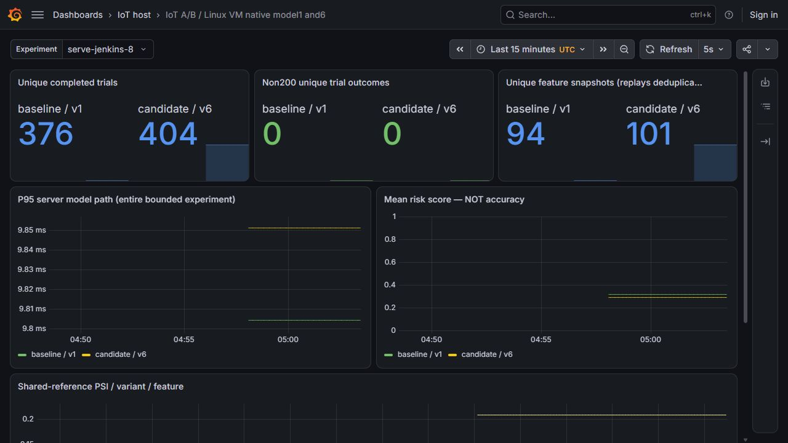
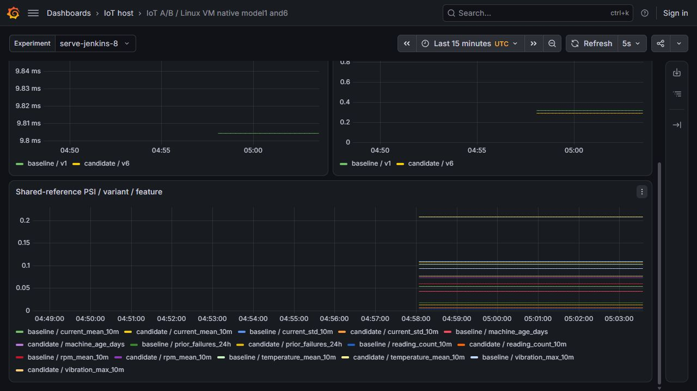
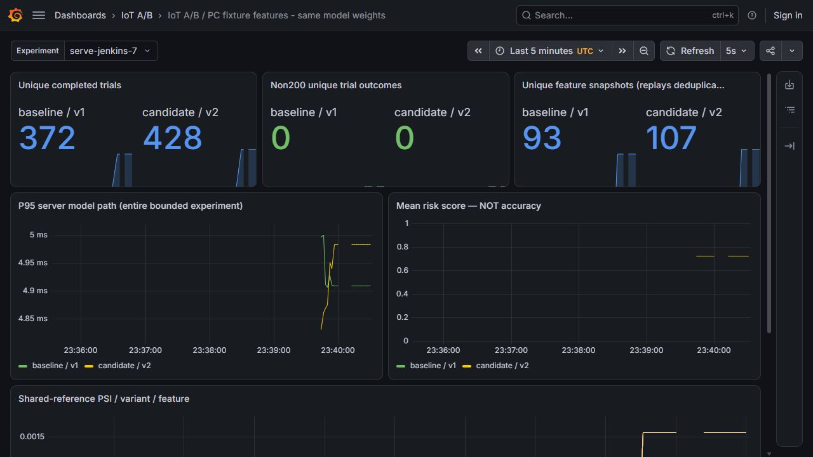
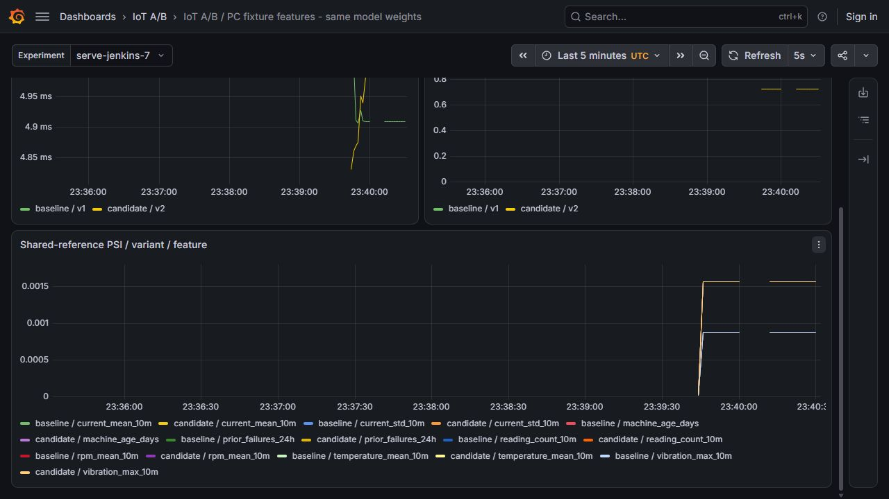

# A/B monitoring with Prometheus and Grafana

The native dashboard monitors the recorded model 1/model 6 experiment through six panels and 26 values from each query engine. Prometheus and Grafana are evaluated at the same declared timestamp and compared with independent calculations from the underlying trial and feature records.

The observed experiment contains 376/404 trials and 94/101 feature snapshots. Replay does not add trials. Sixteen PSI values use the fixed training reference rather than an arbitrary display baseline; their bins and counts are recomputed from raw inputs.

Original query responses, evaluation times, source hashes and screenshots are retained. There are no ground-truth labels in this monitoring workload. PSI, mean risk, response counts and error rates do not establish model accuracy or justify promotion by themselves.

## Commands and recorded examples

Run commands from the repository root unless the example explicitly changes the working directory. Use a fresh output/run name and check the linked runbook before starting platform services. Examples belong to the recorded workload on this page.

```powershell
python -m pytest tests/test_ab_monitoring.py -q
python -S scripts/verify-ab-monitoring.py
```

```powershell
$env:IOT_PROMETHEUS_EXE=(Resolve-Path outputs/monitoring-27/prometheus-3.13.5.windows-amd64/prometheus.exe).Path
$env:IOT_GRAFANA_EXE=(Resolve-Path outputs/monitoring-27/grafana-13.3.0/bin/grafana.exe).Path
$env:IOT_GRAFANA_HOME=(Resolve-Path outputs/monitoring-27/grafana-13.3.0).Path
python -m pytest tests/integration/test_ab_monitoring_http.py -q
```

```powershell
python scripts/prepare-ab-monitoring.py --output outputs/my-ab-monitor --endpoint http://127.0.0.1:18001 --experiment my-trial --label "Private runtime deployment pending"
```

## Implementation and evidence

- [Recorded artifact: ci-serving-linux/monitoring/verification.json](evidence/ci-serving-linux/monitoring/verification.json)
- [Recorded artifact: ci-serving-linux/monitoring/panel-queries.json](evidence/ci-serving-linux/monitoring/panel-queries.json)
- [Recorded artifact: ci-serving-linux/monitoring/independent-psi.json](evidence/ci-serving-linux/monitoring/independent-psi.json)
- [Source: ml/ab_monitoring.py](../ml/ab_monitoring.py)
- [grafana.com / provisioning](https://grafana.com/docs/grafana/latest/administration/provisioning/)
- [prometheus.io / configuration](https://prometheus.io/docs/prometheus/latest/configuration/configuration/#file_sd_config)
- [Source: scripts/verify-ab-monitoring.py](../scripts/verify-ab-monitoring.py)
- [Recorded artifact: ab-monitoring-pc/manifest.json](evidence/ab-monitoring-pc/manifest.json)
- [Recorded artifact: ab-monitoring-pc/verification.json](evidence/ab-monitoring-pc/verification.json)
- [Recorded artifact: ab-monitoring-pc/panel-queries.json](evidence/ab-monitoring-pc/panel-queries.json)
- [Recorded artifact: ab-monitoring-pc/ledger-observations.json](evidence/ab-monitoring-pc/ledger-observations.json)
- [prometheus.io / download](https://prometheus.io/download/)
- [grafana.com / download?edition=oss&platform=windows](https://grafana.com/grafana/download?edition=oss&platform=windows)
- [Recorded artifact: ab-monitoring-pc/official-downloads.json](evidence/ab-monitoring-pc/official-downloads.json)
- [Source: infra/ci/requirements-serving-tests.lock](../infra/ci/requirements-serving-tests.lock)
- [Source: scripts/prepare-ab-monitoring.py](../scripts/prepare-ab-monitoring.py)

## Recorded interface views

These are original captures from the runs described above. Their timestamps, model identities and visible states belong to those runs.










## Related documentation

[Current architecture](architecture.md) · [Demo and recovery](operations.md) · [Rubric index](rubric-tracker.md)

[Original run notes](https://github.com/anle0429/iot-maintenance-platform/blob/a395c4ea47b8f8e235556ab93de3d699ed9df18b/docs/ab-monitoring.md) retain the full historical narrative. Raw evidence files have not been translated or rewritten.
