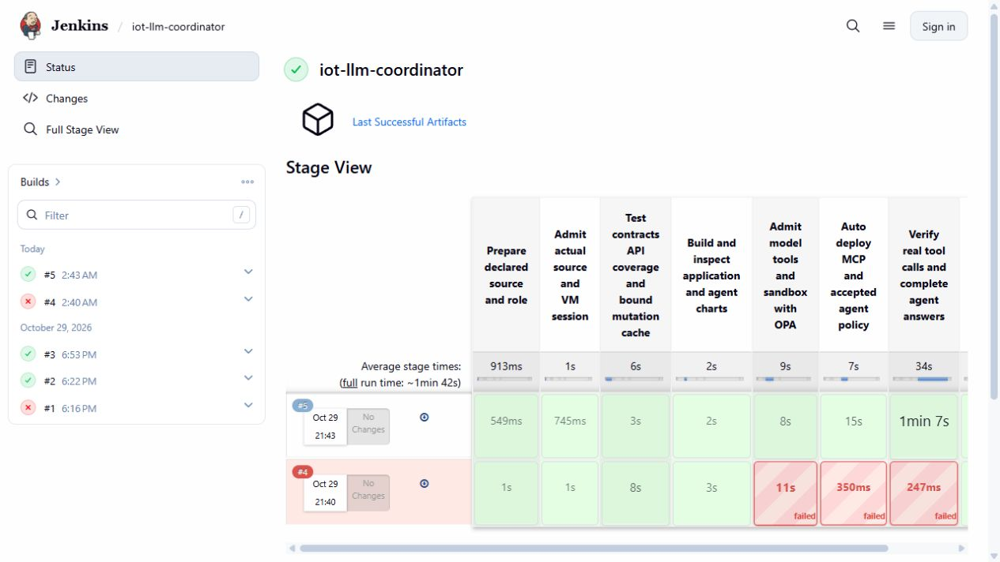
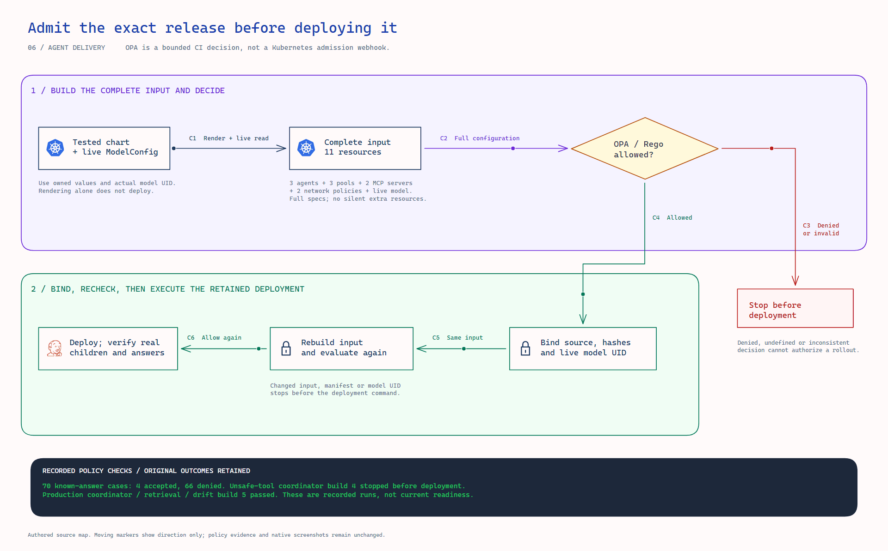
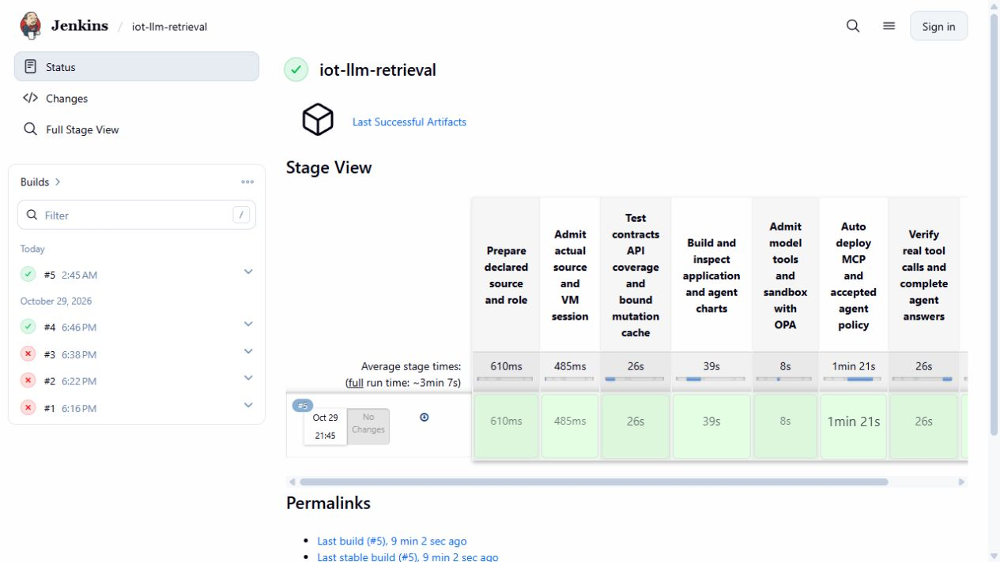
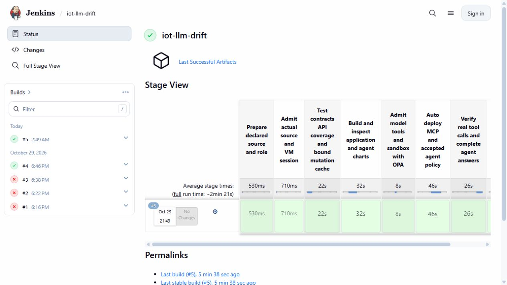
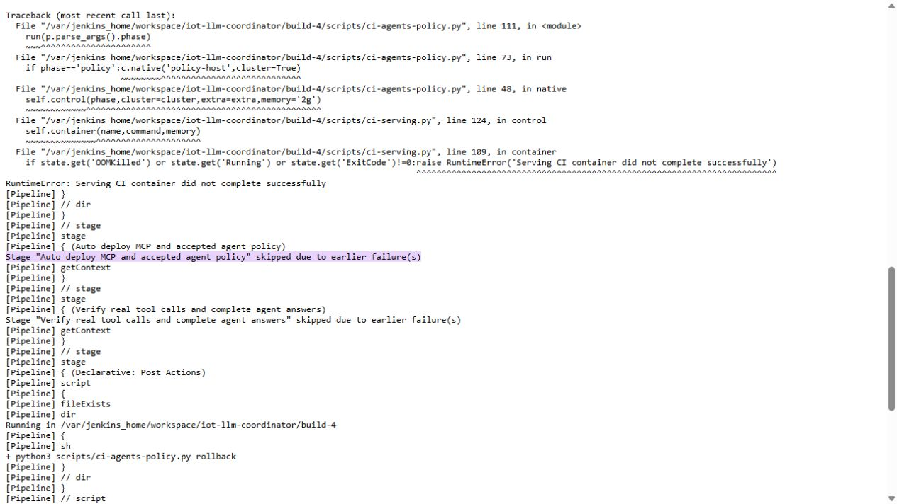

# Admit agent capabilities before deployment

The production agent pipelines evaluate their complete agent configuration with **OPA/Rego before any deployment command**. A second check binds deployment to the same rendered manifest, live model identity and approved input. The policy covers tools, delegation, model routing, generation budgets, worker isolation and the two retained network policies.

Native verification includes **70 known-answer cases** and **four actual Jenkins builds**. Four valid configurations passed; 66 invalid configurations were denied. Coordinator build **4** deliberately added an unapproved `start_pump` tool and failed before deployment. Coordinator, retrieval and drift build **5** each passed admission, deployment and real answer verification.



## Why this is useful

A correct tool name is only part of the configuration. An agent could still point at an unapproved MCP server, bypass the observed model route, share a delegated session or enable code execution. The structured policy checks these relationships together and returns explicit violations for CI review.

The learner confirmed OPA/Rego had not been covered in class. This LLM application evaluates the actual production agent chart and live shared model. The earlier ML deployment-policy experiment remains separate evidence. The official [OPA CI/CD guide](https://www.openpolicyagent.org/docs/cicd) describes configuration checks and command exit codes; this bounded CLI gate needs no additional policy server.

<picture>
  <source media="(prefers-reduced-motion: reduce)" srcset="images/agent-admission.png">
  
</picture>

[Editable Excalidraw](diagrams/agent-admission.excalidraw) · [Full-resolution PNG](images/agent-admission.png) · [Interactive viewer](diagrams/architecture.html)

Moving markers illustrate direction with arbitrary timing. Reduced-motion visitors receive a static image.

## What it checks

The input contains three `SandboxAgent` objects, three `WorkerPool` objects, two `RemoteMCPServer` objects, two `NetworkPolicy` objects and the live shared `ModelConfig`. Missing, duplicated, additional or unrecognized objects fail the declared production inventory.

| Area | Reviewed constraint | Rejected example |
|---|---|---|
| Model route | Existing private observer/router endpoint and shared 7B model | External endpoint or direct route bypassing the observer |
| Generation budget | Integer output budget from 1 to 768; positive timeout up to 600 seconds | 769 tokens, zero timeout or Boolean/string token count |
| Credentials | Existing Secret name/key reference | Missing reference or inline credential field |
| Tool access | Exact per-role read-only tool set and MCP reference | Added `start_pump`, unknown server or execution tool |
| Delegation | Two declared specialists with isolated sessions | Shared sessions or cross-namespace delegation |
| Agent behavior | Reviewed prompt/version, Go runtime, streaming and disabled code blocks | Replaced prompt or enabled code execution |
| Worker isolation | Retained gVisor image/configuration, limits and two-worker baseline | Unreviewed runtime/image, more baseline workers or privileged template |
| Network | Approved destinations and retained policy specs | Additional domain or open egress rule |

Read the [Rego rules](../infra/policy/agent-admission.rego), [approval data](../infra/policy/agent-admission-approved.json), [known-answer cases](../agents/admission_cases.py) and [observed baseline](../tests/fixtures/agent-admission-observed.json). Changing capabilities requires a reviewed policy/data change; a model answer cannot grant itself another tool.

The optional A/B pair is accounted for separately. Production readiness checks the three production roles, rejects unknown/incomplete/duplicate extra identities, and compares both A/B agents' and model configurations' UIDs/specs before and after deployment.

## Real CI outcomes

| Job and build | Scenario | Jenkins result | Verified outcome |
|---|---|---|---|
| Coordinator 4 | Synthetic additional hardware tool | `FAILURE` | OPA false/exit1; no deployment attempt or plan; unchanged resource UIDs/specs and Helm revisions; zero new GPU output tokens |
| Coordinator 5 | Production | `SUCCESS` | Admission, exact-input recheck, rollout and verified specialist delegation |
| Retrieval 5 | Production | `SUCCESS` | Admission, recheck, actual MCP rollout and tool-grounded risk/reference answer |
| Drift 5 | Production | `SUCCESS` | Admission, recheck, actual MCP rollout and tool-grounded drift answer |

All four builds use commit `beb7f5c7dbec14e8429a0877c87eb17e6c901b7b`, with **375 sealed inputs**. The [pipeline](../infra/ci/AgentsPolicy.Jenkinsfile) and [controller adapter](../scripts/ci-agents-policy.py) reuse the retained test/build/deployment/rollback machinery. The original pipeline and historical source-bound evidence remain intact.

The production builds verify four specialist answers: two coordinator children and two direct requests. Their eight actual MCP tool events succeeded. Both retrieval predictions match independent arithmetic against portable model 6, with maximum score error **0.0**. This is a controlled synthetic lab demonstration.





The red downstream boxes in coordinator build 4 inherit the earlier failure. The console explicitly records deployment and answer verification as skipped; native resource/revision checks confirm no changes. Older rows visible in these views belong to their original runs.



## An integration error caught during development

The first native suite exposed a distinction: `allowed == true` can return a **defined false value** while `opa eval --fail` still exits zero. The wrapper compared decision and exit code and stopped before deployment. Process success did not become permission.

The corrected gate uses the truth constraint `allowed = true`: denial then produces an empty query result and exit1. The [official CLI reference](https://www.openpolicyagent.org/docs/cli#opa-eval) defines `--fail` in terms of an empty/undefined result or an error. Original failed-suite records and the later 70-case pass are retained.

The package also retains the original Jenkins XML preflight failure and the later scoped update. An explicit Vault root/unseal scan supplements the initial credential scan without rewriting execution files. Credentials, weights, bulk data and image-export archives are excluded from Git.

## Verify or demonstrate it yourself

From the repository root, without a running VM:

```powershell
python -B -m unittest tests.test_agent_admission tests.test_agent_admission_ci -v
python -B -S scripts/verify-agent-admission.py
```

The verifier reads archives in memory, avoiding Windows path-length limits. It authenticates **1,833 original native payloads**, checks every policy input/decision/exit, reconciles the denied deployment boundary, verifies each production phase and checks actual answers and prediction arithmetic. It starts no service and spends no cloud credit.

For a fresh policy-only demonstration on the existing CPU VM, use the retained authenticated source and a new output directory:

```bash
sudo /usr/bin/python3 -B \
  /srv/iot-data/workspace/iot-maintenance-platform/data/llm-source/agent-admission-727cb6db/tree/scripts/check-agent-admission.py \
  --opa /srv/iot-data/workspace/iot-maintenance-platform/data/runtime/policy-assets-28/opa \
  --source-manifest /srv/iot-data/workspace/iot-maintenance-platform/data/llm-source/agent-admission-727cb6db/manifest.json \
  --output /srv/iot-data/workspace/iot-maintenance-platform/outputs/agent-admission-demo
```

This needs the CPU lab and pinned OPA binary; it makes no model request and deploys no candidate. Keep existing output and choose a new name when repeating. The complete production pipeline additionally needs a genuinely fresh feature lease and sufficient time in both VM sessions.

Inspect the retained private UI at [coordinator](http://127.0.0.1:19787/job/iot-llm-coordinator/), [retrieval](http://127.0.0.1:19787/job/iot-llm-retrieval/) and [drift](http://127.0.0.1:19787/job/iot-llm-drift/). VM/tunnel availability is bounded; offline evidence remains usable after they stop.

## Scope and limits

The gate protects these owned CI procedures. It is not a Kubernetes admission webhook and cannot constrain a separate administrator using `kubectl` directly. It checks configuration boundaries; prompt admission and runtime tool validation remain separate controls. The immediate recheck catches observed input changes before deployment, but does not create an atomic transaction with all concurrent cluster administrators.

Its eleven-object input covers the agent chart and live model. It does not independently certify every MCP application image or all Kubernetes resources. Existing API tests, image/source binding and the unchanged strict mutation baseline retain their own scope.

For a presentation, show the rejected `start_pump` case first, then a green production row. Explain why the **decision, exit code, exact configuration identity and actual outcome** all matter.
