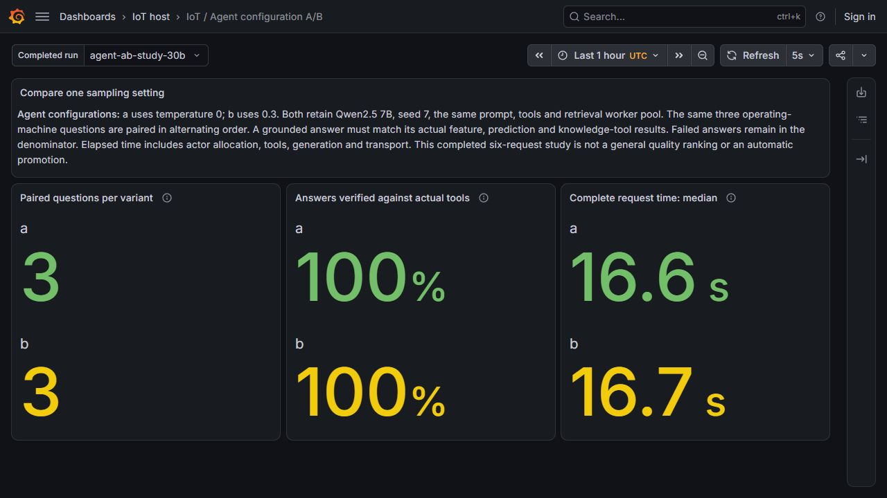
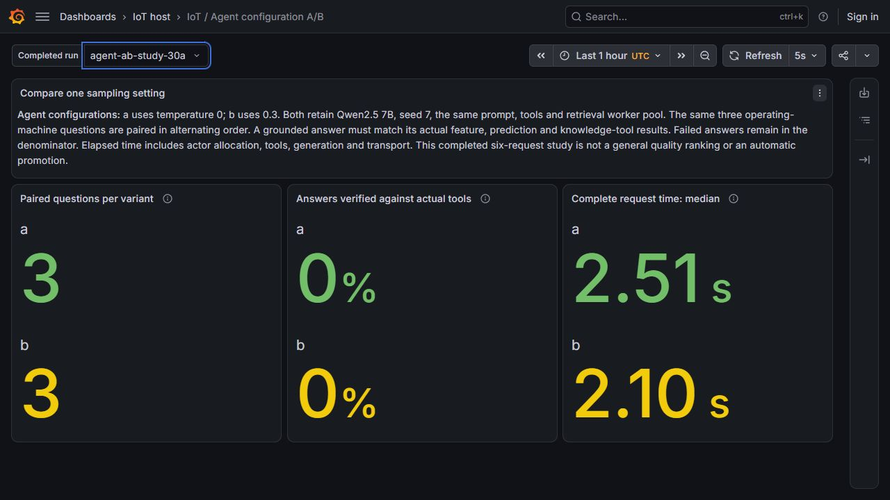

# Comparing agent configurations

Two retrieval agents answered the same three machine questions using Qwen2.5 7B. One used temperature 0, the other 0.3. Both produced three answers that matched their actual tool results. Their median complete-request times were 16.59 and 16.68 seconds. This small run gives no reason to change the production configuration.

This is the agent configuration experiment for L56. The [1.5B/7B model-artifact comparison](llm-model-ab.md) addresses L57 separately.

## What changed

| Variant | SandboxAgent | ModelConfig | Temperature |
|---|---|---|---:|
| a | `iot-ab-retrieval-a` | `iot-ab-model-a` | 0 |
| b | `iot-ab-retrieval-b` | `iot-ab-model-b` | 0.3 |

Both retain the same 7B model, seed 7, 768-token generation budget, response policy 0.2.2, tool declarations, sandbox network rules and retrieval worker pool. The original three agents and shared model configuration remain unchanged. No new VM or worker pool was added for the experiment.

The [configuration planner](../agents/ab_configuration.py) creates four separate resources. Native acceptance checks more than their YAML: both ModelConfigs are accepted, both SandboxAgents have current-generation Ready conditions, and their gVisor ActorTemplates have actual golden snapshots. A narrow projection of each generated runtime Secret confirms `/model/temperature` is 0 or 0.3. Full Secret contents are excluded from the evidence.

## Workload and answer checks

The measured cohort used P-001, P-002 and P-003, selected from actual operating-machine responses in the refreshed feature API. The order alternated a/b, b/a, a/b. Every question asks for features, failure prediction and a vibration reference. Each request has a distinct context, message and task identity.

An answer passes only when its machine ID, event timestamp, model version, score and document IDs match its own native MCP history. The cited passage must also match the authored source bytes. All six prediction scores were independently recomputed from the pinned model 6 coefficients; the maximum difference was **0.0**. These are simulated, uncalibrated model scores, as declared in every accepted answer.

The feature preparation was performed at 01:01:53 UTC on 30 October 2026, with a real one-hour cache lease. The accepted comparison finished at 01:42:04 UTC, within that lease. Its receipts include the original zero-key observation, actual SDK materialization, 200 populated keys and the resumed deployment of the same prepared state. No timestamp or TTL was extended to make the test pass.

## Recorded result

| Quantity | a: temperature 0 | b: temperature 0.3 |
|---|---:|---:|
| Distinct machine questions | 3 | 3 |
| Answers verified against tools | 3/3 | 3/3 |
| Successful MCP events | 9 | 9 |
| MCP tool errors | 0 | 0 |
| Median complete-request time | 16.591 s | 16.677 s |



The duration includes actor allocation, tool calls, generation and A2A transport. It is different from the short direct-model latency measured in L57. There is no separate per-agent TTFT or token-attribution claim here; the existing proxy cannot reliably assign every model request to an agent role.

Three paired questions cannot establish a general quality ranking or the effect of sampling across a wider workload. Temperature 0.3 is not promoted automatically. The dashboard describes a completed batch, rather than live throughput or production accuracy.

## Keep the failed predecessor visible

The first six requests received HTTP 200 envelopes containing **failed A2A tasks**. The retrieval MCP connection was refused before tool results or final answers were available. Both variants therefore had zero verified answers. Their roughly two-second response times describe failure handling, not successful agent performance.



The runner completed the failed-outcome inventory and exited normally; that exit does not mean the tasks succeeded. The [original diagnosis](evidence/llm-agent-ab/failed-task-diagnosis.json) and full task responses are retained. The two unavailable MCP Pods were then recovered with the same application image, arguments, environment and mounts. The next cohort added explicit deployment and ready-endpoint checks before making any question. The two cohorts remain separate.

The earlier [restart recovery](agent-restart-recovery.md) also preserves its failed attempts, automatic Valkey failover and temporary scaling maintenance. These failures explain the guards now used by the demo.

## Verify and present

From a clone, without contacting the VM:

```powershell
python -B -S scripts/verify-llm-agent-ab.py
python -B -m unittest discover -s tests -p test_agent_ab_configuration.py -v
```

The verifier authenticates 1,044 original native payloads, rechecks all six accepted answers and 18 MCP events, recomputes prediction arithmetic, checks three independent Grafana/Prometheus vectors and retains all six failed predecessor tasks. It also checks that maintenance pause annotations were removed and native Paused conditions returned to False.

For the retained live lab, use the [private monitoring viewers](llm-monitoring-demo.md), then open `/d/iot-agent-ab`. Select `agent-ab-study-30b` for the accepted run or `agent-ab-study-30a` for the failed predecessor. Explain the task state and answer check before comparing timings. The [configuration receipt](evidence/llm-agent-ab/configuration-verification.json), [accepted result](evidence/llm-agent-ab/comparison-verification.json) and [dashboard receipt](evidence/llm-agent-ab/dashboard-verification.json) identify their exact native sources.
