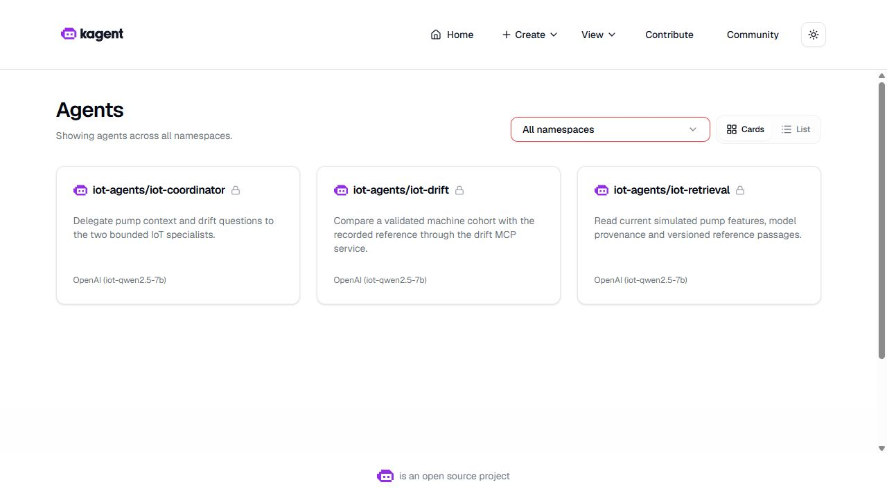
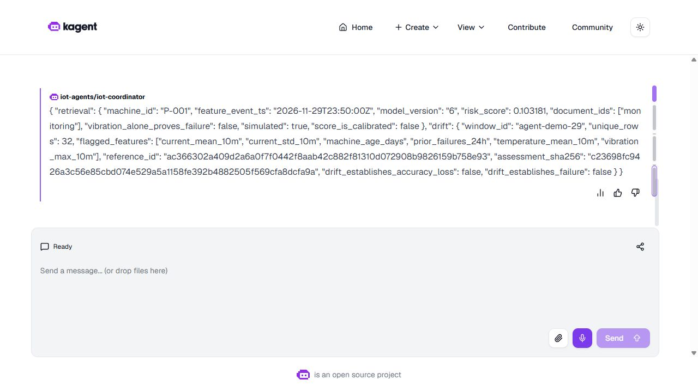
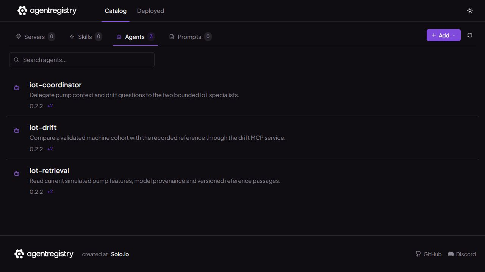

# Private gateway for the IoT agents

The agent chat and registry now share the existing NGINX gateway. Both private hosts require authentication and use a lab certificate. A complete coordinator conversation passed through this gateway, including the independent retrieval and drift histories. The credentials are managed through two scoped Vault AppRoles.

This is a single-operator lab. The authenticated `coursework` account maps to the pinned UI's existing `admin@kagent.dev` application principal. NGINX replaces client identity headers and removes the gateway Authorization header before forwarding. This proves the private front-door controls; it does not establish tenant isolation inside the agent controller.



## Follow a question through the system

The browser opens an administrative viewer on the PC's loopback address. IAP carries that connection to a loopback viewer on the VM. The viewer authenticates to `agents.iot.test` over HTTPS and verifies its private CA, hostname and actual certificate. NGINX then forwards the request to the existing kagent UI. The UI sends the question to the coordinator, which delegates to the two specialists.

The retrieval specialist calls `get_machine_features`, `predict_failure` and `search_knowledge`. The drift specialist calls its cohort-comparison tool. Their answers return to the coordinator, which preserves the machine, timestamp, model version and source identifiers.



The recorded answer identifies pump P-001, model version 6, risk score 0.103181, the authored `monitoring` document and the 32-machine drift reference. Its event timestamp belongs to the simulator's clock. It is not a claim that real measurements came from the future. The answer explicitly retains the synthetic-data, uncalibrated-score and drift-interpretation limits.

The independent checker compares the final answer with the original child tasks and all four actual MCP results. An A2A task marked `completed` is insufficient by itself.

## What was measured

| Check | Actual result |
|---|---|
| Chat UI and registry | Both HTML pages and their JavaScript assets returned 200 through authenticated HTTPS |
| Missing or incorrect credentials | Eight requests rejected with 401 |
| HTTP to HTTPS | Two redirects returned 308 |
| Identity spoofing | Supplied client identity headers were replaced; the application returned the fixed lab principal |
| Catalog | Retrieval, drift and coordinator version 0.2.2 matched actual native resource UIDs and specification hashes |
| Invalid TLS identity | Untrusted CA rejected; unknown SNI rejected before a certificate was served |
| Gateway burst | 320 requests in 2.01145 seconds: 150 returned 200 and 170 returned 429 |
| Recovery | A subsequent authenticated request returned 200 |
| Existing routes | Metrics, logs, traces and feature health still returned 200 |
| Coordinator | One complete parent, two independently checked child histories, four successful tool calls |
| Current configuration tests | Eight tests passed natively against the sixteen sealed gateway inputs |

The limiter is configured at 30 requests/second per client IP, with a burst allowance of 90. The burst demonstrates rejection and recovery on this workload. It is not a maximum-capacity result or service-level guarantee. Existing monitoring routes were checked for preservation; this does not close the separate LLM telemetry requirements.

The retained native gateway uses NGINX Ingress Controller 5.7.0 with NGINX 1.31.7 and its pinned image digest. The UI remains kagent 0.10.3, with the same actual image digest before and after its identity-forwarding setting was added. The controller, backends, model configuration and agent/pool specifications were preserved.

## Centralize credentials without rotating them

The provisioning step reused the existing credential bytes and wrote two dedicated KV2 paths:

| AppRole | Allowed data path | Consumer |
|---|---|---|
| `iot-agent-gateway` | `iot/data/agents/gateway` | Gateway credential synchronization |
| `iot-agent-services` | `iot/data/agents/services` | MCP and model-client Kubernetes Secret synchronization |

Each consumer logged in over CA-verified HTTPS, obtained a 300-second token, read its own version-1 secret and revoked the token. Reads of the other agent path, Airflow credentials and the older gateway path returned 403. Reading with the revoked token also returned 403. The roles have no default policy; their maximum token TTL is 900 seconds and SecretIDs have bounded lifetime and use counts.

All four Kubernetes Secret UIDs and credential bytes remained unchanged. This milestone demonstrates actual Vault consumers and restricted access. Automatic rotation, continuous agent injection, Vault high availability and the rubric's separate centralized-secret UI capture remain outside this evidence.

## Inspect the recorded result first

From the repository root, no running VM is needed:

```powershell
python -B -S scripts/verify-agent-gateway.py
```

The checker authenticates 714 original native payloads, all sixteen current gateway inputs, phase-specific source packets, original failed attempts and four unedited UI captures. It recomputes response hashes, burst counts, registry identities, policy constraints and complete child-answer acceptance. The [archive receipt](evidence/agent-gateway/native-archive.json) identifies the exact gzip transferred from the VM; it was not recompressed on the PC.

Open the [capture index](evidence/agent-gateway/ui/index.json), then compare the coordinator context ID with the original A2A response inside the archive. Browser screenshots show a loopback HTTP administrative view. The upstream HTTPS controls are established by the native TLS/request receipts. No browser certificate warning was bypassed, and public DNS or browser trust of the private CA is not claimed.

## Run the private demo again

Use the retained lab and its [recovery procedure](demo-walkthrough.md). Confirm actual CPU/GPU readiness and a genuinely fresh one-hour feature lease first. A clone contains code and evidence, but not model weights, runtime credentials, images, data or these prepared native source packets.

The recorded deployment has the following routes:

| Host | Existing backend | Administrative viewer |
|---|---|---|
| `agents.iot.test` | `kagent-ui:8080` | `127.0.0.1:18090` |
| `registry.iot.test` | `iot-agent-registry:12121` | `127.0.0.1:18091` |

If the viewers are already running, reuse them. Otherwise start each in its own VM terminal. The commands below refer to the exact retained source used for this milestone; they do not install missing state on a new machine. Choose new audit filenames for a later run and check for an existing listener before binding a port.

```bash
CW_ROOT=/srv/iot-data/workspace/iot-maintenance-platform
CW_SOURCE=$CW_ROOT/data/llm-source/agent-gateway-final-adc15dc2/tree
sudo /usr/bin/python3 -B "$CW_SOURCE/scripts/view-agent-gateway.py" \
  --role agents --gateway-ip 10.53.22.203 \
  --ca "$CW_ROOT/outputs/agent-gateway-29a/ca.crt" \
  --credentials "$CW_ROOT/data/runtime/agent-gateway-29a-private/credentials.json" \
  --audit "$CW_ROOT/outputs/learner-gateway-view/agents.jsonl"
```

In the second terminal, use the same command with `--role registry` and `--audit "$CW_ROOT/outputs/learner-gateway-view/registry.jsonl"`. Obtain the actual gateway ClusterIP again after any cluster rebuild rather than assuming the recorded address remains valid.

On the PC, forward both loopback ports through the existing private IAP connection. With the Windows CLI used in this lab:

```powershell
gcloud compute ssh iot-cw-vm --zone us-central1-a --project YOUR_PROJECT_ID `
  --tunnel-through-iap `
  --ssh-flag=-L18090:127.0.0.1:18090 `
  --ssh-flag=-L18091:127.0.0.1:18091 `
  --command="sleep 3300"
```

Keep that terminal open. Visit `http://127.0.0.1:18090` and `http://127.0.0.1:18091`; select **Agents** in the catalog. In kagent, open **iot-coordinator** and ask:

> Use both specialists. Get the current features and failure prediction for pump P-001 and a reference about vibration. Also assess drift for the standard demo cohort of all 32 unique machines P-001 through P-032 using window_id agent-demo-29. Combine the actual results, preserving model and source identifiers.

Expand each specialist's **Activity** panel. Retrieval should show three successful tools; drift should show one. Inspect their actual results before explaining the combined answer. An expired feature lease is a demo failure to repair through real materialization, not by editing timestamps.



The viewer binds only loopback, fixes the upstream host, checks the local Host/Origin and permits a bounded set of methods and chat paths. It attaches the existing login in memory. It is an administrative convenience, so anyone controlling that local session can act as the lab operator. Keep it behind IAP and stop the owned viewer/tunnel when finished. Optional diagnostic request bodies stay in private runtime directories and are excluded from published evidence.

## Explain the failures as well as the result

The first ingress used `$remote_user` in an annotation that rejects `$`. The controller Pod was Ready, but both ingresses were rejected and TLS failed. The correction uses fixed values for the explicitly single-operator account, and the deployment helper now requires the actual expected TLS leaf before accepting readiness. The original deployment and both guarded header repairs remain separately identified; the updated whole deployment helper is not relabeled as the originally executed version.

The next probe correctly encountered an unknown-SNI handshake rejection, but its client caught only certificate-verification exceptions. The corrected client accepts only that specific negative-test outcome. A later chat invocation selected a runner absent from its ten-file source packet and exited before sending a request; the corrected invocation used the separately sealed runner.

The browser relay also needed the official `X-User-Id` server-action forwarding setting, Next.js protocol headers and both new-chat and existing-session URL forms. Tests now cover these routing boundaries. The final original UI captures show the working session and its actual answer.

For presentation, explain four decisions: why authentication belongs before the UI, why a Ready Pod does not prove an accepted ingress, why a completed task still needs fact checking, and why Vault consumers must fail when reading a different service's secret. Full token/TTFT/safety telemetry, A/B comparisons and the remaining [LLM rubric](final-llm-rubric-tracker.md) obligations stay open.
