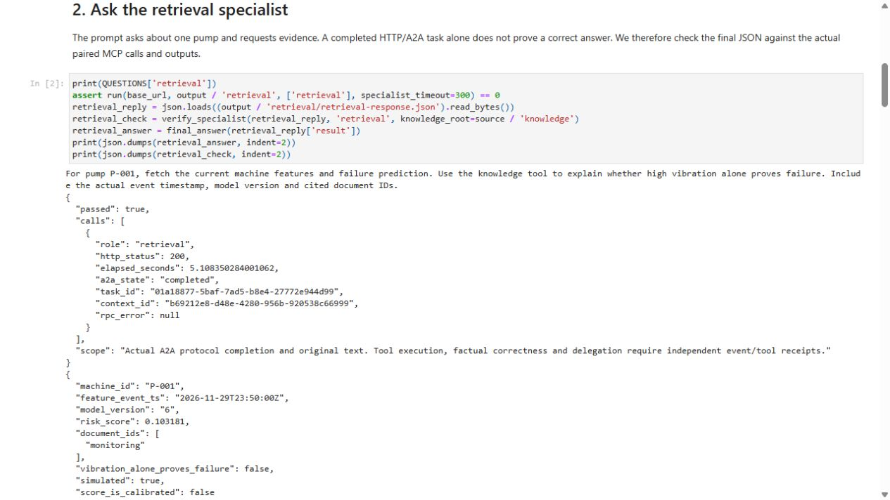
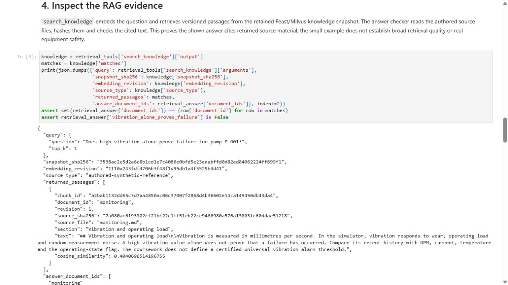
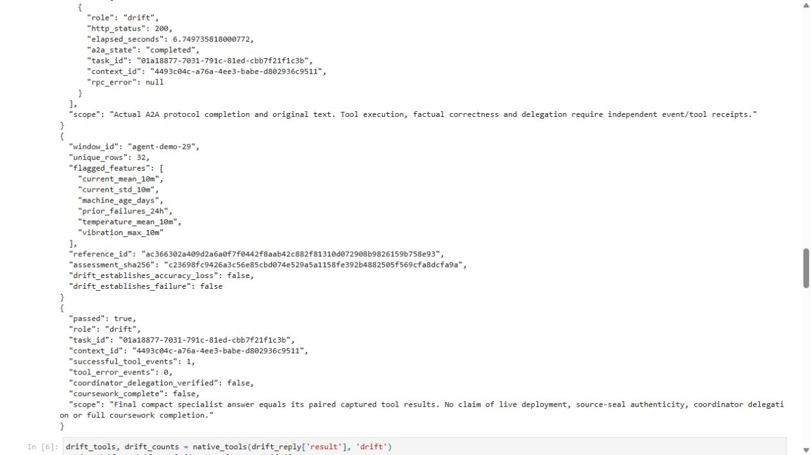

# A notebook that calls the deployed agents

The [source notebook](../notebooks/03_agent_feature_drift_rag.ipynb) ran through a real Jupyter kernel on the control VM. All seven code cells completed, with two actual specialist requests and four successful MCP calls. The final answers were checked independently against their native tool histories, genuine Feast preparation and authored reference files.

[Executed notebook](evidence/agent-notebook/executed.ipynb) · [Original HTML export](evidence/agent-notebook/executed.html) · [Execution receipt](evidence/agent-notebook/execution.json) · [Answer checks](evidence/agent-notebook/answer-checks.json)

## What to follow in each section

| Section | Operation | Evidence to inspect |
|---|---|---|
| Connect | Load the prepared lab context and isolated kernel | Model 6, real preparation time and one-hour lease |
| Retrieval | Ask `iot-retrieval` about P-001 | Actual A2A task/context and final compact answer |
| Features and prediction | Inspect its first two MCP calls | The prediction's feature trace equals the returned Feast-backed snapshot |
| RAG | Inspect its knowledge-tool call | Query, chunk/document IDs, source hash, original passage and final citation |
| Drift | Ask `iot-drift` about P-001 through P-032 | Exactly 32 unique machines, pinned reference and assessment hash |
| Acceptance | Reconcile both answers with native outputs | Three retrieval events, one drift event and no tool error |

The notebook sends questions through the existing A2A client. The deployed agents choose and invoke MCP tools; the notebook does not execute a replacement model or supply a canned answer. The internal interface is private to the lab. Gateway authentication is tracked separately.



The shown request returned model 6's uncalibrated score of approximately 0.103181 for the simulated P-001 snapshot. Its simulated feature time is 29 November, while real preparation occurred on 29 October. Those clocks serve different purposes. Both the machine-feature output and the prediction trace carry the same preparation time and source identity.



The RAG result cites the `monitoring` document's vibration-and-load passage. The checker hashes the actual authored file and requires the returned text to occur in it. A single citation example is not a broad retrieval-quality benchmark.



The drift comparison flagged six of eight features in this 32-machine cohort against the fixed reference. The served prediction model is version 6; the historical drift reference retains model 3's training lineage. Drift measures distribution change here, not accuracy loss or a physical failure.

## Recorded execution

The run started at 16:21:24 UTC on 29 October 2026 and ended at 16:21:39. All requests finished inside the genuine feature lease, prepared at 16:18:11 and expiring at 17:18:11 UTC. The old keys expired naturally before that fresh 200-machine SDK materialization. No timestamps or TTLs were extended to make the notebook pass.

The kernel used the existing isolated Python 3.12 environment: nbclient 0.10.4, nbformat 5.10.4, nbconvert 7.16.6 and ipykernel 6.30.1. Source cells were unexecuted when submitted. The runner retained the executed notebook and HTML without editing outputs. The four original browser captures show that unmodified export, not a live Jupyter-server interface.

The [native archive](evidence/agent-notebook/native-receipts.tar.gz) preserves 58 original payloads, including ten exact source files, both native specialist traces, actual feature preparation, current resources and process journals. The source catalog retains its original bytes; this packet uses no newline-normalization exception. Credential scans cover real runtime values and the private GPU-join credential.

## Check and run it yourself

From a clone, without a running VM:

```powershell
python -S scripts/verify-agent-notebook.py
python -m pytest tests/test_agent_notebook.py tests/test_agent_notebook_evidence.py -q
```

Read the executed notebook first, then follow one task ID from its displayed answer into the captured MCP events. The offline checker recomputes every displayed JSON result from those original events, checks all seven execution counts and rejects changed source, truncated output or contradictory summaries.

To repeat it on the retained VM, first complete a new genuine [feature preparation](agent-demo.md#1-check-the-vm-and-data-lease). Set `FEATURE_PREPARATION_RUN` to that successful report's directory name. At least 20 minutes must remain on its lease and 30 minutes in the approved VM session. Wait for prior actors to be idle and choose a new output name. From the VM project root:

```bash
SOURCE="$PWD/data/llm-source/agent-notebook-29a/tree"
sudo data/runtime/notebook-venv/bin/python -B \
  "$SOURCE/scripts/run-agent-notebook.py" \
  --runtime-root "$PWD" --source-root "$SOURCE" \
  --output "$PWD/outputs/agent-notebook-demo-new" \
  --feature-run "$FEATURE_PREPARATION_RUN"
```

That sealed source and the Python environment exist on the retained VM; they are runtime state excluded from Git. The runner refuses a modified source packet, an existing output directory, an expired lease or a different kernel. On failure it retains error cells and original request receipts. Inspect them before deciding whether to try a new run.

The selected full coursework remains incomplete. Coordinator delegation, scaling, boundaries and model measurements have separate linked experiments; cold/warm startup, CI, product gateway, full telemetry, A/B and the other tracked obligations require their own evidence. The [nbclient execution reference](https://nbclient.readthedocs.io/en/latest/reference/nbclient.html) explains kernel execution and error handling.
