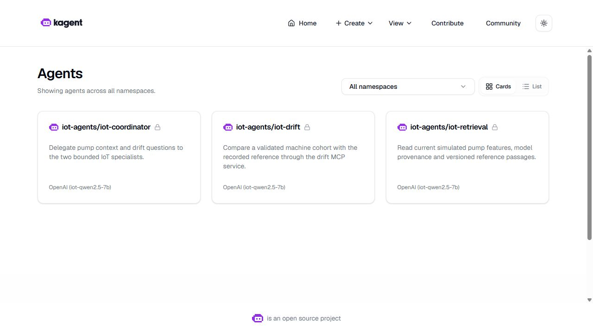
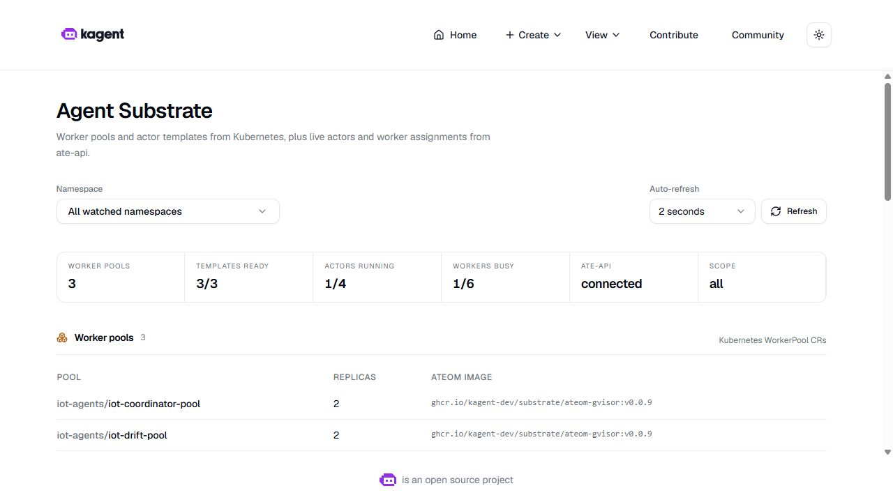
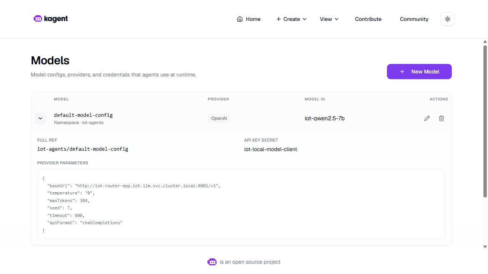
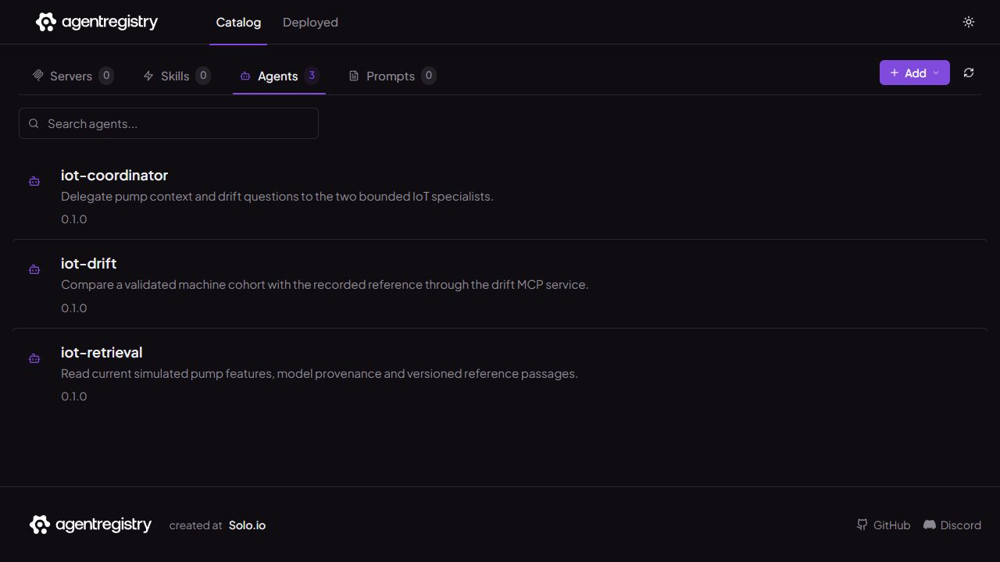

# Native agent control plane and catalog

The subsequent [GPU agent checkpoint](gpu-agent-routing.md) records complete specialist answers, actual coordinator delegation and catalog version 0.2.2. This page preserves its earlier deployment/failure baseline.

The deployment recorded on 29 October uses kagent 0.10.3, Agent Substrate 0.0.9 and agentregistry 0.4.0 on the retained VM. Three sandbox agents reached Ready with golden snapshots and separate two-worker pools. Their versioned catalog entries identify the actual runtime image, Kubernetes resource UID and agent-specification hash. Current availability depends on an active VM session and fresh feature data.

This page retains the original platform foundation. Later checkpoints verify [GPU specialist/coordinator conversations](gpu-agent-routing.md), [MCP isolation](agent-network-isolation.md) and [automatic worker scaling with original UI captures](agent-scaling.md). A later [executed agent notebook](agent-notebook.md) verifies Feast-backed features, RAG and drift. A measured cold/warm comparison remains separate acceptance work.



## How the components fit together

The retrieval specialist has three MCP tools: read machine features, obtain the model prediction and retrieve versioned reference passages. The drift specialist has one cohort-comparison tool. The coordinator has A2A references to the specialists. None has a pump-control or arbitrary-shell tool.

All three reference `default-model-config`, which selects the existing Qwen2.5-7B backend through llm-d. `OpenAI` in this configuration names the compatible API protocol. It does not select a paid external OpenAI model. The applied settings and the generated per-agent settings are checked independently, without exporting their credentials.

Substrate creates actors inside gVisor workers. A worker is a slot for an executing actor, rather than a permanently running copy of one chat session. The original foundation kept two workers per role. A later [KEDA experiment](agent-scaling.md) verified automatic 2 → 4 → 2 scaling for all three pools. Idle sessions can snapshot and release a slot. The pools share one control VM, so additional workers do not establish host-level high availability.

The installation follows the version-compatible [kagent Substrate guide](https://kagent.dev/docs/kagent/0.x/examples/agent-substrate/). The controller verifies the Substrate API certificate using the generated public CA. JWT authentication uses the retained cluster's ServiceAccount issuer. The trusted runtime workers and atelet require host privileges. These are distinct from the isolated agent actor and from the unprivileged MCP services.





## Storage and private access

One retained 4-GiB PostgreSQL volume backs separate kagent and registry databases and users. Passwords are generated privately and referenced through Secrets. The catalog uses the external persistent database option described in the [registry installation documentation](https://aregistry.ai/docs/quickstart/), rather than its ephemeral development database.

Substrate keeps six 1-GiB Valkey volumes and a 16-GiB local object-store volume on the existing SSD. A guarded Ansible bind mount puts the runtime's canonical host directory on that SSD. The second application reported zero changes. No VM, disk, cloud bucket or Internet-facing port was added.

The controller, registry and UI remain private ClusterIP services. The screenshots use temporary loopback forwarding through IAP. Gateway authentication for the complete agent product remains open; these internal pages are not presented as a finished public application.

## Registry publication

Each catalog entry records the actual immutable Go ADK image, agent resource UID, specification hash and ActorTemplate name. Publication and versioned HTTP readback succeeded for retrieval, drift and coordinator. The catalog stores governance metadata; it does not deploy the Helm-managed SandboxAgent configuration.



## What the integration checks found

The first deployment was rejected during server-side validation because RemoteMCPServer required a description. The next installation had running workers but could not select them. kagent's generated selector matches a label on the WorkerPool resource; adding that exact label and notifying its worker records resolved the mismatch. The original failed and interrupted runs are retained.

The native A2A client also needed wire version `0.3` and a message `contextId`. After that, the controller's network policy needed the router Pod's actual port 8080 in addition to the Service-facing port. These fixes produced real tool calls from a gVisor actor.

Two retained retrieval attempts contain six actual MCP tool results in total. Features and prediction share the same trace, served model version is 6, and returned knowledge passages match their original source hashes. One attempt failed during the final model response. A later task reached protocol completion but cut off a quotation at the 4,096-token context limit. Its reported prompt and generated token counts sum to exactly 4,096. Neither is accepted as a complete conversation.

The CPU response timeout was increased from 180 to 600 seconds. The output cap is 384 tokens. The same model's context was then increased to 8,192 tokens, confirmed through `/props` and Kubernetes arguments. Weights, image and resource limits stayed the same. The one-node model rollout used Recreate because a simultaneous second model reservation would not fit the scheduling budget. This causes a brief lab interruption.

Initial operator diagnostics did not establish the required isolation boundary. Their unsuccessful results remain visible. Ready gVisor snapshots alone are not substituted for an exercised allow/deny test. Startup latency and the effect of warm-up have not yet been benchmarked.

## Verify the recorded checkpoint

The later [response baseline and candidate policy](agent-response-contract.md) adds a complete native drift answer and preserves the overall timeout. Retrieval and coordinator acceptance remain open. Policy 0.2 is prepared locally; it does not replace the recorded 0.1 deployment described here.

```powershell
python -S scripts/verify-agent-platform.py
python -m unittest tests.test_agent_probe -q
```

The first command checks 528 source, command, readback and image payloads. It verifies applied configuration, native Ready states, catalog identities, tool-result provenance and the retained failed/partial outcomes. It explicitly reports complete chat, boundary probes, autoscaling, warm-up and overall coursework completion as unverified. The nine client tests check protocol/error handling with fixtures; they are not native model evidence. Captures retain the exact historical client, and the verifier separately reports whether it matches the current source.

[Agent learning guide](llm-learning-guide.md) · [Live demo steps](agent-demo.md) · [LLM requirements](final-llm-rubric-tracker.md) · [Original capture inventory](evidence/agent-platform/capture.json)
