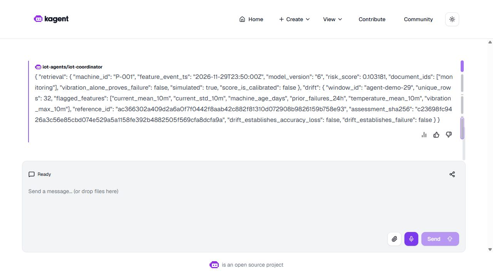
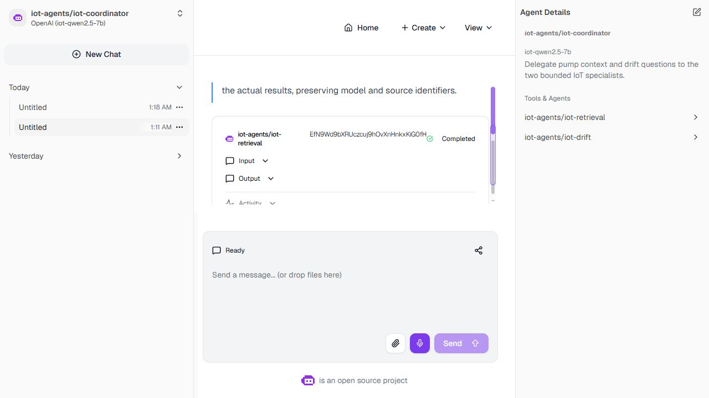
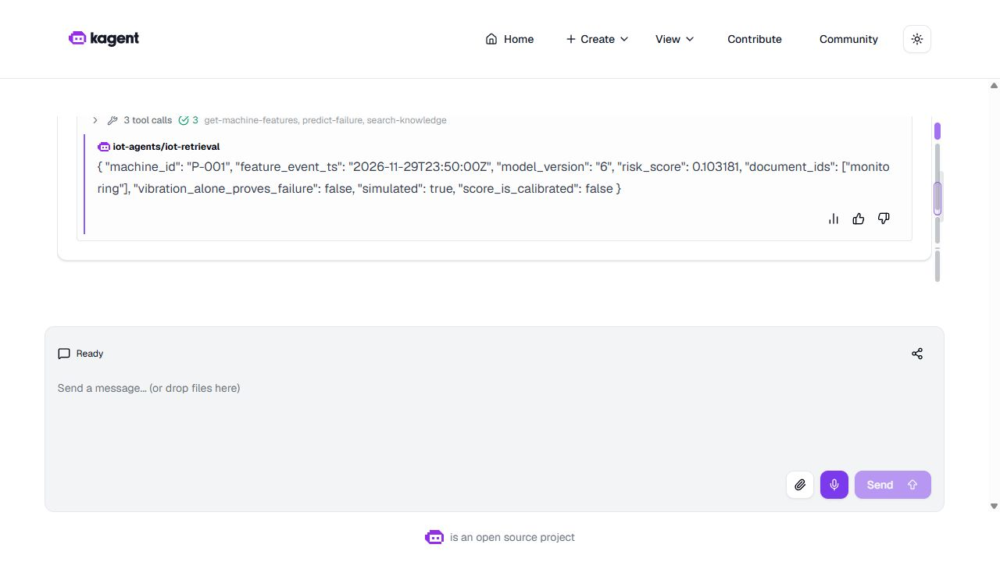
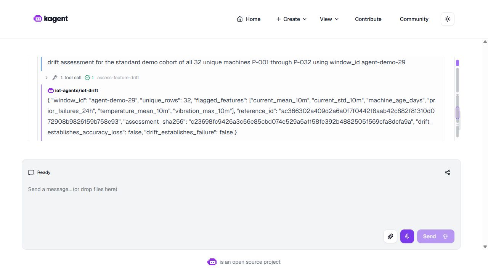

# Post-restart agent validation

The recorded validation completed on **30 October 2026 at 06:30 UTC**. The coordinator delegated to retrieval and drift, then returned an answer matching both actual child tasks. Retrieval completed three MCP tools; drift completed one. The independent model-6 calculation matches the original prediction exactly.

This is a recorded run on the retained lab. Its genuine feature lease ran from **06:09:29 to 07:09:29 UTC**; it is not evidence of current readiness. Use the [operations runbook](operations.md) for execution requirements and recovery commands.



## What happened

| Phase | Actual outcome |
|---|---|
| Initial preflight | The GPU aliases were loaded and six worker registrations matched their current Pod IPs. MCP readiness failed while the old feature lease was expired. No question or SDK preparation ran in this preflight. |
| Genuine preparation | Feast SDK materialized 200 machines. Physical feature keys went from 0 to 200; the container exited 0 without OOM. An immutable seed was deployed in Helm revision 50. Preparation timestamps and TTL were not edited. |
| Conversation A | Both the parent and its retrieval child failed with router 503, `failed to find endpoint candidates`. The parent had already issued a delegation: this was not a zero-work attempt. The child history has no successful MCP results. |
| Diagnosis | GPU models were loaded, but the observer had 36 container restarts. Kubelet events recorded probe timeouts and liveness-triggered restarts. Its previous termination was exit 0/Completed, not OOM. Observed CPU was 1000m; measured health calls took 1.37 and 2.76 seconds. |
| Configuration repair | Observer scrape cadence changed from 2s/1s timeout to 15s/10s; its liveness/readiness timeouts changed from 1s/3s to 5s/5s. Application code, images, health paths, backend checks, credentials, other jobs and ledger data were preserved. |
| Stability window | Thirteen live/ready observations over 184.29 seconds used the same Pod and restart counts. The Prometheus process stayed at PID 20990 and the observer target was UP. Ledger row counts did not decrease. |
| Conversation B | A distinct context completed: one parent, two completed child tasks and four successful MCP events with zero tool errors. All chat and child-history requests used the authenticated, CA/SNI-verified private UI gateway. |

Both conversations used the same prompt and sealed agent source. B follows an infrastructure repair; these two outcomes are not a quality comparison or latency optimization experiment. The 184-second window is bounded stability evidence, not a long-term availability guarantee. The scrape/probe changes were applied together, so their individual effects were not isolated.

The observer computes ledger-derived metrics synchronously; frequent scraping is a plausible contributor to the observed CPU pressure. This is an inference from source and measurements, not a controlled causal result. An earlier diagnostic also queried the wrong observer service port; its connection error is retained, while the later correct-port measurements supply the health evidence.

## Read the task, not just the card

The native UI showed **Completed** on A's retrieval delegation wrapper. Its underlying child task was **failed**, and the parent was also **failed**. The original screenshot is retained without changing that label. A completed delegation wrapper therefore does not establish a successful specialist answer.



For B, acceptance checks the parent, both actual child histories, tool call/result pairing, citation source and exact preservation of the child answers. The independent numeric check uses the portable model artifact and the captured eight-feature vector rather than the LLM's text alone.





The risk score is `0.10318092377929837`, displayed as `0.103181`, from model 6. It is an uncalibrated score on simulated data. The 32-machine drift call preserves reference and assessment hashes. Its fixed window can replay an existing assessment; a successful MCP call is not automatically a newly created drift window. The controller also contains an empty UI-created chat from inspection; no prompt was submitted there, and it is not another experiment.

## Runtime and recovery boundary

The retained source uses three production agents while preserving both A/B resources. It requires actual ready MCP replicas/endpoints and a genuine feature lease. The [operations runbook](operations.md) documents CPU/GPU recovery, explicit model loading, genuine SDK preparation, the protected coordinator command and the separate steady-state monitoring overlay.

The original chart and short-experiment monitoring sources remain unchanged so their historical evidence can still be authenticated. A base deployment may restore its original scrape/probe budgets; the overlay reapplies the measured steady-state configuration. Its health checks still fail on actual backend errors. The official [Kubernetes probe documentation](https://kubernetes.io/docs/tasks/configure-pod-container/configure-liveness-readiness-startup-probes/) explains the separate liveness/readiness and timeout behavior.

## Check the recording without a VM

```powershell
python -B -S scripts/unpack-evidence.py
python -B -S scripts/verify-learner-demo.py
```

The checker authenticates 280 original native payloads, two sealed source packets, genuine preparation and physical TTL observations, both failed tasks, the permitted configuration differences, all thirteen stability samples, private TLS transport facts and four original JPEGs. It independently recomputes the accepted answers and model arithmetic. No service starts and no model request is sent.

[Original archive receipt](evidence/learner-demo/native-archive.json) · [Capture index](evidence/learner-demo/ui/index.json) · [Full requirement map](final-audit-matrix.md)
