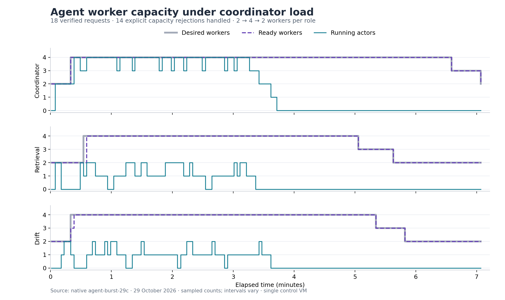
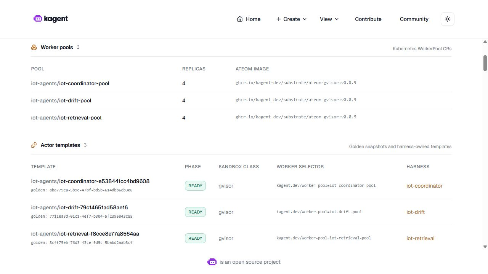

# Agent worker scaling and admission backpressure

All three Substrate worker pools were observed scaling **2 → 4 → 2** under real coordinator traffic. The accepted run completed 18 coordinator requests, checked 36 independent child sessions and retained 14 explicit capacity rejections handled by bounded retries. The complete observation lasted 424.01 seconds, including the automatic return to two idle workers per role.



This plot uses the original sampled observations. It is separate from the unedited application screenshots below. [SVG](images/agent-worker-scaling.svg) · [Plot source](diagrams/agent_scaling.py) · [Offline verifier](../scripts/verify-agent-scaling.py)

## How the scaling decision works

Each role has a dedicated WorkerPool and a KEDA ScaledObject. KEDA reads the existing controller's Substrate status API, counting only running actors in `iot-agents` whose template belongs to that role. HPA changes the WorkerPool scale subresource; Substrate reconciles its worker Deployment.

| Setting | Recorded configuration |
|---|---|
| KEDA | 2.21.0; chart and all three images pinned by digest |
| Kubernetes / Substrate | K3s v1.35.9+k3s1 / Substrate 0.0.9 |
| Capacity | Minimum 2, maximum 4 workers per role |
| Demand target | 0.5 running actors per worker, leaving spare capacity |
| Metric polling | 5 seconds; HPA reconciliation is separate |
| Scale-in | 180-second stabilization window, at most one worker per 30 seconds |
| Metric failure | Conservative capacity fallback; fallback was inactive in the accepted experiment |

Worker capacity and model capacity are different. The worker pools provide actor slots on the control VM; the shared V100 still serves model generation. These results establish elasticity for this workload. A throughput improvement would require a matched baseline comparison.

## Ready does not mean idle

The first burst exposed an important lifecycle boundary. An actor's response can arrive before its worker finishes saving the actor's snapshot. A new request can therefore receive Substrate's explicit “no free workers” error even while the worker Pod is Ready.

The [load client](../scripts/benchmark-agent-scaling.py) now waits and retries for at most 60 seconds, only for that exact pre-dispatch rejection. It reuses the original context, message and RPC identifiers. Each rejection and retry response is stored separately; the first failed response is preserved. Ambiguous transport failures, executed-task failures and unrelated errors stop the test.

The accepted run used 32 parent HTTP attempts: 18 completed requests and 14 recorded capacity rejections. The independent checker verifies each final answer against its two actual child histories, verifies that retries preserve the original request, and rejects duplicate child sessions. The result records zero **unhandled** request failures; it does not describe the service as rejection-free. The upstream rejection uses HTTP 200 with a JSON-RPC error; a public gateway needs its own admission/error contract.

## Native UI evidence

The original kagent interface shows all three pools at four replicas during the test:



After the requests finished, the pools returned automatically to two replicas:


The [screenshot index](evidence/agent-scaling/ui/index.json) also includes the shared model, three Ready gVisor templates, registry version 0.2.2 and verified specialist/coordinator conversations. Conversation images show the earlier `agent-chat-29n` run; the scaling images show `agent-burst-29c`. The [combined answer](evidence/agent-scaling/ui/coordinator-answer-wide.jpg), [retrieval answer](evidence/agent-scaling/ui/retrieval-answer.jpg) and [drift answer](evidence/agent-scaling/ui/drift-answer.jpg) remain tied to their original sessions. The browser returned JPEG bytes, which were retained without re-encoding or pixel edits.

## Compatibility and resource decisions

Substrate 0.0.9 exposes a WorkerPool scale subresource but does not provide the selector HPA requires. The [guarded deployment operator](../scripts/deploy-agent-scaling.py) adds a string selector under `.spec` and points the scale subresource at it. Each value matches only that pool's Pods. Keeping it under `.spec` matters: the upstream controller replaces its typed, replicas-only status when replicas change. The selector survived both scale-out and scale-in in the accepted run. The upstream image was retained.

A narrow ingress policy lets only the private KEDA operator read the controller's demand endpoint. Reconciliation is limited to the owned namespace and scaler label. The operator checks real HPA/metric health; a Ready ScaledObject with failing metrics is not accepted.

The VM had roughly 49 GB available RAM and 72 GB free SSD, but Kubernetes had reserved 7,944 of its 8,000 CPU millicores. A Feature API rollout consequently remained Pending despite low actual CPU usage. Three historical A/B candidates had hundreds of restarts and no Ready endpoint. A [guarded parking operation](../scripts/park-inactive-ab-candidates.py) scaled only those candidates to zero, reclaiming 300 millicores of reservations. Their releases, Services and data were retained; their old Pods terminated normally.

The interrupted feature rollout was recovered through a standard Helm rollback to the exact already-prepared candidate, followed by `--resume-deploy`. Data was not regenerated, Helm storage was not edited, and the preparation timestamp/one-hour lease stayed unchanged. All accepted requests completed within that original lease. Run feature preparation before the traffic burst on this node: rollout surge and maximum worker capacity compete for the same CPU reservations.

## Verify and demonstrate

From the repository root, without a running VM:

```powershell
python -S scripts/verify-agent-scaling.py
python -m pytest tests/test_agent_scaling.py tests/test_agent_scaling_evidence.py -q
```

The checker authenticates 1,300 original native payloads, source/process identities, all accepted parent/child traces, retries, worker observations and ten original screenshots. The [compressed native archive](evidence/agent-scaling/native-receipts.tar.gz) is the exact archive captured on the VM. Code and configuration bytes match the deployed source. The packet normalized the knowledge catalog's CRLF line endings to LF; the checker permits only that exact transformation and verifies identical JSON content. Other source changes are rejected.

On the VM:

```bash
sudo k3s kubectl get workerpools,scaledobjects,hpa -n iot-agents
sudo k3s kubectl get pods -n iot-autoscale
```

Use the [agent demo](agent-demo.md) to open the private UI and ask questions. For a repeated burst, the client requires a fresh feature-preparation report with at least 20 minutes left, adequate RAM/SSD, an approved VM session and two idle Ready workers per role. Choose a fresh output directory and a sealed source bundle. Preserve the installed KEDA release when inspecting or demonstrating the lab.

Explain the graph in this order: requests occupy actors, running-actor metrics cause HPA to add workers, Ready capacity catches up, and workers shrink after the stabilization window. Explain the separate admission wait while a completed actor saves its snapshot.

## Scope

The workers share one physical control VM. Two warm replicas provide spare slots, but cross-node HA and uninterrupted recovery from a worker failure were not tested. A later [executed agent notebook](agent-notebook.md) verifies Feast-backed features, RAG and drift separately. A cold/warm startup benchmark, LLM CI, gateway/Vault integration, full telemetry, A/B and the remaining extension requirements still need their own evidence. The selected coursework remains incomplete.

References: [KEDA 2.21 deployment compatibility](https://keda.sh/docs/2.21/deploy/), [Metrics API scaler](https://keda.sh/docs/2.21/scalers/metrics-api/), [Kubernetes scale selectors](https://kubernetes.io/docs/tasks/extend-kubernetes/custom-resources/custom-resource-definitions/#scale-subresource), [pinned WorkerPool API](https://github.com/kagent-dev/substrate/blob/v0.0.9/pkg/api/v1alpha1/workerpool_types.go), [pinned status reconciliation](https://github.com/kagent-dev/substrate/blob/v0.0.9/cmd/atecontroller/internal/controllers/workerpool_controller.go).
