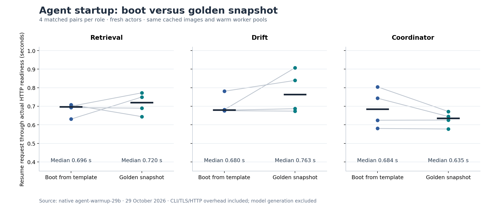

# Agent warm-up: measured results and availability limits

Golden snapshots and two idle workers per role are configured in the retained Substrate deployment. A matched native experiment compared 24 fresh actors across retrieval, drift and coordinator. Every actor reached its actual HTTP agent-card endpoint and was then suspended. **The timing results were mixed: this experiment does not establish a general startup improvement from snapshots.**



[Original measurements](evidence/agent-warmup/measurements.json) · [Native report](evidence/agent-warmup/verification.json) · [Plot source](diagrams/agent_warmup.py) · [SVG](images/agent-startup-pairs.svg)

## What was compared

Each role used its same current template, immutable image, golden snapshot and two-worker pool on the control VM. Every sample created a new actor with no private snapshot. The native `ResumeActor` request used `boot=true` for a boot from the template and `boot=false` for golden-snapshot restoration. Four pairs per role alternated which mode ran first.

The templates declare an HTTP readiness probe for `/.well-known/agent-card.json` on port 80. Native Run/Restore waits for that probe. The benchmark also retrieved the actual card through the assigned worker, checked its role URL/version, and recorded the worker Pod UID and actor UID. The clock runs from the resume request through the completed HTTP card, including CLI/TLS/HTTP and small receipt-writing overhead.

This is an actor-startup comparison on an already-running lab. Both modes retain cached images and warm worker Pods. It excludes image download, initial VM/Pod startup, model loading, LLM generation and TTFT. A Go agent whose HTTP endpoint starts quickly need not benefit from restoring a process snapshot.

| Role | Pairs | Boot median | Golden median | Observed result |
|---|---:|---:|---:|---|
| Retrieval | 4 | 0.696 s | 0.720 s | Golden restoration was slightly slower |
| Drift | 4 | 0.680 s | 0.763 s | Golden restoration was slower |
| Coordinator | 4 | 0.684 s | 0.635 s | Golden restoration was slightly faster |

All individual values are shown in the plot; the black marks are medians. Four pairs are a small sample, and the measured differences do not justify a general speed guarantee. The benchmark retains the unfavorable results. It does not rerun until every role appears faster. GPU offload has a separate [model-inference experiment](gpu-inference.md) and should not be credited to agent warm-up.

Warm capacity also has a cost: worker Pods reserve resources while idle, and snapshots consume retained storage. This experiment measures elapsed startup time, not a reduction in cloud charges. The existing pool configuration remains in place; no VM, disk or public endpoint was added for this test.

## Replicas and HA

Each role has two idle worker slots and can [scale to four](agent-scaling.md) when demand increases. Idle actors suspend and release their slots. More than one worker provides spare process capacity; the recorded scaling experiment establishes elasticity under its workload.

All agent workers share the same physical control VM. The control plane, local snapshot storage and other retained services also depend on that host. A separate GPU worker serves the model, with one GPU and one model backend. Consequently, these replicas do not establish host-level failover or uninterrupted service after a VM/GPU failure. Worker-failure recovery during an active user request was not tested here. A suspended snapshot is also not a guarantee of exactly-once external side effects; the current agents expose read-only data tools and no actuator tool.

## Evidence and limitations

The accepted run `agent-warmup-29b` finished at 16:41:10 UTC on 29 October 2026. Its [exact native archive](evidence/agent-warmup/native-receipts.tar.gz) retains 740 original payloads: every lifecycle request/response/timing, actual HTTP card, worker identity, template and pool readbacks, source packets and process journals. All 24 owned actors were left suspended. Existing sessions, templates, golden snapshots and pool replicas were preserved.

The first pilot stopped after its cold request because its checker expected a hyphenated card name. The actual ADK card uses `iot_retrieval`; its role URL and version were correct. The corrected checker requires the native name, expected role URL and deployed version 0.2.2. The failed original and its successful suspension remain in the archive. It is not included as a matched pair.

The [offline verifier](../scripts/verify-agent-warmup.py) checks every original byte, fresh actor identity, boot flag, readiness result, matching template, balanced order, measurement and cleanup. It explicitly reports that a general startup gain and cross-node HA were not established.

```powershell
python -S scripts/verify-agent-warmup.py
python -m pytest tests/test_agent_warmup.py -q
```

To repeat the experiment on the retained VM, use a new run/output name and a source-sealed copy of [the benchmark](../scripts/benchmark-agent-warmup.py). Require idle existing actors, 30 minutes in the approved session, adequate RAM/SSD and the retained trusted gRPC client/CA. Start with one role and one pair before the full four-pair comparison. The operator uses a ten-minute credential held only in its subprocess environment. Never reset an existing actor's state to obtain a convenient cold sample.

References: [Substrate v0.0.9 resume selection](https://github.com/kagent-dev/substrate/blob/v0.0.9/cmd/ateapi/internal/controlapi/workflow_resume.go), [HTTP readiness contract](https://github.com/kagent-dev/substrate/blob/v0.0.9/pkg/api/v1alpha1/actortemplate_types.go), [golden-snapshot initialization](https://github.com/kagent-dev/substrate/blob/v0.0.9/cmd/atecontroller/internal/controllers/actortemplate_controller.go). These pinned sources explain the API behavior; the linked native artifacts supply the measurements.
