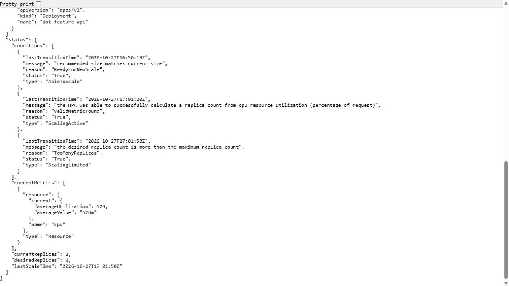
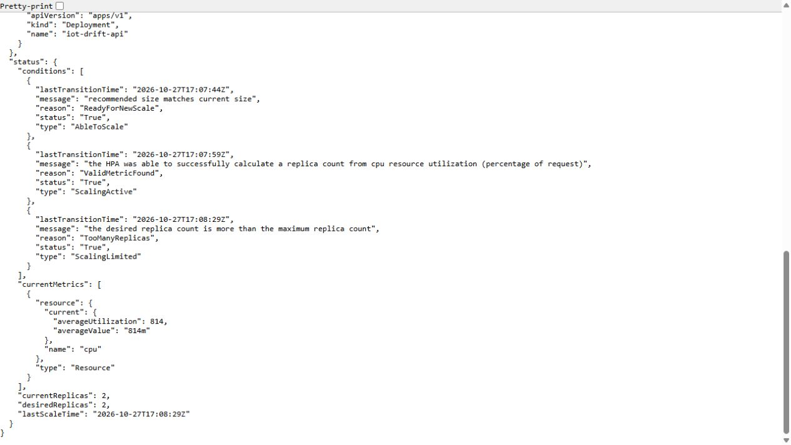

# Native autoscaling of feature and drift APIs

CPU-based Kubernetes HPA was exercised on both APIs with bounded load. The recorded scale sequence is 1→2→1, with Pod/replica and metric readbacks rather than a manifest-only claim.

The tests keep request identity and replay semantics while replicas change, inspect the real workload and restore the recorded HPA bounds after the measurement. Source, image, resource requests/limits and timing are preserved with the UI evidence.

This demonstrates the chosen CPU autoscaling policy on the lab VM. It is not evidence of KEDA request-rate scaling, multi-node resilience or unlimited throughput. Workloads and resource limits must be considered when comparing latency.

## Commands and recorded examples

Run commands from the repository root unless the example explicitly changes the working directory. Use a fresh output/run name and check the linked runbook before starting platform services. Examples belong to the recorded workload on this page.

```bash
python3 scripts/verify-api-autoscale.py --api feature --helm "$HELM" \
  --feature-seed iot-feature-serving-state-helm-v2 \
  --run autoscale-feature-new --output outputs/autoscale-feature-new
python3 scripts/verify-api-autoscale.py --api drift --helm "$HELM" \
  --reference data/drift/reference-27/reference.json \
  --run autoscale-drift-new --output outputs/autoscale-drift-new
```

## Implementation and evidence

- [Source: infra/charts/iot-api/templates/hpa.yaml](../infra/charts/iot-api/templates/hpa.yaml)
- [Recorded artifact: api-autoscale/native/verification.json](evidence/api-autoscale/native/verification.json)
- [Recorded artifact: api-autoscale/native/feature/timeline.json](evidence/api-autoscale/native/feature/timeline.json)
- [Recorded artifact: api-autoscale/native/drift/timeline.json](evidence/api-autoscale/native/drift/timeline.json)
- [Recorded artifact: api-autoscale/screenshots/feature-one-two-one.jpg](evidence/api-autoscale/screenshots/feature-one-two-one.jpg)
- [Recorded artifact: api-autoscale/screenshots/drift-one-two-one.jpg](evidence/api-autoscale/screenshots/drift-one-two-one.jpg)
- [Recorded artifact: api-autoscale/screenshots/capture.json](evidence/api-autoscale/screenshots/capture.json)
- [Recorded artifact: api-autoscale/cache-refresh/verification.json](evidence/api-autoscale/cache-refresh/verification.json)
- [Recorded artifact: api-autoscale/cache-refresh/http.json](evidence/api-autoscale/cache-refresh/http.json)
- [Source: scripts/deploy-api.py](../scripts/deploy-api.py)
- [Recorded artifact: api-autoscale/initial/feature-console.txt](evidence/api-autoscale/initial/feature-console.txt)
- [Recorded artifact: api-autoscale/native/verify-api-autoscale-before-null-metrics.py.txt](evidence/api-autoscale/native/verify-api-autoscale-before-null-metrics.py.txt)
- [Recorded artifact: api-autoscale/capture/manifest.json](evidence/api-autoscale/capture/manifest.json)
- [Recorded artifact: api-autoscale/capture/evidence-map.json](evidence/api-autoscale/capture/evidence-map.json)
- [kubernetes.io / horizontal-pod-autoscale](https://kubernetes.io/docs/tasks/run-application/horizontal-pod-autoscale/)

## Recorded interface views

These are original captures from the runs described above. Their timestamps, model identities and visible states belong to those runs.






## Related documentation

[Current architecture](architecture.md) · [Demo and recovery](demo-walkthrough.md) · [Rubric index](rubric-tracker.md)

[Original run notes](https://github.com/anle0429/iot-maintenance-platform/blob/f4da7bd21667a8bfca5715a7456bc2bcc813b0fc/docs/api-autoscaling.md) retain the full historical narrative. Raw evidence files have not been translated or rewritten.
