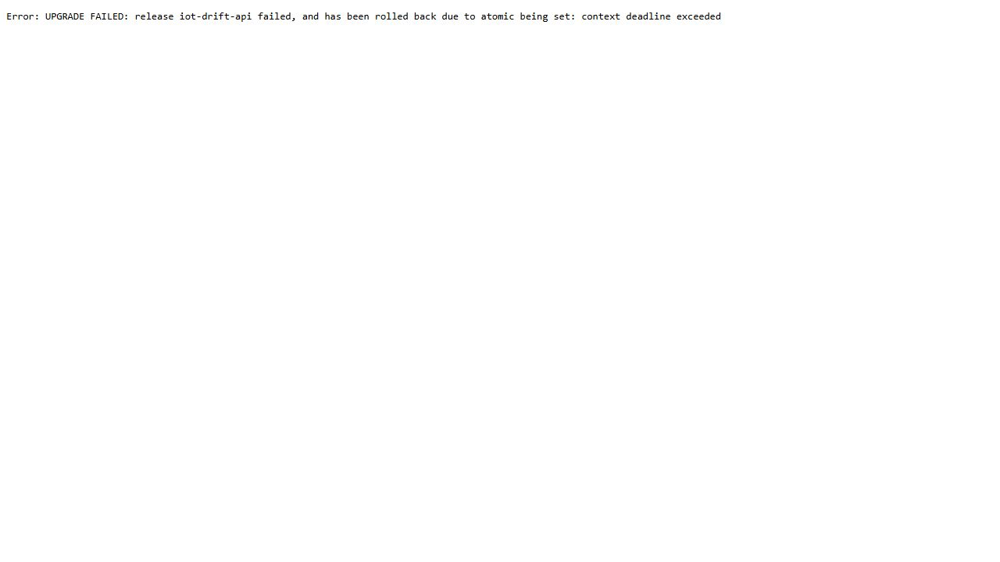
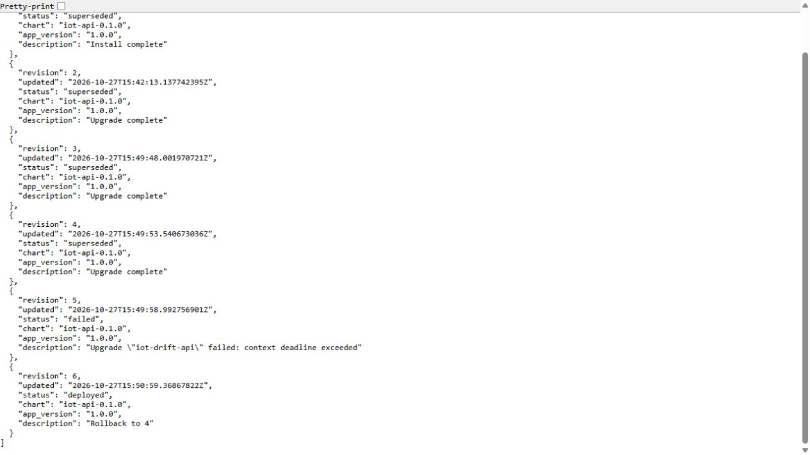
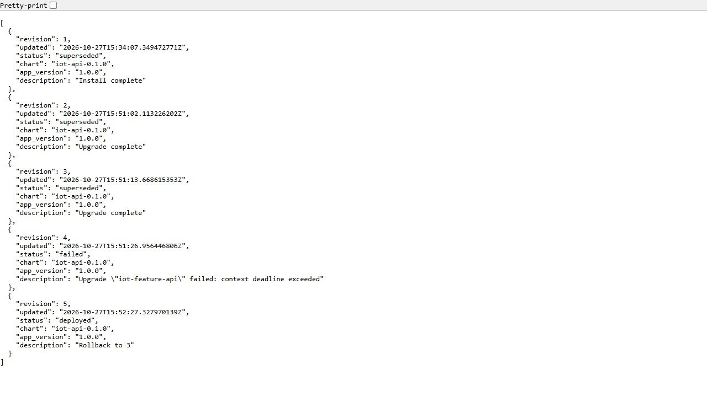

# Helm rolling updates and automatic fallback

The feature and drift APIs are deployed through Helm. Readiness/liveness probes and a rolling strategy control when a new Pod can receive traffic. Atomic upgrades wait for health and restore the previous release when the new one cannot become ready.

Native tests cover successful rollout and deliberately unsuccessful releases on both APIs. Readbacks compare release/Pod identities, endpoint behavior and the restored version; the screenshots show actual rollout history.

The deployment checks concern service availability and recovery under the tested failure. They do not replace schema, prediction-correctness or load gates, and they do not establish multi-host HA. The shared chart is under `infra/charts/iot-api`.

## Commands and recorded examples

Run commands from the repository root unless the example explicitly changes the working directory. Use a fresh output/run name and check the linked runbook before starting platform services. Examples belong to the recorded workload on this page.

```bash
python scripts/deploy-api.py --api drift --helm "$HELM" \
  --revision demo-drift --output outputs/helm-new-drift
python scripts/deploy-api.py --api feature --helm "$HELM" \
  --revision demo-feature --output outputs/helm-new-feature
```

```bash
python scripts/verify-api-rollout.py --api drift --helm "$HELM" \
  --reference data/drift/reference-27/reference.json \
  --run rollback-new-drift --output outputs/rollback-new-drift
```

## Implementation and evidence

- [Source: infra/charts/iot-api/Chart.yaml](../infra/charts/iot-api/Chart.yaml)
- [Source: infra/feature-api/helm-values.yaml](../infra/feature-api/helm-values.yaml)
- [Source: infra/drift-api/helm-values.yaml](../infra/drift-api/helm-values.yaml)
- [Source: scripts/deploy-api.py](../scripts/deploy-api.py)
- [docs.helm.sh / helm_upgrade](https://docs.helm.sh/docs/v3/helm/helm_upgrade/)
- [Source: infra/drift-api/storage.yaml](../infra/drift-api/storage.yaml)
- [Recorded artifact: drift-api/rollout/verification.json](evidence/drift-api/rollout/verification.json)
- [Recorded artifact: drift-api/rollout-initial/drift/rolling-observations.json](evidence/drift-api/rollout-initial/drift/rolling-observations.json)
- [Recorded artifact: drift-api/rollout/deployment-before-drain.yaml.txt](evidence/drift-api/rollout/deployment-before-drain.yaml.txt)
- [Recorded artifact: drift-api/rollout/repair.json](evidence/drift-api/rollout/repair.json)
- [Recorded artifact: drift-api/rollout/drift/bad-image/helm-console.txt](evidence/drift-api/rollout/drift/bad-image/helm-console.txt)
- [Recorded artifact: drift-api/rollout/drift/bad-image-history.json](evidence/drift-api/rollout/drift/bad-image-history.json)
- [Recorded artifact: drift-api/rollout/feature/bad-image-history.json](evidence/drift-api/rollout/feature/bad-image-history.json)
- [Recorded artifact: drift-api/capture/manifest.json](evidence/drift-api/capture/manifest.json)
- [Recorded artifact: drift-api/capture/evidence-map.json](evidence/drift-api/capture/evidence-map.json)
- [Recorded artifact: drift-api/helm-initial/reference-configmap.txt](evidence/drift-api/helm-initial/reference-configmap.txt)
- [Recorded artifact: drift-api/helm/repair.json](evidence/drift-api/helm/repair.json)
- [Source: scripts/verify-api-rollout.py](../scripts/verify-api-rollout.py)

## Recorded interface views

These are original captures from the runs described above. Their timestamps, model identities and visible states belong to those runs.








## Related documentation

[Current architecture](architecture.md) · [Demo and recovery](operations.md) · [Rubric index](rubric-tracker.md)

[Original run notes](https://github.com/anle0429/iot-maintenance-platform/blob/a395c4ea47b8f8e235556ab93de3d699ed9df18b/docs/api-deployment.md) retain the full historical narrative. Raw evidence files have not been translated or rewritten.
