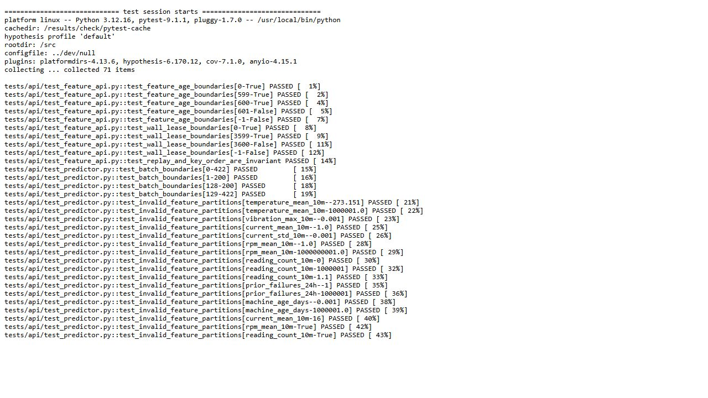
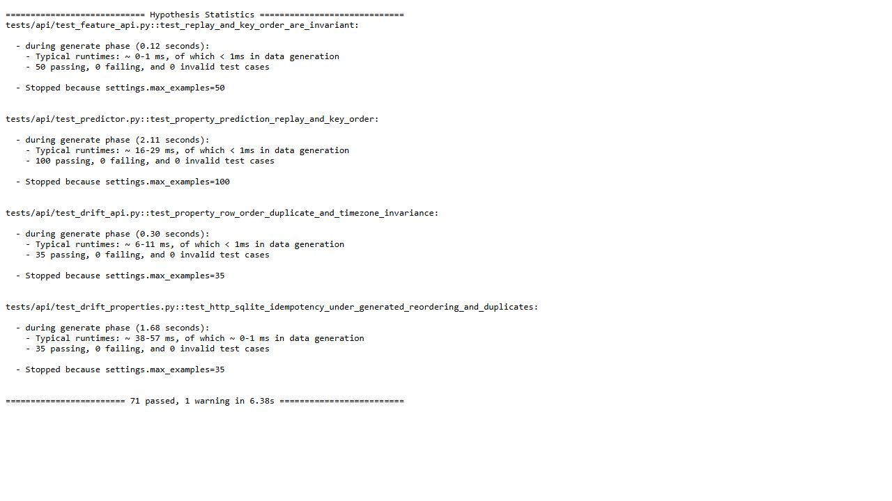

# Kiểm thử biên, phân hoạch và tính bất biến của API

Lượt Linux ngày 28/10/2026, source `ff832374349e0825b6f6bbf3f36fd67031533491`, chạy **71 ca pytest và 220 ví dụ Hypothesis đạt**, seed `20261028`. JUnit, console đầy đủ, source trước/sau và giới hạn container được giữ trong [capsule](evidence/api-validation-linux/manifest.json). Kiểm độc lập: `python scripts/verify-focused-api.py`.

## Chọn ca kiểm thử như thế nào?

| Quy tắc | Biên / phân hoạch đã kiểm | Lý do |
|---|---|---|
| Tuổi feature | -1, 0, 599, 600, 601 giây | Tương lai bị chặn; đúng 600 còn dùng được, quá biên bị chặn |
| Lease demo theo đồng hồ thật | -1, 0, 3599, 3600 giây | Lease hết ngay tại 3600; khác tuổi feature theo event time |
| Kích thước batch prediction | 0, 1, 128, 129 | Tách rỗng / hợp lệ / vượt giới hạn; HTTP 422 hoặc 200 đúng contract |
| Dữ liệu đầu vào | Số hợp lệ, âm ngoài miền, vượt trần, sai kiểu, bool thay số, schema/key lỗi | Các nhóm phải cùng bị từ chối vì cùng vi phạm contract |
| Drift reference và window | 31, 32, 2048, 2049 hàng; histogram biết đáp án | Kiểm cả hai đầu miền và giá trị PSI tính tay |

[Profile](../tests/api/focused-validation.json) chọn đúng 14 nhóm từ các test thực. BVA chọn sát ranh giới vì lỗi thường xảy ra ở dấu `<`/`<=`; equivalence partitioning chia dữ liệu thành các nhóm có cùng hành vi kỳ vọng. Không chỉ chọn vài giá trị ngẫu nhiên.

## Property-based và idempotency

Hypothesis sinh 50 ví dụ thứ tự key/replay feature, 100 ví dụ prediction, 35 ví dụ canonical drift và 35 ví dụ HTTP/SQLite. Nhóm cuối gửi request thật qua FastAPI TestClient với thứ tự hàng khác nhau, duplicate và timezone tương đương; kết quả HTTP phải bằng nhau, chỉ một window được lưu. Mở lại runtime với cùng SQLite vẫn đọc đúng kết quả và một bản ghi. Đây là tính chất nghiệp vụ, không so sánh một hàm với chính nó.

Hai ảnh là ảnh trình duyệt của **trích đoạn nguyên byte từ console native đã lưu**, phục vụ xem lại bằng chứng; không phải ảnh terminal đang chạy. Verifier kiểm trích đoạn nằm trong console đầy đủ, JUnit không lỗi/bỏ qua, tổng ví dụ được cộng độc lập và 31 Git input khớp source trước/sau.

Container Python 3.12.16 giới hạn 2 CPU/1 GiB, không mạng, filesystem chỉ đọc, user 10001; exit 0, không OOM; một lượt Docker wall 9,004 giây. Fixture predictor dùng model 1 để giữ oracle lịch sử; production hiện tại model 6. Đây không phải request mới tới deployment, không thay thế các bằng chứng coverage, mutation, load và integration riêng.

Tự chạy tập nhỏ trong môi trường đã có dependencies: `python scripts/run-focused-api-validation.py --output outputs/my-focused-check` (chọn thư mục mới). Đọc `result/check` trong capsule để đối chiếu; đường dẫn output khi tự chạy là thư mục vừa chọn.
