# Kiến trúc và trạng thái triển khai

Ngày 22/10/2026: generator, [PostgreSQL/Spark → feature → baseline dự đoán](day2-batch.md) và [Kafka/Flink → cửa sổ/late output/snapshot SQLite](day3-streaming.md) đã chạy ở quy mô nhỏ. Chưa có Feast, model serving hoặc agent. Sơ đồ sau là **đích triển khai theo đề**, không phải bằng chứng toàn platform đã deploy. Mỗi hộp là một service/job có thể chạy độc lập; số trên mũi tên chỉ luồng dữ liệu/call.

```mermaid
flowchart LR
    Generator[Python generator job] -->|1. Metadata / telemetry| Source[Source PostgreSQL + object storage]
    Generator -->|2. Delivery by arrival time| Kafka[Kafka]
    Source -->|3. Ingest DP1| Airflow[Airflow scheduler / workers]
    Airflow -->|4. Submit DP1-DP3| Spark[Spark batch jobs]
    Spark -->|5. Bronze / Silver / Gold| Lake[Lakehouse object storage + catalog]
    Spark -->|6. Dim / fact| Warehouse[SQL warehouse]
    Kafka -->|7. Telemetry| Flink[Flink stream jobs]
    Flink -->|8. Realtime features| Online[Feast online Redis store]
    Flink -->|9. Offline feature history| Lake
    Airflow -->|10. Incremental materialization job| Online
    Airflow -->|11. Lineage / assertions| DataHub[DataHub]
    Lake -->|12. Offline data via Feast| KFP[Kubeflow training jobs]
    KFP -->|13. Model / data versions| MLflow[MLflow server + registry]
    MLflow -->|14. Model artifact to image build job| Build[Model image build job]
    Build -->|15. Model image| KServe[KServe predictor]
    Online -->|16. Features / chunks| MCP[MCP data and risk tool servers]
    KServe -->|17. Prediction response| MCP
    Docs[Python RAG ingestion job] -->|18. Chunks / vectors via Feast| Lake
    Docs -->|19. Chunks / vectors via Feast| Online
    User[Chat UI service] -->|20. User question| Gateway[Agentgateway MCP / A2A]
    Gateway -->|21. Dispatch| Coordinator[Coordinator agent deployment]
    Coordinator -->|22. Delegate via gateway| Gateway
    Gateway -->|23. Agent calls| Agents[Data / maintenance agent deployments]
    Agents -->|24. Tool / model requests| Gateway
    Gateway -->|25. Tool calls| MCP
    Gateway -->|26. Generation request| LLM[LLM inference server]
```

Feast SDK xuất hiện trong jobs/services như thư viện, không được vẽ thành một server giả. Diagram chưa biểu diễn hết ingress, registry, sandbox, observability, warm-up và CI/CD; bổ sung cùng bằng chứng khi triển khai. Airflow/KFP/Spark/Flink có thể cần nhiều container/pod, sơ đồ hiện tóm tắt theo nhóm service/job. Sự hiện diện của hộp không chứng minh các tiêu chí rubric đã làm.

Luồng **đã chạy** ở ngày 1: generator Python ghi nguồn riêng → validator Python đọc nguồn → JSON report và log bằng chứng.

Ngày 2 đã kiểm chứng run `day2-final`: PostgreSQL department source → JDBC → Spark → Parquet zones/feature/label → MLlib logistic regression → model và 2.060 test predictions. 44 unit test và 19 kiểm tra Spark/data qua; Silver 57.600 unique, dim_machine 21 phiên bản/20 current, feature 11.520 snapshots. Test chưa có positive nên chưa đánh giá được khả năng phát hiện hỏng. Thư mục output chưa có `_RUN_SUCCESS.json` không được coi là run hoàn tất. Compose chỉ gồm source riêng và batch chạy theo yêu cầu; source được dừng sau run, volume giữ nguyên.

Ngày 3 đã kiểm chứng `day3-complete`: producer Python/Kafka CLI → Kafka 3.9.1 → PyFlink 1.20.3 MiniCluster → event-time window 10 phút và audit/late side output → SQLite Linux volume → snapshot cho host. Phát hai lượt nguồn (116.928 messages), giữ 57.600 unique, loại 59.328 duplicates; cả 5.760 cửa sổ khớp oracle độc lập. 55 unittest/10 kiểm tra tích hợp qua. Có fixture late trong/ngoài watermark, replay sau cache expiry và ảnh UI thật. Streaming Compose tách khỏi batch và Kafka tự dừng sau run; đây chưa phải luồng Flink → Feast/lakehouse trong sơ đồ đích, chưa có crash recovery hoặc exactly-once sink.

Mốc generator chunked đã chạy riêng: iterator vật lý liên tục → exact transport selection/arrival heap → JSONL parts + catalog → validator tuần tự → quality/capacity plan. Nguồn lớn nhất đã kiểm149.023.279byte offline; chưa Parquet hoặc ingest nguồn này vào Spark/Feast. [Cách chạy và phạm vi](chunked-generator.md).
