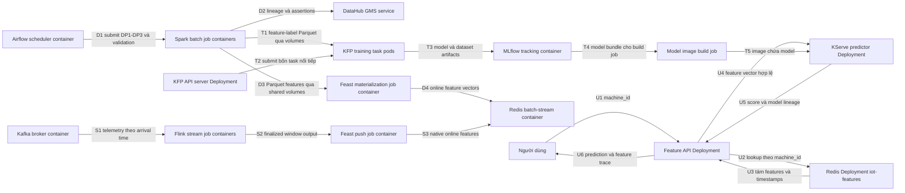

# Kiến trúc và trạng thái triển khai

## Cập nhật28/10/2026

[Sơ đồ tổng thể trong README](../README.md#sơ-đồ-triển-khai-hiện-có) phản ánh mốc hiện tại; các sơ đồ theo ngày bên dưới giữ làm lịch sử. Core vẫn là một VM8CPU/64GiB, k3s và các Compose/systemd services; chưa nhận là cluster nhiều máy hoặc đã đủ mọi yêu cầu final.

| Luồng | Đơn vị thực thi và dữ liệu | Bằng chứng/phạm vi |
|---|---|---|
| Offline DE | Generator job → Spark containers → Parquet HDD; Airflow điều phối validation, SDK job gửi DataHub | [Full102,45GB](full-scale-ingest.md) Bronze/Silver; [DP1–DP3](orchestration.md) pilot riêng, không nhận feature100GB |
| Serving U | Feature API Deployment → Redis API Deployment → KServe predictor Deployment | [Serving CI8](ci-serving.md), active model6/lab production tag;200máy195prediction+5stopped409; Redis batch/stream tách riêng |
| Training T | KFP API → năm task pods → hai Spark executor pods; load qua Feast SDK, đăng ký dữ liệu/model ở MLflow | [Distributed training](distributed-training.md), [CI training](ci-training.md) build2 SUCCESS/model6candidate; cùng một VM, giữ protocol/split đã seal |
| Serving CI C | Jenkins pull bundle production-tag6 → test/build/stage → A/B router Deployment → model1/6 → Helm cutover | [CI8 SUCCESS](ci-serving.md),780trial/40replay; UID/PV/PVC/SQLite trênHDD đối chiếu thật; controlled rollback6→1→6 PASS |
| Retrain R | Airflow sau monitoring → controller container → private KFP API → năm task → model/data MLflow | [Native F51](drift-retraining.md):manual probe giữ drift=false,5task SUCCEEDED/model7candidate; no-drift/replay/cooldown chặn training trùng. RecipeCE cố định, chưa học từ cửa sổ drift chưa nhãn hoặc tự promote |
| Metrics M | node_exporter/Pushgateway/A-B router → Prometheus → Grafana | [Host VM](host-monitoring.md), [scheduled offline drift](offline-drift-monitoring.md), [A/B native6panel/26giá trị mỗi engine](ab-monitoring.md); reference train cố định, không accuracy |
| Logs L | Năm file quan sát từ host/API → Alloy → Loki → Grafana | [Log proof](log-monitoring.md), timestamp/message/label exact, chưa auto-discovery Pod hoặc traces |

Feast SDK, Parquet/SQLite và volume là thư viện/trạng thái trong các đơn vị thực thi, không vẽ thành service có HTTP endpoint giả. DataHub còn MySQL/OpenSearch và MLflow có backend/artifact volumes; [Compose](../infra/orchestration.compose.yaml)/[DataHub](../infra/datahub.compose.yaml)/[MLflow](../infra/mlflow.compose.yaml) là cấu hình chi tiết. Kubernetes API/Redis/KFP/MLflow nội bộ và UI loopback qua IAP; chưa suy ra đã có Vault/service mesh/public gateway từ các kết nối này.

## Luồng đã chạy trên VM ngày27/10/2026

Mỗi hộp dưới đây là service/container/job có thể triển khai độc lập. Feast SDK nằm trong materialization/training/API, không được vẽ thành một service riêng. Các file Parquet/workspace ở volume HDD/SSD của cùng VM; Git chỉ chuyển code/config/bằng chứng nhỏ.

U là luồng người dùng; D/T/S là các luồng dữ liệu/training/stream. [KFP](kfp-cluster.md), [KServe](kubernetes-serving.md), [feature API](feature-api.md), [Airflow/DataHub](orchestration.md) và [stream push](stream-feast-push.md) có phạm vi kiểm chứng riêng. Redis API demo tách khỏi batch/stream Redis. Modelversion2 đã vào registry; predictor hiện pin version1. Bốn training task nối tiếp vẫn dùng Spark local[2], chưa distributed training.

[Final tracker](final-rubric-tracker.md) là chuẩn chính. Drift API, notebook, distributed training, incremental data versioning và các phần CI/gateway/observability/security chưa đủ bằng chứng; không diễn giải sơ đồ này thành hoàn tất toàn final.

## Thiết kế lịch sử ngày22/10

Ngày 22/10/2026: generator, [PostgreSQL/Spark → feature → baseline dự đoán](day2-batch.md) và [Kafka/Flink → cửa sổ/late output/snapshot SQLite](day3-streaming.md) đã chạy ở quy mô nhỏ. Chưa có Feast, model serving hoặc agent. Sơ đồ sau là **đích triển khai theo đề**, không phải bằng chứng toàn platform đã deploy. Mỗi hộp là một service/job có thể chạy độc lập; số trên mũi tên chỉ luồng dữ liệu/call.

```mermaid
flowchart LR
    Generator[Python generator job] -->|1. Metadata / telemetry| Source[Source PostgreSQL + object storage]
    Generator -->|2. Delivery by arrival time| Kafka[Kafka]
    Source -->|3. Ingest DP1| Airflow[Airflow scheduler / workers]
    Airflow -->|4. Submit DP1-DP3| Spark[Spark batch jobs]
    Spark -->|5. Bronze / Silver / Gold| Lake[Lakehouse object storage + catalog]
    Spark -->|6. Dim / fact| Warehouse[SQL warehouse]
    Kafka -->|7. Telemetry| Flink[Flink stream jobs]
    Flink -->|8. Realtime features| Online[Feast online Redis store]
    Flink -->|9. Offline feature history| Lake
    Airflow -->|10. Incremental materialization job| Online
    Airflow -->|11. Lineage / assertions| DataHub[DataHub]
    Lake -->|12. Offline data via Feast| KFP[Kubeflow training jobs]
    KFP -->|13. Model / data versions| MLflow[MLflow server + registry]
    MLflow -->|14. Model artifact to image build job| Build[Model image build job]
    Build -->|15. Model image| KServe[KServe predictor]
    Online -->|16. Features / chunks| MCP[MCP data and risk tool servers]
    KServe -->|17. Prediction response| MCP
    Docs[Python RAG ingestion job] -->|18. Chunks / vectors via Feast| Lake
    Docs -->|19. Chunks / vectors via Feast| Online
    User[Chat UI service] -->|20. User question| Gateway[Agentgateway MCP / A2A]
    Gateway -->|21. Dispatch| Coordinator[Coordinator agent deployment]
    Coordinator -->|22. Delegate via gateway| Gateway
    Gateway -->|23. Agent calls| Agents[Data / maintenance agent deployments]
    Agents -->|24. Tool / model requests| Gateway
    Gateway -->|25. Tool calls| MCP
    Gateway -->|26. Generation request| LLM[LLM inference server]
```

Feast SDK xuất hiện trong jobs/services như thư viện, không được vẽ thành một server giả. Diagram chưa biểu diễn hết ingress, registry, sandbox, observability, warm-up và CI/CD; bổ sung cùng bằng chứng khi triển khai. Airflow/KFP/Spark/Flink có thể cần nhiều container/pod, sơ đồ hiện tóm tắt theo nhóm service/job. Sự hiện diện của hộp không chứng minh các tiêu chí rubric đã làm.

Luồng **đã chạy** ở ngày 1: generator Python ghi nguồn riêng → validator Python đọc nguồn → JSON report và log bằng chứng.

Ngày 2 đã kiểm chứng run `day2-final`: PostgreSQL department source → JDBC → Spark → Parquet zones/feature/label → MLlib logistic regression → model và 2.060 test predictions. 44 unit test và 19 kiểm tra Spark/data qua; Silver 57.600 unique, dim_machine 21 phiên bản/20 current, feature 11.520 snapshots. Test chưa có positive nên chưa đánh giá được khả năng phát hiện hỏng. Thư mục output chưa có `_RUN_SUCCESS.json` không được coi là run hoàn tất. Compose chỉ gồm source riêng và batch chạy theo yêu cầu; source được dừng sau run, volume giữ nguyên.

Ngày 3 đã kiểm chứng `day3-complete`: producer Python/Kafka CLI → Kafka 3.9.1 → PyFlink 1.20.3 MiniCluster → event-time window 10 phút và audit/late side output → SQLite Linux volume → snapshot cho host. Phát hai lượt nguồn (116.928 messages), giữ 57.600 unique, loại 59.328 duplicates; cả 5.760 cửa sổ khớp oracle độc lập. 55 unittest/10 kiểm tra tích hợp qua. Có fixture late trong/ngoài watermark, replay sau cache expiry và ảnh UI thật. Streaming Compose tách khỏi batch và Kafka tự dừng sau run; đây chưa phải luồng Flink → Feast/lakehouse trong sơ đồ đích, chưa có crash recovery hoặc exactly-once sink.

Generator chunked: iterator vật lý liên tục → exact transport selection/arrival heap → JSONL parts + catalog → validator tuần tự → quality/capacity plan. Mốc26/10 chạy **receipt/catalog adapter → Spark typed JSONL → Snappy Parquet Bronze → dedup Silver → exact readback/metrics/query** trên1.117.608.156byte offline. 84tests/13Sparkchecks tại benchmark, có History UI từ event log gốc. Mốc tiếp theo đã nối một pilot chunked nhỏ qua Gold/feature và Airflow như mô tả dưới; chưa Feast. Parquet là thư mục thông thường, chưa transaction log. [Generator](chunked-generator.md), [ingest và bằng chứng](chunk-ingest.md).

Cloud26/10: người dùng chọn8vCPU/64GiB, Terraform apply14resources và plan sau apply không drift. Ansible4roles chuẩn bị HDD500GiB/SSD150GiB/Docker và pilot; chạy lại changed0/failed0. Cùng nguồn1,12GB/image/code: baseline local[2]/heap1GiB/HDDscratch223,942s, optimized local[6]/heap20GiB/SSDscratch100,892s, cả hai13checks/84unit và3.456.000unique. Chưa100GB/Kubernetes/serving. [Chuẩn bị/chi phí](gcp-vm.md), [runtime](gcp-runtime.md).

Tiếp trên chính VM: **Airflow3.1.7 API/scheduler/dag-processor + PostgreSQL16.11 → Docker Spark3.5.9 theo pool một slot → DP1 Bronze → DP2 Silver/Gold → DP3 feature/label**, mỗi stage có ingest/validate/publish, chỉ trigger tiếp khi validation và metadata thành công. DataHub1.6.0.3 GMS/frontend dùng Kafka8.0.0 metadata, OpenSearch2.19.3 và MySQL8.0.44 riêng; SDK1.6.0 gửi schema, producing jobs, table lineage và external assertions. Hai batch sạch qua64rules/14outputtables, một lỗi nullmachine ở batch riêng bị chặn DP2/DP3;91unit trênPC/VM,11known-answerSparkfixtures. UI/GMS chỉ loopback/IAP; các DB/broker/search không publish port. [Luồng, lệnh chạy, ảnh thật và giới hạn](orchestration.md). Đây là Parquet Gold, chưa SQL warehouse/indexing hoặc online feature store trong sơ đồ đích.

**Tiếp nối mốc nguồn100 GB (26–27/10/2026):** [Nguồn liên tục trên VM](scale-100gb.md) đã sinh và đọc kiểm toàn bộ **102.447.847.856 byte offline**, 316.800.000 unique readings,14 quality rules; Spark trung gian5,59 GB/13 checks và99 unit qua. Kết quả100 GB thuộc nguồn JSONL không nén, chưa là Spark/Gold/feature/ML hoặc Airflow toàn100 GB. Ngân sách mới tách HDD400 GB/SSD35 GB; trước Spark lớn cần kiểm lại và đặt scratch trên HDD. Các kết quả nhỏ phía trên giữ nguyên scope/thời điểm lịch sử.
