# Kiến trúc và trạng thái triển khai

Ngày 22/10/2026: chỉ generator CLI và validator Python cục bộ đã chạy. Nguồn là JSONL trên máy; chưa có container, Bronze/Silver/Gold, model hay agent chạy. Sơ đồ sau là **đích triển khai theo đề**, không phải bằng chứng deployment. Mỗi hộp là một service/job có thể chạy độc lập; số trên mũi tên chỉ luồng dữ liệu/call.

```mermaid
flowchart LR
    Generator[Python generator job] -->|1. Metadata / telemetry| Source[Source PostgreSQL + object storage]
    Generator -->|2. Delivery by arrival time| Kafka[Kafka]
    Source -->|3. Ingest DP1| Airflow[Airflow scheduler / workers]
    Airflow -->|4. Submit DP1-DP3| Spark[Spark batch jobs]
    Spark -->|5. Bronze / Silver / Gold| Lake[Lakehouse object storage + catalog]
    Spark -->|6. Dim / fact| Warehouse[SQL warehouse]
    Kafka -->|7. Telemetry| Flink[Flink stream jobs]
    Flink -->|8. Realtime features| Online[Feast online Redis store]
    Flink -->|9. Offline feature history| Lake
    Airflow -->|10. Incremental materialization job| Online
    Airflow -->|11. Lineage / assertions| DataHub[DataHub]
    Lake -->|12. Offline data via Feast| KFP[Kubeflow training jobs]
    KFP -->|13. Model / data versions| MLflow[MLflow server + registry]
    MLflow -->|14. Model artifact to image build job| Build[Model image build job]
    Build -->|15. Model image| KServe[KServe predictor]
    Online -->|16. Features / chunks| MCP[MCP data and risk tool servers]
    KServe -->|17. Prediction response| MCP
    Docs[Python RAG ingestion job] -->|18. Chunks / vectors via Feast| Lake
    Docs -->|19. Chunks / vectors via Feast| Online
    User[Chat UI service] -->|20. User question| Gateway[Agentgateway MCP / A2A]
    Gateway -->|21. Dispatch| Coordinator[Coordinator agent deployment]
    Coordinator -->|22. Delegate via gateway| Gateway
    Gateway -->|23. Agent calls| Agents[Data / maintenance agent deployments]
    Agents -->|24. Tool / model requests| Gateway
    Gateway -->|25. Tool calls| MCP
    Gateway -->|26. Generation request| LLM[LLM inference server]
```

Feast SDK xuất hiện trong jobs/services như thư viện, không được vẽ thành một server giả. Diagram chưa biểu diễn hết ingress, registry, sandbox, observability, warm-up và CI/CD; bổ sung cùng bằng chứng khi triển khai. Airflow/KFP/Spark/Flink có thể cần nhiều container/pod, sơ đồ hiện tóm tắt theo nhóm service/job. Sự hiện diện của hộp không chứng minh các tiêu chí rubric đã làm.

Luồng **đã chạy** ở ngày 1: generator Python ghi nguồn riêng → validator Python đọc nguồn → JSON report và log bằng chứng. Chưa có ingest vào Bronze hay producer Kafka.
