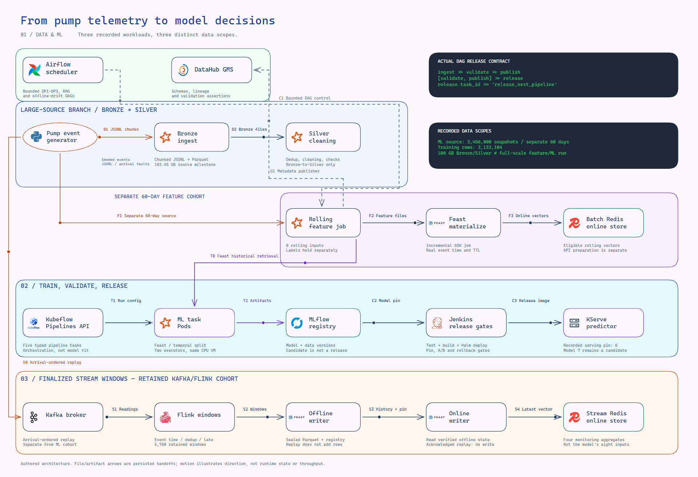
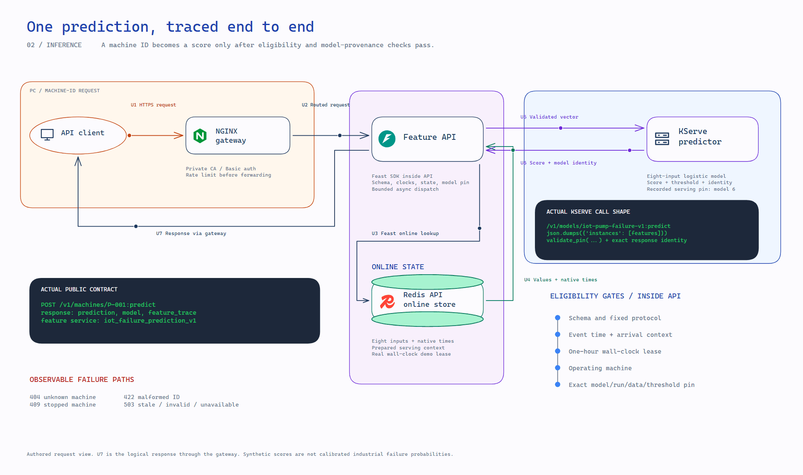
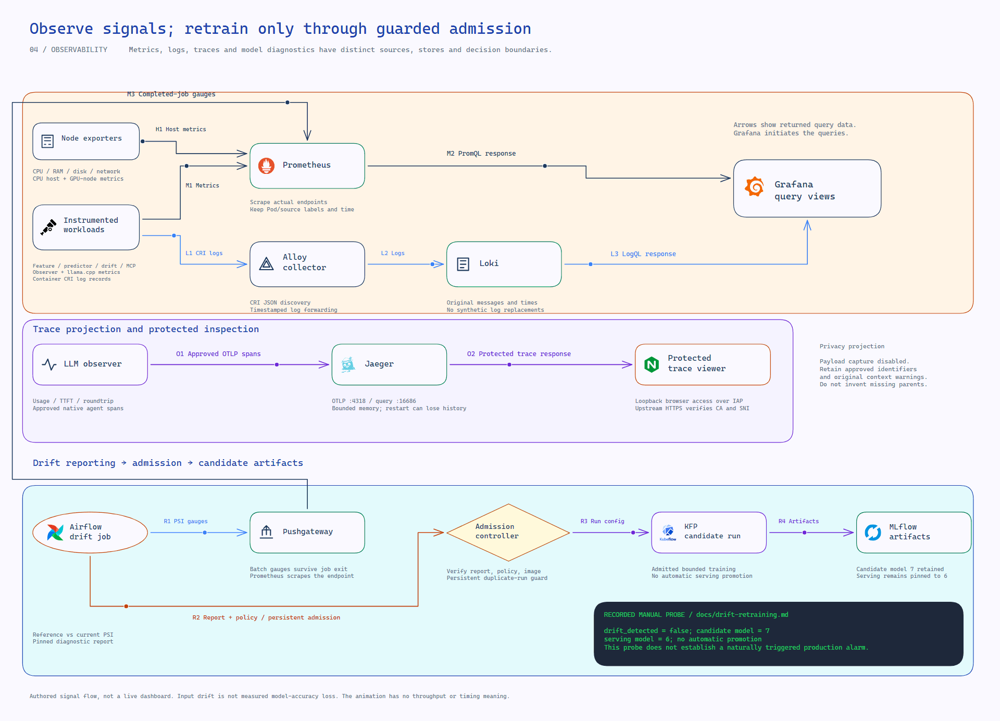
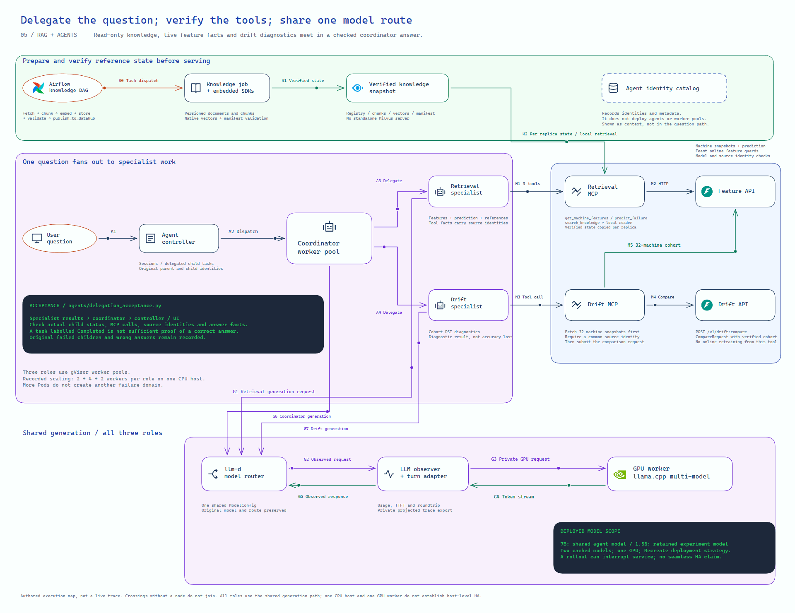

# Architecture

This document describes the IoT lab implemented in this repository: the prediction request, the data and training jobs behind it, and the controls around deployment. The [README](../README.md#architecture) provides the platform overview; the [demo guide](operations.md) provides the operating commands.

The selected coursework scope includes both final ML and final LLM/agents. This page describes recorded Data/ML behavior and the recorded [LLM workstream](llm-platform.md): inference, RAG and MCP have native evidence, and the [GPU checkpoint](gpu-agent-routing.md) verifies specialist answers and real coordinator delegation. The [requirement map](final-audit-matrix.md) and [post-restart rehearsal](agent-runtime-validation.md) connect those components to their own source-bound evidence.

## Scope and runtime

The control and data lab runs on an 8-vCPU/64-GiB Google Cloud VM. A separate private 4-vCPU/15-GiB worker with one 16-GiB V100 serves the agent model. The CPU VM hosts the K3s server and the GPU VM joins the same cluster as a worker. Docker containers and host services provide the remaining components. Shared data and scratch volumes hold datasets, model artifacts and service state. Administration uses loopback ports and IAP.

Three workloads have different boundaries:

| Workload | Recorded scope | Evidence |
|---|---|---|
| Large-source processing | 102,447,847,856 bytes of uncompressed JSONL through Spark Bronze/Silver | [Full-scale ingest](full-scale-ingest.md) |
| Feature engineering and ML | A separate 60-day dataset, 3,456,000 snapshots and 3,132,184 training rows | [Feature dataset](medium-feature-dataset.md), [training protocol](ml-evaluation-protocol.md) |
| Streaming store checks | Retained Kafka/Flink output: 5,760 finalized windows across 20 machines; separate small CI/Airflow fixtures | [Window cohort](window-cohort.md), [stream CI](ci-stream-push.md) |

The 100 GB result does not cover feature engineering or model training at that scale. Diagrams summarize recorded workflows; they do not assert that all jobs run concurrently or that endpoints are currently ready.

The [system map](images/platform-system.svg) ([Excalidraw source](diagrams/platform-system.excalidraw)) brings the data, ML, serving, agent and operating layers together. It groups logical jobs and responsibilities; the [deployment view](images/platform-deployment.svg) separates actual workload resources. See the [diagram guide](diagrams/README.md) for all ten views and the animated presentation.

<picture>
  <source media="(prefers-reduced-motion: reduce)" srcset="images/platform-overview.png">
  
</picture>

[Excalidraw source](diagrams/platform-overview.excalidraw) · [SVG](images/platform-overview.svg) · [Animated viewer](diagrams/architecture.html) · [All ten views and handoff legend](diagrams/README.md)

## Inference request

The API accepts a machine ID, retrieves its features through Feast, checks whether they can support the prediction, and calls the pinned KServe model. Failed or maintenance-state machines can still have monitoring features, but the one-hour failure target is undefined for them.

<picture>
  <source media="(prefers-reduced-motion: reduce)" srcset="images/platform-serving.png">
  
</picture>

[Excalidraw source](diagrams/platform-serving.excalidraw) · [SVG](images/platform-serving.svg) · U1–U7 follow the incoming request, feature lookup, model call and logical return through the gateway.

Feast SDK runs inside the API process. The [runtime](../services/feature_api/runtime.py) validates the schema, event time, arrival context, protocol and one-hour demo lease. Before returning a prediction, it also checks the model version, run, data version and threshold against the selected pin.

### Follow the request in code

| Step | Entry point | What to inspect |
|---|---|---|
| HTTP routing | [feature API app](../services/feature_api/app.py) | Machine-ID validation, readiness, async dispatch and HTTP error mapping |
| Feature eligibility | [FeatureRuntime](../services/feature_api/runtime.py) | `features()` checks both clocks and native feature timestamps; `predict()` checks operating state |
| Store and model calls | [FeastKServeBackend](../services/feature_api/runtime.py) | Read the sealed serving state, use Feast online retrieval and call the fixed KServe endpoint |
| Model identity | [binding](../services/predictor/binding.py) | Validate the model pin and required lineage fields |
| Numeric inference | [PumpPredictor](../services/predictor/runtime.py) | Validate the portable model, compute a score and apply the recorded threshold |
| Independent HTTP check | [demo CLI](../scripts/demo-feature-api.py) | Recompute the score, compare repeated responses and check rejected requests |

With a valid runtime and an unexpired lease, the demonstration covers:

| Request | Expected result | Reason |
|---|---|---|
| `GET /health/live` | 200 | The process is running |
| `GET /health/ready` | 200 | A real online lookup passes the eligibility checks |
| `POST /v1/machines/P-001:predict` | 200 | An operating machine has eligible features |
| `POST /v1/machines/P-006:predict` | 409 | The machine is stopped |
| `GET /v1/machines/P-9999/features` | 404 | The ID is valid but absent |
| `GET /v1/machines/invalid/features` | 422 | The ID does not match the API contract |
| Feature lookup with an expired lease or invalid upstream data | 503 | Inference cannot safely proceed |

The response retains feature timestamps, source/protocol hashes and model provenance. The risk score is not a calibrated real-world failure probability. See [API validation](api-validation.md), [serving CI](ci-serving.md) and the [after-restart checks](final-audit.md).

## Batch data and feature stores

Airflow coordinates DP1 ingestion, DP2 cleaning/aggregation and DP3 feature/label preparation. Each stage validates outputs and publishes metadata before the next stage proceeds. A publisher job sends schemas, lineage and assertions to DataHub.

Spark writes persisted Parquet datasets; downstream jobs read those files from shared volumes. File transfers in the overview diagram are not direct network calls between Spark and the consumer jobs. The full-source Bronze/Silver run and the smaller Airflow DP1-DP3 runs have separate receipts.

The two feature views serve different purposes:

| View | Contents | Use |
|---|---|---|
| `machine_rolling_10m` | Eight inputs computed over the past ten minutes | Historical training and online failure-risk inference |
| `machine_tumbling_final_10m` | Four aggregates from finalized non-overlapping Flink windows | Streaming monitoring and replay checks |

Batch/stream Redis and API Redis are configured separately. Materialization and serving-preparation jobs populate the appropriate store. Finalized stream aggregates are not substituted for the predictor's eight inputs.

All three Redis roles are **online stores**. "Batch" identifies a producer/materialization path, not an offline store. Feast's DuckDB offline provider reads the registered Parquet file/history on the shared VM volumes; KFP's load Pod mounts that history and performs historical retrieval. See the [explicit storage boundaries](feast-feature-store.md#what-redis-stores-and-where-the-offline-store-lives) and [Pod inputs and handoff](training-notebook.md#how-features-reach-kubeflow).

There are also separate time limits: a feature's event-time age, Redis key expiry and the demo's wall-clock lease. A Redis key can exist while its event-time data is too old. Offline Parquet history does not expire with the Redis key. See [Feast](feast-feature-store.md), [materialization](feast-materialization.md) and [TTL policy](feature-jobs-and-ttl.md).

## Streaming writes and replay

Kafka receives telemetry replayed in arrival order. Flink performs event-time aggregation and retains finalized windows. Separate offline and online jobs consume that retained output:

- The offline job writes validated history to Parquet and registers the feature source.
- The online job reads the verified windows and pushes the latest eligible monitoring vectors through Feast.
- Both paths retain state so an acknowledged replay does not increase counts or renew Redis keys.

These are bounded replay checks of real retained Kafka/Flink output. The native 5,760-window run is separate from the three-window CI/Airflow demonstration. They do not establish exactly-once behavior under every crash or a new continuous live source. See [stream pipeline](streaming.md), [CI deployment](ci-stream-push.md) and [full window cohort](window-cohort.md).

## Training and model lifecycle

The notebook and Kubernetes pipeline execute five ML steps. The pipeline is defined in [kfp_notebook.py](../ml/kfp_notebook.py); the executed notebook and parity checks are linked from [training-notebook.md](training-notebook.md).

| Step | Responsibility |
|---|---|
| 1. Load cohort | Read labels separately and retrieve historical features through Feast |
| 2. Split by time | Apply the fixed train/validation/test boundaries and label-window guards |
| 3. Train | Fit using two Spark executor Pods on the same VM; select using validation data |
| 4. Validate saved model | Reload the saved weights and reproduce validation behavior |
| 5. Evaluate holdout | Evaluate the selected model under the unchanged protocol |

Dataset changes are stored incrementally and linked to MLflow runs and model versions. A trained candidate is distinct from a serving release: the recorded retraining run created model 7 as a candidate, while the demonstrated serving pin remains model 6.

Jenkins serving CI retrieves the selected model bundle, runs gates, builds images and deploys with Helm. The recorded A/B experiment compared versions1 and6; controlled rollback restored the previous version before returning to6. This is separate from model 7 training. See [distributed training](distributed-training.md), [automatic versioning](automatic-ml-versioning.md), [serving CI](ci-serving.md) and [A/B deployment](ci-ab-deployment.md).

## Monitoring and retraining

Offline drift monitoring reads a bounded cohort through Feast, compares eight feature distributions with a fixed training reference using PSI, and publishes metrics through Pushgateway. Prometheus scrapes these metrics and Grafana displays them alongside the age of the last successful comparison.

<picture>
  <source media="(prefers-reduced-motion: reduce)" srcset="images/platform-monitoring.png">
  
</picture>

[Excalidraw source](diagrams/platform-monitoring.excalidraw) · [SVG](images/platform-monitoring.svg) · H/M/L/O labels distinguish host metrics, API/job metrics, logs and traces; R1–R4 expand the drift-to-candidate integration. Arrows show signal/artifact flow, including query responses, rather than every underlying HTTP request.

The comparison uses a fixed model 3 training reference. Its PSI values are not accuracy measurements for the served model 6. The recorded retraining test was a manual probe with `drift=false`; it demonstrated a real KFP run and the admission/replay/cooldown controls. It did not establish a naturally occurring drift alarm or automatic promotion.

The deployment also has API metrics and OTLP traces, host/Pod logs, and a separate Knative Eventing-to-KServe drift receiver. Those have their own workloads and evidence. MMD is an additional offline diagnostic for joint sensor-distribution changes. See [offline drift](offline-drift-monitoring.md), [retraining](drift-retraining.md), [API observability](api-observability.md), [logs](log-discovery.md), [Eventing](drift-eventing.md) and [MMD](joint-cohort.md).

## Deployment and security

The [deployment view](images/platform-deployment.svg) ([Excalidraw source](diagrams/platform-deployment.excalidraw)) shows 42 selected workload/client resources: the Feature and Drift APIs, each MCP service, controller/UI/catalog, worker pools, router, substrate state, Docker workloads and host processes. Frames group resources by host and runtime; they are not additional services. A WorkerPool can own multiple worker Pods. The observer and turn adapter share one Deployment with two containers. Feast SDK runs inside consuming jobs/APIs. PostgreSQL, the six-member Valkey cluster, RustFS snapshots, Jaeger, the Airflow DAG processor and the DataHub frontend have their own labels. The VM's loopback viewer is separate from NGINX: U1–U3 follow browser access through IAP/SSH to the viewer and its CA/SNI-verified upstream HTTPS connection. G1–G4 show the model request and return. Framework-internal controllers and other supporting databases remain in the source manifests; this is a selected inventory.

| Runtime | Components and state | Configuration or report |
|---|---|---|
| Google Cloud VM | One 8-vCPU/64-GiB host; separate boot, data and scratch disks | [Terraform](../infra/gcp/vm/), [IaC verification](iac-verification.md) |
| K3s | APIs, KServe, Kubeflow Pipelines, ingress and selected security/Eventing workloads | [Helm charts](../infra/charts/), [KServe config](../infra/kserve/pump-failure.yaml) |
| Docker | Spark jobs, Kafka/Flink, Airflow, DataHub, MLflow and Jenkins | [Orchestration Compose](../infra/orchestration.compose.yaml), [MLflow Compose](../infra/mlflow.compose.yaml) |
| Host services | Prometheus, Grafana, Loki, Alloy, Pushgateway, exporter and Vault processes | [Host metrics](host-monitoring.md), [recovery](operations.md) |

The gateway provides authentication, rate limiting and private-CA HTTPS. Vault supplies scoped credentials to Jenkins and gateway synchronization. The [agent gateway milestone](agent-gateway.md) adds two dedicated AppRoles for the agent gateway and MCP/model-client Secret synchronization, preserving existing credential bytes. Mesh authorization was tested with workload identities in a separate namespace. OPA checks a deployment plan in CI; it is a policy gate, not a cluster admission webhook.

Database, artifact and registry state stays on VM volumes. A Git clone does not reproduce that state or credentials. The lab has not been validated as a multi-host HA deployment. See [agent gateway](agent-gateway.md), [ML gateway](private-gateway.md), [Vault](vault.md), [mesh](private-mesh.md) and [OPA](deployment-policy.md).

## Review and reproduce

1. Follow [one inference request](#inference-request) from the route to the model and inspect its trace.
2. Use the [demo guide](operations.md) for actual service access, feature refresh and expected HTTP results.
3. Open the [final audit](final-audit.md) and [rubric matrix](final-audit-matrix.md) to locate the relevant code, reports and screenshots.
4. Run `python -S scripts/audit-final-coursework.py --output outputs/<new-run>` from the repository root to verify recorded artifacts without starting the platform.

Earlier design sketches and model versions are retained in [Git history](https://github.com/anle0429/iot-maintenance-platform/blob/6fe5cff9217a9e470170a0c12fc0398670d492ad/docs/architecture.md). They describe earlier milestones, not the current lab design.

The supplied rubrics govern scope. [Card Fraud Platform](https://github.com/cvinhnguyen/card-fraud-platform) is a presentation reference; the illustrations and code walkthrough describe this repository's IoT implementation.

## Selected LLM workstream

<picture>
  <source media="(prefers-reduced-motion: reduce)" srcset="images/platform-llm-plan.png">
  
</picture>

The llm-d router and CPU backend have [native inference evidence](llm-inference.md). The [RAG pipeline](rag-orchestration.md), [source-cited generation](llm-grounding.md) and [authenticated MCP services](mcp-tools.md) are separately verified; the [native controller/catalog and gVisor templates](agent-platform.md) are recorded, and [complete specialist/coordinator conversations on the GPU route](gpu-agent-routing.md) are verified. [Worker-level direct MCP isolation](agent-network-isolation.md) is verified with reversible native controls. [Automatic worker scaling](agent-scaling.md) is verified for all three roles. The [executed notebook](agent-notebook.md) demonstrates Feast-backed features, RAG and drift. The [matched startup experiment](agent-warmup.md) records mixed snapshot timings and the single-host HA limit. [RAG delivery](ci-rag.md) and [three MCP/agent pipelines](ci-agents.md) have native CI proof. [Private gateways](agent-gateway.md), [native telemetry](llm-monitoring-demo.md), [model A/B](llm-model-ab.md), [agent A/B](agent-configuration-ab.md) and the [fresh rehearsal](agent-runtime-validation.md) have separate recorded proofs. See the [documentation index](README.md), [workstream](llm-platform.md), [source rubric](rubric-source.md) and [LLM tracker](final-llm-rubric-tracker.md). The drawing itself is not runtime evidence.
