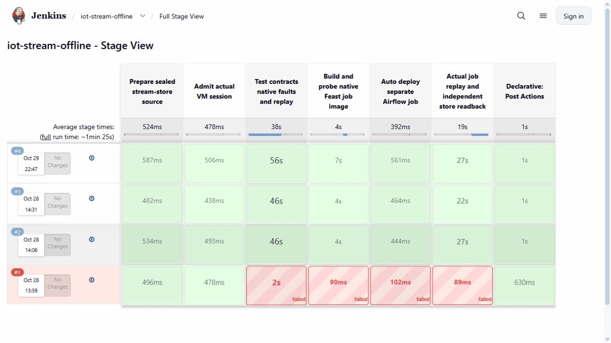
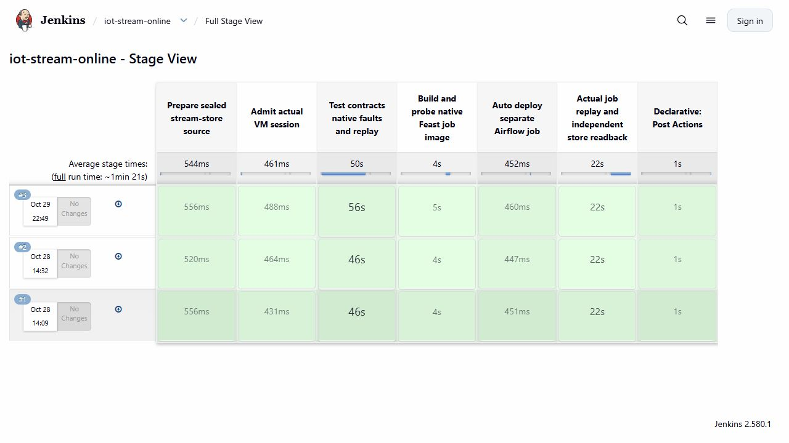

# Trace the data behind an assistant answer

An assistant can repeat a correct number and still draw the wrong conclusion. This checkpoint follows actual generator and stream-store results into a small GPU-served evidence-reading exercise, then checks the answers against the original artifacts.

The two data paths have **different source versions**. The paired simulation below tests configurable drift and training-table joins. The streaming release reuses three retained, genuinely finalized Kafka/Flink windows. It does not consume the newly generated paired dataset or establish a continuously running stream.

## A configurable paired simulation

The [configuration](../infra/llm/data-validation.json) describes three pumps over 48 hours at one-minute intervals, with seed 42 and wear of 0.07 per hour. The second version adds a calibration change from 2 October: temperature rises by 15 °C over one hour and vibration is multiplied by 1.8. Physical wear, failures, maintenance, arrival times and labels stay unchanged in this controlled sensor-drift scenario.

| Native observation | Baseline | Calibration drift |
|---|---:|---:|
| Unique readings | 8,640 | 8,640 |
| Failure events | 13 | 13 |
| Machine/time snapshots at five-minute intervals | 1,728 | 1,728 |
| Eligible, sufficiently observed samples | 1,485 | 1,485 |
| Positive / negative targets | 144 / 1,341 | 144 / 1,341 |
| Censored / stopped / maintenance exclusions | 36 / 132 / 72 | 36 / 132 / 72 |
| Excluded for fewer than five available readings | 3 | 3 |

Spark uses the existing production transforms: rolling features include only past measurements already received at prediction time. Future failures are used only for targets. The target is positive for a failure in `(t,t+1h]`; stopped, maintenance and unobserved horizons do not become negative examples. Split/purge and model evaluation remain separate stages; this export does not train or promote a new model.

The eight feature values are exported separately from an exact two-column target table:

| sample_id | failure_in_next_1h |
|---|---:|
| Dataset-version-scoped sample identifier | 0 or 1 |

`sample_id` hashes the immutable dataset identity, machine ID and timestamp. A machine has many samples, so using only `machine_id` would create an incorrect many-to-many join. Baseline and drift versions receive distinct sample IDs even when their target truth is identical. Duplicate or orphan join keys fail explicitly. [Two original example rows](evidence/assistant-data/table-examples.json) show both classes; all 1,485 rows per table remain in the native archive.

The successful Spark container used two CPU cores and 4 GiB memory. Its job completed the paired feature/label work in 51.05 seconds with the retained Spark 3.5.9 image. The first attempt failed when Snappy could not load its native library from a non-executable temporary filesystem. A fresh second run used an executable temporary mount inside the same bounded non-root container. Original failure logs and partial outputs were retained; no target or simulator setting was changed to pass the run.

## Independent offline and online streaming releases

Two existing Jenkins jobs ran again from prepared source `49115d5a7dcb8c331e8169e8a37df462743d921f`. Each tested the native store and fault/replay boundaries, built/probed its image, deployed its own Airflow DAG and checked actual persisted results.

| Release | Actual result |
|---|---|
| `iot-stream-offline`, build 4 | SUCCESS; 95.955 seconds; three historical rows, initially empty online values, replay adds no rows |
| `iot-stream-online`, build 3 | SUCCESS; 88.307 seconds; linked to offline 4; latest values for two machines, unchanged offline Parquet, replay adds no effects |

Each Airflow run completed its push and replay tasks. The source windows and availability timestamps were preserved. Job configuration and credentials were not edited. The current CI controller differs from the executed revision only by one constructor docstring; the verifier pins both hashes and compares executable syntax trees.





For P-001, history contains temperatures 20 and 40; the latest online value is 40. P-002 has 100. These are synthetic monitoring observations. Finalized tumbling windows and rolling predictor features have different timing/availability semantics. The monitoring row also lacks five required predictor inputs, even after renaming its three closest fields.

## What the LLM got right and wrong

The deployed observer and private V100-backed 7B model received three bounded questions containing actual source facts. These were direct-model evaluation requests, not new agent tools or a change to the production agent prompts.

| Question | Original outcome |
|---|---|
| Read generator counts, target separation and preserved physical truth | Matched |
| Read offline/latest online values and assess predictor-input completeness | Wrong completeness conclusion |
| Read exclusion counts and keep future targets outside inference features | Matched |

The second answer correctly reported three historical rows, two online machines and P-001's latest temperature 40. It nevertheless claimed the monitoring row was a complete predictor input. The [original answers and expected fields](evidence/assistant-data/llm-answers.json) retain that error. The result is **2/3 matched factual contracts**, not a general model-accuracy estimate.

We then executed the unchanged Pydantic contracts in both deployed MCP replicas. The candidate was rejected for five missing predictor fields; an attempted `features` override in the machine-selection request was also rejected. This was an execution of the deployed validation classes, not a fresh HTTP prediction. It did not need an active feature lease or generate another model answer. The [guard receipt](evidence/assistant-data/deployed-input-guard.json) records the actual module hashes and errors.

The first evaluation attempt stopped on a backend transport error during GPU recovery. The next attempt obtained one complete answer, then its second TCP connection was refused before the request was sent. An explicit continuation carried the first answer byte-for-byte and completed only the remaining questions. Its guards preserve completed wrong answers too: no response is selected by correctness or regenerated to improve a score. Readiness checks and pre-send connection refusals are recorded separately from model requests.

All three final responses match their durable observer request IDs and provider usage. The GPU output counter increased by 137 tokens across the complete cohort: 41 from the original first answer and 96 from the two continued requests. Resource identities and restart counts stayed unchanged across that cohort. These timings are not a throughput or maximum-capacity benchmark.

## Run the checks yourself

From a normal clone, without starting cloud services:

```powershell
python -B -m unittest tests.test_training_samples tests.test_llm_data_validation -q
python -B -S scripts/verify-assistant-data.py
(Get-Content docs/evidence/assistant-data/table-examples.json -Raw | ConvertFrom-Json).labels | Format-Table
```

The checker authenticates original source and execution bytes, independently reconstructs feature windows and future labels from raw telemetry/events, checks the two-column join, verifies both CI/Airflow runs and reconciles the unedited SSE responses and token counters. The [archive metadata](evidence/assistant-data/native-archive.json) distinguishes original payloads from the explicitly derived display examples.

For a new live stream-store demonstration, recover the [retained lab](demo-walkthrough.md), then open the private Jenkins UI. Build **iot-stream-offline** with the prepared source above. Wait for SUCCESS and note its new build number N. Build **iot-stream-online** with the same source and `OFFLINE_RELEASE=stream-offline-jenkins-N`. Each run must create its own fresh state. The historical 3/2 and current 4/3 pairs remain available; do not overwrite their files.

The paired Spark driver is [audit-assistant-samples.py](../scripts/audit-assistant-samples.py). It requires the retained Spark runtime and a settings JSON including the source revision; [the original executed settings](evidence/assistant-data/study-settings.json) show that format. Preserve a failed run and choose a new output directory. A Git clone does not contain the VM images, credentials, prepared services or model weights.

For your presentation, first show one sample ID appearing once in each table. Explain why future truth is separate from features. Then show offline 4/online 3 and the latest-value rule. Finish with the wrong LLM answer and the deployed schema rejection: the assistant helps explain evidence, while deterministic contracts protect the prediction boundary.
