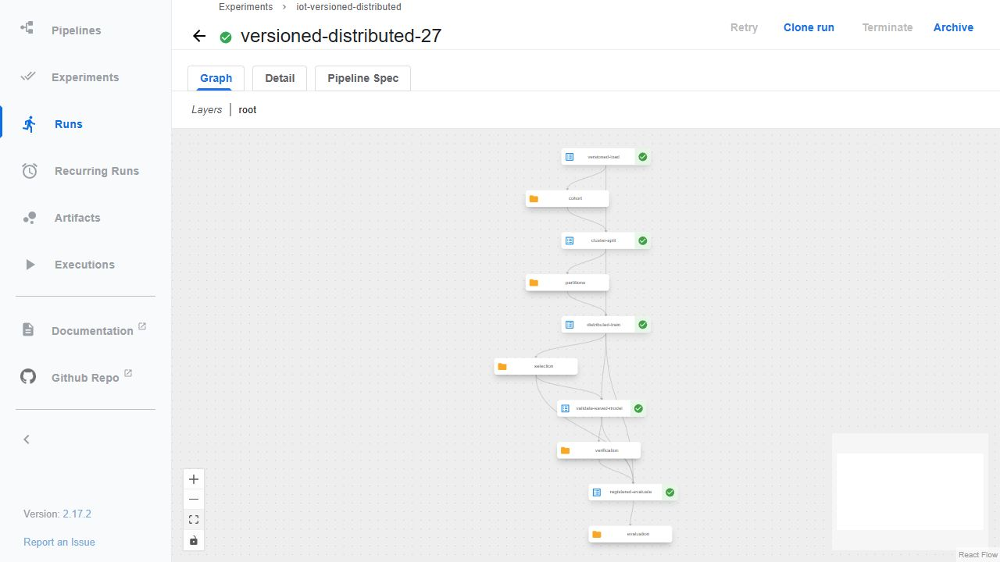
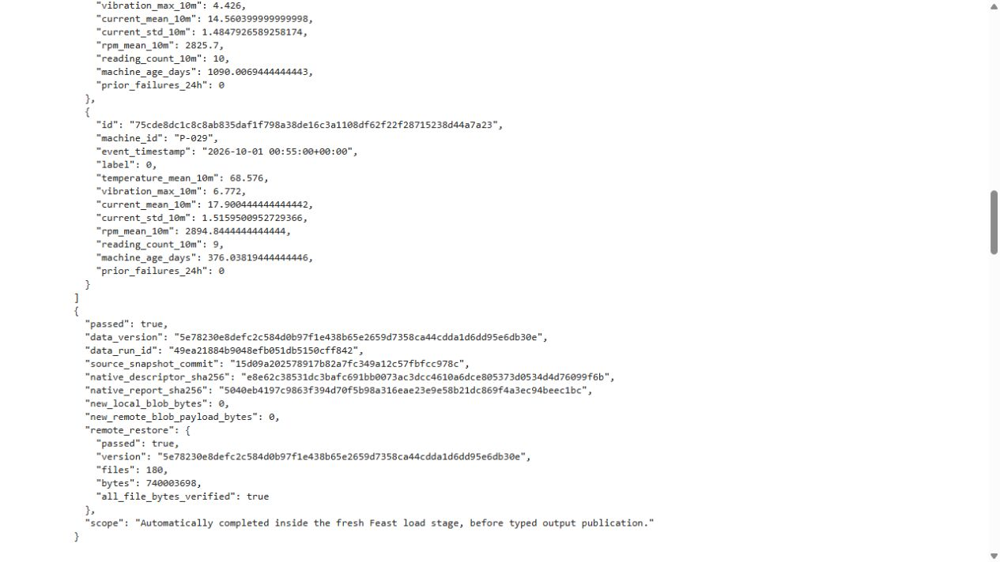
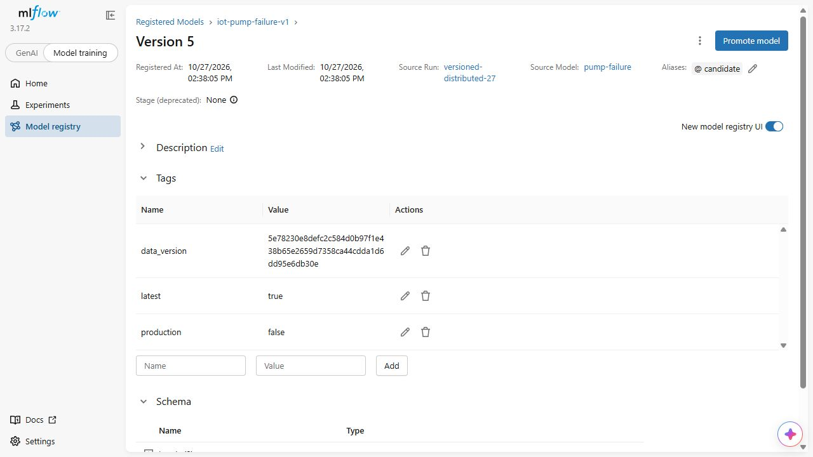

# Tự động version dữ liệu và model

Mỗi lần lấy feature mới để training cần gắn với một dataset xác định. Nếu dữ liệu không đổi, hệ thống tái sử dụng những blob đã có; nếu có tệp thay đổi, chỉ phần nội dung mới được lưu thêm. Model được đăng ký sau đánh giá và trỏ tới data run đó, thay vì upload lại toàn bộ dataset vào mỗi model run.

[Pipeline mới](../ml/kfp_versioned.py) và [Notebook](../notebooks/01_failure_training.ipynb) vẫn có năm bước ML. [Persistence hooks](../ml/automatic_versions.py) nằm trong bước1 và bước5:

| Bước | Việc chính | Điều kiện đi tiếp |
|---|---|---|
| 1. Feast và version dữ liệu | Lấy mới toàn cohort, ghép nhãn hai cột, chuẩn hóa Parquet theo ngày, publish CAS và MLflow | Khôi phục đầy đủ từ server và kiểm đúng byte rồi mới xuất artifact cho bước split |
| 2. Temporal split | Dùng kernel và protocol đã đóng băng | Kiểm grain, label availability/purge, finite và class support |
| 3. Train | Fit scaler/class weights/model trên train; validation chọn ngưỡng | Lưu weights và seal lựa chọn trước holdout; KFP dùng hai executor thật |
| 4. Nạp lại model | Kiểm validation và score portable/native | Validation phải thành công, chưa mở holdout và đúng hash selection |
| 5. Evaluate và đăng ký | Tái lập holdout với ngưỡng cố định; đăng ký weights/params/metrics và tham chiếu dataset | Model đọc lại từ registry phải khớp native score; đăng ký candidate, không tự promote production |

Một ô init của Notebook không tính là bước ML. Test set đã có kết quả trong các lượt lịch sử; đây là tái lập protocol, không thay feature, tham số, ranh giới hoặc ngưỡng theo test. Cohort trung gian60ngày có3.132.184 snapshot; mốc này không chứng minh training trên nguồn100GB.

## Dữ liệu được nhận diện như thế nào?

[Canonicalizer](../ml/canonical_dataset.py) giữ schema, thứ tự cột, UTC và sort snapshot id theo từng ngày; đọc lại Parquet để kiểm giá trị. [CAS](../ml/data_versions.py) dùng SHA256 của byte thực, còn manifest mô tả đầy đủ snapshot. Vì vậy một lượt Feast mới có thứ tự hàng khác vẫn có thể nhận cùng data version. Native report/descriptor của từng lần pull được giữ riêng để tránh gắn model vào nhầm một lượt lấy dữ liệu khác.

Mỗi model đi qua [model/data gate](../ml/model_data_link.py): protocol, source manifest, native report, input descriptor, canonical manifest và remote data run phải thuộc đúng split dùng train. Chỉ cùng protocol hoặc cùng số hàng chưa đủ. [Registration CLI](../ml/register_incremental_model.py) lưu model-only artifacts, tham chiếu data version và kiểm200 score đọc lại; phục vụ online vẫn là quy trình triển khai riêng.

Số byte blob upload mới không bao gồm tải xuống để kiểm chứng, HTTP overhead hay metadata. Hai lượt đọc dataset giống nhau có thể upload thêm0 byte nhưng vẫn đọc dữ liệu từ server để khôi phục snapshot hoàn chỉnh. [Thử nghiệm59→60ngày trước đó](incremental-data-versioning.md) đo riêng phần dữ liệu thêm mới, replay và full restore; không gán nó thành lượt tự động khi chưa có tích hợp.

## Môi trường thực thi

[Image Feast](../infra/ml-versioning/Feast.Dockerfile) thêm MLflow Skinny3.17.2 và giữ NumPy2.5.4/Pandas2.3.3/Arrow26 của Feast0.67.0. [Image Spark](../infra/ml-versioning/Spark.Dockerfile) giữ nguyên Python path chạy Spark3.5.9/NumPy1.26.4; bộ SDK đăng ký model ở `/opt/registry-sdk` chỉ được subprocess đăng ký import. Cả hai có dependency lock và `pip check`; không trộn full MLflow yêu cầu Arrow<26 vào Feast đang dùng Arrow26.

[Private registry bridge](../scripts/configure-kfp-registry.py) đọc địa chỉ Docker thực và interface CNI thực. Socket chỉ nghe trên mạng pod; Service `tracking` là ClusterIP, không có NodePort hoặc cổng Internet mới. Native probe phải đọc được health và data run FINISHED trước khi chạy ML. Socket/service dùng systemd-socket-proxyd; địa chỉ upstream nằm trong cấu hình máy, không phải credential.

Kho CAS dùng SQLite transaction để serialize publication. Lượt tự động cho phép chờ khóa tối đa300 giây ở cả publish cục bộ và remote; mặc định của tool riêng vẫn30 giây. Chờ khóa không làm giảm các guard RAM/đĩa/thời gian. [Known-answer test](../tests/test_data_versions.py) chứng minh publisher thứ hai không vào cùng lúc và có thể thử lại sau khi khóa được giải phóng.

## Tự chạy trên VM đã chuẩn bị

Clone Git chứa code và bằng chứng nhỏ; cohort, Feast registry, CAS, tracking server, images và cluster là trạng thái của VM. Dùng các prerequisite trong [Feast](feast-feature-store.md), [KFP](distributed-training.md) và [incremental store](incremental-data-versioning.md). Lấy deadline từ autoSTOP thật, không tự cộng thêm90phút vào giờ hiện tại.

Từ repo root trên VM, dùng tên run mới và data run đã hoàn tất của kho hiện có:

```bash
sudo python3 scripts/configure-kfp-registry.py \
  --run registry-demo-new --data-run "$DATA_RUN_ID"
sudo data/runtime/kfp-venv/bin/python scripts/run-versioned-training.py \
  --run versioned-training-demo-new --deadline-utc "$DEADLINE_UTC" \
  --source-binding data/runtime/ml-versioning/source-snapshot.json \
  --oracle outputs/distributed-oracle/distributed-smoke-27-v2/verification.json
```

Runner cần ít nhất 90 phút, 24 GiB RAM khả dụng và 40 GB trống trên mỗi đĩa data/scratch; nó tiếp tục theo dõi dự phòng và chỉ dừng chính run này khi không đủ. Source binding phải khớp từng byte thực chạy. [Sealer](../scripts/create-versioned-source-binding.py) tạo binding từ Git commit trên máy có checkout sạch; khi đổi code phải chuyển cả source lẫn binding tương ứng, giữ binding cũ để truy vết. Không suy ra Git HEAD của VM từ commit trên PC.

Notebook dùng cùng hooks, có guard 90 phút/16 GiB/30 GB và output mới mỗi lần:

```bash
sudo data/runtime/notebook-venv/bin/python scripts/run-training-notebook.py \
  --run versioned-notebook-demo-new --deadline-utc "$DEADLINE_UTC"
```

Lượt Notebook dùng `local[2]`; chỉ KFP có distributed training. Dataset/model version mới vẫn là candidate cho tới khi quy trình triển khai chọn và kiểm phiên bản phục vụ.

## Kết quả chạy thật

Hai lượt độc lập khởi động **19:15:28 UTC ngày 27/10/2026** trên cùng VM 8 CPU/64 GiB:

| Lượt | Kết thúc | Kết quả | Model đăng ký tự động |
|---|---|---|---|
| Notebook `versioned-notebook-27` | Jupyter19:34:29UTC; wrapper19:34:32 | 6 ô code / 0 lỗi, init + 5 ML;5 container exit0/OOMfalse | Version4, run `6b41a38b83b04b4e9459471b507d5f2f` |
| KFP `a9298a17-3866-4680-b221-c009b64e4b2a` | Controller19:38:25UTC | Backend SUCCEEDED,5 task; hai executor thực hiện task LogisticRegression | Version5, run `491a78d03969430da89f7045c24eb2bf` |

[Notebook receipt](evidence/automatic-versioning/notebook/execution/execution.json) và [KFP receipt](evidence/automatic-versioning/kfp/controller/verification.json) xác nhận hai lượt đã hoàn tất. Controller KFP đo1368,248 giây; UI đo riêng workflow22 phút 42 giây. Thời gian gồm lấy Feast, version/readback dữ liệu, ML và đăng ký; hai lượt chạy đồng thời, chưa phải benchmark tăng tốc distributed so với local.



Cả hai kéo mới **3.132.184 dòng**, canonical thành180 tệp logic và nhận data version `5e78230e8defc2c584d0b97f1e438b65e2659d7358ca44cdda1d6dd95e6db30e`, tham chiếu data run `49ea21884b9048efb051db5150cff842`. [Receipt Notebook](evidence/automatic-versioning/notebook/dataset/lineage/automatic-data.json) và [receipt KFP](evidence/automatic-versioning/kfp/dataset/lineage/automatic-data.json) đo **0 byte blob mới ở cả local lẫn remote**, metadata upload mới cũng 0. Mỗi lượt vẫn khôi phục 740.003.698byte từ MLflow và kiểm mọi tệp. Native report của hai lượt khác nhau; model/data gate giữ đúng provenance của từng lần pull dù content version giống nhau.



[Model4](evidence/automatic-versioning/notebook/dataset/lineage/registration.json) và [model5](evidence/automatic-versioning/kfp/dataset/lineage/registration.json) đều có weights, hyperparameters và metrics, không upload thêm dataset vào model run. Mỗi model đọc lại từ registry khớp 200 score native với delta lớn nhất 2,22e-16. [Server readback](evidence/automatic-versioning/model-run-readback/verification.json) kiểm hai run FINISHED, `max_iter=40`, `reg_param=0.1`, ngưỡng0,7, tags đúng source/data run và các thư mục weights/portable/lineage.



Alias `candidate` hiện trỏ version5; version4 từng được đặt candidate khi nó đăng ký trước. Cả hai `production=false`, KServe vẫn version1. MLflow run này bao quát **thao tác đăng ký**, nên UI duration 3,8 giây của run5 không phải thời gian training. Đọc thời gian ML từ Spark/KFP và receipt của toàn workflow.

Cả hai giữ ngưỡng0,7, testTP13.115/FP14.536/FN6.842/TN433.891, F1=0,5509578222/PR-AUC=0,6151480585. Toàn 468.384score portable so native Spark trong từng lượt lệch tối đa 4,44e-16. Không so hash weights giữa hai fit để suy ra lỗi: thứ tự hàng/reduction số thực có thể khác; native report, model version và kiểm score của từng model được giữ riêng.

[Event proof mới](evidence/automatic-versioning/kfp/controller/distributed-verification.json) có ApplicationEnd, hai executor ID1/2 và task LR stage7–17 thành công trên cả hai, không task attempt lỗi. [Quan sát pod đã lọc](evidence/automatic-versioning/capture/two-running-executors.json) giữ UID/resource/security facts, bỏ env values. [Readback độc lập5 typed artifacts](evidence/automatic-versioning/typed-artifacts/verification.json) tải từ object store KFP thật và hash toàn bộ tệp data/model được tham chiếu. Credentials chỉ dùng trong bộ nhớ tiến trình đọc, không xuất ra evidence.

## Source và các sửa lỗi được giữ lại

[Binding của hai full run](evidence/automatic-versioning/source/source-snapshot.json) gồm 41 tệp tại Git `15d09a202578917b82a7fc349a12c57fbfcc978c`; [ba helper Feast](evidence/automatic-versioning/preparation/helper-readback/verification.json) được đọc lại và đối chiếu riêng cùng commit. [Bốn input SDK](evidence/automatic-versioning/preparation/final-images/sdk-source.json) thuộc Git68e4a5c, có cùng byte tại commit15; application code được mount riêng, không suy ra nó đã nằm trong image. Đây là snapshot copy trên VM, không phải khẳng định Git HEAD của VM.

Giữ nguyên các lần private-route thất bại: directPod→Docker timeout, guard bắt CIDR mặc định sai, và socket reset do runtime MLflow không publish cổng loopback như Compose mẫu. [Probe cuối](evidence/automatic-versioning/preparation/registry-route/verification.json) dùng địa chỉ CNI/Docker thực và đã qua từ pod non-root. Hai-run admission chờ 41 giây, ghi RAM 14→54,6 GB rồi mới vượt cùng ngưỡng 50 GiB; không hạ gate. Source được giữ cố định suốt hai lượt.

Notebook cần [chỉnh group của riêng lineage directory](evidence/automatic-versioning/preparation/notebook-permissions/verification.json) từ10001 sang185 khi đang chạy: Feast vẫn là owner, Spark Docker có group185; KFP đã dùng group10001. Chỉ thay metadata thư mục, giữ nguyên byte/source/protocol. Sau khi full run và capsule đã đóng, [sửa launcher](../ml/notebook_runtime.py) thêm supplementary group10001 cho các lượt sau. [Oracle trước/sau](evidence/automatic-versioning/sharing/repair/verification.json) dùng fixture nhỏ và hai image thật: trước bị từ chối ghi, sau cả hai UID ghi được vào thư mục2775/group10001. Oracle này kiểm quyền ghi, không phải chạy lại training.

[Binding mới 44 tệp](evidence/automatic-versioning/sharing/source/source-snapshot.json) tại Git `91fb73d098a68630a14717378e68d9aac9611eff` thêm guard cho ba helper Feast và chứa launcher đã sửa. Tách rõ full run nguồn15 với kiểm quyền/provenance nguồn91. VM đã có binding44 cho lượt mới; dữ liệu/model/receipt cũ vẫn giữ nguyên.

[Manifest156tệp của full runs và preparation](evidence/automatic-versioning/capture/manifest.json), [17tệp quyền ghi](evidence/automatic-versioning/sharing/capture/manifest.json), [9tệp typed-artifact readback](evidence/automatic-versioning/typed-artifacts/capture/manifest.json) và [5tệp server-run readback](evidence/automatic-versioning/model-run-readback/capture/manifest.json) giữ tổng187 payload native. Các mapping đi kèm nối byte gốc với đường dẫn trong Git; [7ảnh nguyên bản](evidence/automatic-versioning/screenshots/capture.json) có SHA riêng. Binary model, Parquet, database và secrets nằm ngoài Git. Các CI/CD training/materialization/production serving còn là mốc riêng.
