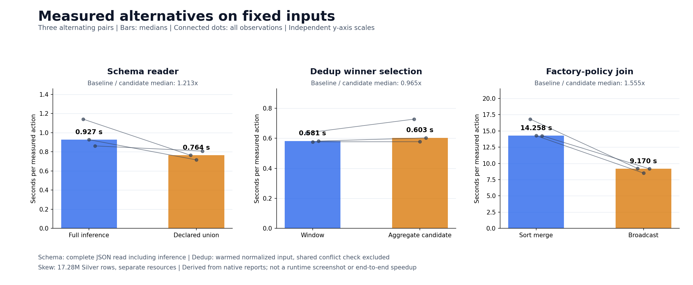
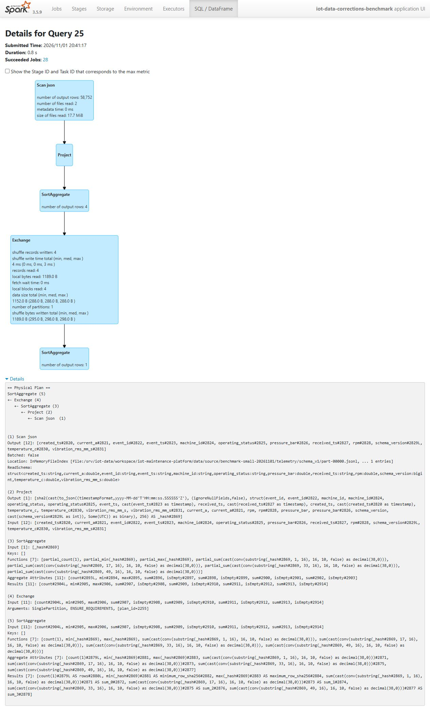
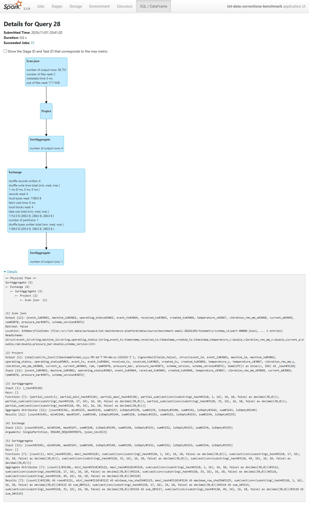
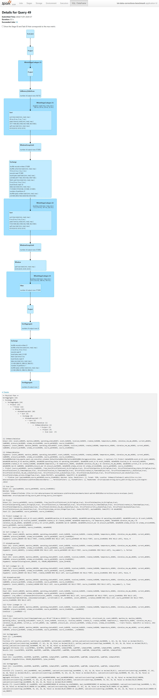
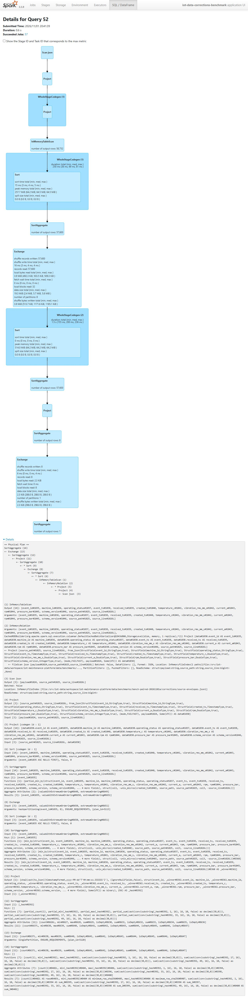

# Schema evolution and deduplication benchmark

This study measures two separate implementation choices on the same bounded telemetry source. Schema parsing compares full-input inference with a declared union schema. Deduplication compares the existing window ordering with a deterministic aggregate candidate. Each comparison requires equivalent complete results before its timings are accepted.

The [benchmark module](../pipelines/data_corrections_benchmark.py) is separate from [production DP2 transformations](../pipelines/transforms.py). It does not replace DP2's parser or deduplication method. The aggregate selector is a measured candidate, not an already deployed optimization.

## Input and scope

The input is the original development cohort: 20 machines over 48 hours, stored in two immutable JSONL partitions. It contains 58,752 exports for 57,600 unique readings, including 1,152 extra exports. Each schema version has 28,800 unique readings; export counts differ because retries are distributed across the partitions.

The source manifest pins each partition's bytes, SHA-256 and row count. The benchmark verifies these before and after execution. It rejects inputs above 100,000 exports or 200 MB and does not regenerate the source. These bounds deliberately separate this study from the retained 100 GB ingest and the 17.28-million-row [skew benchmark](skew-benchmark.md).

Version 1 omits `pressure_bar`; version 2 supplies it. Both versions must normalize to the same twelve-column contract, with a nullable double for pressure. Unknown v1 pressure remains NULL. Neither reader may replace it with zero or discard v2 pressure.

## Schema evolution: correctness and timing

There are three reader configurations, serving two different purposes:

| Configuration | Behavior | Role in the study |
|---|---|---|
| Schema inferred only from the v1 partition, then reused for both partitions | Omits `pressure_bar` from the schema and loses the v2 field | Separate demonstration of the original problem; not an equivalent performance baseline |
| Full-source inference | Infers from both partitions with `samplingRatio=1.0`, then casts every output column to the declared contract | Correct baseline for the timing comparison |
| Declared union schema | Reads the same two files using the explicit production field declaration, followed by the same typed projection | Candidate for avoiding the inference pass |

Both timed readers use `FAILFAST`. Timestamp inference is disabled in the inferred reader; its strings are explicitly cast to timestamps. The declared reader parses timestamps using the declared types. The resulting values, types, missing-pressure behavior and complete row multiplicities must agree with the independent source oracle.

Timing starts before constructing the reader DataFrame, so the inferred reader's schema-discovery action is included. It ends after materializing a summary that consumes every output column. Timing only a later `count()` would miss inference performed during reader construction and could allow Spark to prune sensor columns.

The v1-only demonstration records how many v2 exports lose pressure. It is not labeled a Spark execution failure: a reader can finish successfully while producing an incomplete schema. Its result is not compared as though it were equivalent to the corrected readers.

## Deduplication: equivalent winner selection

Each `event_id` identifies one immutable reading. A retry may have a later `created_ts`; changing the reading's other payload fields is a conflict and must be rejected.

Untimed preparation wraps the original JSON lines with their actual relative `source_path` and one-based physical `source_line`. Spark parses these envelopes through the unchanged production parser. The resulting normalized frame is materialized once into a shared `MEMORY_AND_DISK` cache. Both selectors read this same warmed input after the same null-key and immutable-payload conflict gate.

The winner contract is:

1. Latest `created_ts`.
2. Ascending `source_path` when creation times tie.
3. Descending `source_line` when both preceding keys tie.

| Selector | Implementation |
|---|---|
| Window baseline | `row_number()` partitioned by event ID with the three ordering rules above; retain rank 1 |
| Aggregate candidate | `min_by(struct(all output columns), struct(-unix_micros(created_ts), source_path, -source_line))` grouped by event ID |

The aggregate order preserves timestamp microseconds and the same path/line tie breaks. Ordering keys must be non-null, and source lines must be positive. A complete ordering tie refers to identical payload and provenance after conflict validation; choosing either copy cannot change the returned row.

The timed section includes selector construction and full-column materialization. It excludes JSON parsing, cache preparation and the shared conflict check. These are **winner-selection timings on a warmed normalized input**, not end-to-end Bronze-to-Silver timings. The benchmark does not compare a validated baseline with an unvalidated candidate.

Hand-computed fixtures check a later export, microsecond ordering, both provenance tie breaks, immutable conflicts, null ordering keys and pressure semantics. Both selectors must also match the unchanged production deduplication function on the fixture.

## Measurement and equivalence gates

For the correction experiments, each strategy receives one unmeasured warmup. The final study runs three paired repetitions per experiment, reversing strategy order on the second pair. All twelve measured executions are retained; medians use all three observations for each strategy. The separate skew job performs its known-answer checks and factory-partition diagnostic before six measured queries; it does not add these four correction warmups. A one-pair pilot checks integration and is not substituted for the final three-pair result.

Each timed action serializes every output column, computes row SHA-256 values and collects one bounded aggregate containing the row count, hash extrema and four hash-component sums. This forces full-column work without returning the dataset to the driver. The summary is a diagnostic, not a proof that two multisets are identical.

A separate Python implementation reads the authenticated original JSON lines, normalizes values and independently resolves the latest export and tie breaks. After every measured execution, Spark checks both `actual.exceptAll(expected)` and `expected.exceptAll(actual)` over every result column. Both differences must be empty, preserving multiplicity as well as values. These validation actions run outside the timer and measured job group.

The report retains each duration, strategy, repetition, result summary and exact comparison outcome. Its `physical_plan` comes from the same materialization query object that performed the timed action; the selector's own plan is retained separately. Explicit Spark job groups connect measured executions to completed event-log task metrics. The success marker binds the final report bytes and is written only after all source and correctness gates pass.

## Airflow execution and evidence

[The benchmark DAG](../airflow/dags/iot_data_benchmarks.py) defines a serial chain:

`preflight → schema_dedup_pairs → validate_corrections → skew_pairs → validate_skew`

The [task adapter](../pipelines/benchmark_airflow.py) launches bounded sibling Spark containers and validates completed task metrics. The [launcher](../scripts/run-data-benchmarks.py) prepares a fresh run with source bindings and the existing CPU-session descriptor. All tasks use the shared single-slot `spark_jobs` pool. The correction and skew experiments retain separate inputs, resource settings, application IDs and reports.

The final run, `bench-paired-20261101a`, completed all five tasks on 1 November 2026, from 20:40:27 to 20:43:58 UTC. The [native API snapshot](evidence/batch-benchmarks/final/airflow.json) records their actual states and times. The correction application is `local-1793565635088`; the separate skew application is `local-1793565724983`. The successful one-pair pilot, `bench-pilot-20261101d`, is retained separately and contributes no observations to the final medians.


The [input specification](evidence/batch-benchmarks/final/input-spec.json) binds sixteen runtime files and 72 input files, including the generated skew binding. The source packet also retains both test files. The correction container uses 4 CPUs, 10 GiB and a 7 GiB driver heap with eight shuffle partitions; the skew container uses 6 CPUs, 28 GiB and a 20 GiB heap with 32 partitions. Resources stay fixed within each comparison. The adapter checks actual host disk mounts through a bounded read-only probe and keeps a finish reserve before the existing eight-hour VM auto-STOP deadline.

The [native archive](evidence/batch-benchmarks/native.tar.gz) contains real container exits, all reports, completed task metrics, Airflow task logs and both failed predecessors. Pilot B failed preflight when Docker SDK returned no captured stdout with the default local logging driver; [the original error capture](evidence/batch-benchmarks/screenshots/airflow-pilot-b-preflight-failed.jpg) shows the resulting TypeError, and no Spark task ran. Pilot C completed correction measurements and validation, then failed loading Snappy JNI from a noexec temporary mount. The final adapter gives only the resource probe an explicit JSON log driver, and directs JVM temporary files to its own scratch mount while `/tmp` remains noexec. The failed runs were not cleared or marked successful.

## Results

The [correction report](evidence/batch-benchmarks/final/corrections.json) and [skew report](evidence/batch-benchmarks/final/skew.json) retain every observation. Values below are seconds measured by the Python action timer, including the boundaries defined above.

| Experiment / pair | Baseline | Candidate |
|---|---:|---:|
| Schema 1: inferred / declared | 1.141795 | 0.764024 |
| Schema 2 | 0.926981 | 0.715816 |
| Schema 3 | 0.862027 | 0.807974 |
| **Schema median** | **0.926981** | **0.764024** |
| Dedup 1: window / aggregate | 0.635606 | 0.727420 |
| Dedup 2 | 0.576567 | 0.577089 |
| Dedup 3 | 0.581427 | 0.602638 |
| **Dedup median** | **0.581427** | **0.602638** |
| Skew 1: sort merge / broadcast | 16.807852 | 9.215180 |
| Skew 2 | 14.258209 | 8.507135 |
| Skew 3 | 14.249135 | 9.169817 |
| **Skew median** | **14.258209** | **9.169817** |



The declared reader's median is 17.6% lower than full inference. Both preserve all 58,752 exports and the same typed values. The separate v1-only demonstration loses pressure for 29,359 v2 exports; the corrected readers preserve those values and leave pressure NULL for all 29,393 v1 exports.

Both dedup selectors return the same 57,600 complete winning rows, removing 1,152 extra exports. The aggregate candidate's median is **3.6% higher**, so this study supplies no reason to replace production DP2's window selector. The plans still contain sorting in both methods; using an aggregate API does not by itself demonstrate a faster physical plan.

The separate skew comparison reduces the median by 35.7% on its 17.28-million-row input, with all six executions returning identical 4,320 factory-hour aggregates. This is a new Airflow execution; the earlier standalone skew measurements remain unchanged in [their own report](skew-benchmark.md#before-and-after-on-the-same-input).

### Native Spark plan captures

These original full-page captures show the first measured pair. Query durations displayed by Spark are not the Python medians above. In particular, schema inference also performs a discovery job before the pictured materialization query. Input/output counters inside a plan describe that operator's grain: the global checksum aggregate returns one row, not one reading.

<details>
<summary>Schema readers: native queries 25 and 28</summary>

| Full-source inference | Declared union schema |
|---|---|
|  |  |

</details>

<details>
<summary>Dedup selectors: native queries 49 and 52</summary>

| Window baseline | Aggregate candidate |
|---|---|
|  |  |

</details>

The [capture identities](evidence/batch-benchmarks/spark-capture.json) link each image to its actual application and measured job group. [The two completed applications](evidence/batch-benchmarks/screenshots/spark-final-applications.jpg) are loaded from the full original event logs in the existing History Server. Opening those pages did not rerun Spark.

## Reproduce and verify

The standard-library verifier needs Python and a local clone, without a live VM or Spark installation:

```bash
python scripts/verify-batch-benchmarks.py --output outputs/batch-benchmarks-check.json
```

It regenerates the bounded source in a fresh temporary directory under `outputs/`, authenticates every original file, independently recomputes the complete schema/dedup checksums and compares all skew aggregate rows. It also decompresses and hashes both complete event logs and recomputes their task metrics. The two [stage verification receipts](evidence/batch-benchmarks/final/correction-verification.json) and [skew receipt](evidence/batch-benchmarks/final/skew-verification.json) remain native outputs, rather than replacements for these independent checks.

To execute again on the approved reference VM, first deploy the new DAG and its source files. The original small source and validated `scale-ingest-medium-26` Silver/machine inputs must already exist. Use a new run ID and a fresh descriptor of the currently authorized CPU session:

```bash
sudo python3 scripts/run-data-benchmarks.py \
  --run-id benchmark-demo-new \
  --source data/source/benchmark-small-20261101 \
  --source-manifest docs/evidence/batch-benchmarks/runtime-source.json \
  --descriptor /private/path/to/current-instance.json
```

The launcher hashes the installed code against the [recorded source manifest](evidence/batch-benchmarks/runtime-source.json), checks mounted volumes/session limits, prepares new directories and triggers `iot_data_benchmarks`. Use `--repetitions 1` for a separate pilot. A queued API response is not completion: inspect all five actual task states and both validation reports. A clone contains the evidence and code, not the bulk Silver source, credentials or running Airflow services.

## Interpretation limits

There is no minimum speedup required for success. A slower candidate remains a valid measurement and must be reported. The small dataset, shared VM services, JVM warmup and uncontrolled OS/file caches limit any performance conclusion. The two experiments measure different boundaries, so their elapsed times must not be added into an end-to-end pipeline speedup.

The study does not establish 100 GB schema/dedup performance, a production DP2 rollout or general cluster behavior. It complements the earlier persisted-data correctness checks and the separate factory-policy join benchmark.

The relevant Spark APIs are documented in [JSON data sources](https://spark.apache.org/docs/3.5.9/sql-data-sources-json.html), [min_by](https://spark.apache.org/docs/3.5.9/api/python/reference/pyspark.sql/api/pyspark.sql.functions.min_by.html), [unix_micros](https://spark.apache.org/docs/3.5.9/api/python/reference/pyspark.sql/api/pyspark.sql.functions.unix_micros.html) and [exceptAll](https://spark.apache.org/docs/3.5.9/api/python/reference/pyspark.sql/api/pyspark.sql.DataFrame.exceptAll.html).
