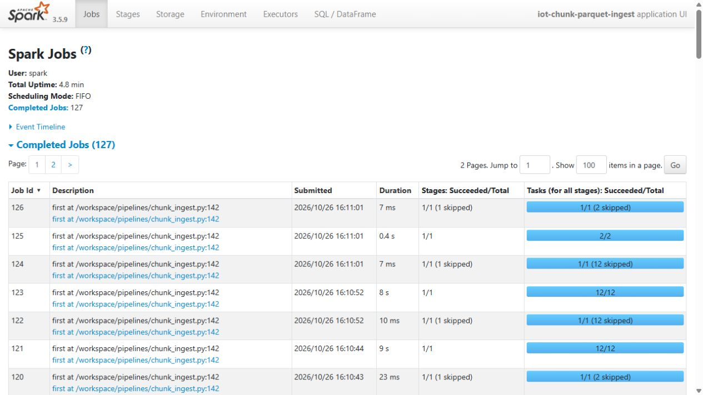
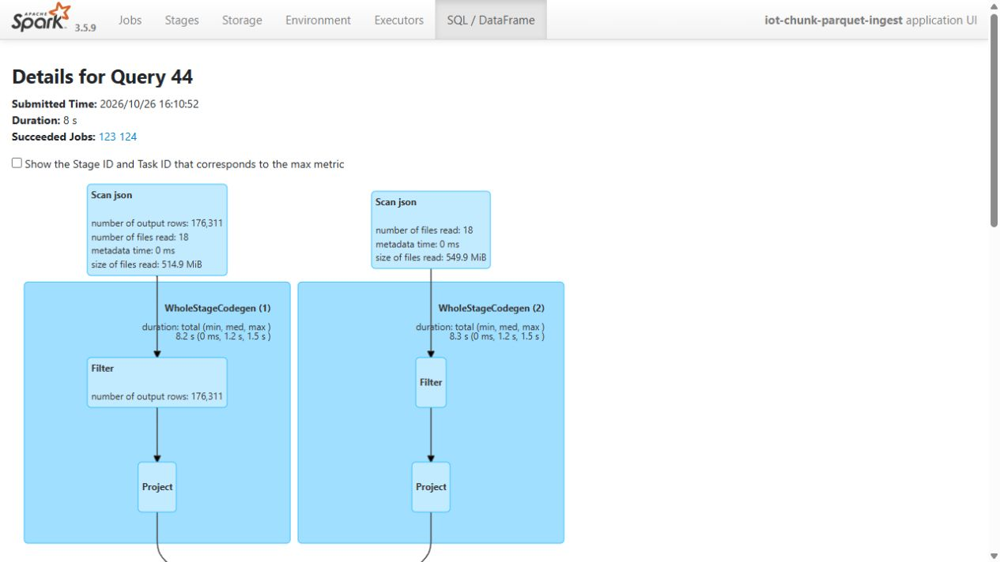
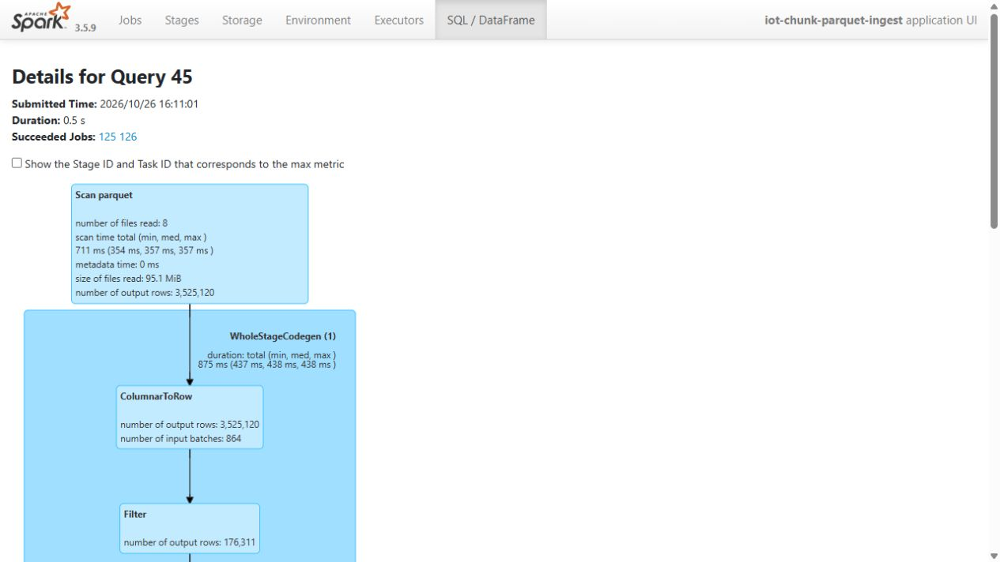

# Catalog-bound Spark ingestion and exact Parquet readback

The adapter binds the successful source receipt, manifest, catalog and every part checksum before Spark reads the five offline tables. Typed Bronze Parquet retains stored rows, source paths, manifest identity and ingestion time. Silver deduplicates by event ID/latest export time and rejects conflicting immutable payloads.

The recorded intermediate benchmark uses 1,117,608,156 offline bytes and 3,456,000 unique readings. It passed 84 host tests and 13 Spark checks per setting, including exact multiset readback, empty metadata boundaries and schema/duplicate handling. Spark event logs and History UI are genuine run artifacts.

The baseline and optimized configuration use the same workload and verify the same output. Format sizes, query measurements, spill and scratch placement are recorded separately rather than inferred from compression ratios.

This adapter does not reinterpret export or ingestion time as first arrival. The small day 2/day 3 loaders do not automatically support the chunked layout. Full-scale source ingestion and downstream features have separate evidence.

## Commands and recorded examples

Run commands from the repository root unless the example explicitly changes the working directory. Use a fresh output/run name and check the linked runbook before starting platform services. Examples belong to the recorded workload on this page.

```powershell
./scripts/run-chunk-ingest.ps1 -RunName practice-ingest -SourcePath data/source/chunked-release/pilot
Get-Content outputs/practice-ingest/ingest-report.json
```

```powershell
docker compose -f infra/ingest.compose.yaml --profile history up -d history
docker compose -f infra/ingest.compose.yaml stop history
```

```powershell
./.venv/Scripts/python.exe -m generator.chunked generate --config generator/configs/ingest-medium.json --output data/source/medium-practice --offline-only
./scripts/run-chunk-ingest.ps1 -RunName medium-practice -SourcePath data/source/medium-practice -SkipBuild
```

## Implementation and evidence

- [Source: pipelines/chunk_source.py](../pipelines/chunk_source.py)
- [Source: pipelines/chunk_ingest.py](../pipelines/chunk_ingest.py)
- [Source: pipelines/ingest_metrics.py](../pipelines/ingest_metrics.py)
- [Recorded artifact: chunk-ingest-small/ingest-report.json](evidence/chunk-ingest-small/ingest-report.json)
- [Recorded artifact: chunk-ingest-medium/ingest-report.json](evidence/chunk-ingest-medium/ingest-report.json)
- [Recorded artifact: chunk-ingest-boundary/ingest-report.json](evidence/chunk-ingest-boundary/ingest-report.json)
- [Recorded artifact: chunk-ingest-medium/spark-metrics.json](evidence/chunk-ingest-medium/spark-metrics.json)
- [Recorded artifact: chunk-ingest-medium/run-context.json](evidence/chunk-ingest-medium/run-context.json)
- [Recorded artifact: chunk-ingest-verification.json](evidence/chunk-ingest-verification.json)
- [Recorded artifact: chunk-ingest-medium/history-applications.json](evidence/chunk-ingest-medium/history-applications.json)
- [Recorded artifact: chunk-ingest-medium/history-query-44.json](evidence/chunk-ingest-medium/history-query-44.json)
- [Recorded artifact: chunk-ingest-medium/history-query-45.json](evidence/chunk-ingest-medium/history-query-45.json)
- [Source: generator/configs/ingest-medium.json](../generator/configs/ingest-medium.json)
- [Recorded artifact: chunk-ingest-medium/100gb-current-plan.json](evidence/chunk-ingest-medium/100gb-current-plan.json)
- [spark.apache.org / sql-data-sources-json.html](https://spark.apache.org/docs/3.5.9/sql-data-sources-json.html)
- [spark.apache.org / sql-data-sources-parquet.html](https://spark.apache.org/docs/3.5.9/sql-data-sources-parquet.html)
- [github.com / WebUI.scala](https://github.com/apache/spark/blob/v3.5.9/core/src/main/scala/org/apache/spark/ui/WebUI.scala)
- [spark.apache.org / monitoring.html](https://spark.apache.org/docs/3.5.9/monitoring.html)
- [docs.kernel.org / cgroup-v2.html](https://docs.kernel.org/admin-guide/cgroup-v2.html)

## Recorded interface views

These are original captures from the runs described above. Their timestamps, model identities and visible states belong to those runs.








## Related documentation

[Current architecture](architecture.md) · [Demo and recovery](demo-walkthrough.md) · [Rubric index](rubric-tracker.md)

[Original run notes](https://github.com/anle0429/iot-maintenance-platform/blob/f4da7bd21667a8bfca5715a7456bc2bcc813b0fc/docs/chunk-ingest.md) retain the full historical narrative. Raw evidence files have not been translated or rewritten.
