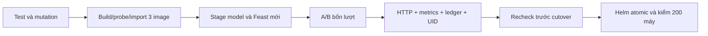

# Phase A/B trong serving CI

**Mã đã nối vào Jenkins; chưa có build/deploy native thành công.** Source `da1b180880f8069f6eb3ed2be71f5bc94737c789`. VM hiện đã dừng; các kết quả dưới đây thuộc PC, HTTP loopback và Kubernetes protocol fixtures. Chưa cài job `iot-serving`, build/import image mới hoặc chạy Grafana trên VM. F33/F34/F52/F53 vẫn đang làm.

[Jenkinsfile](../infra/ci/Serving.Jenkinsfile) gọi `ab` sau khi stage model/Feast và trước full cutover. [Driver](../scripts/ci-serving.py) build/probe/import thêm image A/B, rồi dùng [native adapter](../ml/ab_native.py) triển khai và đọc lại tài nguyên. [Bộ kiểm giao thức](../ml/ab_ci.py) độc lập với Kubernetes để kiểm response, offline trace, metrics và retry. Nó không tự tạo UID hoặc nhận report PC thành bằng chứng native.



Đây là luồng mã đã triển khai, chưa phải hình chụp một Jenkins run thành công.

## Pipeline kiểm gì?

1. Đọc URL predictor từ deployment feature API đang hoạt động; không cố định baseline là version1. Chỉ nhận service KServe private. Đọc ISVC/service/pod UID, container ID/restart count/config digest, rồi kiểm portable hash và model metadata ngay trong predictor pod.
2. Tạo A/B release riêng với hai pin/URL, reference đã lấy từ cluster và seed Feast mới. Config/reference dùng ConfigMap immutable riêng. Ledger dùng static PV/PVC `Retain` trên HDD hiện có, cùng node đã quan sát; không tạo đĩa cloud. `1Gi` là dung lượng khai báo, không phải quota filesystem được chứng minh đã cưỡng chế. Không xóa dữ liệu cũ khi trùng tên tài nguyên/release.
3. Gửi bốn lượt qua mọi máy đang operating, tối đa2.048trial. Trước khi tạo tài nguyên phải có ít nhất32máy ở mỗi nhóm hash và đủ100request mỗi nhóm. Những lượt lặp không biến thành mẫu thống kê độc lập. Máy stopped không được đưa vào thử nghiệm dự đoán.
4. Mỗi response phải đúng request/máy/variant và9field pin. Feature values, event time, age, operating context, protocol, source manifest và lease phải khớp seed cùng latest-row lookup độc lập từ Parquet bằng DuckDB. **Truy vấn DuckDB trên dataset VM chưa chạy ở mốc này.**
5. Đọc report và Prometheus scrape từ A/B API: trial counts phải khớp chính xác; drift dùng snapshot duy nhất và đúng reference/8feature. Counter trực tiếp ở predictor phải tăng **ít nhất** số trial tương ứng, vì có thể có health probe/lưu lượng khác. Không gán phần tăng thêm đó cho thí nghiệm.
6. Retry40request đồng thời; response và ledger/metrics của thí nghiệm phải giữ nguyên. Đọc SQLite ở chế độ read-only từ thư mục volume của release, đối chiếu toàn bộ trial cùng seal experiment/pins/context/reference/capacity. Chỉ trạng thái PVC `Bound` chưa đủ chứng minh dữ liệu đã ghi đúng chỗ.
7. Giữ ổn định ISVC/service/pod/container identities và active routing trong lúc thử. Trước full cutover, receipt phải còn dưới5phút, đúng source/release/candidate UID, config/volume/ledger vẫn khớp và lease thật còn hiệu lực. Receipt PC hoặc tài nguyên bị thay/restart làm job dừng. Sau đó mới dùng Helm atomic và kiểm toàn bộ máy qua API chính.

Lỗi giữ lại tài nguyên/bằng chứng của release để điều tra; cleanup chỉ dừng controller của build và rollback đúng lần switch của nó. Không tự xóa PV/PVC/model/data. Ledger cũ không được nhận thành một run mới, không có resume bằng cách sửa attempt marker. Rollback command chưa chứng minh fallback khỏe nếu lease baseline đã hết; vẫn cần kiểm native riêng.

Thêm A/B và image thứ ba làm tăng thời gian chuẩn bị: guard ban đầu cần **90phút** trước auto-stop thực; Jenkins timeout85phút, các phase sau vẫn cần15phút dự phòng/12GiB RAM/20GB trên cả HDD/SSD. Đây là ngân sách kiểm bảo thủ, chưa phải số đo thời gian Jenkins native. Guard training100phút ban đầu/90phút runner,24GiB/40GB hai đĩa giữ nguyên; auto-stop VM8giờ giữ nguyên.

## Bằng chứng PC

[Verification](evidence/ci-ab-preparation/verification.json), source packet và logs cùng gắn source da1b180:

- **49test hợp đồng PASS/38subtest**. Bộ giao thức110/110statements,64/66branches; adapter113/121statements,55/60branches. Adapter tests dùng mock Kubernetes, command/ownership calls;8statement DuckDB chưa thực thi. Không dùng coverage này để nhận đã deploy Kubernetes.
- **262PASS/1POSIXtimezone skip** trong bản sao51file theo allowlist, gói Git73file. API predictor/feature/A/B vẫn425statements100%/125of128branches97,66%,0excluded. Không thay cho mutation Linux7module hoặc Locust native. Copy filesystem không chứng minh Docker builder semantics.
- Test [HTTP CI](../tests/integration/test_ab_ci_http.py) dùng chính probe và transport của driver, ba Uvicorn server thật trên loopback: **800trial/40retry**, hai nhóm372/428 và200snapshot duy nhất.125readiness calls chạy nền; predictor counters tăng492/548 trong cửa sổ đo, lớn hơn số trial. Đây là ví dụ vì sao phải tách ledger counters của thí nghiệm khỏi tổng counter upstream.
- SQLite tạm trên PC đọc lại đủ800row; kiểm read-only không thay bytes database. Registry/Feast/offline oracle là fixture, cả hai phiên bản dùng cùng legacy weights. Chưa có hai model native mới hoặc bằng chứng chất lượng/statistical A/B.
- Helm3.20.0 lint/template thực choK8s1.35.9 dựng Service/Deployment với paired image/init, config/seed/reference/PVC đúng tên, private ClusterIP. YAML không có status/UID giả. Chưa chạy apply, image build/import hoặc Groovy/Jenkins validation.

Gói73file có SHA256 `dcd9acce84c6183ab59975890fd28453ef3d6e895a304af74d1d4d43adcb88ec`. Packer mới vẫn tái tạo gói adaba/69file đúng SHA `0142f1b6c0e3bc58ab80828ffd7e9270506cd2e73cdab6aaa6ed20423943358e`;44file ML guard không đổi so với d83. [Manifest](evidence/ci-ab-preparation/manifest.json) giữ21payload/854.120byte. Ledger HTTP được factor model/trace trùng vào dictionary SHA để giảm lặp; ghép lại được semantic JSON đúng hash, không đổi ID/thời gian/số đo. Đây không phải tuyên bố giữ nguyên HTTP wire bytes. Ba console chỉ bỏ đường dẫn PC bằng phép thay đã ghi rõ.

## Tự kiểm và bước tiếp theo

Trong môi trường test API của dự án:

```powershell
python -m pytest tests/test_ab_ci.py tests/test_serving_ci.py -q
$env:IOT_AB_CI_PROOF_DIR = Join-Path (Get-Location).Path 'outputs/ci-ab-demo'
try { python -m pytest tests/integration/test_ab_ci_http.py -q }
finally { Remove-Item Env:IOT_AB_CI_PROOF_DIR }
```

Output directory phải chưa tồn tại. Test chỉ mở loopback và tự đóng server/thread; không chạm Kubernetes/cloud. Lệnh `ci-serving.py ab` dành cho trusted Jenkins với source seal, session, dataset và controller SDK có sẵn trên VM; không chạy trực tiếp từ PC để thay một lượt native.

Khi có phiên VM hợp lệ: kiểm state/job thật; chuyển [gói training đã sửa d811](ci-training.md) trước first build F29. Sau đó còn cần production model theo policy cố định, live SDK export, native Linux gates/image probes, A/B SQL/volume/pod readbacks, Jenkins SUCCESS và ảnh thật. [Grafana6panel](ab-monitoring.md) đã được kiểm bằng Prometheus/Grafana thật trênPC:26seriesmỗiengine/800trial/40retry và ảnh gốc. Dashboard trênVM vẫn chưa chạy. Template màu hiển thị hiện ở9fa1326; packet73file ởda1 vẫn là bằng chứng nguồn lịch sử. Không suy đoán approval mới từ thời gian chờ.

Tham chiếu: [ConfigMap immutable](https://kubernetes.io/docs/concepts/configuration/configmap/#immutable-configmaps), [storage classes và volume binding](https://kubernetes.io/docs/concepts/storage/storage-classes/#volume-binding-mode). Tài liệu dự án và kết quả PC ở trên giữ phạm vi riêng với API documentation.
