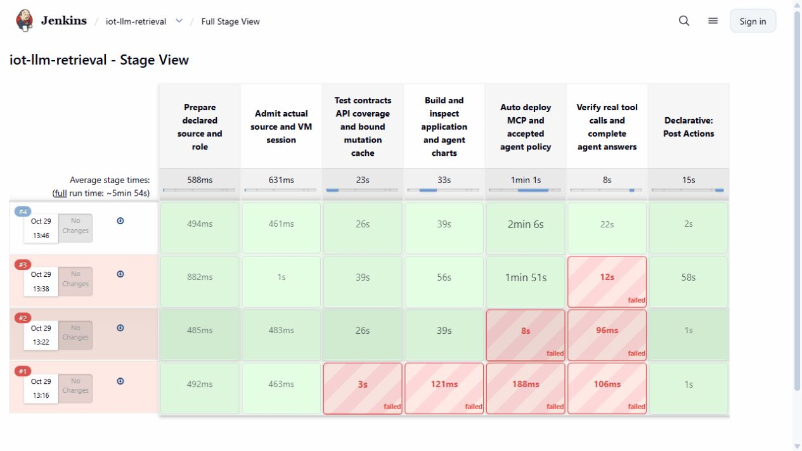
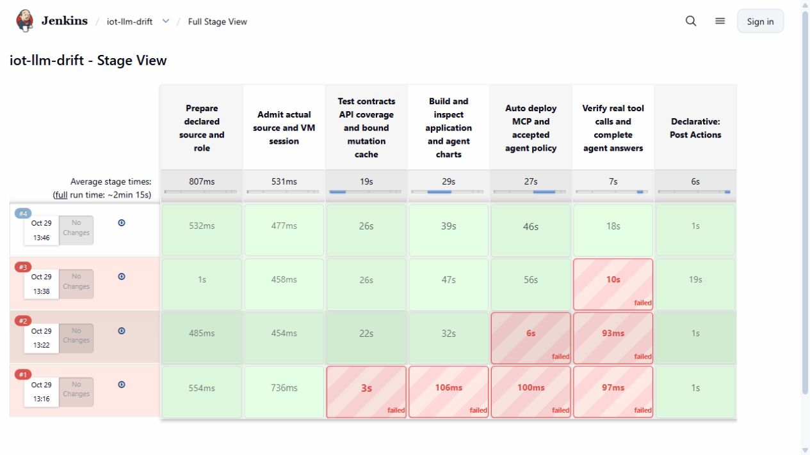
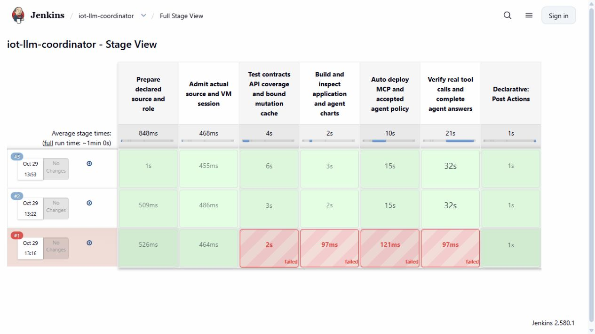

# Delivering MCP services and IoT agents

Three private Jenkins jobs share a source-bound release procedure. Each job keeps its own build number, tests, chart packages, deployment receipts and original agent responses.

| Job | Application delivered | Native acceptance |
|---|---|---|
| `iot-llm-retrieval` | Retrieval MCP service and the accepted retrieval-agent policy | Features, prediction and source-cited knowledge agree with actual tool results |
| `iot-llm-drift` | Drift MCP service and the accepted drift-agent policy | The reported assessment matches the actual unique 32-machine cohort |
| `iot-llm-coordinator` | Accepted coordinator policy | Two independent child histories support the complete combined answer |

On 29 October 2026, **retrieval build 4, drift build 4 and coordinator build 3 all passed** their seven native Jenkins stages on the retained lab. All three used source commit `daee5d3ff335917ffb7f1705e17bf1e723aa20ad`. Coordinator acceptance ran after both MCP releases and checked two real child sessions. These are three separate delivery pipelines; the [RAG pipeline](ci-rag.md) has its own release record.







## Follow one release

The [Jenkinsfile](../infra/ci/Agents.Jenkinsfile) selects the role from the declared job name. The [driver](../scripts/ci-agents.py) binds each phase to the full Git commit and release identity. A [source declaration](../infra/ci/agents-source.json) covers application code, transitive test imports, charts and the frozen quality evidence.

The two MCP jobs build a test image over the retained dependency image, then execute all **132 native API cases** and export statement/branch coverage. Each accepted run recorded **98.0337% statement coverage and 90.7407% branch coverage**, with no excluded lines or skipped cases. Fourteen additional contract tests check source completeness, lease boundaries, generation-aware readiness, capability limits, quality thresholds and separate subprocess output streams.

The existing strict mutation result is **681 / 850 = 80.117647%**. Timeouts and worker errors remain in the denominator. CI rechecks the complete original ledger and compares every file in the 50-file candidate seal and 64-file native seal with the current source. This is explicitly a cached mutation result on unchanged code; API tests and coverage run fresh. A source or test change blocks reuse of that cache.

The coverage scope is the MCP business package, `services.mcp_tools`; the external probe client is omitted from that measurement. The reported package has no excluded lines. Jenkins stage captures show the delivery result; the remaining technique-specific screenshots are still identified separately in the rubric.

The application build copies the tested MCP files over the verified runtime dependencies. CI reads those files back from the actual non-root image. It exports the image and computes the configuration digest from the original export bytes; the imported Pod image must match that digest. Docker's displayed image ID and containerd's imported ID are not assumed interchangeable.

## Deploy the accepted policy

Each MCP job upgrades only its own release with Helm's atomic wait behavior. Existing credentials, reference data and the sealed knowledge snapshot stay in the release values. Kubernetes Secrets supply the tokens at runtime.

The three agents belong to one shared Helm release. Each job therefore reapplies the complete accepted group and verifies its corresponding role. The package declares application version 0.2.2 and uses the [reviewed post-renderer](../scripts/render-agent-responses.py) with the [response policy](../agents/response-policy.json). The shared model configuration, gVisor pools and KEDA selector fields must remain intact. An identical agent policy is an idempotent reapply; a new agent-version rollout is not claimed.

After deployment, CI calls the real MCP service and sends a fresh A2A question. A completed task is only the first check. Specialist answers must match their original tool histories. Coordinator acceptance reads both actual child sessions and their tasks, checks their MCP facts, and verifies that the combined answer preserves the child results.

## Read failures before retrying

The first source packet omitted a transitive test dependency. All three build-1 runs stopped before deployment. The next packet made that dependency explicit and added an admission test for incomplete input sets.

The subsequent MCP runs reached deployment admission with fewer than ten minutes left on the genuine feature lease. They stopped before changing their releases. The correct recovery is fresh Feast materialization after physical cache expiry. Editing a receipt timestamp or extending a TTL would invalidate the evidence.

Build 3 of each MCP job deployed successfully and passed its native tool probe, then failed in the CI consumer: diagnostic JSON lines on stderr had been merged with the final JSON object on stdout. The ownership-checked recovery branch actually restored both affected releases' previous values. This was a real CI failure, rather than an injected API fault. The corrected consumer preserves stdout, stderr and exit status separately and requires a successful process plus one valid JSON result. Build 4 passed with the same MCP business code and tests.

The original failed builds, deployment plans, rollback receipts and successful retries are retained in the [native archive](evidence/ci-agents/native-archive.json). No failed attempt is presented as successful deployment evidence.

## Run and explain it

Use the retained lab and its [recovery procedure](demo-walkthrough.md), with the private Jenkins port forwarded through IAP. Sign in with the locally maintained operator account, open one job and choose **Build with Parameters**. The prepared application revision is:

```text
SOURCE_COMMIT=daee5d3ff335917ffb7f1705e17bf1e723aa20ad
```

Enter that revision explicitly; older job defaults can refer to the first prepared packet. The lab uses an operator-prepared source packet and a manually started Jenkins build. The test/build/deploy/verification stages then run automatically. A Git clone carries code and recorded evidence; it does not contain the VM's images, data, credentials or prepared source packets. Before another live run, confirm that the CPU/GPU sessions and genuine online-feature lease have sufficient time left. The pipeline deliberately refuses a short lease.

To verify the recorded milestone without starting the VM, run from the repository root:

```powershell
python -B -S scripts/verify-ci-agents.py
```

The checker authenticates the original archive inventory, all 362 current source inputs, native JUnit/coverage output, cached mutation bindings, application configuration digests, chart packages, actual Pod identities and complete agent answers. It also checks the rejected and rolled-back predecessors. The [capture index](evidence/ci-agents/ui/index.json) records the three original, unedited Jenkins screenshots.

For presentation, open the successful stage view, then inspect its test report, application/chart identities and original A2A response. Trace one feature value or citation from the final answer back to its tool result. For the coordinator, show both child-session IDs. Explain why an old successful response cannot prove that a newly deployed release works.

The remaining LLM gateway, telemetry, A/B and extension requirements stay separate in the [final LLM tracker](final-llm-rubric-tracker.md).
