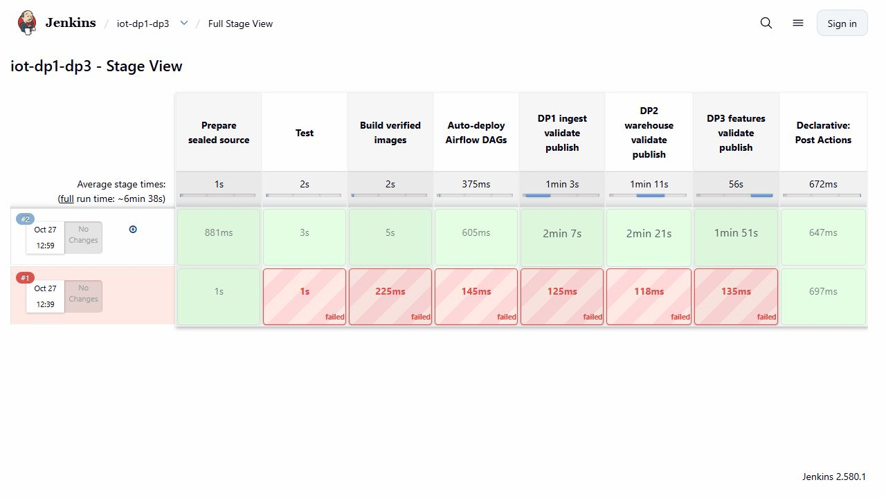

# CI/CD for DP1–DP3

The data-pipeline Jenkins job runs tests, builds its controller image and deploys three Airflow DAGs for Bronze ingestion, Silver/Gold preparation and feature/label output. Successful publication requires validation and DataHub readback rather than only a process exit.

The recorded build 2 succeeded. The three native DAG runs and their task order are retained with source/image identities, API responses, validation artifacts and UI captures. A deliberately invalid batch was blocked instead of being published as a successful downstream dataset.

This is the CI pilot workload. The 102.45 GB Spark run was submitted and verified separately; a successful pilot DAG does not mean that Airflow has executed the entire full-scale workload. Credentials remain in runtime/Jenkins, outside source and evidence.

## Implementation and evidence

- [Source: infra/ci/Jenkinsfile](../infra/ci/Jenkinsfile)
- [Source: infra/ci/iot_ci_data_pipelines.py](../infra/ci/iot_ci_data_pipelines.py)
- [Source: scripts/ci-data-pipelines.py](../scripts/ci-data-pipelines.py)
- [Source: infra/ci/Jenkins.Dockerfile](../infra/ci/Jenkins.Dockerfile)
- [Source: infra/ci/jenkins-bootstrap.groovy](../infra/ci/jenkins-bootstrap.groovy)
- [www.jenkins.io / docker](https://www.jenkins.io/doc/book/installing/docker/)
- [www.jenkins.io / pipeline](https://www.jenkins.io/doc/book/pipeline/)
- [plugins.jenkins.io / credentials-binding](https://plugins.jenkins.io/credentials-binding/)
- [Recorded artifact: ci-data-pipelines/native/verification.json](evidence/ci-data-pipelines/native/verification.json)
- [Recorded artifact: ci-data-pipelines/capture/stage-view.json](evidence/ci-data-pipelines/capture/stage-view.json)
- [Recorded artifact: ci-data-pipelines/screenshots/jenkins-build2-source-commit.jpg](evidence/ci-data-pipelines/screenshots/jenkins-build2-source-commit.jpg)
- [Recorded artifact: ci-data-pipelines/reports/dp1-verification.json](evidence/ci-data-pipelines/reports/dp1-verification.json)
- [Recorded artifact: ci-data-pipelines/reports/dp2-verification.json](evidence/ci-data-pipelines/reports/dp2-verification.json)
- [Recorded artifact: ci-data-pipelines/reports/dp3-verification.json](evidence/ci-data-pipelines/reports/dp3-verification.json)
- [Recorded artifact: ci-data-pipelines/reports/build.json](evidence/ci-data-pipelines/reports/build.json)
- [Recorded artifact: ci-data-pipelines/reports/source-receipt.json](evidence/ci-data-pipelines/reports/source-receipt.json)
- [Recorded artifact: ci-data-pipelines/native/console.txt](evidence/ci-data-pipelines/native/console.txt)
- [Recorded artifact: ci-data-pipelines/indexed/datahub.json](evidence/ci-data-pipelines/indexed/datahub.json)
- [Source: pipelines/ci_metadata.py](../pipelines/ci_metadata.py)
- [Recorded artifact: ci-data-pipelines/screenshots/dp1-native-verification.jpg](evidence/ci-data-pipelines/screenshots/dp1-native-verification.jpg)
- [Recorded artifact: ci-data-pipelines/screenshots/dp2-native-verification.jpg](evidence/ci-data-pipelines/screenshots/dp2-native-verification.jpg)
- [Recorded artifact: ci-data-pipelines/screenshots/dp3-native-verification.jpg](evidence/ci-data-pipelines/screenshots/dp3-native-verification.jpg)
- [Recorded artifact: ci-data-pipelines/screenshots/capture.json](evidence/ci-data-pipelines/screenshots/capture.json)
- [Recorded artifact: ci-data-pipelines/capture/evidence-map.json](evidence/ci-data-pipelines/capture/evidence-map.json)
- [Recorded artifact: ci-data-pipelines/capture/manifest.json](evidence/ci-data-pipelines/capture/manifest.json)
- [Recorded artifact: ci-data-pipelines/capture/source-commit.json](evidence/ci-data-pipelines/capture/source-commit.json)
- [Recorded artifact: ci-data-pipelines/failed-build/console.txt](evidence/ci-data-pipelines/failed-build/console.txt)
- [Recorded artifact: ci-data-pipelines/python-temp-repair/verification.json](evidence/ci-data-pipelines/python-temp-repair/verification.json)
- [Recorded artifact: ci-data-pipelines/capture/controller-runtime.json](evidence/ci-data-pipelines/capture/controller-runtime.json)

## Recorded interface views

These are original captures from the runs described above. Their timestamps, model identities and visible states belong to those runs.

## Related documentation

[Current architecture](architecture.md) · [Demo and recovery](demo-walkthrough.md) · [Rubric index](rubric-tracker.md)

[Original run notes](https://github.com/anle0429/iot-maintenance-platform/blob/f4da7bd21667a8bfca5715a7456bc2bcc813b0fc/docs/ci-data-pipelines.md) retain the full historical narrative. Raw evidence files have not been translated or rewritten.
