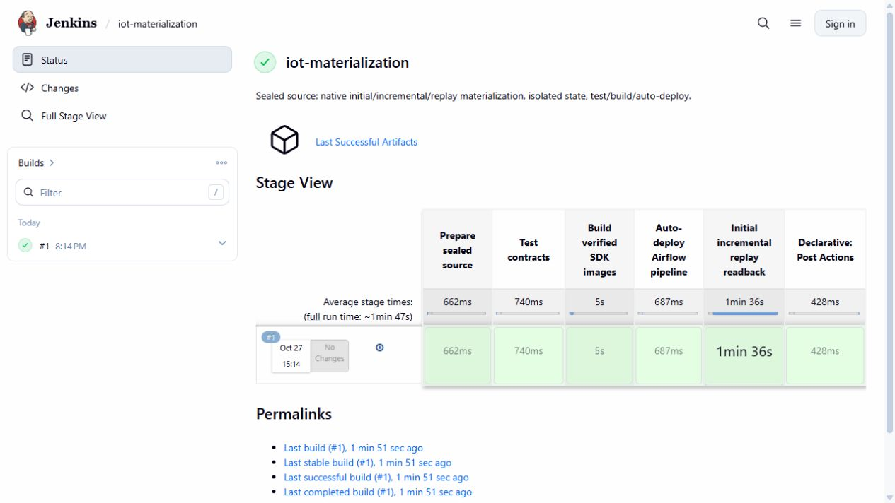
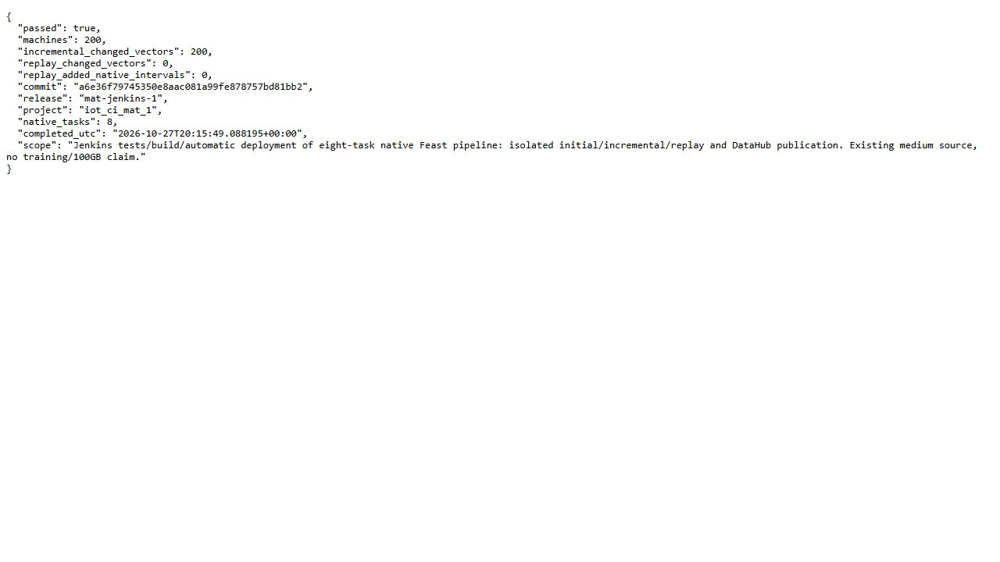

# CI/CD for incremental Feast materialization

The materialization CI job tests and builds a release, deploys the Airflow definition, and verifies native initial, incremental and replay behavior in an isolated CI namespace. It does not rewrite the earlier materialization checkpoint or training registry.

The successful Jenkins run includes eight successful Airflow task instances across the recorded materialization/metadata runs. Online checks read all 200 machine vectors and timestamps. Replay must preserve values; backward cutoffs are rejected; DataHub publication is read back after validation.

Source bindings, controller/container identities, registry state and original UI captures establish the test/build/auto-deploy path. Simulated cutoffs and actual execution clocks are recorded separately. The workflow is a bounded backfill demonstration, not evidence of continuously updating physical pumps.

## Commands and recorded examples

Run commands from the repository root unless the example explicitly changes the working directory. Use a fresh output/run name and check the linked runbook before starting platform services. Examples belong to the recorded workload on this page.

```bash
python scripts/package-materialization-release.py \
  --commit a6e36f79745350e8aac081a99fe878757bd81bb2 \
  --output outputs/materialization-release.tar
```

```python
from pathlib import Path
from hashlib import sha256
import json, tarfile

packet = Path('outputs/materialization-release.tar')
manifest = json.loads(packet.with_suffix('.manifest.json').read_text())
assert sha256(packet.read_bytes()).hexdigest() == manifest['archive_sha256']
target = Path('data/ci/source') / manifest['commit']
target.mkdir(parents=True, exist_ok=False)
with tarfile.open(packet) as archive:
    assert all(m.isfile() and m.name.startswith('tree/')
               and '..' not in Path(m.name).parts for m in archive.getmembers())
    archive.extractall(target, filter='data')
for name, expected in manifest['files'].items():
    assert sha256((target / 'tree' / name).read_bytes()).hexdigest() == expected
(target / 'manifest.json').write_text(json.dumps(manifest, indent=2) + '\n')
```

## Implementation and evidence

- [Source: infra/ci/Materialization.Jenkinsfile](../infra/ci/Materialization.Jenkinsfile)
- [Source: scripts/ci-materialization.py](../scripts/ci-materialization.py)
- [Source: infra/ci/iot_ci_materialization.py](../infra/ci/iot_ci_materialization.py)
- [Recorded artifact: ci-materialization/controller/build.json](evidence/ci-materialization/controller/build.json)
- [Recorded artifact: ci-materialization/controller/stage-view.json](evidence/ci-materialization/controller/stage-view.json)
- [Recorded artifact: ci-materialization/controller/console.txt](evidence/ci-materialization/controller/console.txt)
- [Recorded artifact: ci-materialization/controller/source-manifest.json](evidence/ci-materialization/controller/source-manifest.json)
- [Recorded artifact: ci-materialization/reports/airflow.json](evidence/ci-materialization/reports/airflow.json)
- [Recorded artifact: ci-materialization/reports/verification.json](evidence/ci-materialization/reports/verification.json)
- [Recorded artifact: ci-materialization/reports/native/initial/materialization.json](evidence/ci-materialization/reports/native/initial/materialization.json)
- [Recorded artifact: ci-materialization/reports/native/incremental/materialization.json](evidence/ci-materialization/reports/native/incremental/materialization.json)
- [Recorded artifact: ci-materialization/reports/native/replay/materialization.json](evidence/ci-materialization/reports/native/replay/materialization.json)
- [Recorded artifact: ci-materialization/reports/datahub-indexed.json](evidence/ci-materialization/reports/datahub-indexed.json)
- [Recorded artifact: ci-materialization/reports/admission.json](evidence/ci-materialization/reports/admission.json)
- [Recorded artifact: ci-materialization/capture/manifest.json](evidence/ci-materialization/capture/manifest.json)
- [Recorded artifact: ci-materialization/capture/evidence-map.json](evidence/ci-materialization/capture/evidence-map.json)
- [Recorded artifact: ci-materialization/capture/failed-helper-journal.txt](evidence/ci-materialization/capture/failed-helper-journal.txt)
- [Recorded artifact: ci-materialization/controller/verification.json](evidence/ci-materialization/controller/verification.json)
- [Source: scripts/package-materialization-release.py](../scripts/package-materialization-release.py)
- [www.jenkins.io / jenkinsfile](https://www.jenkins.io/doc/book/pipeline/jenkinsfile/)

## Recorded interface views

These are original captures from the runs described above. Their timestamps, model identities and visible states belong to those runs.






## Related documentation

[Current architecture](architecture.md) · [Demo and recovery](demo-walkthrough.md) · [Rubric index](rubric-tracker.md)

[Original run notes](https://github.com/anle0429/iot-maintenance-platform/blob/f4da7bd21667a8bfca5715a7456bc2bcc813b0fc/docs/ci-materialization.md) retain the full historical narrative. Raw evidence files have not been translated or rewritten.
