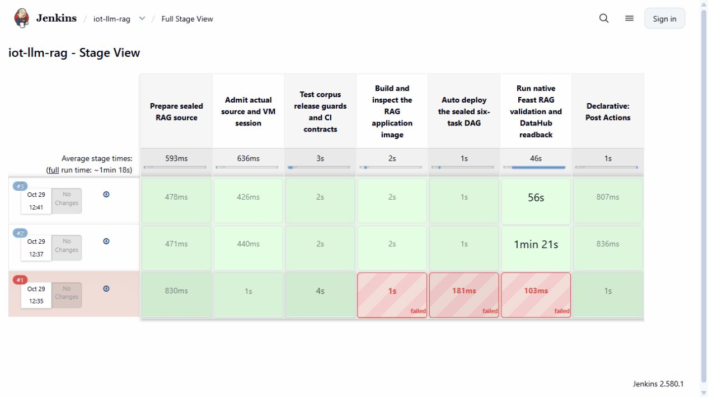
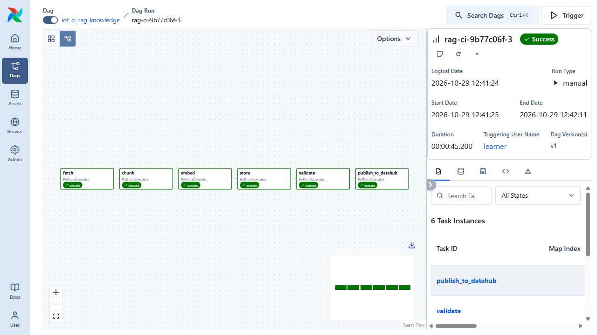

# RAG delivery through Jenkins and Airflow

The private `iot-llm-rag` Jenkins job tests a pinned source revision, builds the RAG application image, deploys its Airflow DAG and waits for a fresh six-task run. Build **3** completed on 29 October 2026 with all seven Jenkins stages successful. Airflow run `rag-ci-9b77c06f-3` processed four authored documents into 18 chunks, passed ten persisted-data checks and published source-bound lineage to DataHub.



## What happens in a release

1. **Prepare and admit.** Jenkins copies the operator-prepared source for the selected full Git commit. Each phase checks its file hashes, build identity, remaining VM session, available RAM and both data disks.
2. **Test.** Thirteen tests exercise corpus provenance, chunk boundaries, release integrity and CI contracts. The successful native test container and its console are retained.
3. **Build.** Docker packages the application, corpus and embedding configuration over the verified dependency image. CI reads the packaged files back from the non-root image and compares their hashes with the tested source.
4. **Deploy.** CI creates a new run manifest and isolated state directory, then installs `iot_ci_rag_knowledge`. The existing manual DAG remains available. The CI DAG authenticates its selected task module before executing it.
5. **Execute and verify.** Airflow runs `fetch → chunk → embed → store → validate → publish_to_datahub`. Jenkins waits for that exact run, then reconciles all six container identities, exit states, persisted checks and DataHub responses.

The first five tasks use the newly built application image. Publication uses the retained DataHub SDK image with the same sealed application source mounted read-only. Both image IDs are recorded. The data tasks also mount that source, so the packaged-byte comparison is essential: it proves that the built application and the executed modules agree.



## Recorded result

| Observation | Build 3 |
|---|---|
| Tested source | `9b77c06fe872d588e4f7e55af8c5834f2b03448e` |
| Jenkins duration | 65.757 seconds |
| Airflow duration | 45.200 seconds |
| Tasks | Six successful tasks, each on its first attempt |
| Persisted data | 4 documents; 18 chunks, embeddings, offline rows and online entities |
| Validation | Ten checks passed; replay returned identical online data |
| Retrieval | Three native semantic queries found their expected document in the top three |
| Governance | Five knowledge datasets, ten assertions and the actual CI flow with all six jobs |
| Credentials | Existing Jenkins credential `iot-airflow`; no values in source or evidence |

The small corpus uses cached CPU embedding dependencies. These timings describe one lab release with warm dependencies; they do not measure GPU inference or full-platform capacity. The separate [GPU report](gpu-agent-routing.md) covers generation and agent conversations.

Build 1 is retained as a failure: Docker interpreted a configuration digest as a remote image name. The correction verifies the existing dependency ID, assigns a local tag and checks its layers after building. Build 2 passed, but its inherited publication linked to the manual DAG. Build 3 adds a separate CI governance entry point with the actual DAG URL, commit and Jenkins release. The original manual publisher remains source-identical to its earlier evidence.

## Run it yourself

For a laptop review with the VM stopped, run from the repository root:

```powershell
python -B -S scripts/verify-ci-rag.py
```

Expect `passed: true`, six native tasks and ten quality checks. This verifies the recorded packet without starting services. It checks 260 original native payloads, 41 current source files and both original screenshots.

To run a new release, first recover the retained lab using the [demo runbook](demo-walkthrough.md). It must already contain its dependency images, embedding cache, DataHub, Airflow and Jenkins state. On the private Jenkins interface, sign in with the locally maintained operator account, open **iot-llm-rag → Build with Parameters**, and explicitly select this prepared revision:

```text
SOURCE_COMMIT=9b77c06fe872d588e4f7e55af8c5834f2b03448e
```

Only operator-prepared revisions beneath `data/ci/source/` are accepted. A Git clone alone does not contain that runtime state. The account material stays outside Git in the VM's `data/runtime/ci/jenkins-private/`; Airflow credentials are supplied by Jenkins Credentials. Do not paste them into pipeline files.

Watch each stage, then open the new Airflow run named `rag-ci-9b77c06f-<build number>`. Its six task states should be **Success**. Inspect `outputs/ci-rag/` in the build artifacts: `verify.json` identifies the real task containers, `quality.json` records the persisted checks, and `ci-datahub-publication.json` contains the independently read-back CI flow and job identities. Preserve a failed run and inspect its first failed stage before starting another.

For presentation, explain one complete chain: selected Git source → tests → image → deployed DAG → persisted Feast rows → quality checks → DataHub lineage. Show how the metadata identifies the exact source and build, then use the [agent notebook](agent-notebook.md) to explain how the assistant retrieves that kind of knowledge.

## Scope and evidence

The [native archive](evidence/ci-rag/native-archive.json), [Jenkins stages](evidence/ci-rag/jenkins-stages.json), [quality report](evidence/ci-rag/quality.json) and [CI governance readback](evidence/ci-rag/ci-datahub-publication.json) are checked by the [offline verifier](../scripts/verify-ci-rag.py). The archive preserves the failed predecessor and both successful builds. Screenshots are original browser captures.

This checkpoint covers RAG pipeline delivery, L35. A later [MCP/agent delivery checkpoint](ci-agents.md) records three separate successful pipelines for L36–L38. Gateway access, full agent telemetry, A/B evaluation and the remaining LLM requirements are tracked in the [final LLM rubric](final-llm-rubric-tracker.md).
