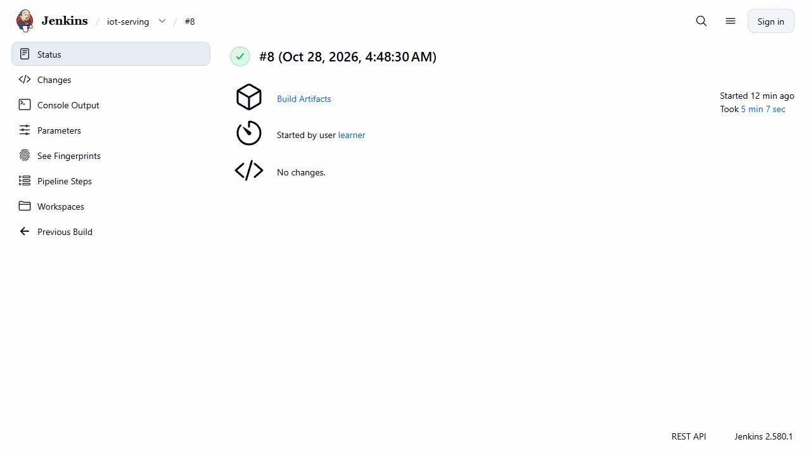
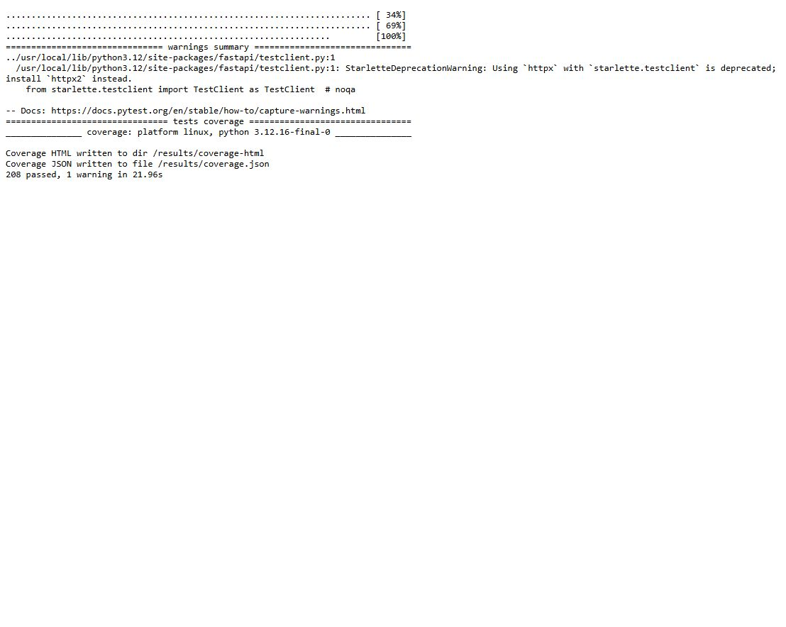
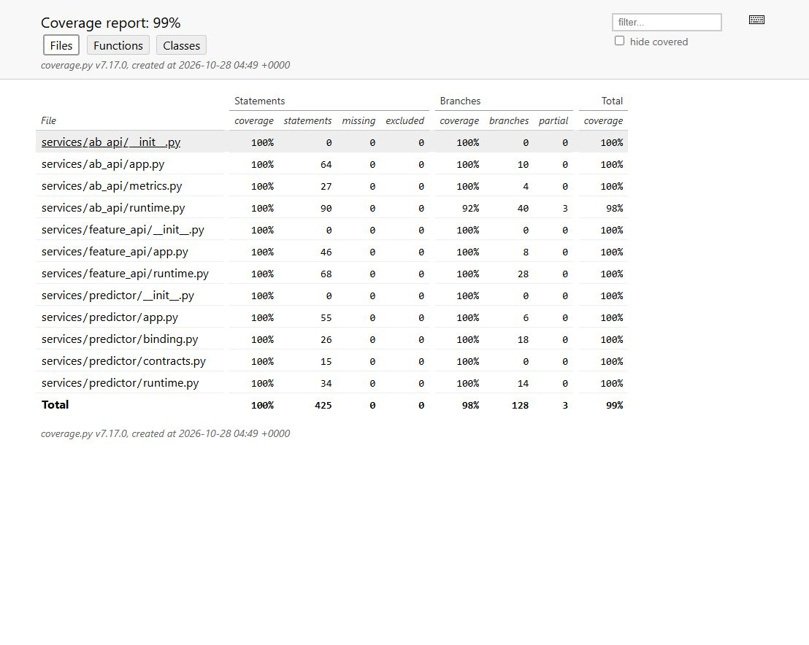
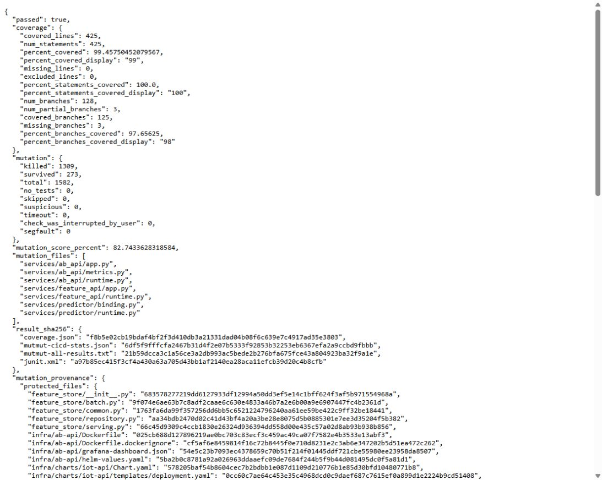
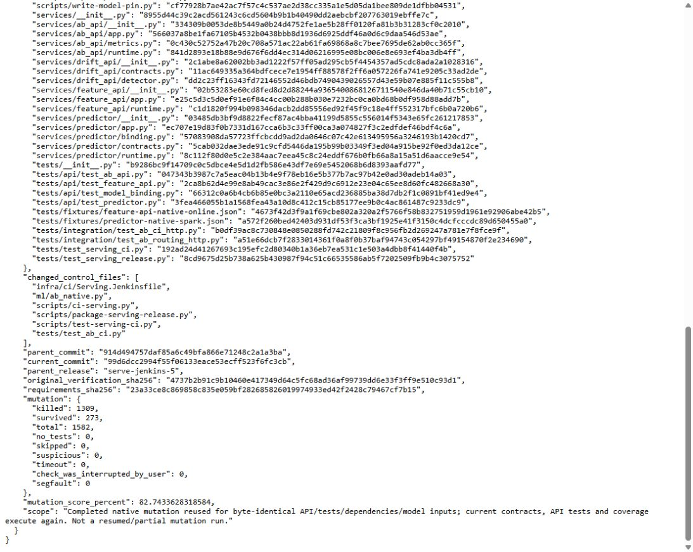
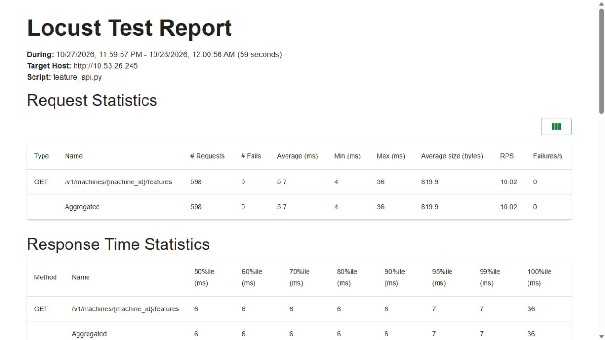
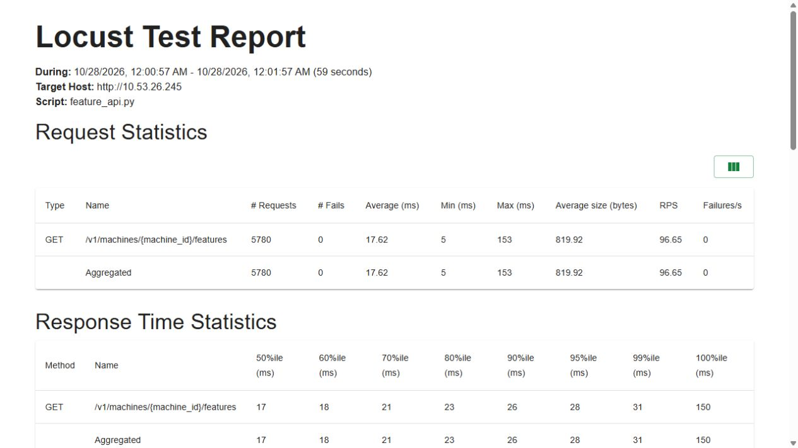

# CI phục vụ model: Jenkins → KServe và feature API

Cập nhật28/10: [overlay metrics/traces](api-observability.md) source2f đã gate/rollout riêng, chưa Jenkins serving build mới hoặc Locust mới. Các kết quả CI8/source99 bên dưới giữ đúng phạm vi lịch sử.

## Kết quả native ngày28/10/2026

**Jenkins `iot-serving/8` SUCCESS trong307,949giây**, source **`99d6dcc2994f55f06133eace53ecff523f6fc3cb`**, packet75file. Chạy trên cùng Linux VM8CPU/64GiB, K3s1.35.9+k3s1/Docker29.9.2. CI đã chọn model6 qua MLflow SDK, kiểm thử, build/probe/import ba image, stage private, chạy A/B trước cutover, đổi feature API bằng Helm và kiểm toàn bộ200máy. Model6 có marker production **cho export trong lab dữ liệu mô phỏng**; đây không phải phê duyệt vận hành máy bơm thực.

[Refresh vận hành06:33UTC](active-feature-refresh.md) dùng cùng image/model6 nhưng seed mới từ materialization thật sau khi lease cũ hết. Kết quả200máy được lưu riêng, không tính thành một lần chạy CI8 mới.

| Phép kiểm | Kết quả thực tế | Bằng chứng |
|---|---|---|
| Native contract/API |104contracts/41subtests;208API tests PASS |[Contracts](evidence/ci-serving-linux/ci/tests/contracts.txt), [API](evidence/ci-serving-linux/ci/tests/api-tests.txt) |
| API coverage |425/425statements100%;125/128branches97,65625%;0excluded |[HTML](evidence/ci-serving-linux/ci/tests/coverage-html/index.html), [gate](evidence/ci-serving-linux/ci/tests/verification.json) |
| Mutation đầy đủ |1.309killed/1.582total=82,74336%;273survived; các trạng thái bỏ/chưa xong đều0 |[Provenance](evidence/ci-serving-linux/ci/tests/mutation-provenance.json), [inventory parent5](evidence/ci-serving-linux/mutation-parent5/tests/mutmut-all-results.txt) |
| A/B model1/model6 |780trial:376/404;94/101snapshot;40concurrent replay không tăng đếm |[Native report](evidence/ci-serving-linux/ci/ab-verification.json), [ledger readback](evidence/ci-serving-linux/independent-hdd-ledger.json) |
| Full cutover |195operating predictions đúng arithmetic;5stopped trả409 |[200HTTP responses](evidence/ci-serving-linux/ci/http-all-machines.json) |
| Controlled rollback |6 →1 →6; mỗi bước195prediction+5stopped, phục hồi candidate |[Rollback](evidence/ci-serving-linux/rollback/verification.json) |
| Dashboard native |6panel;26giá trị qua mỗi engine Prometheus/Grafana;16PSI tính độc lập |[Query readbacks](evidence/ci-serving-linux/monitoring/panel-queries.json) |

Mutation được **dùng lại từ lượt hoàn chỉnh build5/source914d494**, không chạy lại trong8:67file API/test/fixture/model/dependency và pip freeze/model pin khớp; hash artifact gốc/full inventory đều được kiểm. Contract/API/coverage chạy mới trong8. Source/API/test/dependency đổi sẽ từ chối reuse; không nhận partial hoặc reuse-chain. Test container2CPU/4GiB không OOM. [Manifest](evidence/ci-serving-linux/manifest.json) giữ172payload/11.639.527byte và10JPEG gốc; `native-capture.json` giữ inventory161file ban đầu, chỉ bỏ hai file bookkeeping của coverage khi xuất bản. Các projection có ghi nguồn/hash và phép chọn; không có database, secret, helper setup hoặc dataset lớn trong capsule.











## Rollback và cửa sổ đo

Build6 bị guard chặn khi HPA thêm pod giữa A/B. Source mới journal UID/bounds, tạm giữ mỗi predictor1replica, chờ hội tụ rồi giữ nguyên guard identities; CI8 đọc initial/final giống nhau và phục hồi đúng bounds1..2. Đây là điều kiện đo ổn định trên một VM, chưa phải bằng chứng HA/autoscale.

CI7 SUCCESS nhưng kiểm rollback riêng sau đó thất bại: Redis baseline đã hết key dù context chưa hết hạn. CI8 chuẩn bị state/ConfigMap mới bằng materialization thật, rồi kiểm cả HTTP/cohort/pin, lease context và **PTTL vật lý của đủ200key** trước A/B và hai lần trước cutover. Ngưỡng dự phòng15phút giữ nguyên; minPTTL ngay trước switch3.040.112ms. Không sửa đồng hồ hoặc TTL để vượt guard. [Lỗi rollback7](evidence/ci-serving-linux/failed-fallback7/rollback-to-baseline.txt), [cache diagnostic](evidence/ci-serving-linux/failed-fallback7/baseline-redis-diagnostic.json), [guard6](evidence/ci-serving-linux/failed-ab6/ab.txt) được giữ cùng lượt thành công.

Post-CI controlled rollback8 hoàn tất04:55:43UTC, kiểm HTTP và portable model từ từng pod đúng đường dẫn bundle rồi phục hồi6 trong `finally`. Đây là rollback có kiểm soát sau CI; chưa đo zero downtime dưới tải hoặc thử image lỗi trong Helm atomic. Mọi rollout/rollback tiếp theo vẫn phải kiểm context và cache thực còn hạn.

## Locust native: feature retrieval API

Locust2.47.0,1/10users,60giây cấu hình mỗi lượt, pacing0,1giây/user, ramp2/s; cùng VM dùng chung. SLA giữ≥100request,0failure,P95≤500ms. Workload chỉ `GET` feature, không đo prediction TPS hoặc tải cực đại.

| Users | Final requests | Failures | Req/s | P50/P95/P99 ms | HTML |
|---:|---:|---:|---:|---|---|
|1|598|0|10,016|6/7/7|[Báo cáo1](evidence/ci-serving-linux/load/users-1.html)|
|10|5.780|0|96,652|17/28/31|[Báo cáo10](evidence/ci-serving-linux/load/users-10.html)|

HTML cuối lượt khớp quitting-SLA summary. CSV là snapshot định kỳ sớm hơn:591/5.706request, cùng0failure/P95; history cuối khớp CSV. [Locust2.47 stats](https://github.com/locustio/locust/blob/2.47.0/locust/stats.py) ghi CSV mỗi giây và đóng file không ghi lại snapshot cuối. Giữ nguyên cả hai, không sửa CSV cho bằng HTML. Giao diện có thể hiển thị59giây do làm tròn; cấu hình thực60giây. Receipts có epoch hoặc timestamp kèm offset, quy đổi UTC khi đối chiếu; trình duyệt trênPC Chicago hiển thị giờ địa phương.





## Tự kiểm bằng chứng và chạy lại

Từ repo root trong bản clone có lịch sử Git đầy đủ:

```powershell
python -S scripts/verify-native-serving.py
```

Verifier chỉ cần standard library+Git, không bật Docker/VM: kiểm172hash, tái tạo packet75file và parent73file từ Git lịch sử,67protected inputs, toàn bộ1.582mutation IDs, image source/CRI config IDs, UID/PV/PVC/HDD ledger,780HTTP/arithmetic/cohort/replay,600HTTP rollback,26series mỗi engine, HTML/CSV và10JPEG nguyên gốc. Đây là audit receipt đã lưu, không tạo một deployment mới. Khi dùng shallow clone cần lấy đủ historical commits trước.

Chạy hệ thống mới cần runtime/dataset/registry và quyền private Jenkins trênVM. Chọn fullGitSHA đã push và version model cụ thể; exporter yêu cầu production policy. Không reuse ledger/release cũ. Candidate6 hiện đã active nên không submit lại thí nghiệm6-vs6; cần một candidate thực sự mới và baseline khỏe. Nếu chạy mutation mới lâu, chuẩn bị lại baseline bằng dữ liệu thật trước cửa sổ A/B, kiểm TTL/clock reserve; không refresh giữa thí nghiệm. Guard90phút ban đầu/15phút các phase,12GiB RAM/20GB hai đĩa và VMautoSTOP8giờ giữ nguyên. UI chỉ qua IAP/loopback, không public webhook.

Mean risk/PSI không đo accuracy và không tự phê duyệt model. [Native A/B dashboard](ab-monitoring.md) giải thích phép tính và giới hạn. Các mục sau là lịch sử theo đúng source/build; những câu “chưa” trong snapshot cũ không mô tả CI8.

## CI7 thành công; kiểm tra cache fallback

**Build7/source`7c37ee8` đã SUCCESS sau297,749giây.**95contracts/41subtests và208API tests Linux PASS;425/425statements/125of128branches, mutation gốc build5 được dùng lại hợp lệ1.309/1.582=82,74336%. Ba image đã build/probe/import; A/B native780trial chia360/420,40replay không tăng đếm,90/105snapshot; initial/final pod/container identities khớp. Helm đã switch model6 và độc lập kiểm200máy:195prediction đúng portable arithmetic,5stopped409. Cả hai HPA đã restore1..2. Terminal122payload/4.367.770byte được giữ nguyên; ảnh Jenkins/coverage/API/gate/provenance là ảnh gốc.

Kiểm post-CI rollback về revision12 gặp lỗi readiness và timeout240giây. `finally` đã restore candidate6, không ghi marker thành công cho fallback. Chẩn đoán readonly: Redis legacy0key,600expired/0evicted; context thật được chuẩn bị04:06:12UTC vẫn chưa hết3600giây. Đây là hai hạn khác nhau. [Feast0.67 Redis writer](https://github.com/feast-dev/feast/blob/v0.67.0/sdk/python/feast/infra/online_stores/redis.py) bỏ qua event có timestamp bằng/cũ hơn và chỉ đặt TTL trong nhánh ghi; vì vậy lặp cùng snapshot không bảo đảm gia hạn TTL cache. Native module source và Redis diagnostics đã giữ; không sửa timestamp, kéo TTL hoặc xóa key để che lỗi.

Adapter mới kiểm fallback trước A/B và ngay trước cutover: API ready; toàn bộ cohort lấy feature đúng máy/protocol; ít nhất một operating prediction đúng pin; context còn≥15phút; Redis service private có đủ key cho cohort và **PTTL thực mỗi key≥15phút**. Mọi bước readonly.104contracts/41subtests trênPC PASS, có ca context mới nhưng physical TTL hết, API lỗi, cohort/pin/trace/endpoint sai. Sửa này đã được kiểm trongCI8 ở đầu tài liệu; CI7 SUCCESS giữ đúng source cũ. Baseline8 mới dùng state/ConfigMap riêng và kiểmTTL≥55phút sau materialization; receipt/ledger cũ giữ nguyên.

Các mục bên dưới giữ lịch sử build5/6 và phần chuẩn bị ban đầu; các câu “chưa” trong snapshot cũ chỉ áp dụng nguồn/lượt nêu ở mục đó.

## Build6 và cửa sổ đo ổn định

Build6/source`314cfc9` kết thúc FAILURE sau255,424giây:84contracts/41subtests và208API tests Linux PASS; dependency/model pin/67file bảo vệ khớp build5 nên mutation hoàn chỉnh82,74336% được dùng lại với provenance riêng. Ba image build/probe/import và stage model6 thành công. Trong thử A/B thật, HPA thêm pod candidate lúc04:12:23UTC; guard phát hiện tập pod thay đổi và chặn cutover. API chính vẫnmodel1. Snapshot terminal83payload được giữ nguyên, không gọi đây là A/B đạt.

Adapter hiện ghi journal trước khi tạm đặt cả baseline/candidate về`minReplicas=maxReplicas=1`, chờ ISVC/HPA/Deployment thực tế hội tụ rồi mới lấy identities/counters. Guard ổn định giữ nguyên; initial/final identities được lưu cả khi guard lỗi. Sau verify hoặc rollback, CI phục hồi đúng bounds ban đầu bằng JSON patch kiểm UID/bounds, từ chối ghi đè thay đổi của người vận hành. Việc này tạo điều kiện đo kiểm soát, không chứng minh autoscale hay HA. [KServe HPA](https://kserve.github.io/website/docs/model-serving/predictive-inference/autoscaling/hpa-autoscaler) giải thích quan hệ ISVC/HPA; [Jenkins `post cleanup`](https://www.jenkins.io/doc/book/pipeline/syntax/#post) được dùng để restore sau các post-condition khác, rồi archive trong`finally`.

95contract tests/41subtests PASS trênPC sau sửa, gồm partial patch failure, replica chưa hội tụ, timeout, UID/policy conflict và journal không bị thay. Còn cần lượt native mới để nhận Jenkins SUCCESS và full cutover; không dùng lại ledger của build6.

## Native build5 và sửa adapter sau gate thành công

Build5/source`914d494` kết thúc FAILURE sau44phút56,068giây ở bước A/B, trước full cutover. Phần kiểm thử đã hoàn tất thật:63contracts/41subtests và208API tests PASS;425/425statements,125/128branches; **1.309/1.582mutants=82,74336%**,273survivor,0timeout/skip/no-test/interruption. Inventory/stats/hashes đã qua strict gate; không nhận135mutant chưa xong của build4 vào kết quả này.

Ba image predictor/feature/A-B đã build/probe/import và model6 đã stage private thành công. A/B bị chặn ngay khi đọc bundle của baseline: adapter giả định`/app/model`, còn imagelegacy1 thực tế có`IOT_MODEL_BUNDLE=/app/models/pump-failure-v1`. Traffic vẫnmodel1; chưa có thí nghiệm A/B hoặc Jenkins SUCCESS từ build5. Capsule native78payload được giữ nguyên để công bố cùng lượt sửa.

[Adapter](../ml/ab_native.py) mới đọc biến cấu hình thật bên trong predictor pod, giới hạn bundle trong application root, kiểm portableSHA/model identity như cũ và ghi lại đường dẫn quan sát. Probe đã chạy readonly trên cả hai pod thật: version1 ở`/app/models/pump-failure-v1`, version6 ở`/app/model`; metadata qua HTTP bằng metadata đọc cùng bundle. Không tạo symlink hoặc sửa image cũ để vượt kiểm tra.

Để tránh lặp lại43phút mutation cho một sửa đổi chỉ ở control plane, [completed-gate verifier](../ml/serving_gate_reuse.py) hỗ trợ parent build rõ ràng. Nó yêu cầu inventory nguồn đầy đủ và byte-identical cho toàn bộAPI/test/fixture/model/dependency cùng mọi file ngoài sáu file control được liệt kê; chỉ cho thêm hai file thực hiện/kiểm gate reuse. Hash bốn artifact gốc, full mutation inventory/strictscore, selected production pin và installed dependency freeze đều phải khớp. Gate lỗi, partial, source/API/test/dependency đổi hoặc chain từ một receipt đã reuse đều bị từ chối. Mặc định parent rỗng vẫn chạy mutation mới.

Lượt CI sửa tiếp theo vẫn chạy lại contracts,208API tests và coverage trong container Linux mới; chỉ dùng lại **mutation hoàn tất** từ build5/source914d494 khi mọi seal khớp. Receipt mới ghi riêng `mutation_provenance` và giữ console cũ trong`mutation-parent/`, không giả là đã mutation lại trên source mới. Worker2/2CPU4GiB, ngưỡng>90%/80%, full count và autoSTOP8giờ không đổi.17unit mới kiểm cả thay đổi source/artifact/deps/pin, parent hiện tại/tương lai/path injection và mounts readonly; source mới cần được kiểm native trước khi nhận pipeline PASS.

**Snapshot chuẩn bị trước build7:** source ban đầu **`d811a7853b431ba5bb3d248d4526aad5f3ff635e`**, kiểm trên PC Windows/Python3.13.14, khi đó chưa serving CI/A-B native SUCCESS. [A/B API trênPC](ab-testing.md) có routing/ledger/metrics/PSI và400HTTPpredictions, và [phase A/B đã nối mã](ci-ab-deployment.md); chốt `switch` từ chối chuyển toàn bộ lưu lượng khi thiếu native receipt. Snapshot PC bên dưới giữ nguyên, không thay bằng số native.

Cập nhật28/10: model6 từ training CI đã được cấp marker cho **export trong lab mô phỏng riêng**, SDK kiểm đúng lineage/weights. Serving build1 dừng vì Jenkins không đọc được bundle0700; source9f7e7e6 sửa quyền đọc riêng bundle. Build2 qua61contract/202API tests Linux nhưng mutation chưa chạy vì thiếu parent của script phụ trợ; source1134ead sửa `also_copy` sang thư mục `scripts/` trong packet73file. **Build3 kết thúc FAILURE sau40phút56,998giây**:61contract/202APItests Linux PASS, console mutmut ghi đủ1.582mutants/1.245killed/337survived, khoảng78,70%. Bước xuất inventory sau đó lỗi vì mutmut3.8 cần `--all BOOLEAN`; vì vậy chưa có structured stats hoặc verification gate, không nhận console là inventory được duyệt. Chưa image rollout/A-B/cutover thành công; traffic vẫn version1. Các snapshot PC bên dưới giữ nguyên nguồn cũ.

Trong lúc build3 chạy, test A/B được bổ sung để kiểm đúng hai vector chia nhóm ở biên byte127/128, readiness trả đủ hai pin/reference, ledger giữ schema định danh khi mở lại, và metrics khớp bảng đáp án có hai nhóm khác nhau/lỗi/đúng biên histogram. Test startup giờ thực hiện prediction qua backend được lắp vào API, thay vì chỉ đọc tên experiment. **206test PASS/1POSIXskip trên PC**,425statements100%/125of128branches97,65625%; chưa phải native mutation gate cho bộ test mới. Không sửa source đã niêm phong của build3 hoặc nhận các thay đổi chữ hoa/thường tương đương là killed.

Cache thật của mutmut3.8 trên Linux còn cho thấy tên phương thức dạng `module.xǁClassǁmethod__mutmut_1`; parser cũ chỉ tách `.x_` của hàm thường. Regression test đã tái hiện lỗi, parser mới nhận cả hai dạng bằng biểu thức đầy đủ và vẫn từ chối tên lạ/sai module/thiếu inventory. **62contract tests/41subtests PASS trên PC** sau sửa; không đổi7module, số mutant, ngưỡng coverage/mutation, timeout hoặc worker. Build3 vẫn dùng source1134ead cũ; sửa này cần source/build mới để được kiểm native.

Thêm một kiểm tra chính sách: tag registry `production=false` phải chặn export kể cả khi stage cũ ghi `Production`; chỉ trường hợp **không có tag** mới được dùng stage.55test model binding PASS trên PC sau bổ sung; bộ55 này gồm một test mới so với lần đo206 ở trên.

Runner sửa thành `mutmut results --all true`; đã kiểm bằng CLI3.8 thực trong chính image Linux cũ, với **hai trạng thái fixture được khai báo rõ**, xuất được cả tên hàm/class và file stats đúng chỗ. Đây chỉ là kiểm tương thích CLI. Runner còn giữ raw metadata của7module ngay sau mutation, kể cả khi bước sau lỗi; metadata chưa hoàn tất không được dùng để vượt gate. **63contract tests/41subtests PASS trên PC** sau bổ sung kiểm bảo toàn metadata. Các bản gói chuẩn bị trước sửa CLI chưa được submit; lượt native mới phải lấy source mới, môi trường mới và đo lại toàn bộ1.582mutants.

**Build4/source9465857 kết thúc FAILURE sau41phút25,623giây.**63contracts/208APItests Linux PASS; mutation bị `TimeoutExpired` ở2400giây. Metadata thô được giữ đủ1.582ID:1.193killed/254survived/**135chưa hoàn tất**. Không tính score từ tập chưa xong và không nhận chúng là killed. Đã xác nhận container terminal/không OOM; chưa build/stage/A-B/cutover.

Số đo này cho thấy ngân sách mutation40phút chưa đủ cho bộ test đã tăng kiểm tra. Lượt kế tiếp dùng **3000giây cho mutation và3300giây cho riêng container test**; các container control khác vẫn3000giây, Jenkins85phút/admission90phút/VMautoSTOP8giờ không đổi. Giữ nguyên2worker/2CPU/4GiB,7module, mọi test, ngưỡng>90%/>80% và yêu cầu mọi mutant hoàn tất. Đây là điều chỉnh deadline bên trong pipeline theo đo thật; phải chạy lại từ workspace mới, không resume metadata của build4.

CI này nhằm tránh tình huống feature API gọi model mới nhưng vẫn đọc Redis, metadata hoặc ảnh chạy của bản cũ. [Jenkinsfile](../infra/ci/Serving.Jenkinsfile) và [driver](../scripts/ci-serving.py) chuẩn bị từng release độc lập, rồi mới đổi API chính sau các chốt kiểm. Đây là mã ứng dụng/vận hành cần cho coursework; secrets và trạng thái chạy riêng không nằm trong Git.

## Snapshot thiết kế trước native SUCCESS: luồng và điều kiện

1. **Nguồn cố định:** người vận hành chọn full Git SHA đã push và model version cụ thể. Gói ban đầu có56file; [source A/B đầu](ab-testing.md) có69file và [CI bridge](ci-ab-deployment.md) có73file, cùng manifest SHA từng file; kiểm lại trước các phase. Không lấy working files hoặc tự chọn alias `candidate`.
2. **Tài nguyên thật:** còn ít nhất90phút trước thời điểm auto-stop thực,12GiB RAM khả dụng và20GB trên cả HDD/SSD. Các phase sau vẫn cần15phút dự phòng. Đây là guard của serving; guard100phút ban đầu/90phút runner,24GiB/40GB của training giữ riêng.
3. **Model production:** [exporter](serving-release.md) kiểm trạng thái registry, run, protocol, data/model lineage và artifact hash. Hai API dùng cùng [pin9trường](versioned-serving.md). CI không tự promote model. Snapshot registry thật trước VM dừng có5version `production=false`; version2 trong kiểm thử này chỉ là fixture.
4. **Kiểm thử Linux:** [test runner](../scripts/test-serving-ci.py) yêu cầu mọi API test thực thi, coverage statement và branch đều **>90%**, không excluded lines. Mutation **>80% killed/total** trên đủ7module đang chờ native gate:4module version pin và3module A/B mới; không tính timeout, skipped, thiếu test hoặc interrupted là killed. Môi trường mới, tối đa2worker/4GiB; kết quả từng mutant và dependency lock được giữ. Build3 thất bại ở CLI export sau mutation; bộ test mới chưa có native gate PASS.
5. **Build/import:** probe source/model/pin trong image predictor/feature và source trong image A/B. Hash config blob thực từ Docker-save rồi so với CRI config ID; không giả định Docker manifest ID là config ID. Import chỉ rõ socket containerd của K3s và namespace `k8s.io`.
6. **Stage độc lập:** release `serve-jenkins-<build>` có KServe InferenceService mới, Redis ClusterIP mới và ConfigMap seed immutable riêng. Chuẩn bị Feast từ cohort medium hiện có, đọc200máy và32vector oracle trước khi đổi API chính. Lease dùng giờ thực, không sửa timestamp để làm dữ liệu có vẻ mới.
7. **A/B trước cutover:** phase mới dùng [chốt kiểm báo cáo](../ml/serving_ci.py), yêu cầu đúng candidate pin/ISVC UID, hai nhóm tối thiểu100request khác ID, phản hồi/model identity hợp lệ, counters khớp và drift8feature không dùng nhãn. Các con số này là mức kiểm kỹ thuật được khai báo, **không phải phép kiểm chất lượng hay độ tin cậy thống kê**. Router/traffic split và readback counters/PSI đã kiểm quaHTTPthật trênPC với registry/Feastfixtures; xem [A/B](ab-testing.md). [PhaseJenkins/nativeadapter](ci-ab-deployment.md) đã có mã tạo deployment/probe/readback/SQLite và kiểm ISVCUID; chưa có lượt native. Giữ record dưới5phút và recheck tài nguyên trước cutover. Toàn pipeline chưa có bằng chứng SUCCESS; phải kiểm native trước khi nhận hoàn tất.
8. **Switch/verify sau khi đủ A/B:** Helm `--atomic --wait` đổi cùng lúc API image, init image, seed, Redis endpoint và KServe URL. Đọc lại generation/Ready pods/CRI hashes/ISVC UID; đối chiếu HTTP200máy với latest-row lookup độc lập và arithmetic portable. Lưu response và pod receipts. Các bước này hiện mới là mã chuẩn bị, chưa có rollout thật.

Rollback chỉ hướng tới revision trước của chính release; không ghi đè thay đổi ngoài release. Giữ model/Redis cũ để phục hồi, không tự xóa dữ liệu. Lệnh rollback thành công chưa đủ chứng minh dịch vụ cũ khỏe; lease cũ có thể đã hết hạn sau VM STOP. HPA tối đa2replica cùng một VM, không nhận là HA nhiều máy.

## Phần chuẩn bị d811 đã kiểm chứng trên PC

[Bằng chứng hiện tại](evidence/serving-ci-preparation/current/verification.json) gắn15source hashes với commit d811a78:

- **37test hợp đồng/export/training PASS**,38subtest; `ml.serving_ci`121statements/70branches **100%**,0excluded. Có kiểm đường dẫn Jenkins→host Docker, ranh giới tài nguyên, strict coverage/mutation counts, paired rollout, seed/image/UID, thiếu hoặc sai báo cáo A/B. Hai nhóm100request trong test A/B là dữ liệu kiểm thử chủ động, không phải request gửi VM.
- **207test PASS/1POSIX timezone skip** trong bản sao37file theo allowlist đơn giản của test context. Hai API serving đạt244statements/74branches100%; không thay cho mutation Linux hoặc Locust native. Bản sao là filesystem thông thường, chưa chứng minh Docker builder xử lý context giống hệt.
- **Helm3.20.0 lint/template thực:** dựng Service/Deployment/HPA cho Kubernetes1.35.9; image/init cùng release, private ClusterIP, seed và model URL khớp, HPA max2. [Rendered YAML](evidence/serving-ci-preparation/current/helm-rendered.yaml) không có status/UID giả.
- Gói serving56file SHA256 `55dd626baf926948a460afbbb7ef4a39d2d7b4c1d9a705973e4d45fbc50cc5b8`; [manifest](evidence/serving-ci-preparation/current/source-v4.manifest.json). Gói training mới89file SHA256 `a87a161546db6839c0d6b1032cc339fa3f6b7a979b4639d7562d2cb135673428`; [manifest](evidence/serving-ci-preparation/current/training-source-v4.manifest.json). Cả44file ML guard byte-identical với d83b338; chưa đổi kernel/protocol.
- Gói training lịch sử d83b338/84file được tái tạo đúng SHA `cd8b42111ea3c2daa581ee3ac7814f584c629aadd40756e629b1b82f25866b82`. [Capsule ban đầu source3eff](evidence/serving-ci-preparation/verification.json) giữ nguyên36test/206test trước khi thêm A/B guard; chỉ capsule `current/` chứng minh guard mới. Lượt đóng gói source417 thiếu `tests/__init__.py` đã lỗi; [probe](evidence/serving-ci-preparation/old-source-rejection.json) xác nhận exporter hiện từ chối trước khi tạo archive, không nhận gói lỗi là thành công.

Hai manifest giữ31payload nhỏ của hai thời điểm riêng. Hai console mỗi capsule chỉ bỏ đường dẫn PC bằng phép thay được ghi rõ, có hash raw/published. Các payload khác giữ bytes gốc; không có weights runtime, credentials, tar lớn hoặc binary Helm trong Git. [Manifest hiện tại](evidence/serving-ci-preparation/current/manifest.json).

## Các lệnh kiểm bản chuẩn bị d811 lịch sử

Trên môi trường Python test của dự án đã cài dependency tương ứng:

```bash
python -m pytest tests/test_serving_ci.py tests/test_ci_training.py tests/test_serving_release.py -q
python -S scripts/ci-serving.py --help
python scripts/package-serving-release.py --commit d811a7853b431ba5bb3d248d4526aad5f3ff635e --output outputs/serving-review.tar
helm lint infra/charts/iot-api -f docs/evidence/serving-ci-preparation/current/fixture-feature-values.json
helm template iot-feature-api infra/charts/iot-api -n iot-features --kube-version 1.35.9 -f docs/evidence/serving-ci-preparation/current/fixture-feature-values.json
```

Tên output phải chưa tồn tại; tool từ chối overwrite. Hai lệnh Helm trên chỉ lint/render fixture, không deploy. Linux test image dùng [38dependency pins](../infra/ci/requirements-serving-tests.lock); không cài mutmut/fork trên Windows hoặc bật Docker khi thiếu RAM.

[Training CI](ci-training.md) và serving8 đã SUCCESS trênVM; kết quả hiện tại ở đầu tài liệu. Những lệnh d811 ở đây chỉ tái tạo bản chuẩn bị lịch sử. Chỉ dùng private trusted Jenkins, source do người vận hành chọn; không webhook/untrusted PR hoặc public endpoint mới.

Tham chiếu chính thức: [KServe custom predictor](https://kserve.github.io/website/docs/model-serving/predictive-inference/frameworks/custom-predictor), [Helm3 upgrade](https://docs.helm.sh/docs/v3/helm/helm_upgrade/), [mutmut](https://mutmut.readthedocs.io/en/latest/). Tài liệu nêu mục đích các API; bằng chứng chạy của dự án được tách riêng ở trên.

Phần A/B mới ở sourceadaba5a có20test và sealed227PASS/1POSIXskip, coverage425statements100%/125of128branches97,66%; [hướng dẫn và proof hiện tại](ab-testing.md). Gói d811/56file và các số đo ở mục trên được giữ theo source cũ, không relabel thành native CI.

[CI bridge source da1b180](ci-ab-deployment.md) bổ sung73file/49contracttests/262sealedtests và800HTTPtrial với healthprobes nền. Các mục số đo d811 phía trên vẫn là lịch sử; không cộng hoặc đổi nguồn bằng chứng.
