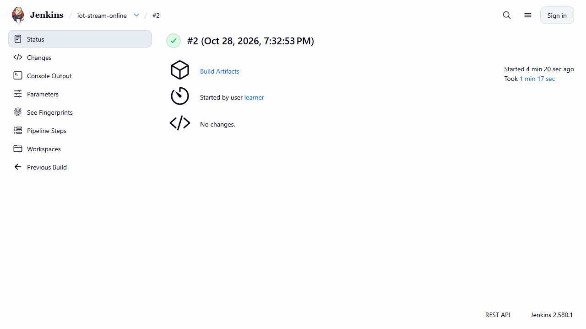

# CI/CD for offline and online stream-feature jobs

Two Jenkins jobs independently test, build and deploy the offline and online stream paths as Airflow DAGs. The recorded offline build 3 and online build 2 succeeded. Each DAG has a push task followed by a replay task.

The CI input is a retained three-window Kafka/Flink fixture. The offline release writes the exact expected history; online validation starts from an empty project and checks the latest expected vectors. Replay is a no-op and the upstream retained source is read-only.

The full 5,760-window native store demonstration is documented separately in `window-cohort.md`. It does not turn these three-window CI runs into a continuous live stream. Original Airflow graph captures and Docker job captures have distinct identities and timestamps; they do not claim both jobs were simultaneously RUNNING.

## Commands and recorded examples

Run commands from the repository root unless the example explicitly changes the working directory. Use a fresh output/run name and check the linked runbook before starting platform services. Examples belong to the recorded workload on this page.

```powershell
python -S scripts/verify-ci-stream-push.py
```

```powershell
python -m unittest tests.test_stream_staging_contract tests.test_stream_runtime_contract tests.test_window_outbox -v
```

## Implementation and evidence

- [Source: infra/ci/StreamPush.Jenkinsfile](../infra/ci/StreamPush.Jenkinsfile)
- [Source: scripts/ci-stream-push.py](../scripts/ci-stream-push.py)
- [Source: infra/ci/iot_ci_stream_push.py](../infra/ci/iot_ci_stream_push.py)
- [Source: feature_store/staged_job.py](../feature_store/staged_job.py)
- [Source: feature_store/staged_push.py](../feature_store/staged_push.py)
- [Recorded artifact: ci-stream-push/manifest.json](evidence/ci-stream-push/manifest.json)
- [Source: tests/fixtures/stream-finalized-native.json](../tests/fixtures/stream-finalized-native.json)
- [Recorded artifact: stream-push/warm/feast/source-report.json](evidence/stream-push/warm/feast/source-report.json)
- [Recorded artifact: ci-stream-push/offline-3/ci/verification.json](evidence/ci-stream-push/offline-3/ci/verification.json)
- [Recorded artifact: ci-stream-push/offline-3/jobs/replay.json](evidence/ci-stream-push/offline-3/jobs/replay.json)
- [Recorded artifact: ci-stream-push/offline-3/ci/airflow.json](evidence/ci-stream-push/offline-3/ci/airflow.json)
- [Recorded artifact: ci-stream-push/online-2/ci/verification.json](evidence/ci-stream-push/online-2/ci/verification.json)
- [Recorded artifact: ci-stream-push/online-2/jobs/replay.json](evidence/ci-stream-push/online-2/jobs/replay.json)
- [Recorded artifact: ci-stream-push/online-2/jobs/write-container.json](evidence/ci-stream-push/online-2/jobs/write-container.json)
- [Recorded artifact: ci-stream-push/online-2/ci/airflow.json](evidence/ci-stream-push/online-2/ci/airflow.json)
- [Recorded artifact: ci-stream-push/offline-3/tests/verification.json](evidence/ci-stream-push/offline-3/tests/verification.json)
- [Recorded artifact: ci-stream-push/online-2/tests/verification.json](evidence/ci-stream-push/online-2/tests/verification.json)
- [Recorded artifact: ci-stream-push/history/prior/native-prototype/verification.json](evidence/ci-stream-push/history/prior/native-prototype/verification.json)
- [Recorded artifact: ci-stream-push/offline-3/requirements-installed.lock](evidence/ci-stream-push/offline-3/requirements-installed.lock)
- [Recorded artifact: ci-stream-push/online-2/requirements-installed.lock](evidence/ci-stream-push/online-2/requirements-installed.lock)
- [Recorded artifact: ci-stream-push/offline-3/runtime-parity.json](evidence/ci-stream-push/offline-3/runtime-parity.json)
- [Recorded artifact: ci-stream-push/online-2/runtime-parity.json](evidence/ci-stream-push/online-2/runtime-parity.json)
- [Recorded artifact: ci-stream-push/history/prior/native-manifest.json](evidence/ci-stream-push/history/prior/native-manifest.json)
- [Recorded artifact: ci-stream-push/history/precise-readback/precise-offline-readback.json](evidence/ci-stream-push/history/precise-readback/precise-offline-readback.json)
- [Recorded artifact: ci-stream-push/history/prior/offline-1/ci/discover.txt](evidence/ci-stream-push/history/prior/offline-1/ci/discover.txt)
- [Recorded artifact: ci-stream-push/history/prior/jenkins/offline-1.json](evidence/ci-stream-push/history/prior/jenkins/offline-1.json)

## Recorded interface views

These are original captures from the runs described above. Their timestamps, model identities and visible states belong to those runs.





## Related documentation

[Current architecture](architecture.md) · [Demo and recovery](demo-walkthrough.md) · [Rubric index](rubric-tracker.md)

[Original run notes](https://github.com/anle0429/iot-maintenance-platform/blob/f4da7bd21667a8bfca5715a7456bc2bcc813b0fc/docs/ci-stream-push.md) retain the full historical narrative. Raw evidence files have not been translated or rewritten.
