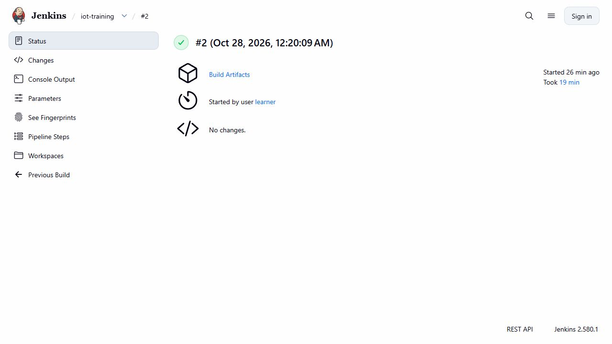
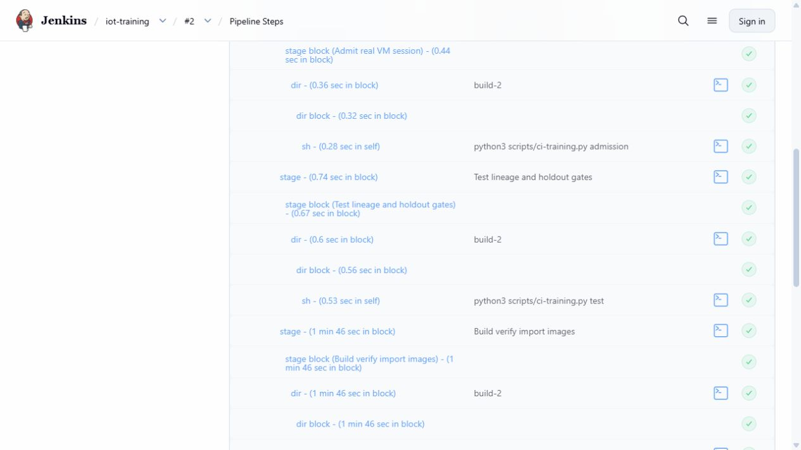
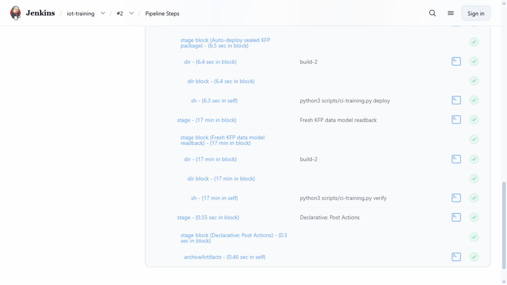
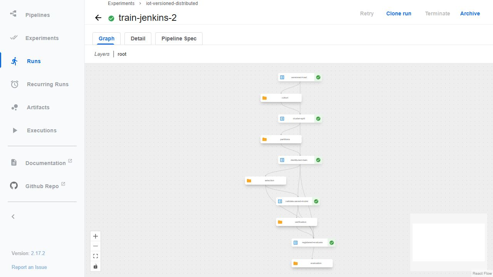
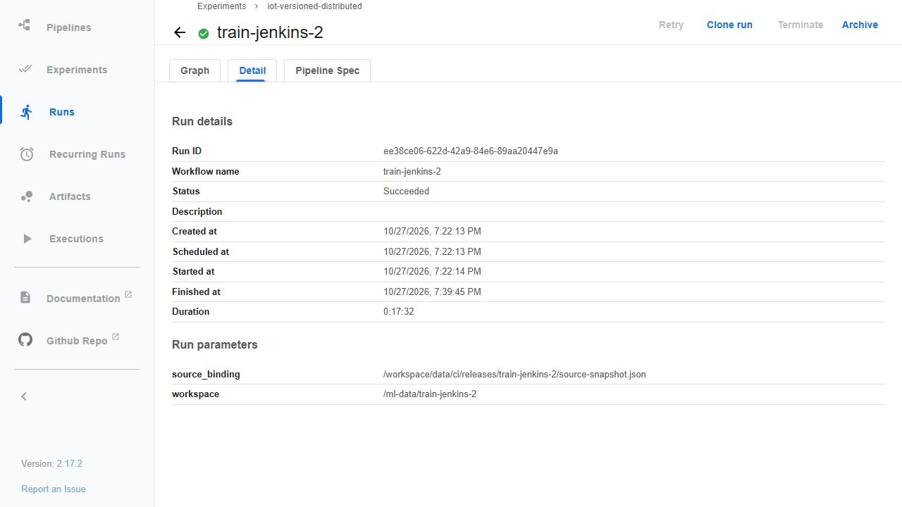

# CI training: Jenkins → KFP → dữ liệu và model candidate

**Jenkins `iot-training/2` đã SUCCESS trên VM ngày28/10/2026**, chạy test → build/import → auto-deploy → một run KFP mới SUCCEEDED. Run này chạy đủ năm bước, hai Spark executor thật và đăng ký model version6 ở trạng thái **candidate/production=false**. Đây là bằng chứng F29; CI phục vụ model production và A/B trên VM còn riêng.

[Training.Jenkinsfile](../infra/ci/Training.Jenkinsfile) điều khiển `admission → test → build/import → auto-deploy → fresh KFP verification`. [Controller](../scripts/ci-training.py) dùng cùng [pipeline năm bước](automatic-ml-versioning.md) và cùng kernel/protocol đã cố định. Không tuning thêm từ holdout đã quan sát; model mới chỉ đăng ký **candidate**, không đổi model phục vụ.

## Điều kiện một build được nhận là thành công

1. Gói nguồn lấy từ Git commit đã push, không lấy working files. Mỗi phase so lại SHA của mọi file trong packet; image cũng phải chứa đúng source đó.
2. Admission dùng thời điểm auto-stop thực của phiên VM: CI cần ít nhất100phút ban đầu để dành10phút chuẩn bị, rồi runner vẫn cần90phút/24GiB RAM khả dụng/40GB trên **cả hai đĩa**. Khi đang chạy, guard8GiB/20GB/10phút còn lại giữ nguyên. Không thay số đo để nhận job.
3. Kiểm thử chặn stale run, source/model/data mismatch, production promotion và mở holdout sai validation. Build hai image application trên SDK Feast/Spark đã khóa; probe container mạng `none` kiểm mọi file source trong image. Import vào containerd và xác nhận CRI config ID khớp SHA256 của **config blob thực trong Docker export**; Docker29 image ID có thể là manifest ID khác với config ID, được ghi riêng.
4. Compile cùng năm task, thay riêng image reference bằng tag duy nhất của release. KFP YAML có hai document (pipeline + Kubernetes platform); giữ cả hai, bao gồm mounts, UIDs, resources, DownwardAPI và cache disabled. Không nhận một file YAML là bằng chứng đã chạy.
5. Deploy tự kiểm không còn Notebook/KFP đang hoạt động, backup source thay đổi và copy source đã test sang workspace VM. Snapshot44file gắn đúng source commit; pipeline package được bind SHA trong deployment manifest. Image chứa cùng mã đã đóng gói, các pod đọc bản mounted đã so hash; không nhận là code trong image tự được dùng khi mount che nó.
6. Submit **run mới** `train-jenkins-<build>` vào KFP, workspace mới. Chỉ PASS khi backend SUCCEEDED, có đủ5main container chạy đúng image đã kiểm, hai executor thật cùng thực hiện LR stages, automatic data publication/restore và model-only registration đều PASS. Preflight phải sau khi CI verify bắt đầu; source/data/model version phải liên kết đúng với submission của build này.

Driver train dùng Spark registry image của release; executor giữ SDK Spark3.5.9 đã có và đọc cùng source từ PVC đã bind. Hai executor nằm trên cùng VM, không suy ra multi-host hoặc speedup. Init không tính là bước ML. Dataset vẫn là cohort medium3.132.184hàng, không train toàn102,45GB.

## SDK, quyền và secrets

[Controller Dockerfile](../infra/ci/TrainingController.Dockerfile) đặt KFP2.17.3/kfp-kubernetes2.17.3 trong **venv riêng**. [39 dependency pins](../infra/ci/requirements-training-controller.lock) được lấy từ native KFP environment; `pip check` phải chạy trong venv đó. Không đổi protobuf/numpy/pyarrow của runtime Feast/Spark để cài SDK controller.

Jenkins riêng hiện có một executor, Docker socket trusted và source packet chỉ nhận từ người vận hành. Container controller giới hạn1CPU/2GiB, kết nối mạng host/private KFP, mount kubeconfig hiện có read-only trong thời gian deploy/verify/cleanup. Kubeconfig/token không được copy vào image, artifact hay parameter; không tạo credential/role/endpoint công khai mới. Các bước compile/source probes dùng mạng `none`.

Build được người vận hành trigger với `SOURCE_COMMIT`; các bước sau tự chạy. Chưa có GitHub webhook hoặc chạy untrusted pull request. Controller cũ không cần restart để thêm job. Xem giới hạn quyền Docker và cấu hình Jenkins trong [CI dữ liệu](ci-data-pipelines.md).

## Tự chuẩn bị và chạy

Trên clone có Git/Python, chọn SHA source đã push:

```bash
python scripts/package-training-release.py \
  --commit <source-commit> --output outputs/training-release.tar
```

[Tool export](../scripts/package-training-release.py) có allowlist và từ chối overwrite; tạo tar cùng manifest SHA. Copy sang VM, xác minh/extract theo [quy trình sealed packet](ci-materialization.md#tự-chạy), đặt tại `data/ci/source/<commit>/{tree,manifest.json}`. Giữ nguyên bộ dữ liệu, CAS, registry, oracle distributed và các PVC hiện có; clone Git không chứa runtime này.

Trên Jenkins tạo job Pipeline `iot-training`, parameter chuỗi `SOURCE_COMMIT`, dùng nguyên Jenkinsfile nêu trên với Groovy sandbox. `IOT_DEPLOY_ROOT` và quyền private node đã có từ mốc CI trước. Chỉ trigger khi VM thực còn đủ thời gian. `data/runtime/ci/session.json` phải được ghi từ thời điểm start/stop thực đã được phép; không tự cộng giờ vào file này để vượt guard.

Pipeline bảo toàn report cũ: workspace `data/ml-workspaces/training-cluster-27/train-jenkins-<build>`, receipts `outputs/versioned-training/train-jenkins-<build>`, source/image/deployment manifest `data/ci/releases/train-jenkins-<build>`. File source cũ được backup trước deploy; source snapshot của release được lưu riêng. Pointer mặc định cho lượt Notebook sau cần trỏ tới snapshot mới tương ứng source đã deploy, không dùng binding cũ với mã mới.

Nếu CI thất bại, cleanup chỉ dừng controller của release và đọc đúng backend run ID từ submission, xác nhận display name khớp trước khi yêu cầu terminate khi run vẫn active. Không blanket-delete pods hoặc dữ liệu. Kiểm lại trạng thái run đó trước retry; chưa hỗ trợ resume full training.

## Kết quả chạy thật

| Thành phần | Kết quả và bằng chứng |
|---|---|
| Nguồn | Commit `ce510c6bcccd58235fbc78d22cd90570934c50a6`; [packet93file](evidence/ci-training/source-manifest.json), tar481.280B/SHA`58ab60b566a7278463a8cf811a9f0e9543d3a0e037b14e48b40509d6394c5526`. Không lấy working files. |
| Jenkins | [Build2/queue10 SUCCESS](evidence/ci-training/ci/jenkins-build.json),00:20:09.969UTC,1.188.615ms ≈19phút49giây. [Console gốc](evidence/ci-training/ci/jenkins-build2-console.txt):22unit tests PASS; tự chạy các phase sau trigger. |
| Image/deploy | [Hai image](evidence/ci-training/ci/build.json) có đúng78file runtime; [đọc lại độc lập](evidence/ci-training/runtime-source-readback.json) từ cả hai image và mounted source khớp. Docker29 manifest ID được phân biệt với config digest/CRI ID. [Deployment](evidence/ci-training/ci/deployment.json) bind44MLfile và SHA package. |
| KFP | Run `ee38ce06-622d-42a9-84e6-89aa20447e9a`, tên `train-jenkins-2`,00:22:13→00:39:45UTC, [backend SUCCEEDED](evidence/ci-training/ci/kfp-run.json). [Package thực](evidence/ci-training/pipeline.yaml) có5task; [5main container](evidence/ci-training/ci/verified-main-containers.json) exit0/đúng image. |
| Distributed fit | [Hai executor cùng Running](evidence/ci-training/two-executors-running.json); [log verifier](evidence/ci-training/ci/distributed-verification.json) và [bản đếm độc lập từ Spark events](evidence/ci-training/event-summary.json) cùng logSHA`efd03d2d…`:79task thành công/0lỗi; cả executor1/2 làm LR stages6–17. Cùng một node8vCPU/64GiB, không phải benchmark nhiều máy. |
| Dữ liệu | Fresh Feast pull3.132.184rows/200máy/60ngày, train2.195.668rows theo protocol giữ nguyên. [180canonical files](evidence/ci-training/ci/lineage/canonical.json),740.003.698B; [tự động version/restore](evidence/ci-training/ci/lineage/automatic-data.json) đọc lại toàn bộ byte. |
| Incremental | Nội dung không đổi nên reuse version`5e78230e…`, dataRun`49ea2188…`;0local/remote blob byte mới,0metadata payload mới. [Reconciliation](evidence/ci-training/ci/lineage/remote-version.json) và [GET dataRun FINISHED](evidence/ci-training/registry/data-run.json). Số11.845.783B trong metric dataRun là lần tạo phiên bản trước, không phải upload mới của build2. |
| Model | [Registration](evidence/ci-training/ci/lineage/registration.json) và [GET version6 READY](evidence/ci-training/registry/model-version.json) cùng modelRun`be3b27fa0960493d92b45be69b20690e`; [GET modelRun FINISHED](evidence/ci-training/registry/model-run.json) có11params/27metrics, đúng commit/data/protocol và aliascandidate.200nativeSpark/registry probes, sai khác lớn nhất2,22e-16. Không copy dataset vào modelRun. |
| Đánh giá | [Holdout](evidence/ci-training/ci/lineage/evaluation.json): threshold0,7, testPR-AUC0,615148/F10,550958; không đổi split/hyperparameter sau khi xem holdout. Đây là tái lập protocol, không phải kết quả tuning mới hoặc khả năng dự đoán máy thật. |

Admission đo thật57.141.080.064B RAM khả dụng và đủ40GB trên cả hai đĩa; còn27.894giây trước STOP. [GCE session projection](evidence/ci-training/vm-session.json) ghi start00:05:05.721UTC/max28.800s/STOP, deadline08:05:05.721UTC khớp admission và preflight. Sau chạy, [readback](evidence/ci-training/resources-after.json) còn56.550.752.256B RAM, HDD348.677.869.568B/SSD99.556.745.216B trống. Đây là snapshot tài nguyên, không phải peak memory hay giá tiền thực tế.

### Ảnh giao diện thật



Jenkins2.580.1 ghi dấu xanh của build2 và thời gian chạy. Dòng “No changes” đến từ job nhận sealed packet bằng parameter thay vì SCM checkout; source commit được kiểm ở parameter/API/manifest, không suy từ dòng này.



Các bước admission, test và build/import đã hoàn tất; [console](evidence/ci-training/ci/jenkins-build2-console.txt) giữ lệnh và kết quả22tests.



Hai bước cuối tự triển khai source/package rồi kiểm run KFP mới; archiveArtifacts giữ các receipt. Chữ mờ là màu giao diện Jenkins gốc, ảnh không chỉnh sửa.



Đồ thị `versioned-load → cluster-split → distributed-train → validate-saved-model → registered-evaluate` đều xanh. UI2.17.2 và SDK2.17.3 được ghi riêng, không nhận mọi thành phần cùng một version.



Chi tiết ghi đúng runID, source binding riêng release và workspace mới. UI hiển thị giờPC19:22→19:39 ngày27/10; API ghi UTC00:22→00:39 ngày28/10. Ảnh chụp nguyên qua IAP loopback, không mở dịch vụ ra Internet.

### Lỗi đã phát hiện và sửa

Build1 dùng source`d811a785…`,22tests PASS nhưng [FAILURE13,589s](evidence/ci-training/ci/jenkins-build1.json) trước deploy. [Diff image thực](evidence/ci-training/failed-image-source-diff.json) có83file thay vì74:9fileCI thừa, không thiếu hoặc khác nội dung file. Hai dòng mở parent `!scripts/`/`!infra/` trong Dockerignore đã vô tình nhận lại descendants. Commit`ce510c6` thêm chặn descendants sau khi mở parent, giữ allowlist và phép so equality. [Console lỗi](evidence/ci-training/ci/jenkins-build1-console.txt) được giữ nguyên; build2 không dùng guard đã nới.

Sau VM restart, MLflow Docker vẫn healthy nhưng private socket bridge không hoạt động. Đã chạy lại script registry route hiện có, kiểm bằng PodHTTP thật rồi mới hoàn tất training. Published hostport15000 còn từ chối kết nối ở thời điểm kiểm; private route phục vụ pipeline đã hoạt động. Không đổi source44, không giả dữ liệu health và không restart Docker để che lỗi. Cần xử lý tính bền sau reboot ở mốc vận hành riêng.

### Tự kiểm bằng chứng từ clone

```bash
python -S scripts/verify-ci-training.py
```

Chỉ cần Python chuẩn và Git history có commit nguồn. Tool không khởi động cloud, không train lại: kiểm47payload SHA,93source từ Git và tar byte-exact,78source/image/mount,44MLguard,5main/executor/task evidence, tự tính content-version từ180file và metric từ confusion counts, rồi đối chiếu data/model REST receipts. File dưới `docs/evidence/ci-training/` là bản chọn lọc605.158B kèm manifest; operational helpers, credentials, packet/image/data và rawSpark log2.802.459B giữ ngoài Git. `pod-main-bindings.json` là projection ghi rõ trường của5application pods được chọn từ11pod; các response/file/ảnh còn lại giữ byte gốc.

Đã kiểm từ clone sạch ở commit tài liệu`49defc6` trên cùng PC Windows: verifier chuẩn PASS,22unit tests PASS/0,183s và audit47file byte-exact, link tài liệu,57+93dòng rubric nguồn PASS. Unit tests dùng môi trường Python của PC; verifier chạy với `-S`, không cần dependency ngoài thư viện chuẩn. Đây là kiểm tra khả năng đọc/tái lập packet và logic từ clone; luồng KFP/Spark/MLflow nặng là lượt Linux VM ở trên, không nhận đã train lại trên clone/laptop.

Giới hạn: source PVC của5main có mount read-write theo package hiện tại; không nhận đây là hardening read-only. KFP drivers/init không tính vào5MLtask. Raw evaluation có câu giới hạn kế thừa về lúc khai báo protocol; timestamp/backend/main containers chứng minh lượt thực thi hiện tại. Không diễn giải câu đó thành “chưa train”. Chưa webhook, production promotion, serving CI/A-B native hoặc ML trên100GB.

## Chuẩn bị lịch sử trước build thành công

Các receipt ở phần này giữ trạng thái **lúc chuẩn bị**, không mô tả runtime sau build2.

- Source `d811a7853b431ba5bb3d248d4526aad5f3ff635e` sửa bind source từ `/var/jenkins_home/...` trong Jenkins sang host path thực `data/runtime/jenkins-home-27/...` cho Docker daemon. Control oracle cũ chạy từ host nên chưa phát hiện đường dẫn bên trong Jenkins. Thêm regression test;11training tests PASS trong [37test mới](evidence/serving-ci-preparation/current/contract-tests-v4.txt). `ctr` cũng chỉ rõ socket K3s/namespace. Gói này đã được chuyển/xác minh trên VM trước build1; build2 dùng ce510c6 như phần kết quả trên.
- Gói89file/[manifest](evidence/serving-ci-preparation/current/training-source-v4.manifest.json), SHA `a87a161546db6839c0d6b1032cc339fa3f6b7a979b4639d7562d2cb135673428`.44file ML guard không đổi so với d83 và ce510c6. `tests/__init__.py` được đóng gói khi tồn tại trong commit, nên vẫn tái tạo đúng gói d83 lịch sử84file. [Chi tiết kiểm PC và giới hạn](ci-serving.md).
- Source chuẩn bị **lịch sử** `d83b338c159c8f0b096b033f783925aac7ccb994` đã push; **21unit tests PASS trên PC và VM**, gồm Docker-save legacy/OCI layouts, config thay đổi dù giữ filename và manifest thiếu/không duy nhất.
- Packet Git có84tệp,44tệp trong ML guard; archive SHA256 `cd8b42111ea3c2daa581ee3ac7814f584c629aadd40756e629b1b82f25866b82`. [Final manifest](evidence/ci-training-preparation/final-source/source-manifest.json), [21native tests](evidence/ci-training-preparation/final-source/unit-tests.txt), [final preparation](evidence/ci-training-preparation/final-source/verification.json).
- SDK controller image `sha256:3edb872a72669b7f50cf4a62393ac3d6e52c18e08c03f7343071d257e411a966`: Python3.12.16, KFP/kfp-kubernetes2.17.3 trong `/opt/kfp-venv`, [pip check sạch](evidence/ci-training-preparation/sdk-preparation/pip-check.txt). SDK build đầu từ nguồn `bc3ca82`; lock/Dockerfile/kernel không đổi ở d83, chỉ sửa controller OCI check và thêm3tests. Không nhận source mới đã dùng để train.
- [Compile thực](evidence/ci-training-preparation/final-source/pipeline.yaml) có đủ5task và document Kubernetes, SHA `a47f6df784d6f30e5e6394f8aade192d69f847d24ce8c3a0e851945a643f8d7c`. Image tags trong package chuẩn bị là **placeholder tương lai**, chưa build/import/deploy runtime application.
- [Private control oracle](evidence/ci-training-preparation/private-control/verification.json) đã dùng transient controller đọc CRI qua socket, kubectl qua kubeconfig read-only và KFP SDK GET thật. Docker manifest ID `865c69e1...`, export config digest/CRI config ID cùng `6ba07ec4...`; không đổi image hoặc registry. Kubeconfig không được copy vào bằng chứng.
- Lượt gọi CRI đầu thiếu `crictl.yaml`; [negative oracle gốc](evidence/ci-training-preparation/private-control/expected-missing-config.txt) giữ lỗi. Đã chỉ rõ `--config=/dev/null` và endpoint socket theo [tài liệu crictl](https://github.com/kubernetes-sigs/cri-tools/blob/master/docs/crictl.md). Probe helper từ Windows có CRLF, Git source LF; [binding](evidence/ci-training-preparation/final-source/export-function-binding.json) giữ raw hash riêng và kiểm nội dung hàm sau universal-newline decoding bằng đúng body Git. Không chỉnh receipt native để làm khớp hash.
- Job Jenkins `iot-training` lúc chuẩn bị có source d83, **lastBuild=null/nextBuildNumber=1**. [Binding lịch sử](evidence/ci-training-preparation/final-source/job-source-binding.json). Sau đó default đã đổi d811 trước build1 và ce510c6 trước build2; receipt cũ không bị viết lại.
- [Guard đo thật](evidence/ci-training-preparation/final-source/current-session-rejected.json) đã từ chối phiên trước vì còn dưới90phút trước auto-stop20:49:51.550UTC; không gửi training trong lần đó. Phiên28/10 chạy trong quyền cùng VM/budget đã được người dùng cấp, giữ8giờSTOP.
- Capsule chuẩn bị **25payload + manifest /23.445B**, SHA256 `8fc7d8fd2928a99625fb43ad23ef7936ee78068245ad747e110c232ebd68e0ab`; [manifest](evidence/ci-training-preparation/capture/manifest.json), [mapping](evidence/ci-training-preparation/capture/evidence-map.json). Native JSON/YAML/log giữ byte gốc; không thêm ảnh thành công mới vào lịch sử chuẩn bị. Capsule chạy thật47payload nằm riêng ở phần kết quả.

Pipeline dùng [KFP container components chính thức](https://www.kubeflow.org/docs/components/pipelines/user-guides/components/container-components/); các kết quả chạy thật trước CI giữ tại [automatic versioning](automatic-ml-versioning.md), không đổi phạm vi bằng chứng lịch sử.
