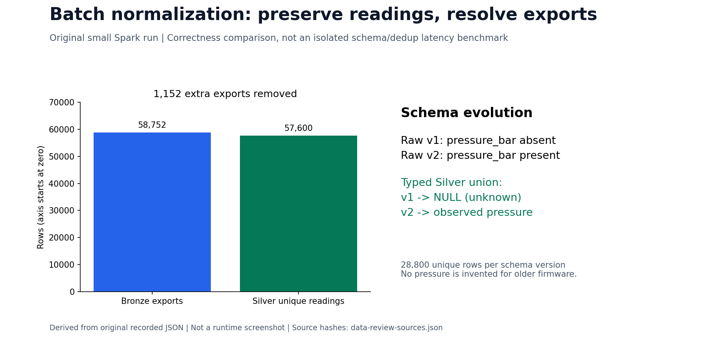
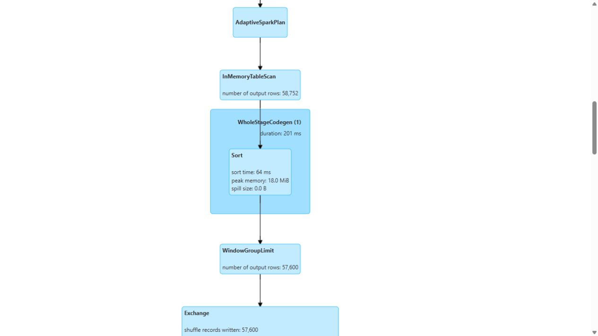

# Data processing: inputs, corrections and evidence

This review makes the data-platform results visible without treating an artifact audit as a grading decision. Measurements and native screenshots refer to their original workloads. A newly drawn chart explains the receipts; it is not a newly captured service interface.

The [current eleven-topic evidence checklist](data-review-audit.md) links each reported issue to code, explanation and visible proof. It also includes the later timing/Airflow work and the new final SQLite and query-derived relationship captures; historical review receipts retain their original then-open items.

## Offline normalization

The development source has 58,752 telemetry exports for 57,600 readings. The [recorded Spark run](evidence/day2-final/batch-report.json) preserves raw exports in Bronze, then parses a declared union schema and resolves repeated event IDs into Silver.

| Issue | Before processing | After processing | Implementation and correctness check |
|---|---|---|---|
| Duplicate exports | 58,752 telemetry rows, including 1,152 repeat exports | 57,600 unique Silver rows; 1,152 extras removed | [deduplicate_telemetry](../pipelines/transforms.py); latest `created_ts` wins; conflicting immutable measurements are rejected; replay leaves the same output |
| Schema evolution | v1 omits `pressure_bar`; v2 supplies it; two physical JSONL schema partitions | One typed Silver schema; 28,800 unique rows per version; v1 pressure remains NULL and v2 pressure is populated | [Declared parser and union](../pipelines/transforms.py); `schema_union_preserves_unknown_pressure` and persisted readback checks |
| Historical machine changes | P-001 changes factory F-01 → F-04 | Two half-open dimension versions, 21 total versions / 20 current machines | [Temporal dimension join](../pipelines/transforms.py); every telemetry/failure/maintenance fact resolves the appropriate version |



The figure derives from the existing source and Spark reports. The later [100 GB ingest](full-scale-ingest.md) separately processed 323,136,000 exports into 316,800,000 unique readings; those counts must not be substituted for this small run.

The native Spark History Server now renders the original `iot-batch-day2-final` application, ID `local-1792662805607`. Its unchanged 270,045,539-byte event log belongs to 22 October; restoring the viewer did not rerun the batch. Query 26 shows 58,752 cached telemetry exports entering the window plan and 57,600 rows after `WindowGroupLimit`, followed by the final rank filter. [Original plan text](evidence/data-platform-review/spark/query-26.txt) retains the declared parser, including `pressure_bar`, and the `created_ts` ordering.



[The complete unedited query capture](evidence/data-platform-review/screenshots/spark-dedup-query26.jpg) includes the application/query header and full plan. [Native SQL notebook captures](schema-design.md#native-table-and-relationship-inspection) independently read the persisted schema/duplicate results. This is one correctness transformation viewed before and after its operators, not two independent timing benchmarks.

Schema evolution and deduplication in those original receipts are **correctness transformations**. A later [controlled timing study](batch-corrections-benchmark.md) now compares equivalent schema readers and deterministic winner selectors, with full-result equality and three measured pairs. Its separate experimental source does not change the original DP2 implementation or its receipts.

## Follow the review questions

| Question | Direct answer and evidence |
|---|---|
| Which columns are skewed or high-cardinality? | [Generator measurements and exact denominators](../generator/README.md#observed-data-characteristics) |
| Which schema changed, and how are duplicates resolved? | [Offline comparison above](#offline-normalization), [schema design](schema-design.md) |
| What did the unoptimized stream get wrong? | [Same-fixture baseline and correction](streaming.md#baseline-problems-and-corrected-results) |
| Where are the original Spark before/after screenshots? | [Sort/merge versus broadcast](skew-benchmark.md#before-and-after-on-the-same-input) |
| Where are DP1–DP3 in Airflow? | [All three original native DAG screenshots](orchestration.md#airflow-integration-each-pipeline-in-the-ui) |
| Are schema/dedup timings and the skew query executed through Airflow? | [Five-task native benchmark run](orchestration.md#measured-benchmark-dag), [all paired measurements](batch-corrections-benchmark.md#results) |
| Which DataHub screenshots establish each stage? | [Stage-specific coverage and gaps](orchestration.md#datahub-lineage-and-validation-evidence-by-stage) |
| Does Redis hold historical training data? | No: [Redis is online; DuckDB reads Parquet offline](feast-feature-store.md#what-redis-stores-and-where-the-offline-store-lives) |
| How do features reach KFP? | [Mounted input paths, native Feast lookup and typed cohort descriptor](training-notebook.md#how-features-reach-kubeflow) |
| Do all three agents use LLM inference? | Yes: [shared ModelConfig and generation route](gpu-agent-routing.md); the earlier representative arrow omitted two visible role connections |
| Where is the Docker size reduction? | [Controlled full/slim comparison](docker-optimization.md#controlled-native-comparison): 1,495,600,805 → 216,150,820 bytes, identical 32-sample HTTP responses |

## Native review and remaining limits

The CPU-session review added a controlled Docker measurement, paired native Flink fixture images, original Spark query inspection and a genuinely executed schema notebook. [The review capsule](evidence/data-platform-review/review.json) records their identities, source files and failed predecessors. No GPU, large-source generation or model training was needed.

The three previously missing DataHub views are now [captured directly](orchestration.md#dp1-and-dp2-native-captures): original DP1 task lineage, original DP2 task lineage, and Silver telemetry Quality with evaluation history. They show retained metadata, including the later CI evaluation date; taking a screenshot is not a new validation run.

The [schema captures](schema-design.md) show real SQL joins and table records, rather than a graphical foreign-key editor. The skew query now also runs as a real task in the separately admitted [benchmark DAG](orchestration.md#measured-benchmark-dag); it remains a distinct workload from DP1–DP3 and the 100 GB ingest.

The [new three-pair study](batch-corrections-benchmark.md) records schema medians of 0.927→0.764 seconds, warmed-input dedup medians of 0.581→0.603 seconds, and a separate skew median of 14.258→9.170 seconds. The aggregate dedup candidate was slower by its median, so the production window selector is retained. These are scoped experiments, not an end-to-end or 100 GB speedup. Original evidence, failures and measurement scopes remain unchanged.

## Verify the review artifacts

```bash
python scripts/verify-data-platform-review.py --output outputs/data-review-check.json
python scripts/verify-batch-benchmarks.py --output outputs/batch-benchmarks-check.json
```

These standard-library checks need no live VM. The review check authenticates actual HTTP responses against all 32 Spark golden samples, retained SQLite windows and executed notebook tables. The benchmark check additionally regenerates the small source, independently reproduces every full-result checksum and recomputes task metrics from complete event logs. They verify recorded evidence, not current service health or a rubric grade.
