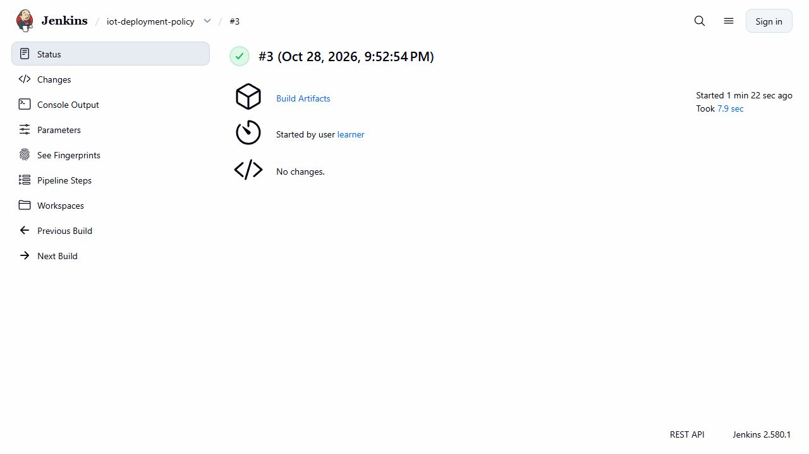
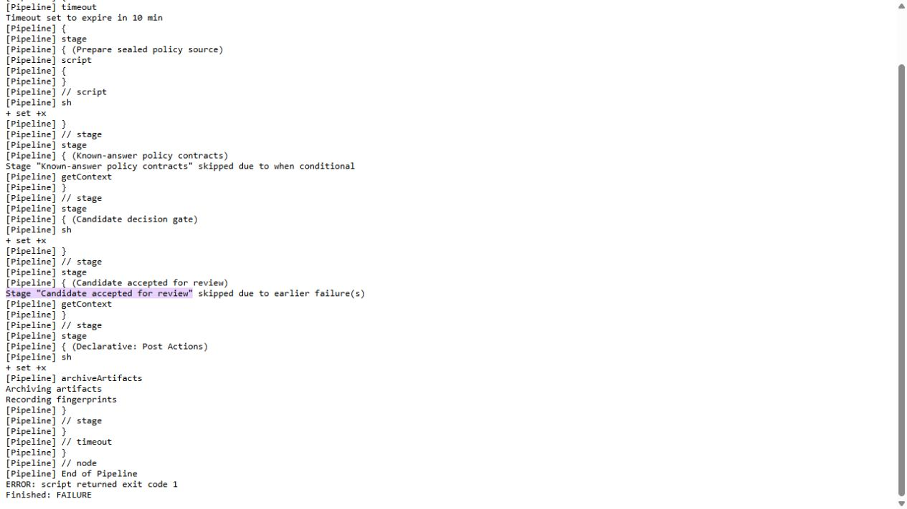

# OPA deployment-policy gate

The Rego policy validates a sealed deployment plan before deployment commands are allowed to continue. The 48-case native suite contains two allowed cases and 46 denials, including missing fields and unsafe resource/security settings.

Jenkins build 3 succeeded on an allowed input. Build 5 intentionally failed the policy gate with exit 1 and skipped downstream deployment, using the same 19 bound source inputs. Earlier erroneous attempts remain available; a failed build is not relabeled as a successful negative test without checking its actual cause.

The published package retains original console, test output, images and source bindings. This is a standalone CI gate rather than a Kubernetes admission webhook. The learner confirmed OPA/Rego had not been covered in class; LLM-specific novel ideas still require separate selection and evidence.

## Implementation and evidence

- [Recorded artifact: course-scope/learner-confirmation.json](evidence/course-scope/learner-confirmation.json)
- [Source: infra/policy/deployment.rego](../infra/policy/deployment.rego)
- [Source: infra/policy/approved.json](../infra/policy/approved.json)
- [Source: scripts/check-deployment-policy.py](../scripts/check-deployment-policy.py)
- [Source: infra/ci/DeploymentPolicy.Jenkinsfile](../infra/ci/DeploymentPolicy.Jenkinsfile)
- [github.com / v1.21.4](https://github.com/open-policy-agent/opa/releases/tag/v1.21.4)
- [www.openpolicyagent.org / cicd](https://www.openpolicyagent.org/docs/cicd)
- [Recorded artifact: deployment-policy-linux/manifest.json](evidence/deployment-policy-linux/manifest.json)
- [Source: infra/policy/opa-assets.json](../infra/policy/opa-assets.json)
- [Recorded artifact: deployment-policy-linux/negative5/verification.json](evidence/deployment-policy-linux/negative5/verification.json)

## Recorded interface views

These are original captures from the runs described above. Their timestamps, model identities and visible states belong to those runs.

## Related documentation

[Current architecture](architecture.md) · [Demo and recovery](operations.md) · [Rubric index](rubric-tracker.md)

[Original run notes](https://github.com/anle0429/iot-maintenance-platform/blob/f4da7bd21667a8bfca5715a7456bc2bcc813b0fc/docs/deployment-policy.md) retain the full historical narrative. Raw evidence files have not been translated or rewritten.
