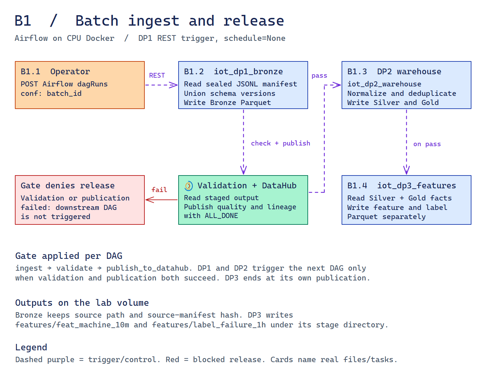
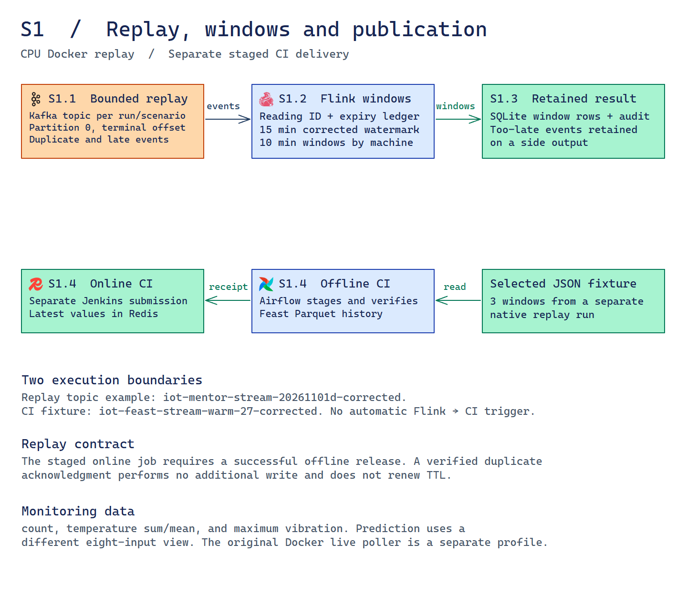
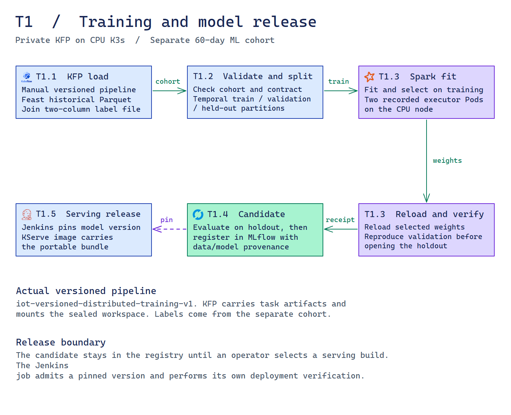
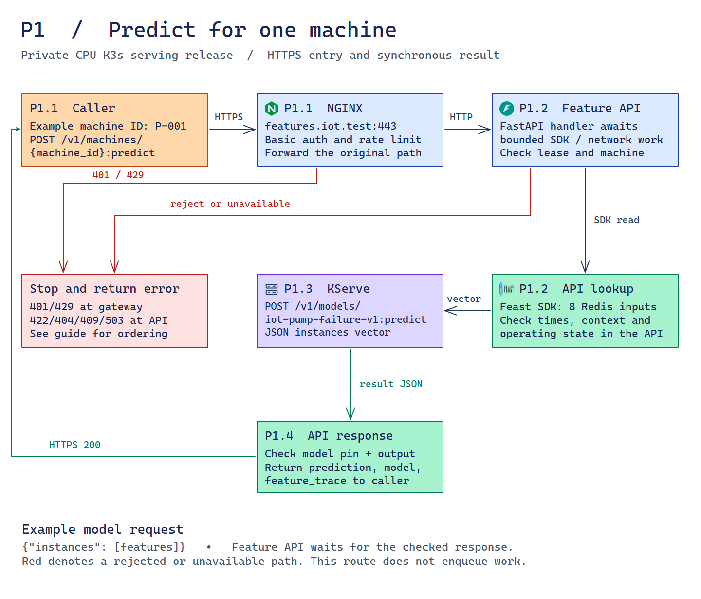
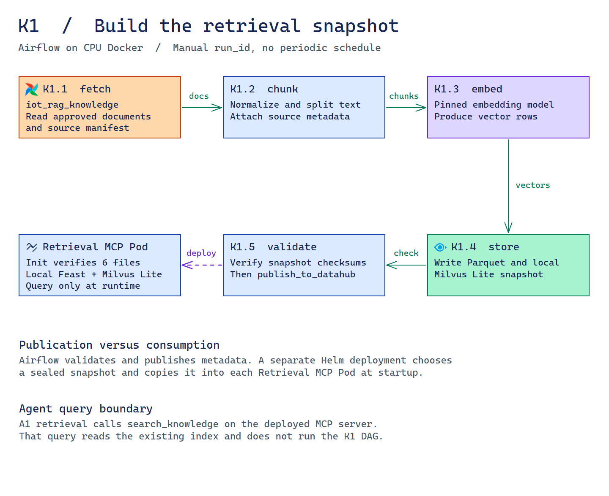
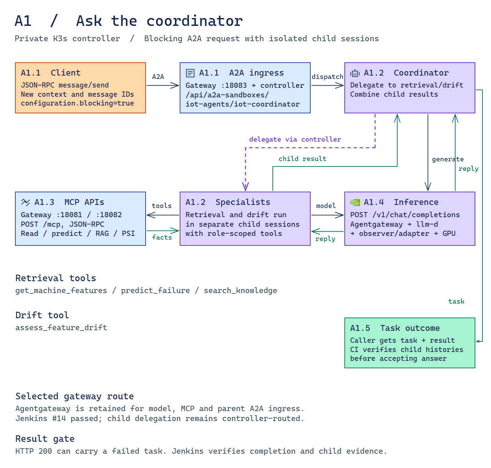
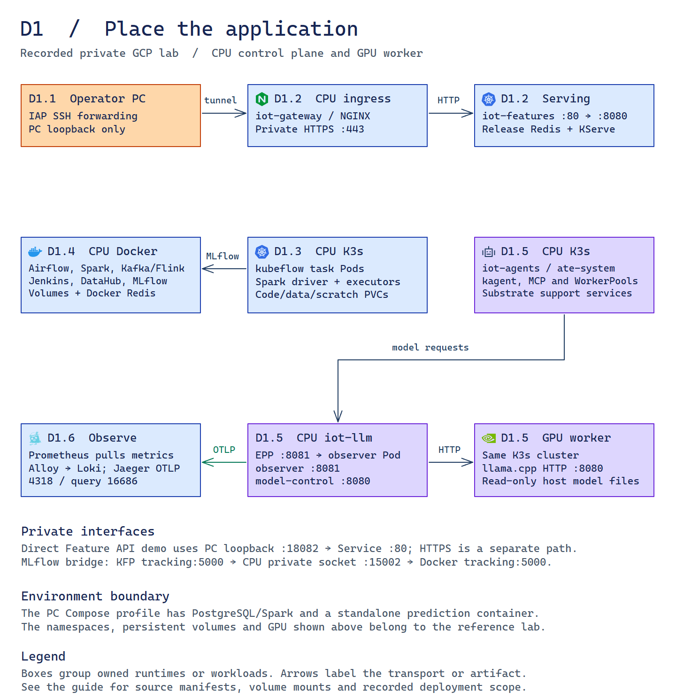

# Application architecture and execution evidence

This guide describes the configuration at `22f7f527525681124a754760a46f2b699aa758b6` on `main` and the retained private GCP lab. The code, declared activation and recorded workloads are three separate forms of evidence. The diagrams combine verified paths for explanation. Each receipt applies to its own run, data scope and version.

## Read the views

| Flow | Question | Editable source | Full-size view |
|---|---|---|---|
| Main architecture | Which components belong together, who calls them, and where do results return? | [Excalidraw](platform-architecture.excalidraw) | [PNG](../images/platform-architecture.png) · [SVG](../images/platform-architecture.svg) · [GIF](../images/platform-architecture.gif) · [Motion](../images/platform-architecture.animated.svg) |
| Execution index | Where do the seven detailed paths intersect? | [Excalidraw](execution-overview.excalidraw) | [PNG](../images/execution-overview.png) · [Motion SVG](../images/execution-overview.animated.svg) |
| [B1](#b1--batch-processing) | How does the operator trigger DP1 and what releases DP2 and DP3? | [Excalidraw](execution-batch.excalidraw) | [PNG](../images/execution-batch.png) · [SVG](../images/execution-batch.svg) · [Motion](../images/execution-batch.animated.svg) |
| [S1](#s1--streaming-and-staged-feature-delivery) | What does Flink retain, and how do the separate offline and online jobs consume the selected output? | [Excalidraw](execution-stream.excalidraw) | [PNG](../images/execution-stream.png) · [SVG](../images/execution-stream.svg) · [Motion](../images/execution-stream.animated.svg) |
| [T1](#t1--train-register-and-select-a-serving-release) | Which run reads historical features, trains, validates and produces a release candidate? | [Excalidraw](execution-training.excalidraw) | [PNG](../images/execution-training.png) · [SVG](../images/execution-training.svg) · [Motion](../images/execution-training.animated.svg) |
| [P1](#p1--predict-failure-risk-for-a-machine) | How does a machine ID become a checked score or a specific HTTP error? | [Excalidraw](execution-prediction.excalidraw) | [PNG](../images/execution-prediction.png) · [SVG](../images/execution-prediction.svg) · [Motion](../images/execution-prediction.animated.svg) |
| [K1](#k1--knowledge-indexing) | When is the RAG snapshot built and when does an MCP Pod receive it? | [Excalidraw](execution-knowledge.excalidraw) | [PNG](../images/execution-knowledge.png) · [SVG](../images/execution-knowledge.svg) · [Motion](../images/execution-knowledge.animated.svg) |
| [A1](#a1--agent-request-and-tool-execution) | Which A2A entry, child sessions, MCP tools and inference calls produce the final task? | [Excalidraw](execution-agents.excalidraw) | [PNG](../images/execution-agents.png) · [SVG](../images/execution-agents.svg) · [Motion](../images/execution-agents.animated.svg) |
| [D1](#d1--locate-the-running-units-and-their-state) | Where do the services, namespaces, ports and data volumes sit? | [Excalidraw](execution-deployment.excalidraw) | [PNG](../images/execution-deployment.png) · [SVG](../images/execution-deployment.svg) · [Motion](../images/execution-deployment.animated.svg) |

In the numbered execution views, orange marks callers or triggers, blue jobs or services, green data or results, purple model and agent workloads, and red denied paths. Solid arrows carry requests, returned data or artifacts, with the label identifying the contract. Dashed purple arrows denote control such as DAG release, delegation or deployment. The main platform view uses the conventions described in its section below. Motion illustrates direction. The I/A/R tables distinguish **implementation**, **activation** and **recorded runtime evidence**.

## Main platform architecture

The README image uses subsystem regions rather than treating a whole workflow as one application. Within those regions, boxes identify executable components or persisted state; ellipses identify callers. Airflow/Spark groups orchestration with its launched processing jobs. Retrieval and Drift each sit above their own MCP service, with Drift API below Drift MCP. The shared LLM band below both columns remains a dependency of all three agents. Its observer/adapter is one CPU workload with two containers, followed by the private GPU model server. The deployment view retains the individual resource placement.

The older `platform-system` scene informed the region layout. The current source decisions, `architecture-system` and detailed flow views determine the contents. The main image describes the configured reference lab and separately recorded workloads; it does not establish simultaneous runtime readiness.

| Boundary | Representation in the main image | Implementation |
|---|---|---|
| Data scope | Historical Parquet groups the table families, registries and separate labels. The 100 GB run ends at Silver. Training reads the separate 60-day feature cohort; the arrow is a file dependency across profiles. | [Batch stages](../../pipelines/orchestrated_job.py), [label-free load and key join](../../ml/notebook_load.py) |
| Two online views | One selected release Redis contains separate prediction and monitoring projects. Serving preparation materializes eight rolling prediction inputs. Retained Flink windows reach the four finalized monitoring aggregates through separate offline/online CI writers. The diagram has no monitoring-to-predictor edge. | [Serving preparation](../../feature_store/serving.py), [staged delivery](../../feature_store/staged_push.py), [stream CI](../../scripts/ci-stream-push.py) |
| Embedded Feast | Feast/DuckDB runs in the training load task, Feast runs in serving preparation and Feature API, and Feast/Milvus Lite runs inside each Retrieval MCP replica. The latter reads its own sealed knowledge copy. | [Training load](../../ml/notebook_load.py), [API backend](../../services/feature_api/runtime.py), [knowledge store](../../rag/store.py), [snapshot init](../../infra/charts/iot-mcp/templates/workload.yaml) |
| Model release | KFP produces an evaluated MLflow candidate. A separate Jenkins serving build selects a version and deploys both the pinned predictor and matching API configuration. Serving preparation supplies context; CI supplies the model pin. | [Versioned pipeline](../../ml/kfp_versioned.py), [serving build](../../infra/ci/Serving.Jenkinsfile), [release plan](../../ml/serving_ci.py) |
| Prediction dependency | The external caller enters through NGINX. Retrieval MCP independently initiates feature or prediction HTTP requests to the same Feature API. That API retrieves the eight inputs, calls KServe and validates the returned pin and score before replying to the initiating caller. | [MCP HTTP calls](../../services/mcp_tools/runtime.py), [feature lookup and prediction checks](../../services/feature_api/runtime.py) |
| Delegation and tools | Coordinator delegates to isolated Retrieval and Drift sessions through the controller. Each specialist calls its own MCP endpoint. Drift MCP first obtains a consistent 32–200-machine Feature API cohort, then calls Drift API for pinned-reference PSI. The coordinator does not call these MCP tools itself. | [Role declarations](../../infra/charts/iot-agents/templates/agents.yaml), [tool routing](../../infra/charts/iot-agents/templates/tools.yaml), [tool runtime](../../services/mcp_tools/runtime.py) |
| Shared inference and returned tasks | All three roles have their own request/response dependency on the shared ModelConfig route: llm-d → CPU observer/adapter → private GPU llama.cpp. The controller returns the A2A task to the caller. Factual acceptance is a separate verifier over parent, child and tool histories. | [Shared ModelConfig](../../infra/agents/kagent-values.yaml), [observer workload](../../infra/charts/iot-llm-observer/templates/workload.yaml), [acceptance checks](../../agents/delegation_acceptance.py) |

The Feature API has three separate right-side connections. Its upper port follows **Online feature lookup** to the serving Redis view. The middle port follows **Features / prediction** to Retrieval MCP, which initiates the request and receives the checked API result. The lower port follows **Cohort feature reads** to Drift MCP. Training history enters the left edge of KFP below the subsystem title. **S1 Finalized windows / via staged offline/online writers** summarizes the retained window and two-stage delivery dependency; it is not a direct Flink-to-Redis call. The source scopes and caller responsibilities remain those in the table above.

Blue arrows carry application calls or events; green arrows carry data, artifacts or returned values; purple arrows carry model inference for ML or LLM. Orange dashed arrows denote release/control. A two-headed arrow summarizes a call and its response. A bridge with a gap marks a crossing without a connection. Flow IDs are navigation labels. Static PNG/SVG exports contain no animation markers. The separate motion SVG and GIF move dots along the authored routes; two-headed paths illustrate both directions. The loops do not establish execution order, latency, concurrency or live traffic. Native Excalidraw stays static and editable. Open the full-size SVG for the smaller payload details; the numbered prediction view retains the exact V1 model endpoint and request shape.

The compact operations band lists shared controls and telemetry. The 7 November follow-up retained Agentgateway ahead of llm-d and on the two specialist MCP routes. The overview labels those transports; A1 expands the private parent A2A entry. Internal child delegation remains controller-routed. [Selected configuration and native proof](../edai-2/global_model_config.md).

## Components and entry points

| Component | Kind and responsibility | Source of wiring |
|---|---|---|
| Operator and simulated equipment | External caller and generated input. The operator triggers named runs. The generator supplies versioned telemetry and delivery attempts. | [Generator](../../generator/README.md) · [Airflow REST driver](../../scripts/verify-orchestration.py) · [Kafka replay](../../pipelines/stream_verification.py) |
| Airflow and Spark | Orchestrator and separately invoked compute jobs. Airflow schedules dependencies and observes receipts. Spark transforms and writes the Parquet tables. | [DAGs](../../airflow/dags/iot_data_pipelines.py) · [Job launch](../../pipelines/airflow_tasks.py) · [Stage implementation](../../pipelines/orchestrated_job.py) |
| Kafka, Flink and the retained sink | Broker, event-time worker and persisted state. Flink consumes a bounded topic partition and writes windows plus audit rows. | [Compose stack](../../infra/streaming.compose.yaml) · [Flink job](../../pipelines/stream_job.py) |
| Feast, DuckDB, Parquet and Redis | Embedded SDK and SQL engine with file-backed historical data and separate online views. The stores and their callers are drawn separately in the detailed flows. | [Repository](../../feature_store/repository.py) · [Feature API backend](../../services/feature_api/runtime.py) · [CI delivery](../../scripts/ci-stream-push.py) |
| Kubeflow, MLflow and Jenkins | KFP starts task Pods, MLflow records immutable artifacts, and a separate Jenkins job pins and deploys a serving release. | [Pipeline](../../ml/kfp_versioned.py) · [MLflow service](../../infra/mlflow.compose.yaml) · [Serving job](../../infra/ci/Serving.Jenkinsfile) |
| NGINX, Feature API and KServe | TLS ingress, synchronous request handler and fixed predictor service. Feature validation runs inside the API process. | [Ingress routes](../../infra/gateway/resources.py) · [API factory](../../services/feature_api/app.py) · [Predictor startup](../../services/predictor/app.py) |
| RAG build and snapshot | Separate manual indexing DAG and persisted release files. Retrieval Pods consume a checksum-bound copy. | [RAG DAG](../../airflow/dags/iot_rag_knowledge.py) · [Snapshot deployment](../../scripts/deploy-mcp-tools.py) |
| kagent, role workers and MCP | Controller, coordinator and specialist actors, plus two role-scoped network tool services. Retrieval loads embedded Feast/Milvus Lite. | [Agent values](../../infra/agents/kagent-values.yaml) · [A2A client](../../agents/probe.py) · [MCP server](../../services/mcp_tools/app.py) |
| llm-d, observer and llama.cpp | Model router, one two-container observer/adapter workload and a private GPU backend. | [Route promotion](../../scripts/promote-llm-observer.py) · [Observer chart](../../infra/charts/iot-llm-observer/templates/workload.yaml) · [GPU workload](../../infra/charts/iot-gpu-multimodel/templates/model.yaml) |
| DataHub, Vault and observability | Metadata, scoped credentials and separate metrics/log/trace collection. These paths support the workflows without becoming inline data-processing stages. | [Metadata publication](../../pipelines/metadata_publish.py) · [Private Vault guide](../edai-1/vault.md) · [Monitoring](../edai-2/observability.md) |

## B1 · Batch processing

The recorded Airflow pilot processes a small catalog-bound source. Airflow 3.1.7 uses LocalExecutor and its PostgreSQL metadata database. Tasks launch sibling Spark 3.5.9 or metadata SDK containers through Docker. Parquet tables and reports live under `data/orchestrated/<batch>/<stage>`. [Airflow deployment](../../infra/orchestration.compose.yaml) · [Container adapter](../../pipelines/airflow_tasks.py) · [Stage paths and checksums](../../pipelines/orchestration_contract.py)

| Step | Interaction and contract | Trigger and boundary | Implementation, activation, recorded evidence |
|---|---|---|---|
| B1.1 | Operator sends `POST /api/v2/dags/iot_dp1_bronze/dagRuns` with `dag_run_id` and `conf.batch_id`. The pilot admits a named batch and a narrowly scoped null-machine fault fixture. | REST activates DP1. All three DAGs have `schedule=None`. DP1 and DP2 release the next DAG under the same batch ID after validation and publication succeed. | **I** [DAG definitions](../../airflow/dags/iot_data_pipelines.py#L13-L36) · **A** [REST trigger](../../scripts/verify-orchestration.py#L86-L92) · **R** [Successful Airflow runs](../evidence/orchestration/orchestration-recovery-26-airflow.json), [failed fixture](../evidence/orchestration/fixture-null-machine-26-airflow.json) |
| B1.2 | DP1 reads verified JSONL catalog parts. The declared schema accepts nullable v1 pressure, and `unionByName` combines the v1/v2 telemetry directories. Four typed Bronze tables retain duplicates and file/manifest provenance. | `ingest → validate → publish_to_datahub`. Spark validates persisted bytes. The DataHub SDK publishes schemas, job/table lineage and external assertion outcomes. Publication uses `ALL_DONE`. | **I** [Bronze ingest](../../pipelines/orchestrated_job.py#L26-L67), [declared reader](../../pipelines/chunk_ingest.py#L42-L53), [metadata publication](../../pipelines/metadata_publish.py#L73-L161) · **A** [Docker task adapter](../../pipelines/airflow_tasks.py#L12-L47) · **R** [DP1 success](../evidence/orchestration/screenshots/airflow-dp1-success.jpg), [GMS readback](../evidence/orchestration/orchestration-recovery-26-datahub.json) |
| B1.3 | DP2 verifies the upstream manifest and validation, rejects conflicting immutable readings, then selects the latest export per `event_id` by `created_ts DESC, source_path ASC`. It writes three Silver tables, two Gold dimensions and three Gold facts. Facts resolve the machine version in `[valid_from_ts, valid_to_ts)`. | DP1's release task activates `iot_dp2_warehouse`. DP2 uses the same three-task stage contract and releases DP3 after both gates. Gold is a dimensional Parquet layout. | **I** [Silver and Gold writers](../../pipelines/orchestrated_job.py#L68-L82), [dedup selector](../../pipelines/chunk_ingest.py#L56-L62), [SCD2 and temporal join](../../pipelines/transforms.py#L47-L70) · **A** [DAG release](../../airflow/dags/iot_data_pipelines.py#L30-L36) · **R** [DP2 success](../evidence/orchestration/screenshots/airflow-dp2-success.jpg), [stage totals](../evidence/orchestration/verification.json) |
| B1.4 | DP3 reads validated Silver/Gold. The pilot samples every five minutes and computes eight inputs using arrived history. It writes `features/feat_machine_10m` and `features/label_failure_1h` separately. The label looks ahead over `(t, t+1h]` and preserves eligibility and censoring. | DP2's release task activates `iot_dp3_features`. DP3 finishes at publication. A separate training run loads history and joins labels. | **I** [DP3 outputs](../../pipelines/orchestrated_job.py#L83-L95), [feature and label contracts](../../pipelines/features.py#L10-L76) · **A** [DP3 definition](../../airflow/dags/iot_data_pipelines.py#L19-L29) · **R** [DP3 success](../evidence/orchestration/screenshots/airflow-dp3-success.jpg), [feature lineage](../evidence/orchestration/screenshots/datahub-feature-lineage.jpg) |

`orchestration-recovery-26` verified 17, 32 and 15 checks across 4, 8 and 2 outputs respectively. Bronze held 58,752 telemetry exports and Silver held 57,600 unique readings. The large-source Spark run processed 102.45 GB through Bronze/Silver. The model used a separate 60-day cohort. The earlier JDBC-envelope benchmark has a source line tie break. The catalog-bound Airflow path retains file and manifest provenance. [Pilot receipt](../evidence/orchestration/verification.json) · [Processing workloads](../edai-1/processing_jobs.md#workload-boundaries)

## S1 · Streaming and staged feature delivery

The native stream runner starts a bounded Flink 1.20.3 job against a private single-broker Kafka 3.9.1 network. Each scenario creates one topic with one partition and replication factor one. The console producer runs inside the broker container. The Flink REST UI binds to host loopback. [Compose](../../infra/streaming.compose.yaml) · [Runner](../../pipelines/stream_verification.py)

| Step | Interaction and contract | Trigger and boundary | Implementation, activation, recorded evidence |
|---|---|---|---|
| S1.1 | `StreamRunner` produces arrival-ordered JSON envelopes containing `delivery_id`, `attempt`, `published_ts` and the event. Retries preserve the event payload. The runner creates `iot-{run_id}-{scenario}` and uses `acks=all` with Kafka producer idempotence. Flink reads partition 0 from earliest to the declared terminal offset. | The bounded runner starts each named job and publishes each phase. The small fixture waits on observed watermark barriers between phases. | **I** [Envelope generation](../../generator/simulation.py#L108-L129), [Kafka source](../../pipelines/stream_job.py#L194-L206) · **A** [Publish and scenario launch](../../pipelines/stream_verification.py#L43-L130) · **R** [Run D topics, end offsets and job IDs](../evidence/data-platform-review/stream-entrypoint/verification.json) |
| S1.2 | Flink extracts device event time and deduplicates by immutable `event_id` before keying by `machine_id`. The corrected job uses a 15-minute watermark delay and 10-minute half-open tumbling windows. The baseline uses delay zero with dedup disabled. | Kafka records activate the operators. A processing-time cache expires independently of the retained SQLite event ledger. Closed-window arrivals go to the late side output with zero additional allowed lateness. | **I** [Dedup and window operators](../../pipelines/stream_job.py#L28-L136), [operator chain](../../pipelines/stream_job.py#L202-L219) · **A** [Baseline and retention flags](../../pipelines/stream_verification.py#L85-L105) · **R** [Run D final reports](../evidence/data-platform-review/stream-entrypoint/verification.json), [expiry readback](../evidence/data-review-audit/screenshots/stream-replay-expiry.jpg) |
| S1.3 | The result sink upserts absolute windows by `(machine_id, window_start)` and stores keyed late, duplicate and progress audits. The event ledger is a separate SQLite file. The job exports committed snapshots on completion. | Flink windows and audit outputs feed the result sink. SQLite commits independently of checkpoints. The retained replay experiment verifies bounded outcomes. | **I** [Result and ledger writes](../../pipelines/stream_contract.py#L77-L163), [post-job export](../../pipelines/stream_job.py#L217-L234) · **A** [Complete-job readback](../../pipelines/stream_verification.py#L131-L159) · **R** [Final SQLite windows](../evidence/data-review-audit/screenshots/stream-final-windows.jpg), [late events and watermarks](../evidence/data-review-audit/screenshots/stream-late-watermarks.jpg) |
| S1.4 | The offline CI job reads three pinned retained windows and writes Parquet/registry using Feast `PushMode.OFFLINE`. The online job mounts that release and its replay receipt read-only, verifies hashes and writes the latest four-field vector per machine using `PushMode.ONLINE`. Completed replay returns before a Redis write. | Separate Jenkins builds activate `iot_ci_stream_offline` and `iot_ci_stream_online` by REST. Each runs `push_finalized_windows → replay_without_new_writes`. Online requires the successful offline release and targets a monitoring project on `online-serve-jenkins-8`. | **I** [Staged runner](../../feature_store/staged_job.py), [writer/readback contracts](../../feature_store/staged_push.py) · **A** [CI release and REST trigger](../../scripts/ci-stream-push.py), [Airflow tasks and mounts](../../infra/ci/iot_ci_stream_push.py) · **R** [Offline build 3](../evidence/ci-stream-push/offline-3/ci/airflow.json), [online build 2](../evidence/ci-stream-push/online-2/ci/airflow.json) |

Run D used `iot-mentor-stream-20261101d-baseline` and `iot-mentor-stream-20261101d-corrected` at end offset 22 each, plus `iot-mentor-stream-20261101d-retention-probe` at end offset 6. The separate generated replay used `iot-day3-complete-generated` and retained 5,760 windows after 116,928 deliveries. The staged CI fixture projects three finalized windows from a third run, `iot-feast-stream-warm-27-corrected` at end offset 22. That original run polled SQLite and used Docker Feast Redis. The later CI run used the retained projection and Kubernetes release Redis. Its monitoring aggregates are `reading_count`, `temperature_sum`, `temperature_mean` and `vibration_max`. The prediction service uses its own project and eight rolling inputs. [Run D report](../evidence/data-platform-review/stream-entrypoint/verification.json) · [Generated replay](../evidence/day3/stream-report.json) · [CI fixture parent](../evidence/stream-push/warm/feast/source-report.json) · [Pinned projection](../../tests/fixtures/stream-finalized-native.json) · [Feature storage](../edai-1/data_storage.md)

## T1 · Train, register and select a serving release

Training starts with the separate 60-day feature dataset. Its artifact path and label join are independent of the bounded DP3 pilot and the 100 GB Bronze/Silver run. The training result is a registered candidate. Serving starts with an explicit version selection and its own gates.

| Step | Interaction and contract | Trigger and boundary | I / A / R |
|---|---|---|---|
| T1.1 | A CLI or parameterized Jenkins training build submits `iot-versioned-distributed-training-v1` to the private KFP API `ml-pipeline.kubeflow:8888`, obtains a run ID and polls it. The load task reads the registered `data/feast/batch-medium-27/machine_rolling.parquet` via Feast/DuckDB. It derives `[id,label]` from the separately prepared cohort and queries Feast with `[machine_id,event_timestamp]`. A one-to-one key/label join produces the cohort descriptor, then the load task publishes its incremental dataset version. | Run submission is asynchronous. Load blocks on verified Parquet, exact lineage and data publication. The driver watches resource guards and terminal status. | **I** [Submission and polling](../../scripts/run-versioned-training.py#L50-L70), [label-free retrieval](../../ml/notebook_load.py#L44-L76), [data publication](../../ml/automatic_versions.py#L18-L38). **A** [KFP component paths](../../ml/kfp_versioned.py#L9-L17), [training CI](../../infra/ci/Training.Jenkinsfile). **R** [Training build 2 KFP run](../evidence/ci-training/ci/kfp-run.json). |
| T1.2 | KFP wires the typed `cohort` output into `cluster_split` to publish `partitions`. The frozen temporal protocol establishes train, validation and held-out partitions and purges overlapping label windows. An absent or failed load blocks downstream tasks. | New task Pod after the load artifact succeeds. Spark split runs locally inside that task Pod. | **I** [Pipeline dependencies](../../ml/kfp_versioned.py#L30-L40), [split component](../../ml/kfp_cluster.py#L27-L31), [kernel](../../ml/cluster_training_job.py). **A** [Protocol](../../ml/protocols/medium-60d-v1.json), [recorded pipeline](../evidence/ci-training/pipeline.yaml). **R** [Five-task training run](../edai-1/ci_training.md). |
| T1.3 | The training task runs `spark-submit --deploy-mode client` with Kubernetes master `kubernetes.default.svc:443`. It requests two executor Pods in `kubeflow`; executors connect to the driver on TCP 39001/39002. Train and validation data feed fit/selection. The following task reloads the selected saved weights and reproduces validation before holdout access. | Two workers share the CPU VM. The next task requires the selected model artifact, and evaluation requires its matching validation receipt. | **I** [Spark settings](../../ml/distributed_submit.py#L10-L38), [train and saved-model validation components](../../ml/kfp_notebook.py), [validation gate](../../ml/automatic_versions.py#L42-L46). **A** [Executor template](../../infra/kfp/spark-executor.yaml), [driver permissions](../../infra/kfp/spark-driver-rbac.yaml). **R** [Two running executor Pods](../evidence/ci-training/two-executors-running.json), [distributed verification](../evidence/ci-training/ci/distributed-verification.json). |
| T1.4 | The final KFP task evaluates the held-out data using the sealed selection. It registers model-only artifacts linked to the exact incremental data version, via `http://tracking:5000`. The MLflow data publication records manifests and content blobs separately from model artifacts. | Held-out evaluation and registration occur only after the matching reload validation and successful data publication. | **I** [Evaluate and register](../../ml/automatic_versions.py#L49-L72), [model/data binding](../../ml/register_incremental_model.py). **A** [Private KFP registry bridge](../../scripts/configure-kfp-registry.py#L30-L39). **R** [Candidate registration](../evidence/ci-training/ci/lineage/registration.json), [recorded candidate 7 path](../edai-1/drift_retraining.md). |
| T1.5 | A separate serving build selects `MODEL_VERSION`, exports and checks the production-marked portable bundle, runs API gates, builds/imports images, stages isolated KServe/Redis and fresh Feature state, verifies the A/B release, then switches the Feature API with Helm `--atomic --wait`. Post-switch native checks can trigger explicit rollback. | An operator selects the serving build and exact version. A successful candidate registration leaves the serving pin unchanged. | **I** [Jenkins stage order](../../infra/ci/Serving.Jenkinsfile), [stage and switch](../../scripts/ci-serving.py#L165-L217), [switch and rollback](../../scripts/ci-serving.py#L369-L390). **A** [Release plan](../../ml/serving_ci.py#L80-L108). **R** [Serving build 8, version 6 and rollback](../edai-1/ci_serving.md), [native rollback receipt](../evidence/ci-serving-linux/rollback/verification.json). |

**Conditional T1.1 entry.** `iot_offline_drift` declares `*/5 * * * *` and starts paused on creation. Successful `retrieve_compare_push` passes its receipt to `admit_kfp_retrain`. A missing recipe skips the scheduled path. An enabled policy requires detected drift or an authorized explicit probe, a current report, a replay/cooldown decision and a durable intent. An unresolved intent blocks a second submission. The recorded manual probe preserved `drift=false`, started a native KFP run and registered candidate 7. Grafana displays metrics from the monitoring path. The Airflow admission task owns the KFP trigger. [DAG](../../airflow/dags/iot_offline_drift.py#L26-L40) · [Admission rules](../../ml/drift_retrain.py#L90-L128) · [Recorded manual probe](../edai-1/drift_retraining.md)

## P1 · Predict failure risk for a machine

The maintenance client submits a machine ID to `POST /v1/machines/{machine_id}:predict`. The Feature API waits for the validated predictor result and returns the score with its model and feature provenance. `GET /v1/machines/{machine_id}/features` shares the lookup path and returns the feature trace without invoking the predictor. The later telemetry image selects the same handlers through `services.observed:create_app`; HTTP instrumentation stays inside the API process. [Wrapper factory](../../services/observed.py#L99-L108) · [Telemetry image](../../infra/observability/API.Dockerfile) · [Recorded wrapper rollout](../edai-1/ci_api_observability.md)

| Step | Interaction and contract | Trigger and boundary | I / A / R |
|---|---|---|---|
| P1.1 | HTTPS `features.iot.test:443` → NGINX → HTTP `iot-feature-api.iot-features:80` → Pod `8080`. NGINX applies Basic auth, removes the Authorization header and forwards the original path. Missing credentials return 401. The feature host applies 5 requests/s with burst 5 and HTTP 429. FastAPI rejects machine IDs outside `^P-[0-9]{3,4}$` with 422. | Operator request over the private gateway. The admin IAP port-forward is a separate entry that targets the Feature Service directly. | **I** [Routes and auth](../../infra/gateway/resources.py#L49-L57), [handler](../../services/feature_api/app.py#L52-L60). **A** [ClusterIP Service](../../infra/charts/iot-api/templates/service.yaml), [Pod port](../../infra/charts/iot-api/templates/deployment.yaml#L40). **R** [Gateway controls](../edai-1/private_gateway.md), [gateway `GET` feature response](../evidence/private-gateway-linux/verification-final/feature-http.json), [admin IAP path](../edai-1/operations.md#ml-demo). |
| P1.2 | Verify ready runtime, one-hour wall-clock preparation lease, protocol, known machine and arrived operating context. The embedded Feast SDK calls `get_online_features()` for `iot_failure_prediction_v1` in project `iot_serving_demo` on the paired Redis service at TCP 6379. Require the exact eight fields, native `PRESENT` statuses, one common event timestamp and age within 600 seconds on the simulation clock. Unknown well-formed ID returns 404 after the readiness and lease gates. Unavailable or incomplete state returns 503. A valid feature trace for a failed or maintenance-state machine yields 409 on prediction. | The async handler awaits synchronous SDK work in a thread under a 16-slot semaphore. Serving preparation, Redis key expiry and event age are separate clocks. | **I** [Handler dispatch](../../services/feature_api/app.py#L28-L37), [eligibility and Redis backend](../../services/feature_api/runtime.py#L40-L94). **A** [Paired Redis and state](../../ml/serving_ci.py#L93-L107). **R** [Native prepared model-6 state](../edai-1/active_feature_refresh.md). |
| P1.3 | `POST /v1/models/iot-pump-failure-v1:predict` with `{"instances":[<eight validated values>]}` to the selected `iot-pump-<release>-predictor.iot-serving` service. KServe Standard serves the custom predictor. Its image contains `portable.json` and `lineage.json`, loaded and verified during FastAPI startup. | Only an operating machine with eligible features reaches this blocking HTTP call. The Feature API waits with a 3-second `urlopen` timeout. The runtime prediction reads in-memory weights. | **I** [Fixed request](../../services/feature_api/runtime.py#L96-L99), [predictor startup and route](../../services/predictor/app.py#L18-L28), [predictor handler](../../services/predictor/app.py#L67-L76). **A** [Image build](../../infra/predictor/Dockerfile), [KServe config](../../infra/kserve/pump-failure.yaml), [release-specific host](../../ml/serving_ci.py#L83-L108). **R** [Native model-6 serving run](../edai-1/ci_serving.md). |
| P1.4 | Predictor returns `predictions` and `model`. Feature API checks exact model pin and production flag, single finite score within [0,1], and the threshold-derived integer decision. Return `{prediction, model, feature_trace}` via the original HTTP request. Bad upstream status, pin or result maps to 503. | Awaited response through Feature API and NGINX. No background queue is part of this path. | **I** [Result checks](../../services/feature_api/runtime.py#L57-L68), [HTTP error mapping](../../services/feature_api/app.py#L28-L37). **A** [Image pin and configured endpoint](../../ml/serving_ci.py#L101-L107). **R** [Native all-machine Service check with 195 predictions and five 409s](../evidence/ci-serving-linux/ci/http-all-machines.json). |

## K1 · Knowledge indexing

`iot_rag_knowledge` is a separately triggered Airflow DAG. A prepared `run_id` selects a source-sealed release. Its six serial tasks are `fetch → chunk → embed → store → validate → publish_to_datahub`. The five drawing steps group validation with the metadata publication it gates. [DAG](../../airflow/dags/iot_rag_knowledge.py) · [Airflow record](../evidence/rag-orchestration/ui/airflow-rag-c-success.jpg)

| Step | Interaction and contract | Trigger or boundary | I / A / R |
|---|---|---|---|
| K1.1 · Ingest | Validate the authored Markdown catalog, source paths, revisions and SHA-256 hashes. Persist the selected documents. | `fetch` starts from the prepared release and blocks downstream tasks on a bad source. | I [Catalog check](../../rag/corpus.py) · A [Release launcher](../../rag/airflow_tasks.py) · R [Native run](../evidence/rag-orchestration/success/native/verification.json) |
| K1.2 · Normalize and chunk | Split Markdown by section, strip fragment boundaries and use bounded overlap. Chunk IDs bind document, revision, section, offset, text and source hash. | `chunk` reads the captured documents. The retained corpus contains four documents and 18 chunks. | I [Chunker](../../rag/corpus.py) · A [Stages](../../rag/pipeline.py) · R [Persisted checks](../evidence/rag-orchestration/success/state/quality.json) |
| K1.3 · Embed | The pinned MiniLM CPU encoder emits normalized 384-dimensional vectors. | `embed` reads persisted chunks using the locked encoder, separate from the generative model. | I [Encoder](../../rag/embeddings.py) · A [Model lock](../../infra/rag/embedding.lock.json) · R [Persisted checks](../evidence/rag-orchestration/success/state/quality.json) |
| K1.4 · Write the knowledge snapshot | Persist `chunks.parquet` as the offline source. Register `iot_knowledge/knowledge_chunks` and write the local `knowledge.db` Milvus Lite online index through Feast. Check same-key replay. | `store` creates a new snapshot. A later MCP Helm deployment selects and seals six files. The retrieval init container verifies and copies them into each replica's local state. | I [Feast store](../../rag/store.py) · A [Selected snapshot](../../scripts/deploy-mcp-tools.py) and [init container](../../infra/charts/iot-mcp/templates/workload.yaml) · R [MCP rollout](../edai-2/mcp_tools.md) |
| K1.5 · Validate and publish metadata | Check persisted counts, provenance, vector validity, replay and ranked passage identity. Recheck artifact hashes, publish schemas, lineage and assertions to DataHub, then read the metadata back. | Airflow runs `validate` before `publish_to_datahub`. DataHub receives metadata. The runtime retrieval replica uses its copied state. | I [Quality gate](../../rag/quality.py) and [publisher](../../rag/metadata_publish.py) · A [DAG](../../airflow/dags/iot_rag_knowledge.py) · R [Ten passing checks](../evidence/rag-orchestration/success/state/quality.json) and [lineage capture](../evidence/rag-orchestration/ui/datahub-rag-lineage.jpg) |

## A1 · Agent request and tool execution

The retained operator entry is private NGINX HTTPS to kagent UI. The checked protocol path uses the controller's A2A v0.3 agent card and JSON-RPC `message/send`. The coordinator starts separate Retrieval and Drift child sessions through the controller. Each role has its own worker pool and uses the same default ModelConfig. [Operator route](../edai-2/agent_gateway.md#follow-a-question-through-the-system) · [Role declarations](../../infra/charts/iot-agents/templates/agents.yaml)

| Step | Interaction and contract | Trigger or boundary | I / A / R |
|---|---|---|---|
| A1.1 · Controller ingress | Resolve a current identity, discover the role card and send the question to `/api/a2a-sandboxes/iot-agents/iot-coordinator`. | The private UI retains its NGINX/controller route. The later native operator check enters through Agentgateway :18083 with a blocking A2A request. | I [A2A probe](../../agents/probe.py) · A [Private gateway](../edai-2/agent_gateway.md) · R [Native UI](../evidence/agent-gateway/ui/agents-final.jpg) |
| A1.2 · Coordinator delegation | The Coordinator invokes `Agent` tools for Retrieval and Drift with `isolateSessions: true`. The child results return through the controller. | The two arrows represent logical A2A delegation. The controller owns session routing and the specialists own their own tool calls. | I/A [SandboxAgent templates](../../infra/charts/iot-agents/templates/agents.yaml) · R [Paired child histories](../edai-2/gpu_agent_routing.md#recorded-results) |
| A1.3 · Specialist MCP tools | Retrieval calls `get_machine_features`, `predict_failure` and `search_knowledge`. Drift calls `assess_feature_drift`. The latter checks a 32–200-machine Feature API cohort before POSTing `/v1/drift:compare` for PSI. RAG embeds the query, ranks in local Milvus Lite and re-reads each Feast chunk by ID before checking provenance. | Separate bearer-authenticated Streamable HTTP `/mcp` listeners at Agentgateway :18081 and :18082 forward to their assigned backends. Feature and prediction calls use fixed native APIs. Retrieval reads only its own sealed snapshot copy. | I [MCP app](../../services/mcp_tools/app.py), [tool runtime](../../services/mcp_tools/runtime.py) and [ranked lookup](../../rag/retrieval.py) · A [RemoteMCPServer specs](../../infra/charts/iot-agents/templates/tools.yaml) · R [Native tools](../edai-2/mcp_tools.md) |
| A1.4 · Generate | All three roles use `default-model-config` for OpenAI-compatible chat through Agentgateway to llm-d. The CPU observer and model-control forward to private GPU llama.cpp and relay the result to the calling role. | Model HTTP/SSE is distinct from tool HTTP. The exact `/iot-telemetry/v1/traces` route bypasses endpoint selection and forwards OTLP to the observer and Jaeger. | I [Model control](../../tools/model-control/main.go) and [trace route](../../infra/llm_observer_routing.py) · A [Shared model values](../../infra/agents/kagent-values.yaml) and [observer promotion](../../scripts/promote-llm-observer.py) · R [Traced generation](../edai-2/observability.md#trace-an-actual-coordinator-request) |
| A1.5 · Verify the result | Compare the completed parent's answer with the two actual child histories and their captured tool facts. Verify machine and model identity, source citations and cohort/reference identity. | Acceptance is a separate check on the native result. Jenkins build 14 passed on the retained gateway configuration. Earlier builds 11/12 preserve the failed/successful pre-follow-up outcomes. | I [Parent acceptance](../../agents/delegation_acceptance.py) and [child checks](../../agents/answer_acceptance.py) · A [CI verification](../edai-2/ci_agents.md) · R [Outcome comparison](../edai-2/observability.md#compare-failed-and-completed-coordinator-tasks) |

Agentgateway is retained for the shared model and both production specialist MCP routes. Native parent A2A ingress and both actual child histories passed again after Jenkins build 14. Child A2A remains controller-routed. The earlier rollback and 503 attempts remain in the evidence history. [Current routing](../edai-2/global_model_config.md) · [Post-deployment results](../evidence/mentor-runtime-20261107/post-ci-outcomes.json).

## D1 · Locate the running units and their state

The deployment view describes the retained private reference lab. Labels identify workload placement and ports from configuration or a cited recorded run. Replicas remain inside their service boundary. Group boxes collect related resources and volumes.

| Step | Placement and contract | Trigger and boundary | I / A / R |
|---|---|---|---|
| D1.1 | Operator PC loopback → SSH over IAP → CPU VM loopback. Direct Feature demo forwards `127.0.0.1:18082` to ClusterIP Service port 80. The gateway experiment separately calls private NGINX HTTPS 443 with CA/hostname verification. | Private administrative access and private ingress are distinct routes. | **I/A** [IAP Terraform](../../infra/gcp/vm/main.tf), [loopback operations](../edai-1/operations.md). **R** [Native gateway checks](../edai-1/private_gateway.md). |
| D1.2 | CPU VM `iot-cw-vm` hosts K3s, Docker and host services. `iot-gateway` owns NGINX ClusterIP 80/443. `iot-features` hosts Feature/Drift APIs and the release Redis. `iot-serving` hosts the KServe predictor. Feature init copies the immutable ConfigMap seed into a memory `emptyDir`. | Selected Kubernetes release. Predictor image contains the portable model, while Redis and the demo seed are prepared separately. | **I/A** [Gateway](../../infra/gateway/resources.py), [Feature init and state](../../infra/feature-api/helm-values.yaml), [paired release](../../ml/serving_ci.py#L80-L108). **R** [Native serving release](../edai-1/ci_serving.md). |
| D1.3 | In `kubeflow`, task Pods mount `iot-ml-code` at `/workspace`, `iot-ml-workspace` at `/ml-data` and `iot-ml-scratch` at `/ml-scratch`. The load task alone adds `iot-data-cas` at `/data-cas`. MLflow at `tracking:5000` crosses a selectorless Service/EndpointSlice to a private host socket on TCP 15002, then the Docker tracking service on 5000. | Host-backed retained data and scratch mounts. KFP API and Spark driver/executors share the CPU host. | **I/A** [PVCs](../../infra/kfp/training-volumes.yaml), [CAS PVC](../../infra/kfp/versioning-volumes.yaml), [registry bridge](../../scripts/configure-kfp-registry.py#L30-L39), [MLflow SQLite and artifacts](../../infra/mlflow.compose.yaml). **R** [Versioned training and publication](../edai-1/automatic_ml_versioning.md). |
| D1.4 | Docker on the CPU host supplies Airflow API/scheduler/DAG processor and PostgreSQL, DataHub GMS/frontend and backing stores, Spark job containers, Kafka/Flink, Jenkins and MLflow. `iot-feast` Redis `online:6379` serves batch materialization and the earlier live stream experiment. The selected K3s release Redis serves separate prediction and staged-stream Feast projects. | Jobs are invoked when their documented trigger fires. File artifacts and service volumes persist independently of job containers. | **I/A** [Airflow](../../infra/orchestration.compose.yaml), [DataHub](../../infra/datahub.compose.yaml), [stream stack](../../infra/streaming.compose.yaml), [Docker Redis](../../infra/feast.compose.yaml), [staged CI Redis selection](../../scripts/ci-stream-push.py#L114-L115). **R** [Processing stages](../edai-1/processing_jobs.md), [feature-storage boundaries](../edai-1/data_storage.md). |
| D1.5 | CPU K3s `iot-agents` contains kagent controller/UI, role WorkerPools and MCP services. `ate-system` hosts Substrate support services. CPU `iot-llm` contains llm-d/Envoy/EPP and observer plus model-control. The private GPU worker belongs to the same K3s cluster and hosts the GPU llama.cpp workload on HTTP 8080 with read-only host model files. | Default model traffic uses `iot-router-epp:8081`. The temporary Agentgateway verification used a distinct ClusterIP and restored the default route. | **I/A** [Agent values](../../infra/agents/kagent-values.yaml), [observer workload](../../infra/charts/iot-llm-observer/templates/workload.yaml), [GPU worker Terraform](../../infra/gcp/inference/main.tf), [recorded model server chart](../../infra/charts/iot-gpu-multimodel/templates/model.yaml). **R** [GPU route](../edai-2/gpu_agent_routing.md), [Agentgateway scope](../edai-2/global_model_config.md). |
| D1.6 | CPU monitoring includes host Prometheus scrapes and Alloy log delivery to Loki. Jaeger in K3s accepts OTLP/HTTP on 4318 and exposes its query UI on 16686. Grafana queries the configured data sources. Vault supplies scoped consumers. | Metrics pulls, log delivery and traces are distinct links from prediction and control. | **I/A** [Prometheus API scrape](../../infra/observability/prometheus-api-job.json), [observer log pipeline](../../infra/llm-observability/observer-logs.alloy), [Jaeger workload](../../infra/observability/jaeger.yaml). **R** [API monitoring evidence](../edai-1/api_observability.md), [LLM monitoring evidence](../edai-2/observability.md). |

Local Compose profiles have a different deployment boundary. The source/batch profile starts the isolated PostgreSQL source and an on-demand Spark job. The predictor Compose profile starts a private single model process. The K3s namespaces, retained feature state and GPU route above belong to the reference lab. [Local source and batch](../../infra/compose.yaml) · [Local predictor](../../infra/predictor.compose.yaml)

## Corrections and verification boundaries

| Earlier drawing | What the execution set clarifies |
|---|---|
| Four-lane application image | A single reading strip flattened call direction and omitted control gates and returned artifacts. The new overview links to separately numbered walks. |
| Batch and training views | DP1 does schema union in the catalog-bound Airflow path. DP3's output is distinct from the KFP 60-day cohort. The 102.45 GB Spark run stops at Silver. |
| Streaming views | The current comparison replay, earlier Docker polling, and the selected three-window CI fixture have separate run identities. CI does not start when a Flink window closes. |
| Prediction views | Lease and operating-context availability checks precede the online read. The same process checks feature age after the read and model identity after KServe responds. |
| Agent views | RAG publication and Helm snapshot selection have separate triggers. All three agent roles use the model route. The candidate Agentgateway result was temporary and its later retained cutover restored the default route after a 503. |
| Deployment views | Private HTTPS and the direct administrative IAP forward are distinct. Local Compose and the recorded CPU/GPU lab have separate resource boundaries. |

Recent recorded Jenkins builds distinguish a model-router failure from a completed coordinator task. Jaeger verification spans record their checked outcomes separately from the native SDK spans. Those older records remain historical. The later automatic-client pair has complete parent closure and named services, and the selected route survived a new Helm/CI deployment. Future readiness and general routing stability remain operational questions. [Jenkins results](../edai-2/ci_agents.md#verify-prompt-versions-with-mlflow) · [Jaeger scope](../edai-2/observability.md#compare-failed-and-completed-coordinator-tasks)

## Earlier drawings

The [diagram inventory](README.md) indexes the earlier system, container, flow and deployment Excalidraw views and the archived interactive viewer. The former [four-lane README image](../images/application-execution.svg) remains available with its [editable source](application-execution.excalidraw). It is retained for review history. Use the current Flow IDs above to read the execution paths.

| Material | Status and editable source |
|---|---|
| Execution set above | Current reading path. Each `execution-*.excalidraw` file is the source of its PNG and SVG exports. |
| System, feature containers, dynamic flows and physical map | Earlier review set with native Excalidraw sources and original exports. The guide above resolves the noted differences in workload scope and routing. [Earlier diagrams](README.md#earlier-architecture-set) |
| Interactive viewer and its reference views | Preserved exports and animation, including the earlier plan and experiments. See each linked Excalidraw source for its authored scope. [Earlier viewer](architecture.html) · [Export inventory](../images/diagram-index.json) |
| Screenshots in the evidence tree | Recorded runtime evidence for the cited run. They are separate from the editable architecture figures. |

## Export from native source

Run `node docs/diagrams/export.mjs --standalone --view execution-prediction` after installing the locked diagram dependencies. The native Excalidraw scene is the source for PNG and SVG exports. Standalone export preserves the earlier interactive viewer and its index. [Renderer](export.mjs)
