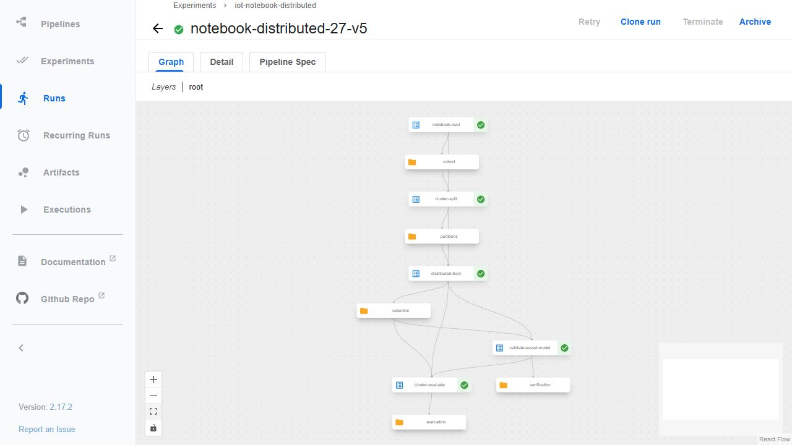
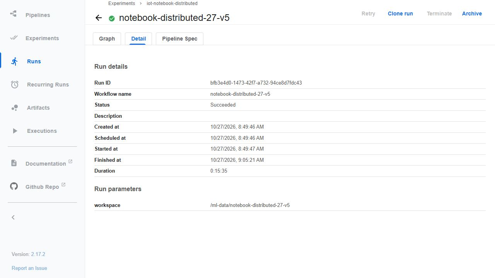
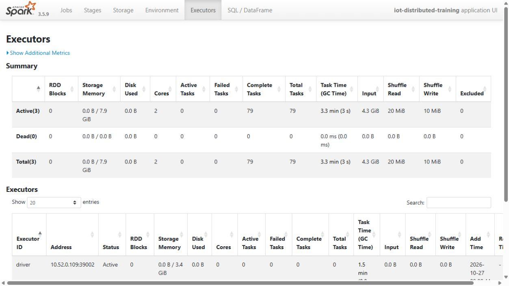
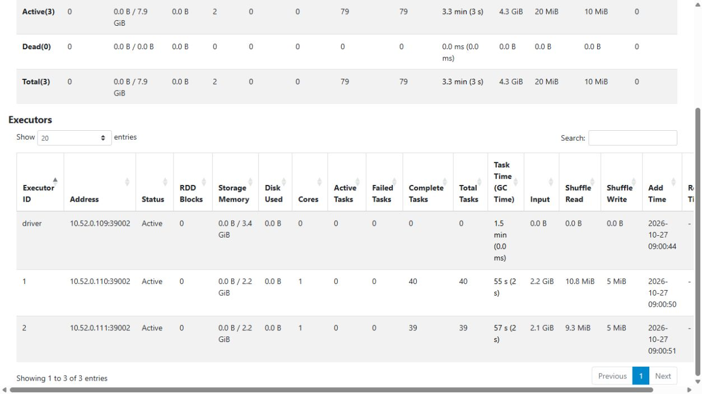

# Distributed training on Kubeflow Pipelines

The five-task pipeline retrieves features and labels, splits by time, trains, reloads/validates the saved model and evaluates holdout. The original recorded run `bfb3e4d0-1473-42f7-a732-94ce8d7fdc43` succeeded on Kubeflow Pipelines 2.17.2. Its controller measured 942.862 seconds; backend workflow timing is a separate measurement.

The driver runs in the training Pod and submits Spark work through Kubernetes to two executor Pods. Each executor has one CPU, a 4-GiB heap and 1-GiB overhead. Native event-log checks find successful logistic-regression fit tasks on both executor IDs, including stages 7–17 at `RDDLossFunction.scala:61`, with no failed task attempts. Two idle Pods alone would not establish distributed training.

Every run freshly retrieves the same 3,132,184 eligible rows. The train/validation/test counts and protocol remain fixed. Notebook parity uses the same five ML steps; its initialization cell is not a sixth stage. Later runs add automatic incremental data/model registration.

Both executor Pods run on the same physical 8-vCPU/64-GiB VM. This is distributed process execution, not a multi-machine speedup benchmark. Original Pod, event-log, registry and UI captures establish the recorded run and remain unchanged.

## Commands and recorded examples

Run commands from the repository root unless the example explicitly changes the working directory. Use a fresh output/run name and check the linked runbook before starting platform services. Examples belong to the recorded workload on this page.

```bash
sudo data/runtime/kfp-venv/bin/python scripts/run-distributed-oracle.py \
  --run distributed-oracle-new --deadline-utc "$DEADLINE_UTC"
sudo data/runtime/kfp-venv/bin/python scripts/run-notebook-kfp.py \
  --run distributed-training-new --deadline-utc "$DEADLINE_UTC" \
  --oracle outputs/distributed-oracle/distributed-oracle-new/verification.json
```

## Implementation and evidence

- [Source: ml/kfp_notebook.py](../ml/kfp_notebook.py)
- [Recorded artifact: distributed-training/controller/verification.json](evidence/distributed-training/controller/verification.json)
- [Recorded artifact: notebook-parity/execution/execution.json](evidence/notebook-parity/execution/execution.json)
- [Source: ml/distributed_submit.py](../ml/distributed_submit.py)
- [Source: infra/kfp/spark-executor.yaml](../infra/kfp/spark-executor.yaml)
- [Recorded artifact: distributed-training/controller/two-executors-running.json](evidence/distributed-training/controller/two-executors-running.json)
- [Recorded artifact: distributed-training/controller/executor-pods.json](evidence/distributed-training/controller/executor-pods.json)
- [Recorded artifact: distributed-training/controller/distributed-verification.json](evidence/distributed-training/controller/distributed-verification.json)
- [Recorded artifact: distributed-training/capture/history-event-copies.json](evidence/distributed-training/capture/history-event-copies.json)
- [Recorded artifact: distributed-training/capture/task-artifacts/evaluation.json](evidence/distributed-training/capture/task-artifacts/evaluation.json)
- [Recorded artifact: distributed-training/capture/artifact-verification.json](evidence/distributed-training/capture/artifact-verification.json)
- [Source: scripts/run-distributed-oracle.py](../scripts/run-distributed-oracle.py)
- [Recorded artifact: distributed-training/oracle/verification.json](evidence/distributed-training/oracle/verification.json)
- [Source: infra/kfp/spark-driver-rbac.yaml](../infra/kfp/spark-driver-rbac.yaml)
- [Recorded artifact: distributed-training/attempt-path/diagnosis/load-main.txt](evidence/distributed-training/attempt-path/diagnosis/load-main.txt)
- [Recorded artifact: distributed-training/attempt-identity/diagnosis/cancellation-reason.json](evidence/distributed-training/attempt-identity/diagnosis/cancellation-reason.json)
- [Recorded artifact: distributed-training/attempt-premature/stop-before-repair.json](evidence/distributed-training/attempt-premature/stop-before-repair.json)
- [Recorded artifact: distributed-training/attempt-python/diagnosis/train-main.txt](evidence/distributed-training/attempt-python/diagnosis/train-main.txt)
- [dlcdn.apache.org / running-on-kubernetes.html](https://dlcdn.apache.org/spark/docs/3.5.9/running-on-kubernetes.html)
- [kfp-kubernetes.readthedocs.io / kubernetes.html](https://kfp-kubernetes.readthedocs.io/en/kfp-kubernetes-2.17/source/kubernetes.html)
- [Recorded artifact: distributed-training/capture/manifest.json](evidence/distributed-training/capture/manifest.json)
- [Recorded artifact: distributed-training/capture/evidence-map.json](evidence/distributed-training/capture/evidence-map.json)

## Recorded interface views

These are original captures from the runs described above. Their timestamps, model identities and visible states belong to those runs.










## Related documentation

[Current architecture](architecture.md) · [Demo and recovery](demo-walkthrough.md) · [Rubric index](rubric-tracker.md)

[Original run notes](https://github.com/anle0429/iot-maintenance-platform/blob/f4da7bd21667a8bfca5715a7456bc2bcc813b0fc/docs/distributed-training.md) retain the full historical narrative. Raw evidence files have not been translated or rewritten.
