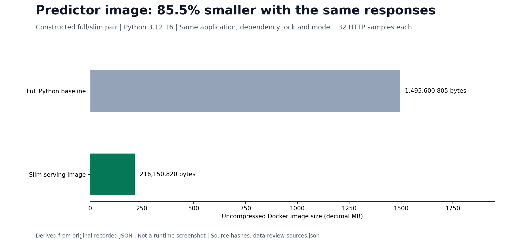

# Container image optimization

The predictor's slim image is **85.5% smaller** than a constructed full-Python baseline, with identical HTTP responses for 32 native Spark golden samples. Both images were built and exercised on the same CPU VM on 1 November 2026. The comparison isolates base-image selection; the application, lock, model, copy allowlist, user and Python patch version are the same.

## Decisions present in the Dockerfiles

| Technique | Actual implementation | What it establishes |
|---|---|---|
| Small, pinned application base | [Predictor Dockerfile](../infra/predictor/Dockerfile) uses digest-pinned `python:3.12-slim-bookworm` | Reproducible selection; the controlled comparison below isolates its size difference |
| Dependency layer before application source | Copy the predictor requirements lock and install before copying app/model files | Application-only changes can reuse the dependency layer; no cache-hit timing claim |
| Omit pip's package cache | `pip install --no-cache-dir` followed by `pip check` | Package-cache omission and dependency validation; no measured layer-byte saving |
| Copy only the serving contract | Predictor copies selected service/protocol files and the portable model bundle | Training datasets, notebook outputs and runtime credentials are excluded from this image |
| Restrict build context | [Predictor ignore file](../infra/predictor/Dockerfile.dockerignore), [Feature API ignore file](../infra/feature-api/Dockerfile.dockerignore) | Explicit source allowlists; a small final filesystem alone would not establish a small build context |
| Separate heavy runtimes | [Spark](../infra/spark/Dockerfile), [Feast](../infra/feast/Dockerfile), [test image](../infra/ci/ServingTests.Dockerfile) | Spark/Java and test tools need not be placed inside the predictor image |
| Non-root execution | Predictor UID/GID 10001 | A security property, not an image-size optimization |

The Dockerfiles above do not demonstrate a multi-stage build. Multi-stage construction should be added only when it removes an actual build dependency; an empty extra stage is not evidence of optimization.

## Controlled native comparison

The [baseline Dockerfile](../infra/benchmarks/PredictorBaseline.Dockerfile) was created for this experiment; it is not presented as an earlier production deployment. [The runner](../scripts/benchmark-predictor-image.py) resolves the full official Python base to a digest matching the slim image's Python patch, rebuilds application layers with `--no-cache`, then checks both real HTTP servers.

Each probe container has no network or published ports, a read-only root filesystem, dropped capabilities, 1 CPU and 512 MiB RAM. Scores and decisions must match [sealed native Spark predictions](../tests/fixtures/predictor-native-spark.json); complete health/model/prediction response values must match between images. No training or threshold selection occurs.

| Measurement | Full Python baseline | Slim serving image |
|---|---|---|
| Python / platform | 3.12.16 / linux/amd64 | 3.12.16 / linux/amd64 |
| Uncompressed image size | 1,495,600,805 bytes | 216,150,820 bytes |
| Image ID prefix | `67d070dea077…` | `7c76754534da…` |
| Known-answer HTTP predictions | 32 / 32 pass | 32 / 32 pass |
| Maximum score difference from Spark golden | 2.22 × 10⁻¹⁶ | 2.22 × 10⁻¹⁶ |
| Complete response values | Identical | Identical |

The difference is **1,279,449,985 bytes**, or **85.5476%**. These are uncompressed `docker image inspect` `.Size` values, not compressed transfer sizes or disk space reclaimed while both images remain cached. Full IDs/calculations are in [the original report](evidence/data-platform-review/docker/verification.json); [base digests](evidence/data-platform-review/docker/bases.json), [baseline history](evidence/data-platform-review/docker/history-baseline.txt), [slim history](evidence/data-platform-review/docker/history-optimized.txt) and [original native archive](evidence/data-platform-review/docker/native.tar.gz) retain the measurement inputs and commands.



The copied context contains 36,155 source bytes before `.dockerignore` filtering; that is not the packed context transferred to Docker. Application-layer builds took approximately 10 and 9 seconds in this single pair, excluding base pulls. One pair does not establish a build-speed or serving-latency improvement. The resource guard controls the client; it does not impose a separate CPU/memory cap on the shared Docker build daemon.

Attempt A built both images but failed when `docker cp` tried to write into a read-only root filesystem. Attempt B supplied the public probe payload as an argument and passed, preserving that protection. Both original attempts remain in the archive.

On the approved Linux VM, prepare an explicit source packet and current private instance descriptor, then use fresh paths and a run suffix:

```bash
sudo python3 scripts/benchmark-predictor-image.py \
  --runtime-root /path/to/project --source /path/to/project/source-packet \
  --output /path/to/project/outputs/image-study-new \
  --descriptor /private/path/to/current-instance.json --run studynew
```

The descriptor is private local input. The runner validates the CPU VM identity, eight-hour auto-STOP deadline and RAM/SSD reserves, and preserves existing outputs/unrelated containers.
