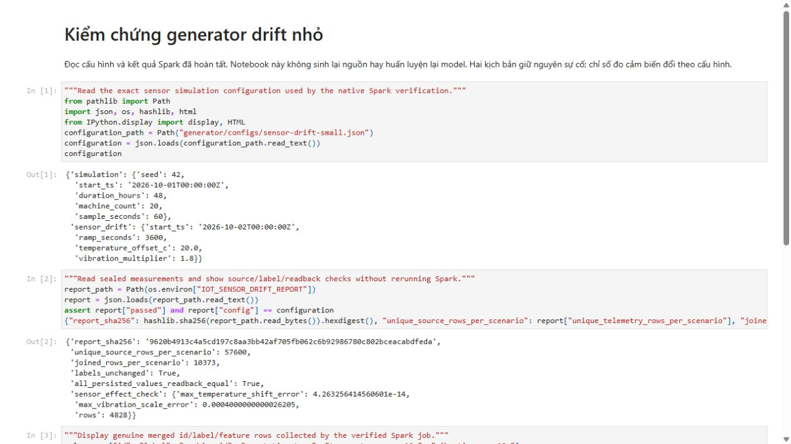
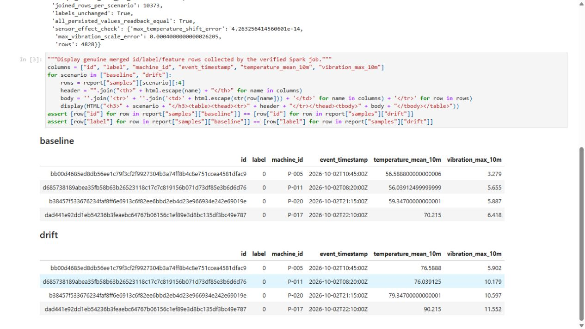
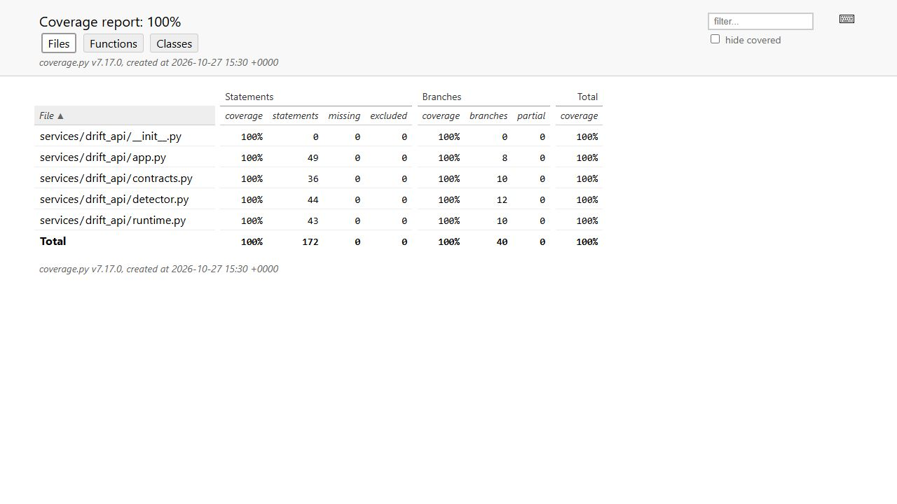
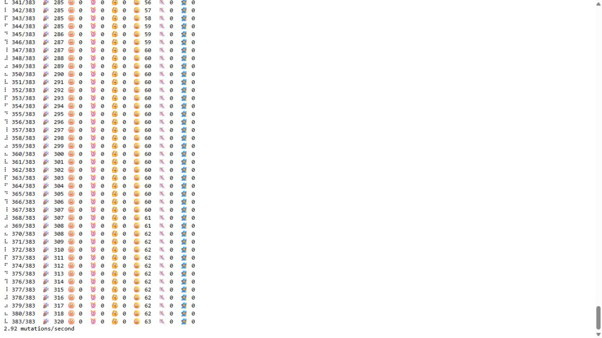

# Sensor drift generation and real-time drift API

The sensor-drift configuration changes generated sensor distributions while retaining the domain's physical failure process and explicit labels. A separate two-column ID/label table is joined with feature snapshots for training; the future target is not included in a drift or inference feature vector.

The FastAPI drift service validates its input, compares the selected window with the fixed reference and returns the declared drift statistics/decision. Native HTTP, async behavior, rolling fallback, property tests and data readbacks are recorded in the linked package.

A distribution shift is a diagnostic signal, not a measured loss in accuracy. The independent offline monitoring, Eventing receiver and MMD diagnostic have their own cohorts and protocols. Their reference/model identities must not be silently interchanged.

## Commands and recorded examples

Run commands from the repository root unless the example explicitly changes the working directory. Use a fresh output/run name and check the linked runbook before starting platform services. Examples belong to the recorded workload on this page.

```bash
python -m generator.drift --config generator/configs/sensor-drift-small.json \
  --output data/source/sensor-drift-new
```

```bash
python -m pip install -r infra/drift-api/requirements-test.txt
python -m pytest tests/api/test_drift_api.py tests/test_sensor_drift.py \
  --cov=services.drift_api --cov-branch --cov-report=html
```

## Implementation and evidence

- [Source: services/drift_api/detector.py](../services/drift_api/detector.py)
- [support.minitab.com / details-about-the-population-stability-index-psi](https://support.minitab.com/en-us/model-ops/monitor-deployed-models/details-about-the-population-stability-index-psi/)
- [docs-old.evidentlyai.com / options-for-statistical-tests](https://docs-old.evidentlyai.com/user-guide/customization/options-for-statistical-tests)
- [Source: scripts/build-drift-reference.py](../scripts/build-drift-reference.py)
- [Source: services/drift_api/contracts.py](../services/drift_api/contracts.py)
- [Source: services/drift_api/runtime.py](../services/drift_api/runtime.py)
- [Source: services/drift_api/app.py](../services/drift_api/app.py)
- [fastapi.tiangolo.com / async](https://fastapi.tiangolo.com/async/)
- [docs.python.org / sqlite3.html](https://docs.python.org/3.12/library/sqlite3.html)
- [Source: generator/drift.py](../generator/drift.py)
- [Source: generator/configs/sensor-drift-small.json](../generator/configs/sensor-drift-small.json)
- [Source: scripts/verify-sensor-drift.py](../scripts/verify-sensor-drift.py)
- [Recorded artifact: drift-api/http/http.json](evidence/drift-api/http/http.json)
- [Recorded artifact: drift-api/generator/generator-verification.json](evidence/drift-api/generator/generator-verification.json)
- [Recorded artifact: drift-api/reference/reference.verification.json](evidence/drift-api/reference/reference.verification.json)
- [Recorded artifact: drift-api/notebook/executed.ipynb](evidence/drift-api/notebook/executed.ipynb)
- [Recorded artifact: drift-api/notebook/executed.html](evidence/drift-api/notebook/executed.html)
- [Recorded artifact: drift-api/notebook/verification.json](evidence/drift-api/notebook/verification.json)
- [Source: notebooks/02_sensor_drift_verification.ipynb](../notebooks/02_sensor_drift_verification.ipynb)
- [Recorded artifact: drift-api/generator/command.json](evidence/drift-api/generator/command.json)
- [Source: tests/api/test_drift_api.py](../tests/api/test_drift_api.py)
- [Source: tests/test_sensor_drift.py](../tests/test_sensor_drift.py)
- [Source: infra/drift-api/mutation.toml](../infra/drift-api/mutation.toml)
- [Recorded artifact: drift-api/combined/verification.json](evidence/drift-api/combined/verification.json)
- [Recorded artifact: drift-api/mutation-initial/verification.json](evidence/drift-api/mutation-initial/verification.json)
- [Recorded artifact: drift-api/mutation/verification.json](evidence/drift-api/mutation/verification.json)
- [Recorded artifact: drift-api/mutation/mutmut-console.txt](evidence/drift-api/mutation/mutmut-console.txt)
- [Recorded artifact: drift-api/mutation/surviving-diffs.json](evidence/drift-api/mutation/surviving-diffs.json)
- [Source: scripts/verify-drift-api.py](../scripts/verify-drift-api.py)
- [Recorded artifact: drift-api/capture/manifest.json](evidence/drift-api/capture/manifest.json)
- [Recorded artifact: drift-api/capture/evidence-map.json](evidence/drift-api/capture/evidence-map.json)
- [Recorded artifact: drift-api/capture/source-commit.json](evidence/drift-api/capture/source-commit.json)

## Recorded interface views

These are original captures from the runs described above. Their timestamps, model identities and visible states belong to those runs.










## Related documentation

[Current architecture](architecture.md) · [Demo and recovery](operations.md) · [Rubric index](rubric-tracker.md)

[Original run notes](https://github.com/anle0429/iot-maintenance-platform/blob/f4da7bd21667a8bfca5715a7456bc2bcc813b0fc/docs/drift-detection.md) retain the full historical narrative. Raw evidence files have not been translated or rewritten.
