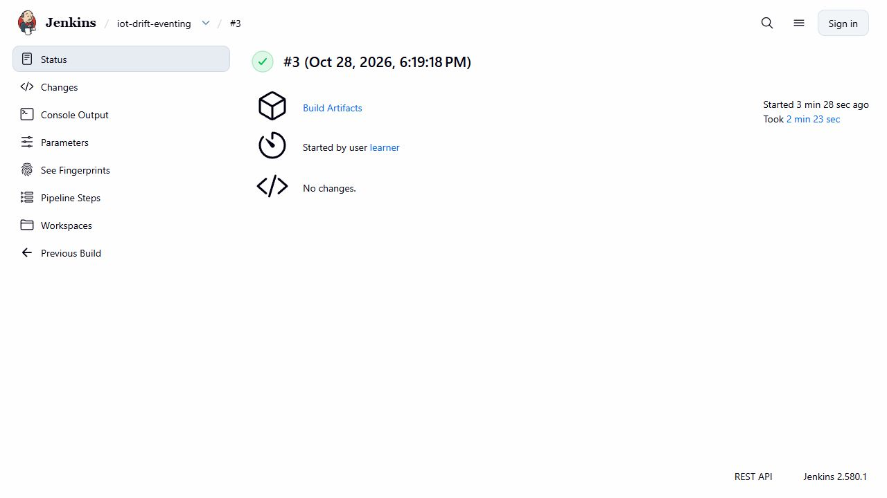
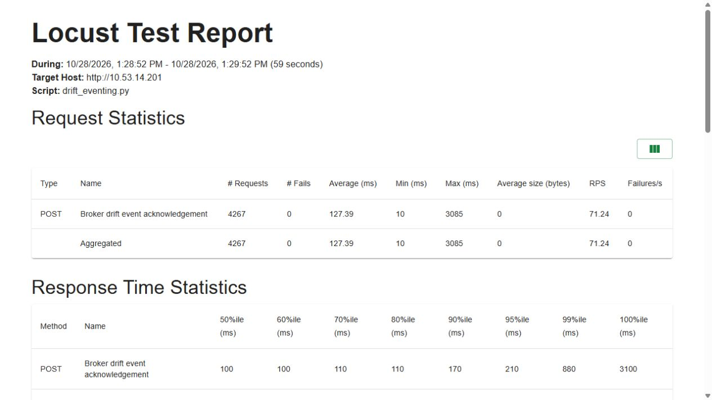

# Knative Eventing to KServe drift delivery

Jenkins Eventing build 3 succeeded after test/build/auto-deploy gates, native SDK/model checks and image probes. The route is publisher→broker ingress→channel dispatcher→filter→KServe drift receiver. Broker/Trigger resources are configuration, not invented processes.

Nine native deliveries received 204 but stored one finalized window; replay, payload conflict 409 and filtering were checked against durable state. The gate recorded 101 main tests/20 subtests, complete coverage of 65 statements/10 branches and 103/119 killed mutants (86.55%). Paced load recorded 598/4,267 ACKs without failure and P95 11/210 ms; the subscriber delta 4,865 matches the measured requests.

Original source/image bindings, Pod identities, HPA restoration and screenshots remain attached to this run. The publisher replays a retained synthetic window. An in-memory broker and successful acknowledgements do not prove arbitrary-crash exactly-once behavior or new-window compute capacity.

## Commands and recorded examples

Run commands from the repository root unless the example explicitly changes the working directory. Use a fresh output/run name and check the linked runbook before starting platform services. Examples belong to the recorded workload on this page.

```powershell
python -S scripts/verify-drift-eventing.py
```

```powershell
python -m pytest tests/api/test_drift_api.py tests/api/test_drift_events.py tests/test_drift_eventing.py tests/test_drift_eventing_gate.py tests/api/test_observed.py -q
```

## Implementation and evidence

- [Source: infra/ci/DriftEventing.Jenkinsfile](../infra/ci/DriftEventing.Jenkinsfile)
- [Source: scripts/ci-drift-eventing.py](../scripts/ci-drift-eventing.py)
- [Source: ml/drift_eventing.py](../ml/drift_eventing.py)
- [Source: services/drift_api/events.py](../services/drift_api/events.py)
- [Recorded artifact: drift-eventing-linux/jenkins/build-3.json](evidence/drift-eventing-linux/jenkins/build-3.json)
- [Recorded artifact: drift-eventing-linux/jenkins/build-3-stages.json](evidence/drift-eventing-linux/jenkins/build-3-stages.json)
- [Recorded artifact: drift-eventing-linux/current/verification.json](evidence/drift-eventing-linux/current/verification.json)
- [Recorded artifact: drift-eventing-linux/sources/actual-workspace-after.json](evidence/drift-eventing-linux/sources/actual-workspace-after.json)
- [Recorded artifact: drift-eventing-linux/manifest.json](evidence/drift-eventing-linux/manifest.json)
- [knative.dev / sinks](https://knative.dev/docs/eventing/sinks/)
- [github.com / http-protocol-binding.md](https://github.com/cloudevents/spec/blob/v1.0.2/cloudevents/bindings/http-protocol-binding.md)
- [Recorded artifact: drift-eventing-linux/current/tests/gate/junit.xml](evidence/drift-eventing-linux/current/tests/gate/junit.xml)
- [Recorded artifact: drift-eventing-linux/current/tests/gate/coverage-html/index.html](evidence/drift-eventing-linux/current/tests/gate/coverage-html/index.html)
- [Recorded artifact: drift-eventing-linux/current/tests/gate/verification.json](evidence/drift-eventing-linux/current/tests/gate/verification.json)
- [Recorded artifact: drift-eventing-linux/current/selection.json](evidence/drift-eventing-linux/current/selection.json)
- [Recorded artifact: drift-eventing-linux/current/reference.json](evidence/drift-eventing-linux/current/reference.json)
- [Recorded artifact: drift-eventing-linux/current/build.json](evidence/drift-eventing-linux/current/build.json)
- [Recorded artifact: drift-eventing-linux/current/publisher.json](evidence/drift-eventing-linux/current/publisher.json)
- [Recorded artifact: drift-eventing-linux/current/metrics-after-delivery.prom](evidence/drift-eventing-linux/current/metrics-after-delivery.prom)
- [Recorded artifact: drift-eventing-linux/current/sqlite-readonly.json](evidence/drift-eventing-linux/current/sqlite-readonly.json)
- [Recorded artifact: drift-eventing-linux/current/conflict.json](evidence/drift-eventing-linux/current/conflict.json)
- [Recorded artifact: drift-eventing-linux/load/fixed1/verification.json](evidence/drift-eventing-linux/load/fixed1/verification.json)
- [Recorded artifact: drift-eventing-linux/load/fixed1/users-1.html](evidence/drift-eventing-linux/load/fixed1/users-1.html)
- [Recorded artifact: drift-eventing-linux/load/fixed1/users-10.html](evidence/drift-eventing-linux/load/fixed1/users-10.html)
- [Recorded artifact: drift-eventing-linux/load/fixed1-control/hpas-restored.json](evidence/drift-eventing-linux/load/fixed1-control/hpas-restored.json)
- [Recorded artifact: drift-eventing-linux/pilot-failed/resume/publisher.json](evidence/drift-eventing-linux/pilot-failed/resume/publisher.json)
- [Recorded artifact: drift-eventing-linux/pilot-failed/mt-broker-filter-logs.txt](evidence/drift-eventing-linux/pilot-failed/mt-broker-filter-logs.txt)
- [Recorded artifact: drift-eventing-linux/failed-ci/1/tests/gate/mutmut-cicd-stats.json](evidence/drift-eventing-linux/failed-ci/1/tests/gate/mutmut-cicd-stats.json)
- [Recorded artifact: drift-eventing-linux/jenkins/build-2-console.txt](evidence/drift-eventing-linux/jenkins/build-2-console.txt)
- [Recorded artifact: drift-eventing-linux/load/pods-before.json](evidence/drift-eventing-linux/load/pods-before.json)
- [Recorded artifact: drift-eventing-linux/load/pods-after.json](evidence/drift-eventing-linux/load/pods-after.json)
- [Recorded artifact: drift-eventing-linux/load/post-failure/pod-difference.json](evidence/drift-eventing-linux/load/post-failure/pod-difference.json)
- [github.com / knative-v1.24.0](https://github.com/knative/eventing/releases/tag/knative-v1.24.0)
- [github.com / RELEASE-SCHEDULE.md](https://github.com/knative/community/blob/main/mechanics/RELEASE-SCHEDULE.md)
- [Source: infra/eventing/assets.json](../infra/eventing/assets.json)
- [Source: scripts/install-eventing.py](../scripts/install-eventing.py)
- [knative.dev / install-eventing-with-yaml](https://knative.dev/docs/admin/install/eventing/install-eventing-with-yaml/)

## Recorded interface views

These are original captures from the runs described above. Their timestamps, model identities and visible states belong to those runs.






## Related documentation

[Current architecture](architecture.md) · [Demo and recovery](operations.md) · [Rubric index](rubric-tracker.md)

[Original run notes](https://github.com/anle0429/iot-maintenance-platform/blob/f4da7bd21667a8bfca5715a7456bc2bcc813b0fc/docs/drift-eventing.md) retain the full historical narrative. Raw evidence files have not been translated or rewritten.
