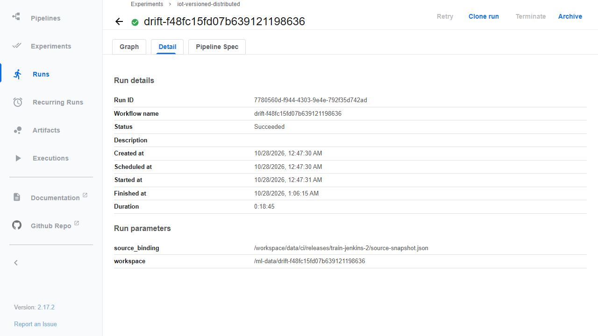
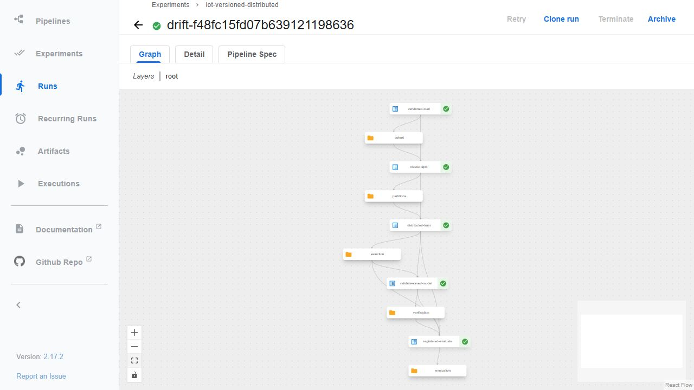
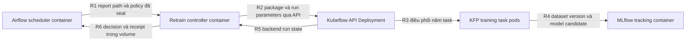

# Airflow gọi Kubeflow để huấn luyện lại

**Đã chạy thật ngày28/10/2026:** Airflow`manual-retrain-probe-28-v2` SUCCESS, KFP`7780560d-f944-4303-9e4e-792f35d742ad` SUCCEEDED đủ5task. Controller thực đo1.128,680giây; UI hiển thị18phút45giây theo thời gian backend. Model mới **version7/candidate/production=false**, modelrun`ae599077b711443b856c1c9c588ad5fa`. Đây là demo thủ công với **drift thực=false**, không phải một cảnh báo drift tự phát sinh.

Feature lease của model6 hết hạn trong phiên này; capture F51 giữ nguyên trạng thái đó. [Lượt làm mới riêng lúc06:33UTC](active-feature-refresh.md) đã materialize và kiểm lại200máy với model6, không thăng cấp model7 hoặc sửa bằng chứng F51.





Ảnh JPEG gốc không chỉnh sửa; UI dùng giờ Chicago, các receipt có epoch hoặc timestamp kèm offset để đối chiếu UTC. [Kết quả gốc controller](evidence/drift-retraining-linux/admission/result.json), [backend KFP](evidence/drift-retraining-linux/admission/backend-run.json), [Airflow run](evidence/drift-retraining-linux/airflow/trained-run.json) và [task instances](evidence/drift-retraining-linux/airflow/trained-tasks.json) giữ đúng identity từng bước.

## Chính sách và đường chạy

Sau `retrieve_compare_push`, DAG [iot_offline_drift](../airflow/dags/iot_offline_drift.py) chạy `admit_kfp_retrain`. [Adapter](../feature_store/drift_retrain.py) mở controllerSDK trong image ID đã kiểm của trainingCI2; [controller](../ml/drift_retrain.py) xác nhận report/completion/metrics, source/reference và recipe trước khi gọi runner KFP. Task đầu vẫn dùng SDK/source monitoring đã seal, không sửa nguồn hay nhãn để tạo drift.



Lock/journal là state của controller trong volume hiện có, không phải một dịch vụ mới. Luồng này không gọi Helm hoặc đổi model đang phục vụ.

Bản lab dùng `max_active_runs=1` và task chờ kết quả KFP. Trong lúc huấn luyện, lần theo dõi drift kế tiếp phải chờ; dashboard vẫn hiển thị tuổi metric cuối, không ghi success mới để che khoảng trống. Lịch5phút là lịch kích hoạt, không phải cam kết so sánh mới mỗi5phút khi có retrain dài. Tách submit và theo dõi hoàn tất thành luồng độc lập là cải tiến vận hành chưa triển khai trong mốc này.

Theo [API KFP chính thức](https://www.kubeflow.org/docs/components/pipelines/user-guides/core-functions/run-a-pipeline/), SDK gửi pipeline package thành một run ở backend. Dự án dùng lại runner đã kiểm [training CI](ci-training.md), `create_run_from_pipeline_package(..., enable_caching=False)`, rồi đọc backend và kết quả5task. [Cấu hình caching](https://www.kubeflow.org/docs/components/pipelines/user-guides/core-functions/caching/) được tắt để bắt buộc thực thi mới.

- Bình thường: report có ít nhất2/8feature PSI≥0,2 mới đủ điều kiện xét retrain. Không có drift thì task trả `skipped/no_detected_drift`, không gọi API tạo training run.
- Demo: `retrain_probe=true` chỉ được nhận khi policy cục bộ cho phép và manual run khai báo `interval_end_utc`. Receipt giữ `manual_probe=true` cùng **giá trị drift thật**; demo không phải bằng chứng cửa sổ đã drift.
- Input phải thành công qua native Feast, Pushgateway trả200 và các hash phải khớp. Report mới trong600giây, recipe48file khớp, đủ90phút/24GiB RAM/40GB hai đĩa trước autoSTOP thực. Các guard trong runner cũ giữ nguyên.
- Global SQLite lock serialize admission. Một window/reference/policy có identity cố định; intent được ghi và fsync trước lời gọi ngoài. Lượt hoàn tất được dùng lại khi replay, không tạo training mới. Cooldown1giờ sau hoàn tất chặn các cửa sổ kế tiếp. Intent chưa rõ kết quả chặn cả retry lẫn window khác để người vận hành đối chiếu backend.

Cách này ưu tiên không tự gửi lại khi mất phản hồi. Nó không tuyên bố exactly-once transaction giữa filesystem và KFP. Nếu intent tồn tại mà receipt thiếu, kiểm tên/run ID trong backend, giữ dữ liệu cũ và đối chiếu trước khi có quyết định vận hành; không xóa intent để ép thử lại.

## Dữ liệu và giới hạn

Drift dùng reference train model3 và cửa sổ mô phỏng không nhãn. Retrain dùng **cùng cohort medium có nhãn/protocol đã cố định** của trainingCI2/sourcece510c6, năm task và hai Spark executor trên cùngVM. Nó tái lập huấn luyện và đăng ký candidate mới; không tự học từ cửa sổ drift chưa có nhãn, không đổi split/ngưỡng hoặc chứng minh chất lượng đã phục hồi. Model phục vụ6 không tự thay. Source44file ML, package YAML và image CI2 giữ nguyên.

Runtime policy/config ởVM, không có secrets trong Git. Controller cần private KFP/kubeconfig hiện có; mount nguồn readonly, chỉ output/state/workspace mới ghi. Giới hạn thực controller **1CPU/2GiB**, Airflow task timeout70phút/runner3900giây; các Spark pod giữ limits đã kiểm trước. Cấu hình này không phải bằng chứng least-privilege hoặc Vault/service mesh.

## Kiểm chứng hiện tại

Source control plane đầu **eba2187**:11unit tests trênPC và Linux SDK image PASS; thêm7tests clock/PSI oracle trênPC thành18PASS. Bản sửa **b41d654** có13tests PASS trênPC, clone và controller readonly. Có ca đúng biên600giây/PSI0,2, no-drift, probe truthful, source đổi, receipt giả, response mất, concurrency, replay sau hết hạn, cooldown và operator reconciliation có hash bằng chứng. DAG thật đã parse đúng hai task và dependency, không chỉ render YAML.

Lượt lịch05:35UTC28/10 lấy feature/push metric thành công nhưng task mới lỗi quyền tạo `outputs/drift-retrain`. Giữ log lỗi; chỉ provision hai thư mục output/state mới cho UID50000, không chmod/chown toàn dự án hoặc ghi lại trạng thái cũ. **Lượt lịch05:40 đã SUCCESS cả hai task**, report drift=false, decision `skipped/no_detected_drift`; không tạo intent huấn luyện.

Manual probe đầu dừng trước lời gọi KFP vì K3s CLI cần giải nén executable trong root chỉ đọc. Bản sửa giữ root readonly và cấp riêng tmpfs512MiB cóexec cho thư mục CLI, kiểm thật `kubectl version`/private service lookup. Readback đủ11run backend cho thấy0run khớp tên probe; submission file chưa tồn tại và source traceback nằm trước lệnh submit. Operator ghi reconciliation gắn hash intent/log/backend, không xóa intent hay sửa marker. Hai test chặn reconciliation thiếu seal hoặc có backend run khớp.

Sau nâng sourceb41, **run Airflow mới**`manual-retrain-probe-28-v2` gọi KFP thật, workspace`drift-f48fc15fd07b639121198636`, bắt đầu05:47:31UTC và backend hoàn tất06:06:15UTC. Controller đọc lại backend/data/model và hoàn tất06:06:21UTC. Cả hai Airflow task SUCCESS lần thử1. Kiểm in-flight riêng trênVM lúc05:51:06UTC: invocation thứ hai nhận lỗi SQLite lock, intent hashes trước/sau không đổi; probe cấu hình networknone và không tạo thêm training.

| Phép kiểm | Kết quả native | Bằng chứng |
|---|---|---|
| Năm main container |5exit0, đúng hai imageCI2/CRI config ID, mount source đã seal |[Pods](evidence/drift-retraining-linux/training/native/pipeline-pods.json) |
| Distributed fit |2executor cùngVM;79TaskEnd/0failed, các LR stage chạy trên cả hai |[Raw selected events](evidence/drift-retraining-linux/training/spark-selected.jsonl), [summary](evidence/drift-retraining-linux/training/event-summary.json) |
| Native pull/version |3.132.184rows,180canonicalfiles/740.003.698byte, remote restore exact;0blob byte mới |[Automatic data](evidence/drift-retraining-linux/training/lineage/automatic-data.json) |
| Model registry |Model7 READY, run FINISHED,11params/27metrics; data root5e782/dataRun49ea;200native-model probes |[Registry](evidence/drift-retraining-linux/registry/model-version.json), [registration](evidence/drift-retraining-linux/training/lineage/registration.json) |
| Completed replay |Trả cùng runID dù report đã quá600giây; không mạng/kubeconfig; backend trước/sau chỉ1run tương ứng |[Replay receipt](evidence/drift-retraining-linux/checks/completed-replay/verification.json) |
| New window cooldown |Airflow`manual-retrain-cooldown-28` SUCCESS, decisioncooldown; backend vẫn12run/toànnamespace,2intent không đổi |[Cooldown receipt](evidence/drift-retraining-linux/checks/cooldown-proof/verification.json) |

0byte mới là kết quả dữ liệu không đổi và được reuse theo content hash; không phải không chạy load/version. Mỗi pull vẫn xác nhận và restore đầy đủ. Source training giữ44file/commitce510c6, controller7file/commitb41d654, monitoring giữ source0bca67c; không nhận VM Git HEAD làm nguồn thực thi.

[Capsule](evidence/drift-retraining-linux/manifest.json) có **118payload/5.018.983byte**, gồm113file native được kiểm SHA sau giải nén, hai ảnh và metadata. Bốn readback SDK lặp nhiều pipeline được gzip **không mất dữ liệu**, tiết kiệm3.096.840byte; verifier giải nén rồi đối chiếu hash gốc, gồm seal reconciliation. Các Spark event đã chọn giữ nguyên dòng thô, bao gồm mọiTaskEnd/JobStart/Stage của loại đã chọn; EnvironmentUpdate/SQL/internal events không publish. [Inventory native](evidence/drift-retraining-linux/native-capture.json) ghi phép chọn, nguồn và SHA của full event log, không giả là đã công bố mọi byte của full log.

Mốc này không đo lại chất lượng để chọn ngưỡng hoặc promote model. Readback sau job vẫn trỏ model6; deployment feature API khi chụp cóAvailable=False và lease demo1giờ từCI8 đã hết. Cần materialization mới trước lần demo API tiếp theo; không sửa timestamp để che expiry. Raw readback đó được giữ nguyên, không suy ra API luôn khỏe từ việc KFP thành công.

## Tự kiểm

Trong repo clone, chỉ cần Python standard library cho tests điều kiện gọi:

```powershell
python -m unittest tests.test_drift_retrain -v
python -S scripts/verify-drift-retraining.py
```

Verifier chỉ dùng standard library+Git từ repo có lịch sử đầy đủ. Nó kiểm118payload và113hash native gốc,7+7control files/44MLsource,24PSI từ raw samples, Airflow instances/KFP5task/CRI images, rawSparkTaskEnds, incrementaldata/model registry, tuổi report, nguyên nhân lỗi cũ và ba chốt chống trùng. Đây là audit receipt, không chạy training/cloud mới.

Native run cần đúng dữ liệu/runtime riêng trênVM. Trước khi bật, provision `outputs/drift-retrain` và `data/runtime/drift-retrain-state` cho UID Airflow50000; policy chứa SHA recipe, source/reference và cooldown. Controller readonly cần vùngtmpfs riêng cóexec cho K3s CLI như [adapter](../feature_store/drift_retrain.py). Không chép config cũ sang máy khác rồi nhận là đã có runtime. Để demo qua Airflow, chọn run ID mới và giờ interval có timezone:

```json
{"interval_end_utc":"2026-10-28T05:40:00Z","retrain_probe":true}
```

Đây chỉ là ví dụ manual conf, không phải lệnh submit hay bằng chứng scheduler tự phát hiện drift. Sau chạy phải đọc state/task instances của Airflow, KFP run ID/backend graph,5main container, data/model lineage và candidate production=false. Giữ receipt lỗi nếu có; không dùng marker của trainingCI2 để nhận lượt mới thành công.
