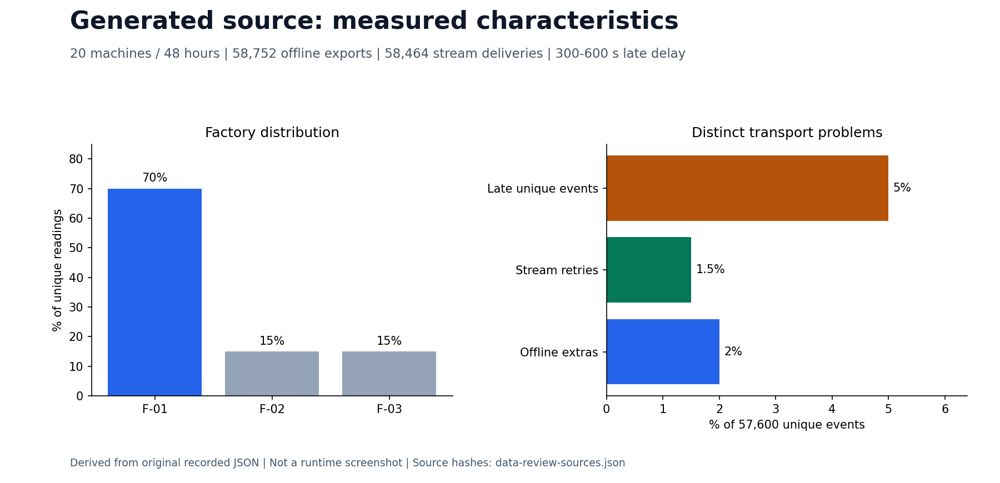

# Data generator

The generator simulates pump history, then applies delivery faults separately. Wear, load, failure and maintenance determine sensor values. Skew, retries, schema changes and late arrival determine how measurements reach the pipelines.

## Observed development source

Twenty machines over forty-eight hours produce 57,600 unique readings. [The generator reference](../../generator/README.md#observed-data-characteristics) supplies exact denominators, source checks and schema examples.

| Characteristic | Measured result |
|---|---|
| Factory skew | 70% / 15% / 15% after joining machine metadata |
| Event-ID cardinality | 57,600 / 58,752 offline rows = 98.039216% |
| Offline duplicate exports | 1,152 extras = 2% of unique readings |
| Schema evolution | v2 adds `pressure_bar`; normalized v1 pressure stays NULL |
| Late stream events | 2,880 / 57,600 = 5%; delays of 300–600 seconds |
| Stream retry deliveries | 864 extras = 1.5% of unique readings; 58,464 total deliveries |



Delivery IDs identify attempts; event IDs identify readings. The [data contract](data_contract.md) defines grain, units and first-arrival timestamps. Future outcomes remain separate labels.

## Generate and inspect

From the repository root, use a fresh output name:

```powershell
$run = "local-$(Get-Date -Format 'yyyyMMdd-HHmmss')"
python -S -m generator generate --config generator/configs/dev.json --output "data/source/$run"
python -S -m generator inspect --source "data/source/$run" --report "outputs/$run/quality.json"
```

The small run needs only Python's standard library. [Chunked generation](chunked_generator.md) preserves physical/random state across bounded output parts. [Throughput measurements](generator_throughput.md) and [resource planning](scale_100gb.md) precede large generation. The [102.45 GB ingest](full_scale_ingest.md) and separate [60-day ML cohort](medium_feature_dataset.md) have their own source identities and receipts.

[Processing jobs](processing_jobs.md) explains schema/duplicate corrections. [Paired batch experiments](batch_corrections_benchmark.md) measures alternatives without assuming every candidate is faster. [Streaming](streaming.md) follows event-time windows, D/E late cases, duplicate rejection and final SQLite results.
