# Data storage and feature stores

The platform persists a layered data lake as Snappy Parquet and builds dimensional tables in its Gold layer. Spark and DuckDB query those files. Feast embeds a DuckDB offline provider and a Redis online provider in consuming jobs and services. This page shows the storage code, table layout, readbacks and measured improvements in one place.

## Contents

- [Actual storage boundaries](#what-is-deployed)
- [Parquet writes and readback](#parquet-writes-and-readback)
- [Gold dimensional analytics](#dimensional-analytics)
- [Measured storage optimization](#storage-optimization)
- [Warehouse index experiment](#warehouse-index-experiment)
- [Feast configuration and write paths](#feast-configuration-and-writes)
- [Medallion zones, table grains and relationships](#schema-design)
- [Feast offline and online features](#feast-feature-store)
- [Write paths and clock boundaries](#feature-jobs-and-ttl)
- [Batch materialization and DataHub](#feast-materialization)
- [Batch materialization CI](#ci-materialization)
- [Finalized stream feature push](#stream-feast-push)
- [Offline and online stream CI](#ci-stream-push)
- [Full retained-window cohort](#window-cohort)

## What is deployed

| Store | Actual implementation | Purpose |
|---|---|---|
| Department source | JSONL; small original batch imports raw envelopes into PostgreSQL | Source records and their provenance, before normalization |
| Layered data lake | Immutable per-run Snappy Parquet directories on the VM data disk | Bronze keeps exports; Silver normalizes and deduplicates; Gold stores analytical tables on bounded runs |
| Gold dimensional model | `dim_machine`, `dim_factory`, `fact_telemetry`, `fact_failure`, `fact_maintenance` in Parquet | Time-correct machine enrichment and analytical joins |
| Retained streaming output | SQLite windows and audits; separate SQLite event ledger | Finalized aggregates, bounded replay and audit readback |
| Offline feature history | Parquet `FileSource` queried through DuckDB; separate Feast registry metadata | Historical retrieval for training and finalized stream feature history |
| Online feature state | Redis projects on the original Docker service and on the selected Kubernetes serving release | Latest values; not training history |

**Lakehouse and warehouse scope.** The `data/lakehouse/` path names the layered Parquet layout. It does not provide a transactional table format, transaction log, snapshot time travel or concurrent table commits. The implementation does not use Iceberg, Delta Lake or Hudi. The DP2 DAG's `warehouse` name refers to its dimensional modeling stage. It does not create a separate SQL warehouse, database indexes on Gold facts or SQL-enforced foreign keys in Parquet. The original PostgreSQL JDBC path reads raw source records, not Gold output. [The source DDL](../../infra/postgres/source.sql) defines only `source_runs` and `source_records`; [the loader](../../pipelines/source_loader.py) imports those records, and [the Spark JDBC reader](../../pipelines/batch_job.py#L35-L39) reads them. The local indexed SQL warehouse experiment below is a separate workload; the deployed DP2 path remains Parquet.

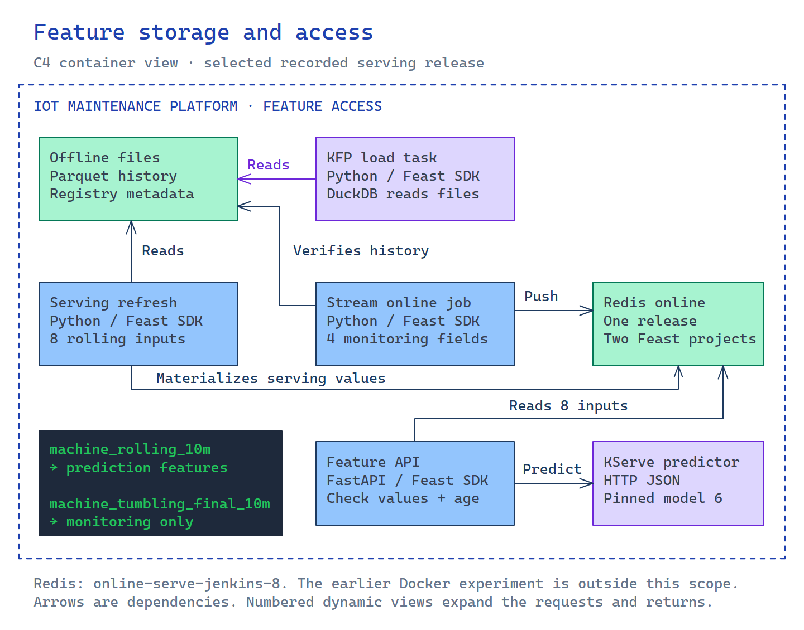

The main diagram selects the Kubernetes serving release. Batch materialization and the original stream push shared Docker `online:6379`; staged stream CI and serving used distinct Feast projects on `online-serve-jenkins-8`. The SDK runs inside each consumer.

## Parquet writes and readback

The chunked Spark path writes new Snappy Parquet output with a bounded partition count and a maximum of 500,000 records per file. `repartition(partitions)` controls Spark output distribution; it is not Hive-style directory partitioning by event date. The job reads the persisted output, verifies duplicate-preserving multisets where required, and records actual footer codecs, rows and bytes. Its write path does not overwrite a prior version.

Excerpt from [`pipelines/chunk_ingest.py`, lines 65–74](../../pipelines/chunk_ingest.py#L65-L74):

```python
def exact_rows_equal(left, right, columns: list[str]):
    """Compare both directions as multisets, preserving duplicate multiplicity and null values."""
    require(left.select(*columns).exceptAll(right.select(*columns)).limit(1).count()==0,'Parquet lost/changed source rows')
    require(right.select(*columns).exceptAll(left.select(*columns)).limit(1).count()==0,'Parquet introduced source rows')


def write_parquet(frame, path: Path, partitions: int):
    """Write a new bounded-partition Snappy dataset, never overwrite a previous run."""
    (frame.repartition(partitions).write.mode('errorifexists').option('compression','snappy')
     .option('maxRecordsPerFile',500_000).parquet(str(path)))
```


For DP1–DP3, the stage path is `data/orchestrated/<batch>/<stage>`. Each materialization records the inventory and SHA-256 of every Parquet part. Readers require a matching successful validation receipt before consuming an upstream stage. This is an application-level integrity and release gate; the atomic small JSON marker does not turn the Parquet directory into a transactional table.

Excerpt from [`pipelines/orchestration_contract.py`, lines 54–69](../../pipelines/orchestration_contract.py#L54-L69):

```python
def inventory(directory: Path) -> list[dict]:
    """Fingerprint every Parquet part; report files never contribute to their own hash."""
    return [{'path': path.relative_to(directory).as_posix(), 'bytes': path.stat().st_size, 'sha256': digest(path)}
            for path in sorted(directory.rglob('*.parquet'))]


def verified_manifest(directory: Path, require_validated: bool = True) -> dict:
    """Reject incomplete, corrupted or failed upstream materializations before consuming them."""
    manifest = json.loads((directory / '_INGESTED.json').read_text(encoding='utf-8'))
    if not manifest['files'] or manifest['files'] != inventory(directory):
        raise ValueError('materialized Parquet bytes changed or are incomplete')
    if require_validated:
        validation = json.loads((directory / 'validation.json').read_text(encoding='utf-8'))
        if validation.get('passed') is not True or validation['manifest_sha256'] != digest(directory / '_INGESTED.json'):
            raise ValueError('upstream validation missing, failed or belongs to different bytes')
    return manifest
```


## Dimensional analytics

DP2 writes Silver and Gold via the same Parquet writer; `fact_*` tables attach the machine version effective at the event's time. The original changed-machine batch has a separate input and proves a historical transition. A Gold analytics join using effective event time does not replace prediction-time checks for arrival and recorded availability.

Excerpt from [`pipelines/orchestrated_job.py`, lines 69–82](../../pipelines/orchestrated_job.py#L69-L82):

```python
raw = load(spark, previous, 'bronze/raw_telemetry')
readings = latest_readings(raw).cache()
machines = load(spark, previous, 'bronze/raw_machines')
failures = load(spark, previous, 'bronze/raw_failures')
maintenance = load(spark, previous, 'bronze/raw_maintenance')
dimension = build_dim_machine(machines.withColumn('recorded_ts', F.col('valid_from_ts')), iso_ts(source.config.start)).cache()
write(readings, 'silver/stg_telemetry')
write(failures, 'silver/stg_failures')
write(maintenance, 'silver/stg_maintenance')
write(dimension, 'gold/dim_machine')
write(dimension.select('factory_id').distinct(), 'gold/dim_factory')
for frame, time_col, name in [(readings, 'event_ts', 'telemetry'), (failures, 'failure_start_ts', 'failure'),
                               (maintenance, 'start_ts', 'maintenance')]:
    write(temporal_fact(frame, dimension, time_col), f'gold/fact_{name}')
```


Excerpt from [`pipelines/transforms.py`, lines 47–70](../../pipelines/transforms.py#L47-L70):

```python
def build_dim_machine(snapshots: DataFrame, observation_start: str) -> DataFrame:
    """Close source snapshots into SCD2 intervals without erasing their recorded/availability time."""
    duplicates = snapshots.groupBy("machine_id", "valid_from_ts").count().filter("count > 1")
    require(duplicates.limit(1).count() == 0, "duplicate machine snapshot effective time")
    ordered = Window.partitionBy("machine_id").orderBy("valid_from_ts")
    dimension = (snapshots.drop("source_path", "source_line")
                 .withColumn("recorded_ts", F.coalesce("recorded_ts", F.lit(observation_start).cast("timestamp")))
                 .withColumn("valid_to_ts", F.lead("valid_from_ts").over(ordered))
                 .withColumn("is_current", F.col("valid_to_ts").isNull())
                 .withColumn("machine_sk", F.sha2(F.concat_ws("|", "machine_id", F.col("valid_from_ts").cast("string")), 256)))
    require(dimension.filter("valid_from_ts IS NULL OR machine_id IS NULL OR factory_id IS NULL OR recorded_ts < valid_from_ts OR valid_to_ts <= valid_from_ts").limit(1).count() == 0,
            "invalid machine dimension interval or availability")
    require(dimension.groupBy("machine_id").agg(F.sum(F.col("is_current").cast("int")).alias("current_count")).filter("current_count != 1").limit(1).count() == 0,
            "machine must have exactly one current version")
    return dimension


def temporal_fact(events: DataFrame, dimension: DataFrame, timestamp_column: str) -> DataFrame:
    """Attach the version effective at event time; this analytics join alone is not a feature PIT proof."""
    event, dim = events.alias("e"), dimension.alias("d")
    condition = ((F.col("e.machine_id") == F.col("d.machine_id"))
                 & (F.col(f"e.{timestamp_column}") >= F.col("d.valid_from_ts"))
                 & (F.col("d.valid_to_ts").isNull() | (F.col(f"e.{timestamp_column}") < F.col("d.valid_to_ts"))))
    return event.join(dim, condition, "left").select("e.*", "d.machine_sk", "d.factory_id")
```


The analytical reader uses DuckDB views over the Parquet files, then runs real joins. This query reports the fact counts and missing parent keys after readback:

SQL from [notebooks/04_data_model_inspection.ipynb, cell 8](../../notebooks/04_data_model_inspection.ipynb):

```sql
SELECT 'fact_telemetry -> dim_machine' AS relationship, count(*) AS fact_rows,
       count(*) FILTER (WHERE d.machine_sk IS NULL) AS missing_parent
FROM gold.fact_telemetry f LEFT JOIN gold.dim_machine d USING(machine_sk)
UNION ALL
SELECT 'fact_failure -> dim_machine', count(*), count(*) FILTER (WHERE d.machine_sk IS NULL)
FROM gold.fact_failure f LEFT JOIN gold.dim_machine d USING(machine_sk)
UNION ALL
SELECT 'fact_maintenance -> dim_machine', count(*), count(*) FILTER (WHERE d.machine_sk IS NULL)
FROM gold.fact_maintenance f LEFT JOIN gold.dim_machine d USING(machine_sk)
UNION ALL
SELECT 'dim_machine -> dim_factory', count(*), count(*) FILTER (WHERE d.factory_id IS NULL)
FROM gold.dim_machine m LEFT JOIN gold.dim_factory d USING(factory_id)
```


The [schema inspection below](#schema-design-native-table-and-relationship-inspection) shows the original table inventory, real SQL joins and unchanged input files. The [relationship readback](#schema-design-query-derived-relationship-view) verifies parent uniqueness and child-key coverage. Neither a notebook query nor a diagram implies enforced Parquet foreign keys.

## Storage optimization

### Columnar scan and compression

The JSONL/Parquet benchmark holds the query and duplicate-preserving input constant. It measures a time filter, row count, temperature sum and maximum vibration, alternating execution order without a Spark cache. The recorded Parquet plan scans the needed columns with `Batched: true` and pushed predicates. The benchmark measures the combined format/layout change; it does not isolate Snappy, projection and predicate filtering as independent speedups.

| Recorded run | JSONL input | Bronze telemetry Parquet | Silver telemetry Parquet | Same-query median: JSONL → Parquet |
|---|---:|---:|---:|---:|
| [Intermediate ingest](../evidence/chunk-ingest-medium/ingest-report.json) | 1,117,608,156 offline bytes | 99,682,563 bytes, 8 files | 102,937,160 bytes, 8 files | 8.958906 → 0.549302 s |
| [Full ingest](../evidence/full-ingest/controller/ingest-report.json) | 102,447,847,856 offline bytes | 13,783,047,687 bytes, 2,048 files | 15,594,300,837 bytes, 2,048 files | 1,740.352958 → 124.691440 s |

The input totals include the offline metadata, while the output columns above show **telemetry tables only**. Do not treat these columns as an exact format-only compression ratio. The Silver files are larger than the corresponding Bronze files despite fewer readings; deduplication does not guarantee a smaller physical file layout. The full-scale query returned 16,156,546 rows in both formats, with matching max vibration and temperature sums within the recorded tolerance.

| Full-scale pair | JSONL (s) | Snappy Parquet (s) |
|---|---:|---:|
| 1 | 1,740.352958 | 124.877106 |
| 2 | 1,289.788011 | 7.520043 |
| 3 | 1,834.150240 | 124.691440 |

The large variation, especially the 7.520043-second Parquet run, is retained. OS cache and shared services were uncontrolled. These are scan results on the recorded Bronze workload, not a warehouse indexing comparison, a universal speedup or the end-to-end cost of conversion.

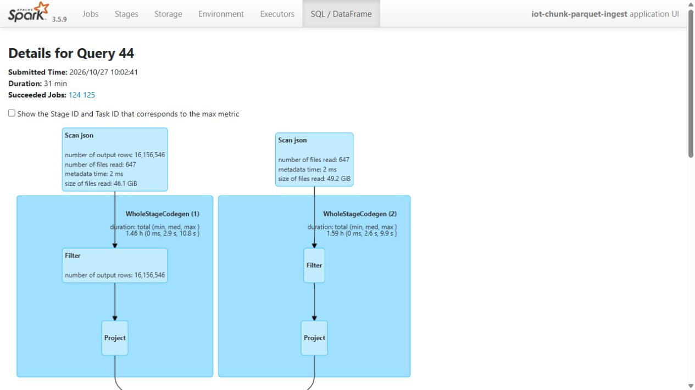

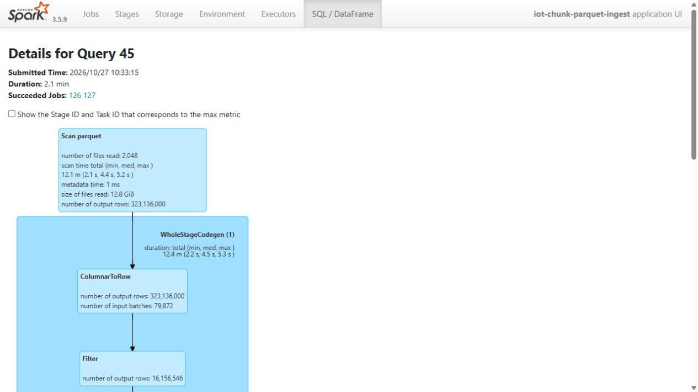

### Compacting the offline feature source

The separate 60-day feature table keeps all 3,456,000 rows. [The measured compaction](../evidence/feast/batch/compaction.json) changes 128 files/128 row groups/186,720,189 bytes into one file/13 row groups/157,481,024 bytes (15.66% fewer bytes). The writer uses bounded Arrow batches, Snappy and lossless UTC-compatible microsecond timestamps. It verifies the full multiset in both directions using DuckDB `EXCEPT ALL` and rechecks the original input hashes. This is a footprint/file-count result; a separate compaction query-speed benchmark was not measured.

Excerpt from [`feature_store/repository.py`, lines 41–70](../../feature_store/repository.py#L41-L70):

```python
data = ds.dataset(source, format='parquet')
schema = pa.schema([pa.field(field.name, pa.timestamp('us', tz=field.type.tz)
                           if pa.types.is_timestamp(field.type) else field.type,
                           nullable=field.nullable, metadata=field.metadata) for field in data.schema],
                   metadata=data.schema.metadata)
pending, pending_rows, rows = [], 0, 0
with pq.ParquetWriter(target, schema, compression='snappy', coerce_timestamps='us', allow_truncated_timestamps=False) as writer:
    for batch in data.to_batches(batch_size=262144, use_threads=False):
        batch = batch.cast(schema, safe=True)
        pending.append(batch)
        pending_rows += batch.num_rows
        rows += batch.num_rows
        if pending_rows >= 500000:
            writer.write_table(pa.Table.from_batches(pending, schema=schema), row_group_size=500000)
            pending, pending_rows = [], 0
    if pending:
        writer.write_table(pa.Table.from_batches(pending, schema=schema), row_group_size=500000)
if rows != report['snapshot_rows']:
    raise ValueError('Compact source row count differs')
# Exact multiset comparison also catches duplicate loss, null changes and timestamp rounding.
connection = backend.con
original = str(source / '*.parquet')
for left, right in ((original, str(target)), (str(target), original)):
    bad = connection.execute('SELECT * FROM (SELECT * FROM read_parquet(?) EXCEPT ALL SELECT * FROM read_parquet(?)) LIMIT 1',
                             [left, right]).fetchone()
    if bad is not None:
        raise ValueError('Compaction changed the feature multiset')
for part in parts:
    if digest(artifacts / part['path']) != part['sha256']:
        raise ValueError('Input changed during compaction')
```


## Warehouse index experiment

The local DuckDB warehouse materializes the five Gold tables from 11 retained `day2-final` Parquet parts. The loader checks every part against the original SHA-256 inventory, then compares each materialized table with its source in both directions using `EXCEPT ALL`. The fact table contains 57,600 unique telemetry events and the dimension contains 21 machine versions. The experiment creates two checkpointed database files under a fresh output directory. Both contain the same rows and statistics. The second copy adds one Adaptive Radix Tree index after the bulk load. [Benchmark code](../../scripts/benchmark-warehouse-index.py) · [Original Gold inventory](../evidence/data-platform-review/schema/input-files.json)

```sql
CREATE INDEX telemetry_event_id_idx ON gold.fact_telemetry(event_id);

SELECT f.event_id, f.machine_id, f.event_ts, f.temperature_c,
       f.vibration_rms_mm_s, f.pressure_bar, d.factory_id, d.valid_from_ts
FROM gold.fact_telemetry AS f JOIN gold.dim_machine AS d ON f.machine_sk = d.machine_sk
WHERE f.event_id = ?;
```

The drill-through query takes a known event ID and returns the reading with the machine version attached when Gold was built. Both variants use DuckDB 1.4.3 on Windows with one thread and a 256 MB memory limit. The benchmark runs two warm-up passes per variant, then eight alternating pairs over the same 64 deterministic keys. Timings include Python parameter binding, query execution and result fetch. Every returned row matches the same query over the retained Parquet files. [Measured pairs and exact oracle rows](../evidence/warehouse-index/report.json)

| Measure | Baseline | With index |
|---|---:|---:|
| Fact access path in native `EXPLAIN ANALYZE` | Sequential Scan | Index Scan |
| Median of eight batches of 64 lookups | 143.994 ms | 45.275 ms |
| Checkpointed database size | 3,682,304 bytes | 6,565,888 bytes |

Median batch time fell **68.56%** on this workload. Index creation took **44.626 ms** before checkpointing and increased the database file by **2,883,584 bytes**. The experiment measures repeated selective reads on one machine with warm caches. Index maintenance during writes and broad analytical scans were outside the measured workload. The original JSON plans record the observed operator type and output cardinality. The fact `operator_rows_scanned` counter is 57,600 in both reports, so the comparison uses the operator type and observed timing. [Sequential plan](../evidence/warehouse-index/baseline-plan.json) · [Indexed plan](../evidence/warehouse-index/indexed-plan.json) · [DuckDB index behavior](https://duckdb.org/docs/guides/performance/indexing)

To reproduce, install `duckdb==1.4.3` in the Python environment and restore the exact retained Gold parts under `data/lakehouse/day2-final/gold/`. Use a fresh output directory. The script rejects missing or changed parts before creating the database files.

```powershell
python -B scripts/benchmark-warehouse-index.py --output outputs/warehouse-index-demo
```

The `.duckdb` copies stay in the run directory. This local SQL workload demonstrates warehouse indexing on the preserved dimensional model. The deployed DP2 and feature pipelines continue to consume the original Parquet datasets.

## Feast configuration and writes

Feast is an SDK here. `create_store()` uses the local registry file, DuckDB offline provider and Redis online provider. The registry describes views and sources; feature values are in Parquet or Redis. The configuration reads the online connection from the environment and does not embed credentials.

Excerpt from [`feature_store/common.py`, lines 32–50](../../feature_store/common.py#L32-L50):

```python
def create_store(project: str, directory: Path, key_ttl_seconds: int = 3600):
    """Use the native DuckDB/Redis providers with one bounded DuckDB connection."""
    import ibis
    from feast import FeatureStore
    from feast.repo_config import RepoConfig
    directory.mkdir(parents=True, exist_ok=True)
    temp = directory / 'duckdb-temp'
    temp.mkdir(exist_ok=True)
    backend = ibis.duckdb.connect()
    backend.raw_sql("SET TimeZone='UTC'")
    backend.raw_sql("SET threads=1")
    backend.raw_sql("SET memory_limit='3GB'")
    backend.raw_sql("SET temp_directory='" + str(temp).replace("'", "''") + "'")
    ibis.set_backend(backend)
    config = RepoConfig(project=project, provider='local', registry=str(directory / 'registry.db'),
                        offline_store={'type': 'duckdb'},
                        online_store={'type': 'redis', 'connection_string': os.environ['IOT_FEAST_REDIS'],
                                      'key_ttl_seconds': key_ttl_seconds})
    return FeatureStore(config=config), backend
```


The batch `FileSource` defines the event timestamp and build audit timestamp. The service exposes only the eight model fields in the protocol, so labels are joined independently for training. The serving Redis state is prepared separately from the batch materialization experiment and from stream monitoring.

Excerpt from [`feature_store/repository.py`, lines 84–98](../../feature_store/repository.py#L84-L98):

```python
def register_batch(store, compact: Path, binding: dict, protocol_path: Path):
    """Expose only the fixed eight model inputs; future truth stays outside the feature view."""
    protocol = load_protocol(protocol_path)
    machine = Entity(name='machine', join_keys=['machine_id'], value_type=ValueType.STRING)
    schema = [Field(name=name, dtype=Int64 if name in ('reading_count_10m', 'prior_failures_24h') else Float64)
              for name in protocol['feature_allowlist']]
    source = FileSource(name='machine_rolling_batch', path=str(compact), file_format=ParquetFormat(),
                        timestamp_field='event_timestamp', created_timestamp_column='created',
                        description='Immutable arrival-aware snapshots reconstructed on the simulated event clock; created is build audit time.')
    view = FeatureView(name=VIEW, entities=[machine], ttl=timedelta(minutes=10), schema=schema, source=source, online=True,
                       tags={'protocol_sha256': PROTOCOL_SHA256, 'source_manifest_sha256': binding['source_manifest_sha256'],
                             'feature_report_sha256': binding['feature_report_sha256'], 'compact_sha256': binding['compact_sha256']})
    service = FeatureService(name=SERVICE, features=[view], tags={'protocol_sha256': PROTOCOL_SHA256})
    store.apply([machine, view, service])
    return service, [VIEW + ':' + name for name in protocol['feature_allowlist']]
```


The staged stream writer first calls Feast with `PushMode.OFFLINE` and checks the exact stored row and unchanged online features before acknowledgement. The online stage reads the verified offline release, checks each input row against it, and writes the latest vector for that machine. A completed online replay returns before issuing the write; it does not renew Redis TTL. These stages do not share a distributed transaction.

Excerpt from [`feature_store/staged_push.py`, lines 23–39](../../feature_store/staged_push.py#L23-L39):

```python
def push(self,row,fault=''):
    """Append only absent offline keys; read back a pending write before acknowledging it."""
    if fault not in ['', 'after_offline']:raise ValueError('Unknown offline fault')
    intent=self.outbox.observe(row)
    if intent['completed_utc'] is not None:return 'completed_offline_replay_noop'
    frame=feature_frame([intent['payload']]);history=self.offline_frame()
    actual=history[(history.machine_id==frame.iloc[0].machine_id)&(history.event_timestamp==frame.iloc[0].event_timestamp)]
    if len(actual)>1:raise ValueError('Duplicate offline key')
    online_before=self.online_values([intent['payload']['machine_id']])[FIELDS]
    mode='reconciled_offline_only'
    if len(actual)==0:
        self.store.push(PUSH,frame,to=PushMode.OFFLINE);mode='native_offline_only'
        if fault:raise RuntimeError('Injected after offline write before acknowledgement')
    after=self.offline_frame();actual=after[(after.machine_id==frame.iloc[0].machine_id)&(after.event_timestamp==frame.iloc[0].event_timestamp)]
    if len(actual)!=1 or not actual[COLUMNS].reset_index(drop=True).equals(frame.reset_index(drop=True)):raise ValueError('Offline readback differs')
    if not self.online_values([intent['payload']['machine_id']])[FIELDS].equals(online_before):raise ValueError('Offline job changed online features')
    self.outbox.acknowledge(intent['key']);return mode
```


Excerpt from [`feature_store/staged_push.py`, lines 85–99](../../feature_store/staged_push.py#L85-L99):

```python
def push(self,row,fault=''):
    """Use a verified source row and the newest finalized vector; older arrivals cannot regress online state."""
    if fault not in ['', 'after_online']:raise ValueError('Unknown online fault')
    _,_,payload=window_payload(row);frame=feature_frame([payload]);same=self.history[(self.history.machine_id==payload['machine_id'])&(self.history.event_timestamp==frame.iloc[0].event_timestamp)]
    if len(same)!=1 or not np.array_equal(same[FIELDS].to_numpy(dtype='float64'),frame[FIELDS].to_numpy(dtype='float64')):raise ValueError('Window is not in the verified offline source')
    # Preserve the offline writer's first availability timestamp when a transport replay changes its audit clock.
    intent=self.outbox.observe({**row,'created':same.iloc[0].created.isoformat()})
    if intent['completed_utc'] is not None:return 'completed_online_replay_noop'
    latest=self.latest[self.latest.machine_id==payload['machine_id']][COLUMNS].reset_index(drop=True)
    self.store.push(PUSH,latest,to=PushMode.ONLINE)
    if fault:raise RuntimeError('Injected after online write before acknowledgement')
    actual=self.store.get_online_features(features=self.service,entity_rows=[{'machine_id':payload['machine_id']}]).to_df()
    if not np.array_equal(actual[FIELDS].to_numpy(dtype='float64'),latest[FIELDS].to_numpy(dtype='float64')):raise ValueError('Latest online readback differs')
    if digest(self.offline)!=self.receipt['offline_sha256']:raise ValueError('Online job changed offline history')
    self.outbox.acknowledge(intent['key']);return 'native_online_only'
```


The chapters below include the original native inventory, queries, UI captures, recovery history and commands. Each receipt remains tied to its own workload.

## Schema design

The persisted Parquet tables are inspected in [an executable SQL notebook](../../notebooks/04_data_model_inspection.ipynb). Native Jupyter captures below show the original small Spark output, including historical machine versions and relationship checks. This is a Parquet inspection workflow, not a newly deployed SQL warehouse or an enforced foreign-key diagram.

### Schema design: Zones and grains

The [Microsoft medallion decision guide](https://techcommunity.microsoft.com/blog/azurearchitectureblog/designing-a-medallion-framework-%E2%80%94-a-decision-guide/4514349) treats the layer names as responsibilities that a project must define. Here, Bronze retains exports, Silver exposes typed reusable records, and Gold publishes historical analytical relationships and ML products. Modeling happens in both Silver and Gold. The `stg_` prefix here names persisted Silver tables; it is not a separate transient pre-Bronze staging zone.

| Responsibility | Silver in this implementation | Gold in this implementation |
|---|---|---|
| Data contract | Parse explicit types, preserve provenance and both effective/arrival clocks; normalize telemetry v1/v2 | Define dimension versions, fact grain, historical joins and separate feature/label products |
| Duplicate handling | Telemetry rejects conflicting payloads, then keeps the latest export by `created_ts`, source path and line; immutable event/arrival fields are preserved | Require unique dimension keys, one matched version per fact and unique snapshot keys; reject missing or multiplied joins |
| Consumption | Shared event and machine-history records for downstream builders | Business queries over dimensions/facts; rolling aggregates for ML; eligible chronological training data |
| Team interpretation | DE responsibility for trustworthy reusable records | DA/analytics-engineering responsibility for metric definitions and consumable models; this repository implements both responsibilities |

Gold does **not** mean every table is pre-aggregated. The three `fact_*` tables retain event/interval grain. `feat_machine_10m` contains rolling aggregates, sampled every five minutes, for prediction. There is no persisted factory/day BI mart, Power BI semantic model or OBT in this implementation. A business report can aggregate the Gold facts at query time; neither that query nor the ML feature table is evidence that a separate reporting mart has been deployed.

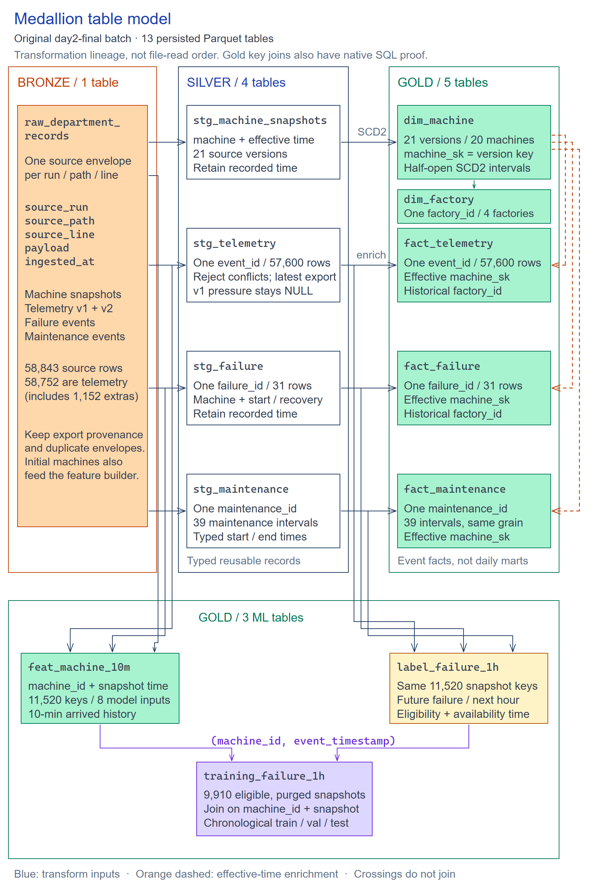

[Full-resolution PNG](../images/data-model-zones.png) · [Vector SVG](../images/data-model-zones.svg) · [Editable Excalidraw](../diagrams/data-model-zones.excalidraw) · [Illustrative moving-dot SVG](../images/data-model-zones.animated.svg).

The drawing is **logical transformation lineage for the original `day2-final` batch**, not a live UI capture or physical file-read sequence. Builders can reuse the same cached DataFrames that they persist as Silver. The five analytical Gold tables and three ML Gold tables belong to the same `gold/` directory. Counts below come from the [executed read-only inventory](../evidence/data-review-audit/executed.ipynb); the [native Gold relationship graph](#schema-design-query-derived-relationship-view) below supplies the complementary child-to-parent key view.

| Zone | Actual table | Grain / key | Original rows | Main inputs or relationship |
|---|---|---|---:|---|
| Bronze | `raw_department_records` | One `(source_run, source_path, source_line)` envelope | 58,843 | Source PostgreSQL records; 58,752 telemetry exports include 1,152 duplicate exports |
| Silver | `stg_machine_snapshots` | One `(machine_id, valid_from_ts)` source version | 21 | Initial machines and machine changes parsed from Bronze; `recorded_ts` retained |
| Silver | `stg_telemetry` | One `event_id` | 57,600 | Typed Bronze telemetry; deterministic export dedup; unknown v1 pressure stays NULL |
| Silver | `stg_failure` | One `failure_id` | 31 | Typed Bronze failure events, including start/recovery and recorded time |
| Silver | `stg_maintenance` | One `maintenance_id` interval | 39 | Typed Bronze maintenance events, including start/end |
| Gold | `dim_machine` | One `machine_sk` for `(machine_id, valid_from_ts)` | 21 | SCD2 intervals from machine snapshots; 20 current machines |
| Gold | `dim_factory` | One `factory_id` | 4 | Distinct factory keys from `dim_machine` |
| Gold | `fact_telemetry` | One `event_id` | 57,600 | Silver telemetry plus the machine version effective at `event_ts` |
| Gold | `fact_failure` | One `failure_id` | 31 | Silver failure plus the version effective at `failure_start_ts` |
| Gold | `fact_maintenance` | One `maintenance_id` | 39 | Silver maintenance plus the version effective at `start_ts` |
| Gold | `feat_machine_10m` | One `(machine_id, event_timestamp)` | 11,520 | Arrived telemetry, recorded past failures and **initial Bronze machine records**; eight model inputs, no future target |
| Gold | `label_failure_1h` | Same snapshot key | 11,520 | Snapshot entities/status, future failure onset and future maintenance start; eligibility and label availability |
| Gold | `training_failure_1h` | Eligible snapshot key, after split purging | 9,910 | Feature/label key join, at least five readings, eligible labels and chronological split boundaries |

The machine snapshot key is validated when constructing the dimension; failure and maintenance rows retain their source IDs. This does not claim that a general-purpose duplicate-removal algorithm runs on every Silver table.

**Keys and cardinality.** Each of the three facts has a many-to-one logical `machine_sk` relationship to `dim_machine`; each machine version has a many-to-one `factory_id` relationship to `dim_factory`. Fact construction first joins `machine_id` and the relevant event time to `[valid_from_ts, valid_to_ts)`. That temporal match must produce exactly one machine version and preserve fact row counts. Feature and label tables have matching unique machine/snapshot keys; training is an eligible, purged subset of that join. These are application-validated relationships in Parquet, not SQL-enforced foreign keys. The original native queries below verify uniqueness, nulls, missing parents and row preservation.

**Run layouts stay separate.** Do not apply the thirteen-table picture or its small-batch counts to the larger ingestion milestone:

| Recorded path | Bronze | Silver | Gold / feature outputs |
|---|---|---|---|
| [Original batch](../../pipelines/batch_job.py), pictured above | One envelope table | Four tables, including machine snapshots; singular `stg_failure` | Five analytical and three ML tables under `gold/` |
| [Airflow DP1–DP3](../../pipelines/orchestration_contract.py) | DP1: `raw_telemetry`, `raw_machines`, `raw_failures`, `raw_maintenance` | DP2: `stg_telemetry`, plural `stg_failures`, `stg_maintenance` | DP2: the same five dimension/fact names; DP3: `features/feat_machine_10m`, `features/label_failure_1h`. No `training_failure_1h` output in DP3 |
| [100 GB ingestion](processing_jobs.md#full-scale-ingest) | Bounded immutable Parquet ingestion | Full-scale normalized/deduplicated output | This milestone ends at Silver; ML uses a separate 60-day workload |

DP2 builds its machine dimension directly from validated DP1 `raw_machines`; it does not persist the original batch's Silver machine-snapshot table. The staged layout has fourteen tables across its three stage directories. Both paths write Parquet, and neither creates a separate SQL warehouse. The Gold DuckDB index experiment above remains a separately measured local workload.

### Schema design: SCD2 and fact/dimension linkage

The [original batch receipt](../evidence/day2-final/batch-report.json) records 21 machine versions and 20 current machines. P-001 has these two versions:

| Factory | `valid_from_ts` | `valid_to_ts` | `is_current` | `recorded_ts` |
|---|---|---|---|---|
| F-01 | 2026-10-01 00:00Z | 2026-10-02 00:00Z | false | 2026-10-01 00:00Z |
| F-04 | 2026-10-02 00:00Z | NULL | true | 2026-10-02 00:05Z |

`machine_id` is the business key; `machine_sk` identifies an effective version. [temporal_fact()](../../pipelines/transforms.py) joins the fact's event time to `[valid_from_ts,valid_to_ts)`, with NULL as the open upper bound. Telemetry, failure and maintenance facts carry that version key; `factory_id` links machine versions to `dim_factory`. The checks require no missing fact key and no lost or multiplied fact rows. Event-time dimensional enrichment alone does not prove prediction-time availability: the feature path separately respects `recorded_ts` and arrival time.

This changed-machine batch is separate from the orchestration pilot, whose receipt has 20 dimension rows and three factories. Mixing those counts would conceal the absence of the change fixture in that pilot.

The later [schema/dedup experiment](processing_jobs.md#batch-corrections) measures equivalent reader and winner-selection alternatives on the same small source. It separately exposes the lost v2 pressure under a v1-only reader, preserves unknown v1 pressure as NULL, and independently verifies every complete result. The aggregate dedup candidate's median was higher than the window baseline, so these experiments do not change the production table-building functions above.

### Schema design: Feature timestamps and naming

`feat_machine_10m` includes `machine_id`, `event_timestamp`, `created`, eight model inputs and audit times such as `max_feature_event_ts`/`max_received_ts`. Event and arrival times bound eligible inputs; `created` is a build timestamp, not a future feature or first arrival. The [native receipt](../evidence/day2-final/batch-report.json) records 11,520 feature snapshots. [Feast registration](../../feature_store/repository.py) declares the two timestamp columns explicitly and excludes the future label from the feature view.

Prefixes identify roles: `raw_` for Bronze, `stg_` for Silver, `dim_`/`fact_` for dimensional Gold and `feat_` for feature tables. An `obt_` table is not implemented or required to explain this layout. There are no SQL-enforced foreign keys inside a Parquet file; the pipeline's validation performs those relationship checks.

### Schema design: Native table and relationship inspection

On 1 November, Jupyter on the PC restarted its kernel and ran all notebook queries against 31 original `day2-final` Parquet files. All input hashes were unchanged after inspection. [The executed notebook](../evidence/data-platform-review/schema/executed.ipynb) and [input-file inventory](../evidence/data-platform-review/schema/input-files.json) preserve the source and outputs.

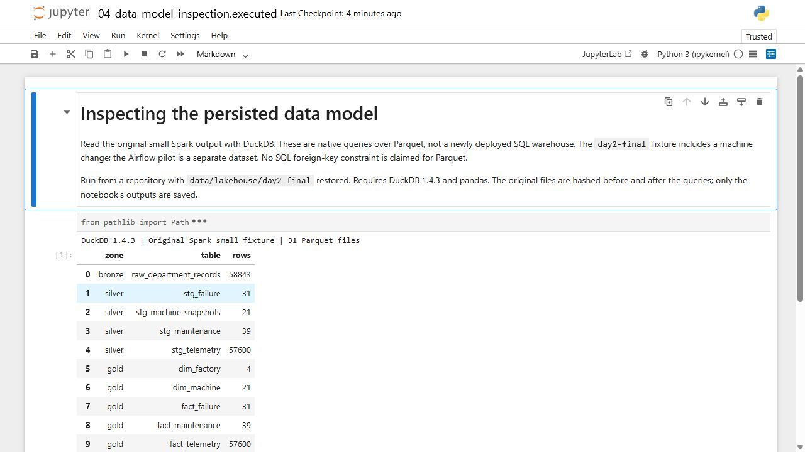

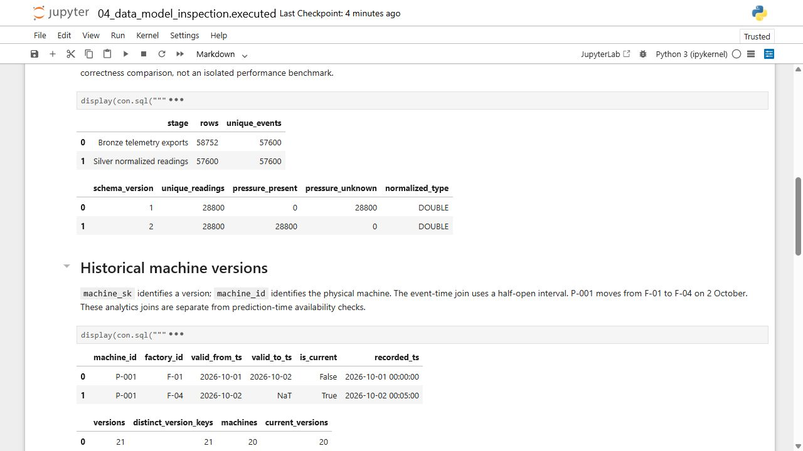

The historical change resolves 1,440 P-001 facts to F-01 on the first day and 1,440 to F-04 on the second. All 57,600 telemetry facts, 31 failure facts and 39 maintenance facts have a matching machine version; all 21 machine versions have a matching factory. These are actual SQL join results, not inferred database constraints.

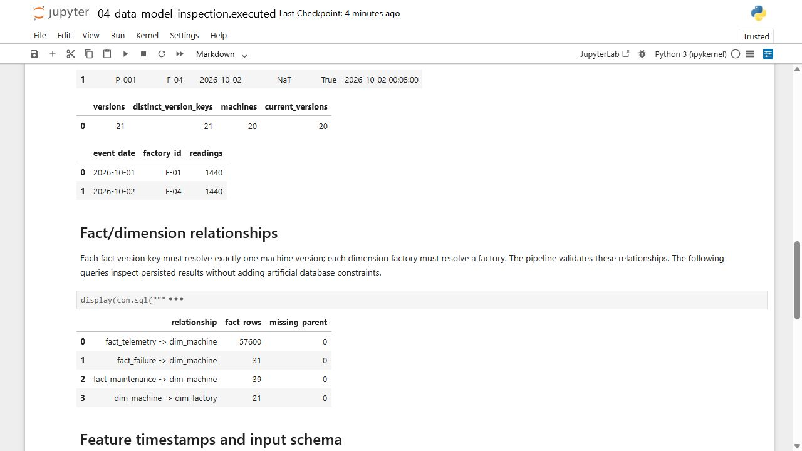

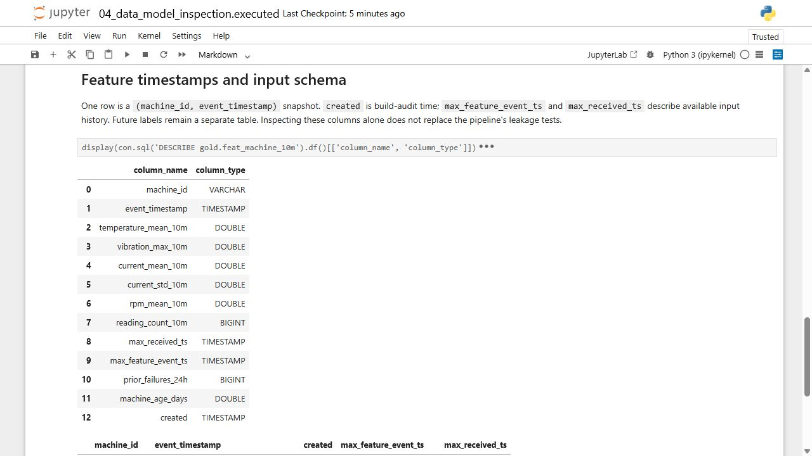

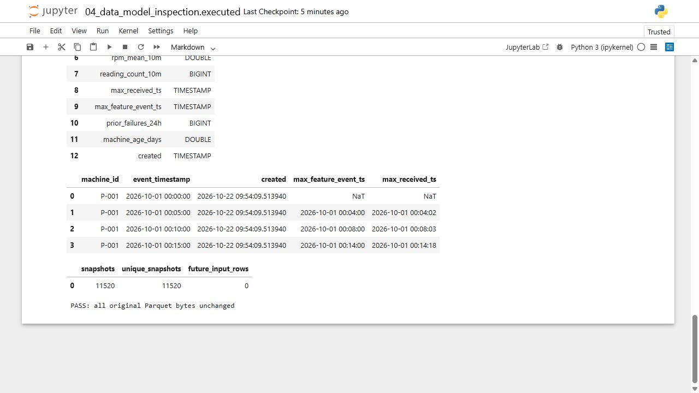

`created` still shows the original 22 October build time; inspecting the files did not rebuild them. The 11,520 snapshot keys are unique and no populated input event/arrival timestamp exceeds its snapshot time. Empty history remains NULL/NaT. This timestamp check supplements the pipeline's leakage tests; it does not by itself establish all availability semantics.

A separate read-only VM catalog inventoried 27 tables across the original batch and later staged pilot. DuckDB UI initialization failed on both attempted inspection versions, so none of its pages are presented as successful native proof. Feast's deployed dependency version was unchanged. The successful captures above are from Jupyter with DuckDB 1.4.3. The later query-derived relationship view below supplies the missing graphical presentation without inventing SQL foreign-key constraints.

### Schema design: Query-derived relationship view

[Notebook 05](../../notebooks/05_data_review.ipynb) queries the same 31 original Parquet files and generates the relationship view only after checking parent-key uniqueness, child null keys, missing parents and join row preservation. All seven cells were also run in the actual Jupyter interface. [The saved executed notebook](../evidence/data-review-audit/executed.ipynb) retains the SQL and SVG output.

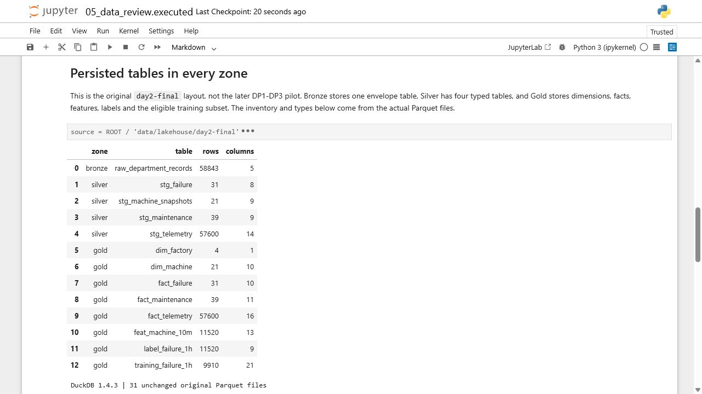

There are thirteen persisted tables: one Bronze envelope table, four Silver tables and eight Gold tables. Gold includes 9,910 eligible/purged training snapshots, a subset of the 11,520 feature/label snapshot keys. The Bronze total of 58,843 includes all source record types; it must not be confused with its 58,752 telemetry exports.

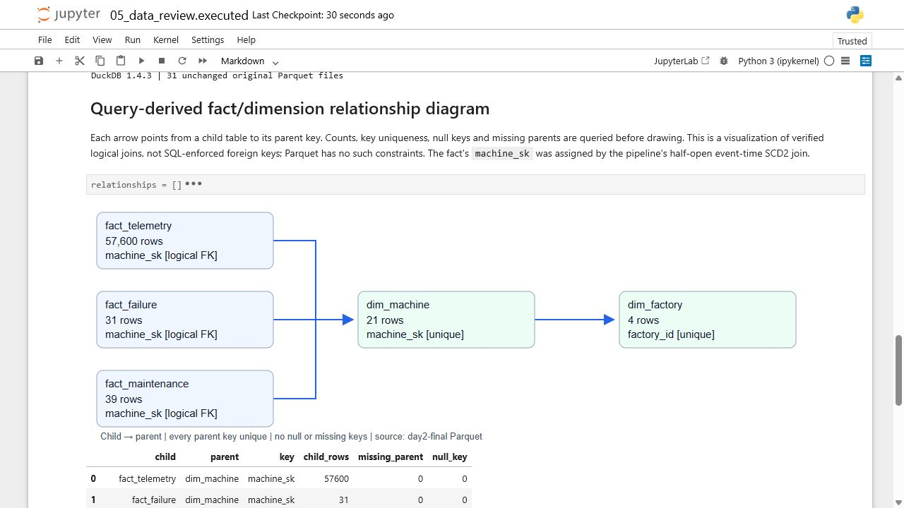

The arrows point from child to parent. Each fact's `machine_sk` resolves one `dim_machine` version, and each dimension row's `factory_id` resolves one `dim_factory`. The row counts come from the files, not an authored estimate. This is a query-generated logical relationship graph, rather than a capture of an enforced database constraint editor.

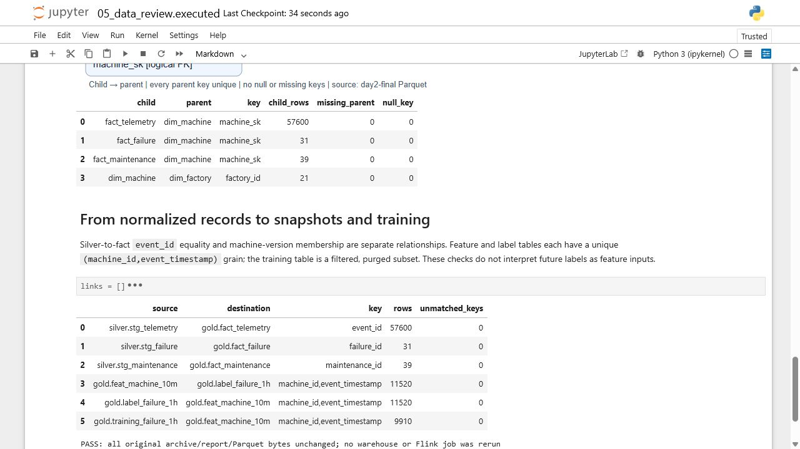

The six additional key checks compare all Silver/fact keys and feature/label/training snapshot membership, with zero unmatched keys. No source archive, report, SQLite snapshot or Parquet bytes changed during inspection. Bronze-to-Silver is a parsing/dedup transformation; Silver-to-fact enrichment and snapshot joins are distinct relationships.

### Schema design: Schema-design evidence map

| Source criterion | Actual implementation | Native visible proof |
|---|---|---|
| M1-34: tables and relationships across zones | [Zone/grain table](#schema-design-zones-and-grains); original batch has one Bronze, four Silver and eight Gold tables | [Complete zone inventory](../evidence/data-review-audit/screenshots/schema-all-zones.jpg), [cross-table key readback](../evidence/data-review-audit/screenshots/schema-key-readbacks.jpg); DP1–DP3 has its [separate lineage layout](processing_jobs.md#orchestration-datahub-lineage-and-validation-evidence-by-stage) |
| M1-35: SCD2 dimension | `machine_sk`, `valid_from_ts`, `valid_to_ts`, `is_current`; half-open temporal enrichment | [Original P-001 change and dimension records](../evidence/data-platform-review/screenshots/schema-evolution-dedup.jpg), [21 versions / 20 current and historical fact counts](../evidence/data-platform-review/screenshots/schema-relationships.jpg) |
| M1-36: feature event/build timestamps | Unique `(machine_id,event_timestamp)` with `created`; future labels outside the view | [Native feature types](../evidence/data-platform-review/screenshots/schema-feature-schema.jpg), [records and input-time bounds](../evidence/data-platform-review/screenshots/schema-feature-times.jpg) |
| M1-37: dim/fact relationships | Three fact tables reference a unique effective machine key; machine versions reference a unique factory key | [Query-derived graph](../evidence/data-review-audit/screenshots/schema-relationship-graph.jpg), [zero null/missing parents and unchanged join counts](../evidence/data-review-audit/screenshots/schema-key-readbacks.jpg) |
| M1-38: naming convention | `raw_`, `stg_`, `dim_`, `fact_`, `feat_`; label/training tables explicitly separate | [All thirteen actual table names](../evidence/data-review-audit/screenshots/schema-all-zones.jpg), [role/grain explanation](#schema-design-zones-and-grains) |

These are evidence mappings to the preserved source criteria, not awarded marks. No new SQL warehouse or constraint enforcement is claimed.

## Feast feature store

Feast names the entity, feature schema and retrieval interfaces shared by training and serving. The recorded implementation uses entity `machine_id`, view `machine_rolling_10m` and service `iot_failure_prediction_v1`, with eight protocol-bound fields. Labels and future failures are outside the view.

Offline features are immutable Parquet; online features are Redis. The view's ten-minute event-time TTL differs from the Redis key's 3,600-second wall-clock expiry. The SDK runs inside jobs/services, not in a separate Feast HTTP server.

### Feast feature store: What Redis stores, and where the offline store lives

**Redis is an online store even when its values were computed by a batch job.** The earlier system-map label "Redis batch store" described the producer, not an offline storage technology. It should be read as "Redis online / batch materialized". Redis provides low-latency entity lookups of the latest prepared vectors; it is not the historical training-data source.

| Boundary | Actual storage / provider | Reader or writer |
|---|---|---|
| Batch offline features | `data/feast/batch-medium-27/machine_rolling.parquet`, plus `registry/registry.db`; persisted on the VM and mounted under `/workspace` | Feast `FileSource` (`machine_rolling_batch`) backed by the DuckDB offline provider |
| Batch online values | Separate Redis instance/namespace populated by the bounded materialization job | `feature_store/materialize.py` → Feast online writes |
| Streaming offline features | Validated Parquet history and its source registry, written by `OfflineStage` | `feature_store/staged_push.py` registers `machine_tumbling_final_10m` |
| Streaming online values | Separate Redis namespace holding the latest finalized monitoring vector | `OnlineStage` verifies and reads the offline history, selects latest values and writes through Feast |
| Feature API online values | Separate serving-preparation state and Redis namespace | `feature_store/serving.py` prepares the eight-input prediction view; the API uses `get_online_features()` |

The [actual RepoConfig](../../feature_store/common.py) specifies `offline_store={'type': 'duckdb'}` and `online_store={'type': 'redis', ...}`. [register_batch()](../../feature_store/repository.py) binds the Parquet file using `FileSource`, `timestamp_field='event_timestamp'` and `created_timestamp_column='created'`. A local registry stores Feast metadata; it is not the feature-history database. The paths above identify the recorded deployment, not files shipped in a clone.

The write paths are:

1. **Batch:** Spark feature Parquet → verified compact FileSource → bounded Feast materialization → Redis online values.
2. **Streaming:** Kafka → Flink finalized output → offline validation/Parquet/registry → online job reading that sealed history → Redis monitoring values.
3. **Training:** offline Parquet + registry → Feast historical retrieval inside the KFP load Pod → persisted cohort → split/train/validate/evaluate. Training does **not** load its history from Redis.

The two views are not interchangeable. The rolling prediction view has eight model inputs; the finalized stream view has four monitoring aggregates. The implemented prediction model does not combine the latter into its eight-input vector. See [KFP data loading](training_notebook.md#how-features-reach-kubeflow) and [the write/TTL policy](#feature-jobs-and-ttl).

The native SDK fixture passed eight checks for point-in-time boundaries, corrections and arrival availability, unknown entities, older writes, replay and physical key expiry. It also demonstrates why a point-in-time join alone does not prove availability. The 60-day backfill uses `filter_by_created_timestamp=False` explicitly because `created` is build time; upstream arrival guards establish historical eligibility.

Compaction retained all 3,456,000 feature rows while changing 128 files/row groups into one file with 13 row groups. Full historical retrieval preserved 3,132,184 eligible rows and their fixed labels/splits. Source, protocol, feature and compacted-artifact hashes bind the result.

The Feast image and dependency lock are separate from Spark/Airflow. Redis runs on an internal network with AOF and no-eviction settings. The native receipts establish this workload; they do not establish full-100-GB feature retrieval or production multi-host availability.

### Feast feature store: Commands and recorded examples

Run commands from the repository root unless the example explicitly changes the working directory. Use a fresh output/run name and check the linked runbook before starting platform services. Examples belong to the recorded workload on this page.

```bash
sudo install -d -o10001 -g10001 data/feast outputs/my-feast
export IOT_FEAST_SCRATCH=/srv/iot-fast/feast-scratch
docker compose -f infra/feast.compose.yaml build tools
docker compose -f infra/feast.compose.yaml up -d online
docker compose -f infra/feast.compose.yaml run --rm tools \
  -m feature_store.checks --output /workspace/outputs/my-feast/native
docker compose -f infra/feast.compose.yaml run --rm tools \
  -m feature_store.batch \
  --artifacts /workspace/data/feature-datasets/feature-medium-27-v2/artifacts \
  --feature-report /workspace/outputs/feature-medium-27-v2/feature-report.json \
  --state /workspace/data/feast/my-batch \
  --reports /workspace/outputs/my-feast/batch \
  --protocol /workspace/ml/protocols/medium-60d-v1.json
docker compose -f infra/feast.compose.yaml run --rm tools \
  -m feature_store.load \
  --state /workspace/data/feast/my-batch \
  --batch-report /workspace/outputs/my-feast/batch/report.json \
  --artifacts /workspace/data/feature-datasets/feature-medium-27-v2/artifacts \
  --feature-report /workspace/outputs/feature-medium-27-v2/feature-report.json \
  --protocol /workspace/ml/protocols/medium-60d-v1.json \
  --destination /workspace/data/feast/my-training \
  --reports /workspace/outputs/my-feast/load
docker compose -f infra/feast.compose.yaml run --rm tools \
  -m feature_store.verify \
  --dataset /workspace/data/feast/my-training \
  --load-report /workspace/outputs/my-feast/load/report.json \
  --artifacts /workspace/data/feature-datasets/feature-medium-27-v2/artifacts \
  --state /workspace/data/feast/my-batch \
  --protocol /workspace/ml/protocols/medium-60d-v1.json \
  --output /workspace/outputs/my-feast/exact.json
```

### Feast feature store: Implementation and evidence

- [Source: infra/feast/Dockerfile](../../infra/feast/Dockerfile)
- [Source: infra/feast/requirements.lock](../../infra/feast/requirements.lock)
- [Recorded artifact: feast/image/pip-freeze.txt](../evidence/feast/image/pip-freeze.txt)
- [Source: infra/feast.compose.yaml](../../infra/feast.compose.yaml)
- [Recorded artifact: feast/online-runtime.json](../evidence/feast/online-runtime.json)
- [Source: feature_store/repository.py](../../feature_store/repository.py)
- [Source: ml/protocols/medium-60d-v1.json](../../ml/protocols/medium-60d-v1.json)
- [Source: feature_store/checks.py](../../feature_store/checks.py)
- [Recorded artifact: feast/native/report.json](../evidence/feast/native/report.json)
- [Recorded artifact: feast/batch/report.json](../evidence/feast/batch/report.json)
- [Recorded artifact: feast/batch/compaction.json](../evidence/feast/batch/compaction.json)
- [Recorded artifact: feast/batch/registration.json](../evidence/feast/batch/registration.json)
- [Recorded artifact: feast/full-load/result/report.json](../evidence/feast/full-load/result/report.json)
- [Recorded artifact: feast/audit/exact.json](../evidence/feast/audit/exact.json)
- [Recorded artifact: feast/audit/verification.json](../evidence/feast/audit/verification.json)
- [Source: feature_store/load.py](../../feature_store/load.py)
- [pypi.org / 0.67.0](https://pypi.org/project/feast/0.67.0/)
- [docs.feast.dev / duckdb](https://docs.feast.dev/reference/offline-stores/duckdb)
- [docs.feast.dev / redis](https://docs.feast.dev/reference/online-stores/redis)
- [docs.feast.dev / point-in-time-joins](https://docs.feast.dev/getting-started/concepts/point-in-time-joins)

### Feast feature store: Related documentation

[Current architecture](architecture.md) · [Demo and recovery](operations.md) · [Rubric index](rubric_overview.md)

[Original run notes](https://github.com/anle0429/iot-maintenance-platform/blob/a395c4ea47b8f8e235556ab93de3d699ed9df18b/docs/feast-feature-store.md) retain the full historical narrative. Raw evidence files have not been translated or rewritten.

## Feature jobs and TTL

There are two different feature views. `machine_rolling_10m` contains eight model inputs from the preceding ten minutes. `machine_tumbling_final_10m` contains four aggregates from finalized non-overlapping Flink windows and is used for monitoring, not substituted into that model.

| Limit | Value | Meaning |
|---|---|---|
| Rolling-view event TTL | Ten minutes | Historical/online lookup freshness; API accepts age 0…600 seconds |
| Finalized-window event TTL | One hour | Approximately six finalized ten-minute monitoring windows |
| Redis key expiry | 3,600 actual seconds | Physical online-key lifetime after a write; acknowledged replay does not extend it |
| Demo lease | 3,600 actual seconds | Bound on how long a prepared simulated snapshot can be served |
| Offline Parquet | No automatic Redis-driven deletion | Retained history; view TTL limits retrieval rather than deleting files |

The prediction target's one-hour future horizon does not determine feature TTL. Build-time `created`, event time and first availability have different meanings. A live Redis key can still contain an ineligible stale feature. Actual materialization and the separate offline/online Airflow jobs are documented with their own run IDs and replay evidence.

### Feature jobs and TTL: Implementation and evidence

- [Source: feature_store/repository.py](../../feature_store/repository.py)
- [Source: feature_store/push.py](../../feature_store/push.py)
- [Recorded artifact: ci-stream-push/offline-3/ci/airflow.json](../evidence/ci-stream-push/offline-3/ci/airflow.json)
- [Recorded artifact: ci-stream-push/online-2/ci/airflow.json](../evidence/ci-stream-push/online-2/ci/airflow.json)
- [Source: infra/ci/iot_ci_stream_push.py](../../infra/ci/iot_ci_stream_push.py)

### Feature jobs and TTL: Recorded interface views

These are original captures from the runs described above. Their timestamps, model identities and visible states belong to those runs.


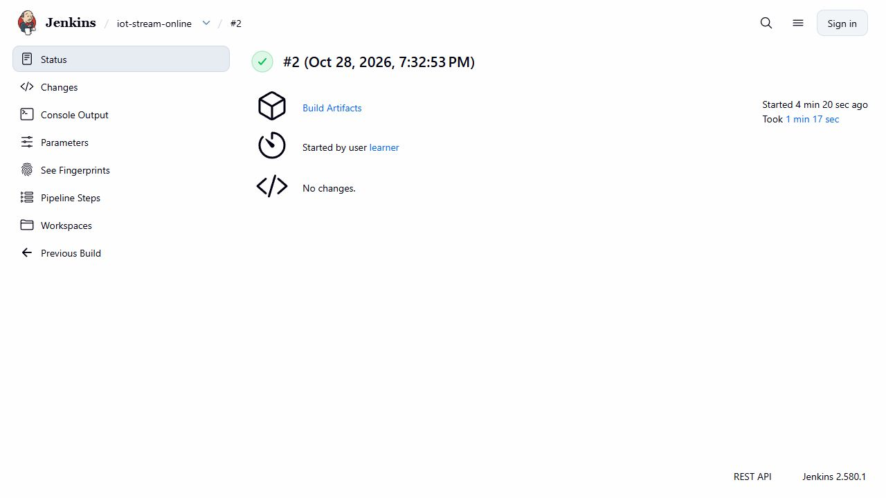


### Feature jobs and TTL: Related documentation

[Current architecture](architecture.md) · [Demo and recovery](operations.md) · [Rubric index](rubric_overview.md)

[Original run notes](https://github.com/anle0429/iot-maintenance-platform/blob/a395c4ea47b8f8e235556ab93de3d699ed9df18b/docs/feature-jobs-and-ttl.md) retain the full historical narrative. Raw evidence files have not been translated or rewritten.

## Feast materialization

The materialization DAG transfers eight offline Feast features for 200 machines to an isolated Redis project, validates every vector, and then publishes metadata. Its tasks are `register_bound_source → materialize_incremental → validate_online → publish_to_datahub`.

The recorded deployment used Airflow 3.1.7 with one active run and a one-slot Feast pool. The SDK and publisher execute in separate bounded containers. It uses the existing 60-day feature source and leaves the training registry unchanged.

Initial, recovery, incremental and replay runs are retained. The first publication failed on a DataHub enum; recovery reused the verified checkpoint without resetting it. Subsequent checks cover all 200 online vectors, replay, rollback of the requested cutoff and publication readback. The CI variant has its own namespace and eight successful Airflow task instances.

The cutoffs are simulated UTC event time, whereas task timestamps and UI clocks describe actual execution. This is a bounded backfill demonstration, not evidence that live sensors were updating at those simulated dates. DataHub restoration after VM restart preserved indexed metadata without rerunning materialization or publication.

### Feast materialization: Commands and recorded examples

Run commands from the repository root unless the example explicitly changes the working directory. Use a fresh output/run name and check the linked runbook before starting platform services. Examples belong to the recorded workload on this page.

```bash
sudo python3 scripts/verify-feast-materialization.py trigger \
  --run my-feast-replay --end 2026-11-30T00:00:00Z
sudo python3 scripts/verify-feast-materialization.py snapshot --run my-feast-replay
sudo python3 scripts/verify-feast-materialization.py metadata --run my-feast-replay
```

### Feast materialization: Implementation and evidence

- [Source: airflow/dags/iot_feast_materialization.py](../../airflow/dags/iot_feast_materialization.py)
- [Source: feature_store/airflow_tasks.py](../../feature_store/airflow_tasks.py)
- [Recorded artifact: feast-materialization/capture/native-containers.json](../evidence/feast-materialization/capture/native-containers.json)
- [Recorded artifact: feast-materialization/controller/verification.json](../evidence/feast-materialization/controller/verification.json)
- [Recorded artifact: feast-materialization/runs/feast-incremental-27/materialization.json](../evidence/feast-materialization/runs/feast-incremental-27/materialization.json)
- [Recorded artifact: feast-materialization/runs/feast-incremental-27-airflow.json](../evidence/feast-materialization/runs/feast-incremental-27-airflow.json)
- [Recorded artifact: feast-materialization/runs/feast-backward-27-airflow.json](../evidence/feast-materialization/runs/feast-backward-27-airflow.json)
- [Recorded artifact: feast-materialization/runs/feast-replay-27/materialization.json](../evidence/feast-materialization/runs/feast-replay-27/materialization.json)
- [Source: feature_store/materialize.py](../../feature_store/materialize.py)
- [Source: feature_store/metadata.py](../../feature_store/metadata.py)
- [Recorded artifact: feast-materialization/runs/feast-incremental-27-datahub.json](../evidence/feast-materialization/runs/feast-incremental-27-datahub.json)
- [Recorded artifact: feast-materialization/screenshots/datahub-online-schema.jpg](../evidence/feast-materialization/screenshots/datahub-online-schema.jpg)
- [Recorded artifact: feast-materialization/screenshots/datahub-six-checks-passing.jpg](../evidence/feast-materialization/screenshots/datahub-six-checks-passing.jpg)
- [Recorded artifact: feast-materialization/capture/expected-and-repaired-errors.json](../evidence/feast-materialization/capture/expected-and-repaired-errors.json)
- [Source: scripts/verify-feast-materialization.py](../../scripts/verify-feast-materialization.py)

### Feast materialization: Recorded interface views

These are original captures from the runs described above. Their timestamps, model identities and visible states belong to those runs.

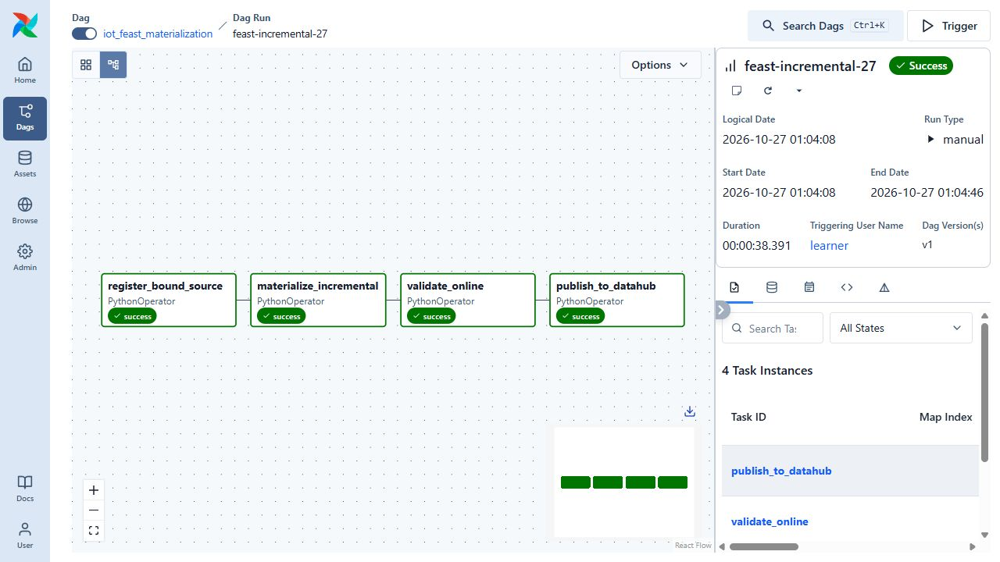

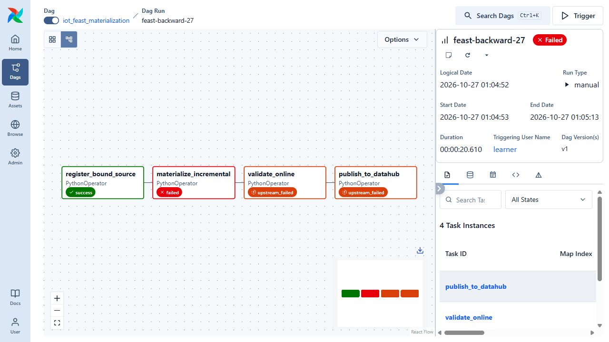

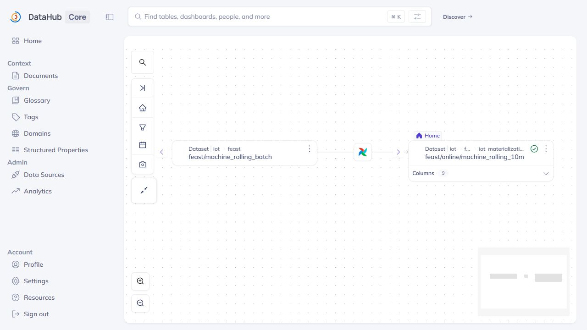


### Feast materialization: Related documentation

[Current architecture](architecture.md) · [Demo and recovery](operations.md) · [Rubric index](rubric_overview.md)

[Original run notes](https://github.com/anle0429/iot-maintenance-platform/blob/a395c4ea47b8f8e235556ab93de3d699ed9df18b/docs/feast-materialization.md) retain the full historical narrative. Raw evidence files have not been translated or rewritten.

## CI materialization

The materialization CI job tests and builds a release, deploys the Airflow definition, and verifies native initial, incremental and replay behavior in an isolated CI namespace. It does not rewrite the earlier materialization checkpoint or training registry.

The successful Jenkins run includes eight successful Airflow task instances across the recorded materialization/metadata runs. Online checks read all 200 machine vectors and timestamps. Replay must preserve values; backward cutoffs are rejected; DataHub publication is read back after validation.

Source bindings, controller/container identities, registry state and original UI captures establish the test/build/auto-deploy path. Simulated cutoffs and actual execution clocks are recorded separately. The workflow is a bounded backfill demonstration, not evidence of continuously updating physical pumps.

### CI materialization: Commands and recorded examples

Run commands from the repository root unless the example explicitly changes the working directory. Use a fresh output/run name and check the linked runbook before starting platform services. Examples belong to the recorded workload on this page.

```bash
python scripts/package-materialization-release.py \
  --commit a6e36f79745350e8aac081a99fe878757bd81bb2 \
  --output outputs/materialization-release.tar
```

```python
from pathlib import Path
from hashlib import sha256
import json, tarfile

packet = Path('outputs/materialization-release.tar')
manifest = json.loads(packet.with_suffix('.manifest.json').read_text())
assert sha256(packet.read_bytes()).hexdigest() == manifest['archive_sha256']
target = Path('data/ci/source') / manifest['commit']
target.mkdir(parents=True, exist_ok=False)
with tarfile.open(packet) as archive:
    assert all(m.isfile() and m.name.startswith('tree/')
               and '..' not in Path(m.name).parts for m in archive.getmembers())
    archive.extractall(target, filter='data')
for name, expected in manifest['files'].items():
    assert sha256((target / 'tree' / name).read_bytes()).hexdigest() == expected
(target / 'manifest.json').write_text(json.dumps(manifest, indent=2) + '\n')
```

### CI materialization: Implementation and evidence

- [Source: infra/ci/Materialization.Jenkinsfile](../../infra/ci/Materialization.Jenkinsfile)
- [Source: scripts/ci-materialization.py](../../scripts/ci-materialization.py)
- [Source: infra/ci/iot_ci_materialization.py](../../infra/ci/iot_ci_materialization.py)
- [Recorded artifact: ci-materialization/controller/build.json](../evidence/ci-materialization/controller/build.json)
- [Recorded artifact: ci-materialization/controller/stage-view.json](../evidence/ci-materialization/controller/stage-view.json)
- [Recorded artifact: ci-materialization/controller/console.txt](../evidence/ci-materialization/controller/console.txt)
- [Recorded artifact: ci-materialization/controller/source-manifest.json](../evidence/ci-materialization/controller/source-manifest.json)
- [Recorded artifact: ci-materialization/reports/airflow.json](../evidence/ci-materialization/reports/airflow.json)
- [Recorded artifact: ci-materialization/reports/verification.json](../evidence/ci-materialization/reports/verification.json)
- [Recorded artifact: ci-materialization/reports/native/initial/materialization.json](../evidence/ci-materialization/reports/native/initial/materialization.json)
- [Recorded artifact: ci-materialization/reports/native/incremental/materialization.json](../evidence/ci-materialization/reports/native/incremental/materialization.json)
- [Recorded artifact: ci-materialization/reports/native/replay/materialization.json](../evidence/ci-materialization/reports/native/replay/materialization.json)
- [Recorded artifact: ci-materialization/reports/datahub-indexed.json](../evidence/ci-materialization/reports/datahub-indexed.json)
- [Recorded artifact: ci-materialization/reports/admission.json](../evidence/ci-materialization/reports/admission.json)
- [Recorded artifact: ci-materialization/capture/manifest.json](../evidence/ci-materialization/capture/manifest.json)
- [Recorded artifact: ci-materialization/capture/evidence-map.json](../evidence/ci-materialization/capture/evidence-map.json)
- [Recorded artifact: ci-materialization/capture/failed-helper-journal.txt](../evidence/ci-materialization/capture/failed-helper-journal.txt)
- [Recorded artifact: ci-materialization/controller/verification.json](../evidence/ci-materialization/controller/verification.json)
- [Source: scripts/package-materialization-release.py](../../scripts/package-materialization-release.py)
- [www.jenkins.io / jenkinsfile](https://www.jenkins.io/doc/book/pipeline/jenkinsfile/)

### CI materialization: Recorded interface views

These are original captures from the runs described above. Their timestamps, model identities and visible states belong to those runs.

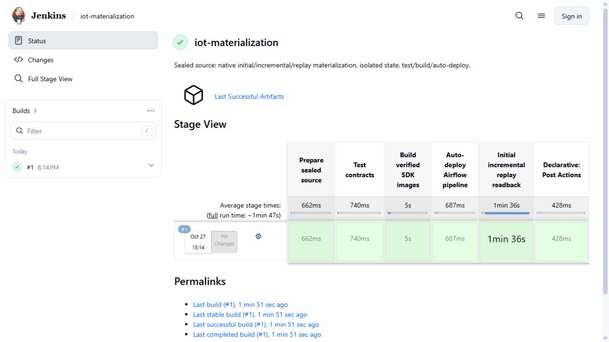

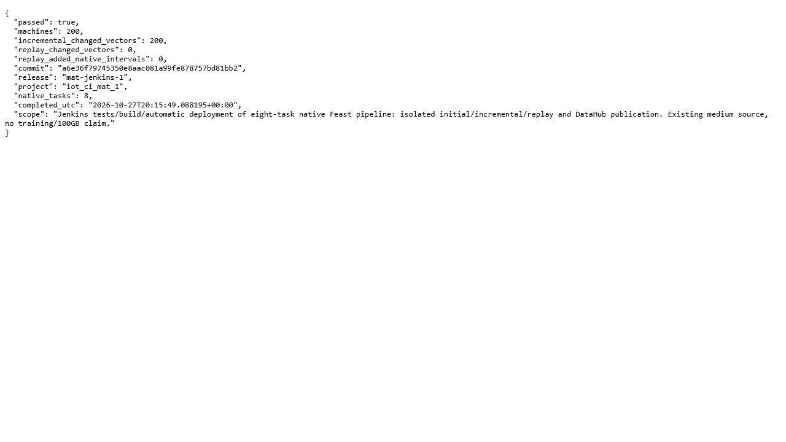


### CI materialization: Related documentation

[Current architecture](architecture.md) · [Demo and recovery](operations.md) · [Rubric index](rubric_overview.md)

[Original run notes](https://github.com/anle0429/iot-maintenance-platform/blob/a395c4ea47b8f8e235556ab93de3d699ed9df18b/docs/ci-materialization.md) retain the full historical narrative. Raw evidence files have not been translated or rewritten.

## Stream Feast push

The push path consumes retained finalized windows from the native Kafka/Flink workload and writes a separate monitoring feature view through Feast. Producer readiness is checked before publishing; failed writes retain retry state rather than silently acknowledging missing data.

The initial native fixture uses three windows and checks offline history, online latest-vector behavior, duplicate replay, conflicts and recovery. The monitoring aggregates differ from the eight rolling inputs used by the failure predictor, and project/registry separation prevents accidental substitution.

Later CI independently deploys offline/online jobs, while the full native 5,760-window cohort has its own 12 container receipts. These bounded retained-output replays do not establish a newly continuous live source or an exactly-once transaction across all stores and failure modes.

### Stream Feast push: Commands and recorded examples

Run commands from the repository root unless the example explicitly changes the working directory. Use a fresh output/run name and check the linked runbook before starting platform services. Examples belong to the recorded workload on this page.

```bash
mkdir -p outputs/push-practice
for step in online-fault recover-online ack-fault recover-ack finish baseline; do
  state=push-practice
  if [ "$step" = baseline ]; then state=push-practice-baseline; fi
  docker compose -f infra/feast.compose.yaml run --rm tools \
    -m feature_store.push_checks --step "$step" \
    --state "/workspace/data/feast/$state" \
    --output "/workspace/outputs/push-practice/$step.json"
  code=$?
  case "$step" in online-fault|ack-fault) expected=3;; *) expected=0;; esac
  test "$code" -eq "$expected" || exit 1
done
```

```bash
sudo data/runtime/scale-venv/bin/python scripts/run-stream-push.py \
  --run stream-practice-1 --deadline-utc '<actual-stop-time-UTC>' \
  --native-proof outputs/push-native-27-v2/verification.json \
  --ingest-fence outputs/scale-ingest-100gb-27/preflight.json
cat outputs/stream-practice-1/feast/verification.json
```

```bash
docker compose -f infra/feast.compose.yaml run --rm tools \
  -m feature_store.inspect_windows \
  --state /workspace/data/feast/stream-stream-practice-1 \
  --worker-report /workspace/outputs/stream-practice-1/feast/report.json \
  --output /workspace/outputs/stream-practice-1/feast/inspection.json
```

### Stream Feast push: Implementation and evidence

- [Recorded artifact: stream-push/warm/feast/verification.json](../evidence/stream-push/warm/feast/verification.json)
- [Recorded artifact: stream-push/warm/feast/observed-live-push.json](../evidence/stream-push/warm/feast/observed-live-push.json)
- [Source: feature_store/inspect_windows.py](../../feature_store/inspect_windows.py)
- [Recorded artifact: stream-push/first-live/feast/inspection.json](../evidence/stream-push/first-live/feast/inspection.json)
- [Recorded artifact: stream-push/warm/feast/report.json](../evidence/stream-push/warm/feast/report.json)
- [Source: feature_store/outbox.py](../../feature_store/outbox.py)
- [Source: feature_store/push.py](../../feature_store/push.py)
- [Recorded artifact: stream-push/native/verification.json](../evidence/stream-push/native/verification.json)
- [Recorded artifact: stream-push/native/finish.json](../evidence/stream-push/native/finish.json)
- [Recorded artifact: stream-push/native/baseline.json](../evidence/stream-push/native/baseline.json)
- [Recorded artifact: stream-push/native/unit-tests-vm.txt](../evidence/stream-push/native/unit-tests-vm.txt)
- [Recorded artifact: stream-push/first-live/feast/verification.json](../evidence/stream-push/first-live/feast/verification.json)
- [Recorded artifact: stream-push/ui-negative/controller-console.txt](../evidence/stream-push/ui-negative/controller-console.txt)
- [Recorded artifact: stream-push/warm/feast/worker-ready.json](../evidence/stream-push/warm/feast/worker-ready.json)
- [Recorded artifact: stream-push/prewarm/run-stream-push.py.txt](../evidence/stream-push/prewarm/run-stream-push.py.txt)
- [Recorded artifact: stream-push/native-initial/online-fault-console.txt](../evidence/stream-push/native-initial/online-fault-console.txt)
- [Recorded artifact: stream-push/native-initial/failed-push-checks.py.txt](../evidence/stream-push/native-initial/failed-push-checks.py.txt)
- [Recorded artifact: stream-push/ui-negative/corrected-rest-checkpoints.json](../evidence/stream-push/ui-negative/corrected-rest-checkpoints.json)
- [Recorded artifact: stream-push/warm/feast/preflight.json](../evidence/stream-push/warm/feast/preflight.json)
- [Recorded artifact: stream-push/image/verification.json](../evidence/stream-push/image/verification.json)
- [Recorded artifact: stream-push/capture/runtime-checkpoint.json](../evidence/stream-push/capture/runtime-checkpoint.json)
- [docs.feast.dev / push](https://docs.feast.dev/reference/data-sources/push)
- [docs.feast.dev / duckdb](https://docs.feast.dev/reference/offline-stores/duckdb)
- [docs.feast.dev / redis](https://docs.feast.dev/reference/online-stores/redis)
- [docs.docker.com / docker-container](https://docs.docker.com/build/builders/drivers/docker-container/)

### Stream Feast push: Recorded interface views

These are original captures from the runs described above. Their timestamps, model identities and visible states belong to those runs.

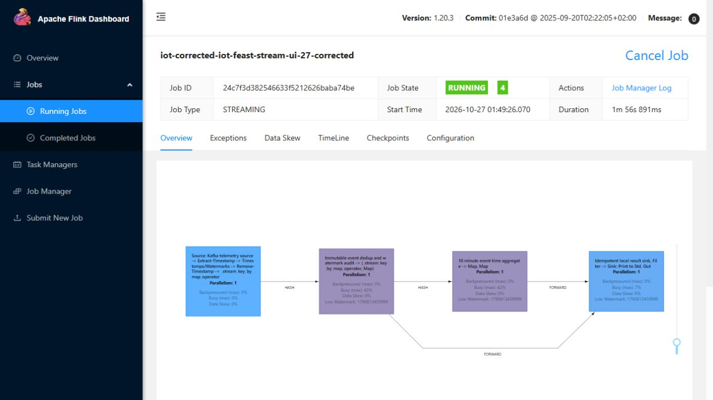

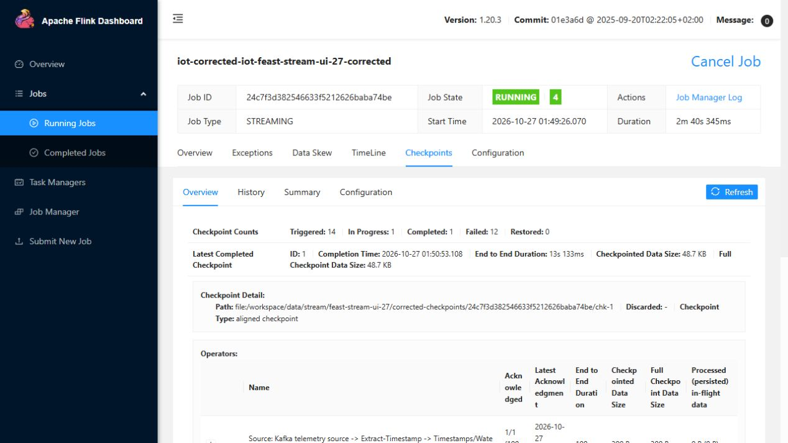


### Stream Feast push: Related documentation

[Current architecture](architecture.md) · [Demo and recovery](operations.md) · [Rubric index](rubric_overview.md)

[Original run notes](https://github.com/anle0429/iot-maintenance-platform/blob/a395c4ea47b8f8e235556ab93de3d699ed9df18b/docs/stream-feast-push.md) retain the full historical narrative. Raw evidence files have not been translated or rewritten.

## CI stream push

Two Jenkins jobs independently test, build and deploy the offline and online stream paths as Airflow DAGs. The recorded offline build 3 and online build 2 succeeded. Each DAG has a push task followed by a replay task.

The CI input is a retained three-window Kafka/Flink fixture. The offline release writes the exact expected history; online validation starts from an empty project and checks the latest expected vectors. Replay is a no-op and the upstream retained source is read-only.

The full 5,760-window native store demonstration is documented separately in `window-cohort.md`. It does not turn these three-window CI runs into a continuous live stream. Original Airflow graph captures and Docker job captures have distinct identities and timestamps; they do not claim both jobs were simultaneously RUNNING.

### CI stream push: Commands and recorded examples

Run commands from the repository root unless the example explicitly changes the working directory. Use a fresh output/run name and check the linked runbook before starting platform services. Examples belong to the recorded workload on this page.

```powershell
python -S scripts/verify-ci-stream-push.py
```

```powershell
python -m unittest tests.test_stream_staging_contract tests.test_stream_runtime_contract tests.test_window_outbox -v
```

### CI stream push: Implementation and evidence

- [Source: infra/ci/StreamPush.Jenkinsfile](../../infra/ci/StreamPush.Jenkinsfile)
- [Source: scripts/ci-stream-push.py](../../scripts/ci-stream-push.py)
- [Source: infra/ci/iot_ci_stream_push.py](../../infra/ci/iot_ci_stream_push.py)
- [Source: feature_store/staged_job.py](../../feature_store/staged_job.py)
- [Source: feature_store/staged_push.py](../../feature_store/staged_push.py)
- [Recorded artifact: ci-stream-push/manifest.json](../evidence/ci-stream-push/manifest.json)
- [Source: tests/fixtures/stream-finalized-native.json](../../tests/fixtures/stream-finalized-native.json)
- [Recorded artifact: stream-push/warm/feast/source-report.json](../evidence/stream-push/warm/feast/source-report.json)
- [Recorded artifact: ci-stream-push/offline-3/ci/verification.json](../evidence/ci-stream-push/offline-3/ci/verification.json)
- [Recorded artifact: ci-stream-push/offline-3/jobs/replay.json](../evidence/ci-stream-push/offline-3/jobs/replay.json)
- [Recorded artifact: ci-stream-push/offline-3/ci/airflow.json](../evidence/ci-stream-push/offline-3/ci/airflow.json)
- [Recorded artifact: ci-stream-push/online-2/ci/verification.json](../evidence/ci-stream-push/online-2/ci/verification.json)
- [Recorded artifact: ci-stream-push/online-2/jobs/replay.json](../evidence/ci-stream-push/online-2/jobs/replay.json)
- [Recorded artifact: ci-stream-push/online-2/jobs/write-container.json](../evidence/ci-stream-push/online-2/jobs/write-container.json)
- [Recorded artifact: ci-stream-push/online-2/ci/airflow.json](../evidence/ci-stream-push/online-2/ci/airflow.json)
- [Recorded artifact: ci-stream-push/offline-3/tests/verification.json](../evidence/ci-stream-push/offline-3/tests/verification.json)
- [Recorded artifact: ci-stream-push/online-2/tests/verification.json](../evidence/ci-stream-push/online-2/tests/verification.json)
- [Recorded artifact: ci-stream-push/history/prior/native-prototype/verification.json](../evidence/ci-stream-push/history/prior/native-prototype/verification.json)
- [Recorded artifact: ci-stream-push/offline-3/requirements-installed.lock](../evidence/ci-stream-push/offline-3/requirements-installed.lock)
- [Recorded artifact: ci-stream-push/online-2/requirements-installed.lock](../evidence/ci-stream-push/online-2/requirements-installed.lock)
- [Recorded artifact: ci-stream-push/offline-3/runtime-parity.json](../evidence/ci-stream-push/offline-3/runtime-parity.json)
- [Recorded artifact: ci-stream-push/online-2/runtime-parity.json](../evidence/ci-stream-push/online-2/runtime-parity.json)
- [Recorded artifact: ci-stream-push/history/prior/native-manifest.json](../evidence/ci-stream-push/history/prior/native-manifest.json)
- [Recorded artifact: ci-stream-push/history/precise-readback/precise-offline-readback.json](../evidence/ci-stream-push/history/precise-readback/precise-offline-readback.json)
- [Recorded artifact: ci-stream-push/history/prior/offline-1/ci/discover.txt](../evidence/ci-stream-push/history/prior/offline-1/ci/discover.txt)
- [Recorded artifact: ci-stream-push/history/prior/jenkins/offline-1.json](../evidence/ci-stream-push/history/prior/jenkins/offline-1.json)

### CI stream push: Recorded interface views

These are original captures from the runs described above. Their timestamps, model identities and visible states belong to those runs.


### CI stream push: Related documentation

[Current architecture](architecture.md) · [Demo and recovery](operations.md) · [Rubric index](rubric_overview.md)

[Original run notes](https://github.com/anle0429/iot-maintenance-platform/blob/a395c4ea47b8f8e235556ab93de3d699ed9df18b/docs/ci-stream-push.md) retain the full historical narrative. Raw evidence files have not been translated or rewritten.

## Window cohort

The native bounded workload processes 256, 1,024 and 5,760 finalized windows from retained Kafka/Flink output. The full cohort covers 57,600 readings and 20 machines. Each size runs isolated offline write/replay and online write/replay containers with the actual SDK.

The full run records 355.499 seconds offline,9.403 seconds offline replay,147.789 seconds online and 46.298 seconds online replay:558.989 seconds total. All 12 containers exit 0 without OOM, using two CPU/fourGiBlimits, non-root execution, read-only inputs and dropped capabilities.

Readback checks complete offline history and the latest online state;80 values and 80 timestamps are independently inspected. Both replays produce 5,760 no-ops and preserve the expected bytes/state. The scale/time/resource admission uses measured pilots and remaining authorized session time.

This is a Docker/SDK run over the retained 22 OctFlink source, not a new full Kafka run or an Airflow job at the same scale. CI/Airflow uses its own three-window fixture and original UI captures.

### Window cohort: Commands and recorded examples

Run commands from the repository root unless the example explicitly changes the working directory. Use a fresh output/run name and check the linked runbook before starting platform services. Examples belong to the recorded workload on this page.

```powershell
python -S scripts/verify-window-cohort.py
python -S scripts/verify-final-handover.py
python -m unittest discover -s tests -p test_window_cohort.py -v
python scripts/replay-window-cohort.py --help
```

```bash
test -n "${IOT_FEAST_REDIS:-}" || exit 1
cohort_id="practice-$(date -u +%Y%m%dT%H%M%SZ)"
cohort_dir="$PWD/data/$cohort_id"
test ! -e "$cohort_dir" || exit 1
sudo install -d -o 10001 -g 10001 "$cohort_dir"/{offline,offline-reports,online,online-reports}
parent_sha=48fca351b74c88a746611b2e103ac9023cd30bbcad321bf933c597eea33db5bf
common=(--rm --network host --user 10001:10001 --cpus 2 --memory 4g --memory-swap 4g --pids-limit 256 --read-only --cap-drop ALL --security-opt no-new-privileges --tmpfs /tmp:rw,nosuid,nodev,size=128m --env IOT_FEAST_REDIS -v "$PWD:/src:ro")
source_args=(--parent /src/docs/evidence/day3/stream-report.json --parent-sha256 "$parent_sha" --rows 256 --source-id "$cohort_id" --state /work/offline)
for op in write replay; do
  docker run "${common[@]}" -v "$cohort_dir/offline:/work/offline:rw" -v "$cohort_dir/offline-reports:/work/offline-reports:rw" iot-coursework-feast-versioned:0.67.0-3.17.2 /src/scripts/replay-window-cohort.py "${source_args[@]}" --destination offline --operation "$op" --output "/work/offline-reports/$op.json" || exit 1
done
for op in write replay; do
  docker run "${common[@]}" -v "$cohort_dir/offline:/work/offline:ro" -v "$cohort_dir/offline-reports:/work/offline-reports:ro" -v "$cohort_dir/online:/work/online:rw" -v "$cohort_dir/online-reports:/work/online-reports:rw" iot-coursework-feast-versioned:0.67.0-3.17.2 /src/scripts/replay-window-cohort.py "${source_args[@]}" --destination online --operation "$op" --online-state /work/online --offline-report /work/offline-reports/replay.json --output "/work/online-reports/$op.json" || exit 1
done
```

### Window cohort: Implementation and evidence

- [Recorded artifact: window-cohort-linux/run/preflight.json](../evidence/window-cohort-linux/run/preflight.json)
- [Recorded artifact: window-cohort-linux/run/budget.json](../evidence/window-cohort-linux/run/budget.json)
- [Recorded artifact: window-cohort-linux/run/full/verification.json](../evidence/window-cohort-linux/run/full/verification.json)
- [Recorded artifact: window-cohort-linux/history/state-readback.json](../evidence/window-cohort-linux/history/state-readback.json)

### Window cohort: Recorded interface views

These are original captures from the runs described above. Their timestamps, model identities and visible states belong to those runs.

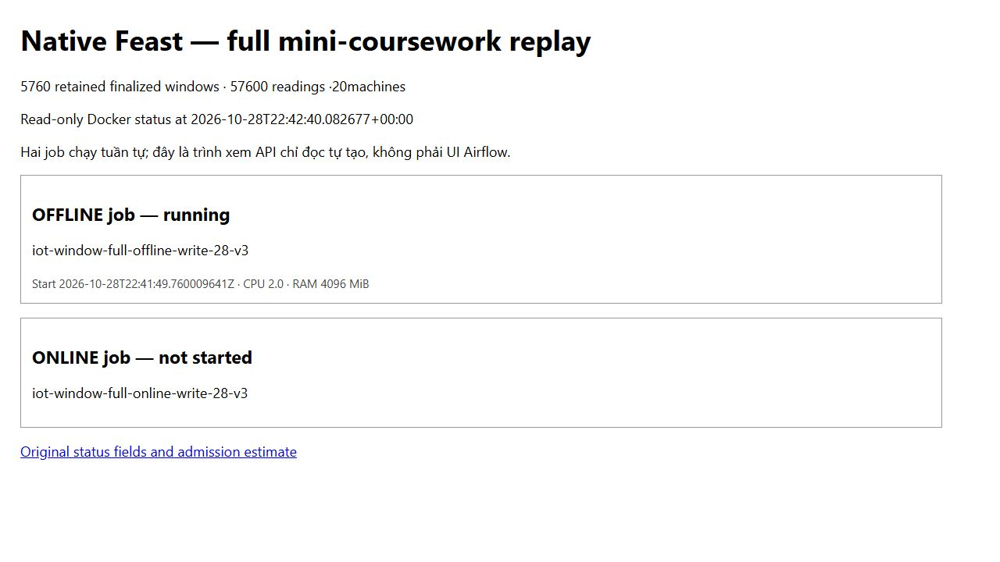

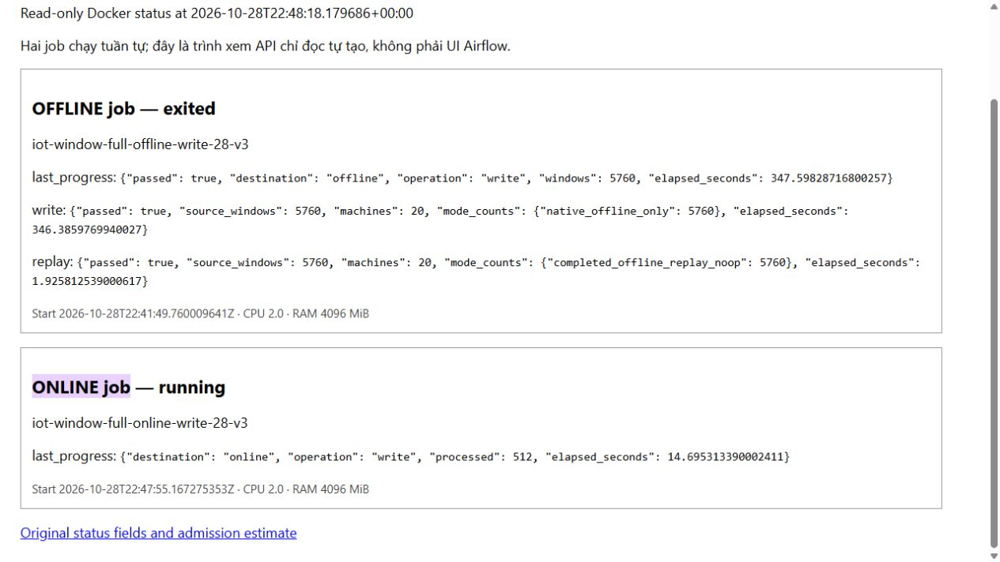

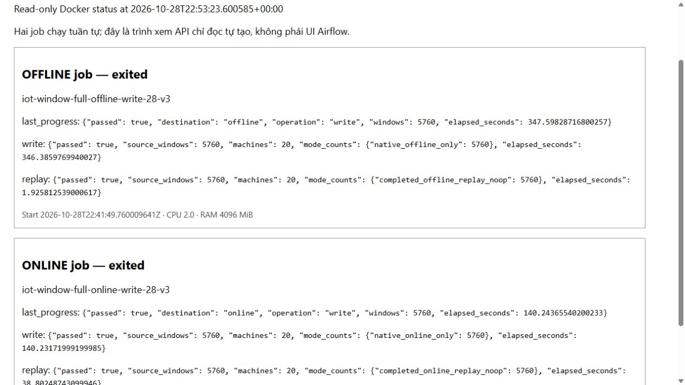


### Window cohort: Related documentation

[Current architecture](architecture.md) · [Demo and recovery](operations.md) · [Rubric index](rubric_overview.md)

[Original run notes](https://github.com/anle0429/iot-maintenance-platform/blob/a395c4ea47b8f8e235556ab93de3d699ed9df18b/docs/window-cohort.md) retain the full historical narrative. Raw evidence files have not been translated or rewritten.
