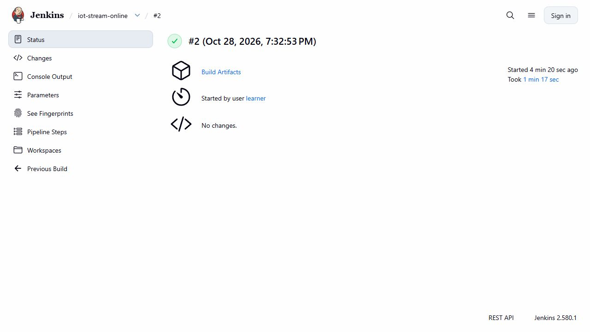

# Feature write paths and TTL policy

`machine_rolling_10m` supplies eight model inputs. Six summarize the preceding ten minutes. The other two are pump age and the count of failures recorded in the previous 24 hours. The monitoring view, `machine_tumbling_final_10m`, holds four aggregates from finalized, non-overlapping Flink windows. [Model input list](../../ml/protocols/medium-60d-v1.json)

| Limit | Value | Meaning |
|---|---|---|
| Rolling-view event TTL | Ten minutes | Historical/online lookup freshness; API accepts age 0…600 seconds |
| Finalized-window event TTL | One hour | Approximately six finalized ten-minute monitoring windows |
| Redis key expiry | 3,600 actual seconds | Physical online-key lifetime after a write; acknowledged replay does not extend it |
| Demo lease | 3,600 actual seconds | Bound on how long a prepared simulated snapshot can be served |
| Offline Parquet | No automatic Redis-driven deletion | Retained history; view TTL limits retrieval rather than deleting files |

The prediction target's one-hour future horizon does not determine feature TTL. Build-time `created`, event time and first availability have different meanings. A live Redis key can still contain an ineligible stale feature. Actual materialization and the separate offline/online Airflow jobs are documented with their own run IDs and replay evidence.

## Implementation and evidence

- [Source: feature_store/repository.py](../../feature_store/repository.py)
- [Source: feature_store/push.py](../../feature_store/push.py)
- [Recorded artifact: ci-stream-push/offline-3/ci/airflow.json](../evidence/ci-stream-push/offline-3/ci/airflow.json)
- [Recorded artifact: ci-stream-push/online-2/ci/airflow.json](../evidence/ci-stream-push/online-2/ci/airflow.json)
- [Source: infra/ci/iot_ci_stream_push.py](../../infra/ci/iot_ci_stream_push.py)

## Recorded interface views

These are original captures from the runs described above. Their timestamps, model identities and visible states belong to those runs.

## Related documentation

[Current architecture](architecture.md) · [Demo and recovery](operations.md) · [Rubric index](rubric_overview.md)

[Original run notes](https://github.com/anle0429/iot-maintenance-platform/blob/a395c4ea47b8f8e235556ab93de3d699ed9df18b/docs/feature-jobs-and-ttl.md) retain the full historical narrative. Raw evidence files have not been translated or rewritten.
