# Batch and stream processing

This page brings together the Spark batch jobs, Kafka/Flink processing, measured corrections, Airflow orchestration, and their original evidence. Start with the code and follow the corresponding results below. Each experiment identifies its input, output and runtime separately.

## Contents

- [Workload boundaries](#workload-boundaries)
- [Spark batch processing code](#spark-batch-processing-code)
- [Flink window processing code](#flink-window-processing-code)
- [Recorded batch and stream review](#review-summary)
- [Catalog-bound ingest and exact readback](#chunk-ingest)
- [102.45 GB Bronze/Silver run](#full-scale-ingest)
- [Guarded large-source runner](#large-ingest-runner)
- [Schema and deduplication measurements](#batch-corrections)
- [Skew and the broadcast join](#skew-benchmark)
- [Bounded feature joins](#bounded-features)
- [60-day feature and label dataset](#medium-feature-dataset)
- [Native Flink fixtures and final readback](#streaming)
- [Airflow DP1–DP3 and DataHub](#orchestration)
- [Jenkins and Airflow CI](#ci-data-pipelines)

## Workload boundaries

| Workload | Input | Output and evidence |
|---|---|---|
| Original small batch | 58,752 telemetry exports in the department-source database | 57,600 unique readings; persisted dimensions, facts, features and labels |
| Airflow DP1–DP3 pilot | Separate 58,752-export source | Four Bronze tables, eight Silver/Gold tables, two feature/label tables; 64 checks |
| Full-source ingest | 102,447,847,856 bytes of offline JSONL, including 323,136,000 telemetry exports | Bronze/Silver only; 316,800,000 unique Silver readings |
| 60-day feature workload | Separate 200-machine Silver source with 17,280,000 unique readings | 3,456,000 snapshots; 3,132,184 eligible training rows |
| Flink paired fixture | Same 22-message workload per variant | Native baseline/corrected windows, late/retry audit and separate expiry probe |
| Generated Flink replay | Two passes, 116,928 messages total | 57,600 unique readings and 5,760 finalized monitoring windows |

## Spark batch processing code

The original batch job reads raw envelopes from PostgreSQL. It declares all supported telemetry fields, including nullable `pressure_bar`, parses JSON in `FAILFAST` mode and preserves source path and line. Firmware v1 does not supply pressure; a v1 NULL is not a zero measurement. The chunked adapter reads v1 and v2 file directories with the same explicit schema and validates each catalog before Spark reads it.

Excerpt from [`pipelines/transforms.py`, lines 6–16](../../pipelines/transforms.py#L6-L16):

```python
def struct_schema(fields: list[tuple[str, str]]) -> T.StructType:
    """Construct explicit nullable source types instead of inferring schema from one file."""
    types = {"string": T.StringType(), "timestamp": T.TimestampType(), "double": T.DoubleType(),
             "int": T.IntegerType(), "boolean": T.BooleanType()}
    return T.StructType([T.StructField(name, types[kind], True) for name, kind in fields])


TELEMETRY_FIELDS = [(name, "string") for name in ("event_id", "machine_id", "operating_status")]
TELEMETRY_FIELDS += [(name, "timestamp") for name in ("event_ts", "received_ts", "created_ts")]
TELEMETRY_FIELDS += [(name, "double") for name in ("temperature_c", "vibration_rms_mm_s", "current_a", "rpm", "pressure_bar")]
TELEMETRY_FIELDS += [("schema_version", "int")]
```


Excerpt from [`pipelines/transforms.py`, lines 32–44](../../pipelines/transforms.py#L32-L44):

```python
def parse_records(raw: DataFrame, fields: list[tuple[str, str]]) -> DataFrame:
    """Parse one source table while retaining the original source file and line number."""
    return raw.select("source_path", "source_line", F.from_json("payload", struct_schema(fields), {"mode": "FAILFAST"}).alias("data")).select("data.*", "source_path", "source_line")


def deduplicate_telemetry(frame: DataFrame) -> DataFrame:
    """Reject conflicting duplicates, then retain the latest export of each immutable reading."""
    payload_columns = [name for name, _ in TELEMETRY_FIELDS if name != "created_ts"]
    hashes = frame.withColumn("payload_hash", F.sha2(F.to_json(F.struct(*payload_columns)), 256))
    conflicts = hashes.groupBy("event_id").agg(F.countDistinct("payload_hash").alias("variants")).filter("variants > 1")
    require(conflicts.limit(1).count() == 0, "conflicting duplicate telemetry payload")
    window = Window.partitionBy("event_id").orderBy(F.col("created_ts").desc(), F.col("source_path"), F.col("source_line").desc())
    return frame.withColumn("rank", F.row_number().over(window)).filter("rank = 1").drop("rank")
```


The immutable payload check excludes `created_ts`, so identical readings exported at different times remain one reading. Conflicting measurements for an event ID fail instead of being silently selected. The original envelope job orders by latest export, ascending source path and descending source line. The chunked adapter has file provenance but no per-line ordinal; it orders by latest export and source path. Same-payload ties within one source path do not change the stored measurement.

Excerpt from [`pipelines/chunk_ingest.py`, lines 42–62](../../pipelines/chunk_ingest.py#L42-L62):

```python
def read_table(spark: SparkSession, source: ChunkSource, table: str):
    """Use a distributed directory scan after catalog verification, without collecting JSON rows or paths."""
    schema=struct_schema(SCHEMAS[table])
    if source.manifest['tables'][table]['parts']:
        frame=(spark.read.schema(schema).option('mode','FAILFAST').option('pathGlobFilter','part-*.jsonl')
               .json(str(source.directory(table))))
    else:
        frame=spark.createDataFrame([],schema)
    pattern='('+re.escape(TABLES[table])+r'/part-[0-9]+\.jsonl)$'
    return (frame.withColumn('source_path',F.regexp_extract(F.input_file_name(),pattern,1))
            .withColumn('source_manifest_sha256',F.lit(source.manifest_sha256)))


def latest_readings(frame):
    """Reject payload conflicts and keep the latest export, with file provenance as a deterministic tie-break."""
    immutable=[name for name in PAYLOAD if name!='created_ts']
    variants=(frame.withColumn('_hash',F.sha2(F.to_json(F.struct(*immutable)),256))
              .groupBy('event_id').agg(F.countDistinct('_hash').alias('variants')).filter('variants>1'))
    require(variants.limit(1).count()==0,'conflicting duplicate telemetry payload')
    order=Window.partitionBy('event_id').orderBy(F.col('created_ts').desc(),F.col('source_path'))
    return frame.withColumn('_rank',F.row_number().over(order)).filter('_rank=1').drop('_rank')
```


The skew query changes only the three-row policy join. The common 200-row machine snapshot is broadcast in both strategies; the large relation keeps its actual 70/15/15 factory distribution. This excerpt shows the two join strategies and the common aggregation:

Excerpt from [`pipelines/skew_job.py`, lines 48–63](../../pipelines/skew_job.py#L48-L63):

```python
def alarm_query(readings, policies, strategy: str):
    """Join on the naturally skewed factory key, then finalize hourly operating alarms and exact sensor sums."""
    if strategy == 'baseline':
        joined = readings.hint('merge').join(policies.hint('merge'), 'factory_id')
    elif strategy == 'broadcast':
        joined = readings.join(F.broadcast(policies), 'factory_id')
    else:
        raise ValueError('unknown join strategy')
    operating = F.col('operating_status') == 'operating'
    alarm = operating & ((F.col('temperature_milli') > F.col('temperature_limit_milli')) |
                         (F.col('vibration_milli') > F.col('vibration_limit_milli')))
    return (joined.groupBy('factory_id', F.date_trunc('hour', 'event_ts').alias('event_hour'))
            .agg(F.count('*').alias('reading_count'), F.sum(operating.cast('long')).alias('operating_count'),
                 F.sum(alarm.cast('long')).alias('alarm_count'),
                 F.sum('temperature_milli').alias('temperature_milli_sum'),
                 F.max('vibration_milli').alias('vibration_milli_max')))
```


On the independent 60-day feature run, the bucketed join limits each snapshot to neighboring time buckets and reapplies the exact time and availability predicate. This is different from the Flink tumbling aggregation below: rolling prediction snapshots can overlap, and labels come from a separate future-horizon calculation.

Excerpt from [`pipelines/bounded_features.py`, lines 6–22](../../pipelines/bounded_features.py#L6-L22):

```python
def _bucket(column: str, seconds: int):
    """Use UTC epoch microseconds and floor, including timestamps before the epoch."""
    return F.floor(F.unix_micros(column) / F.lit(seconds * 1_000_000)).cast("long")


def _candidates(snapshots: DataFrame, events: DataFrame, event_column: str,
                seconds: int, direction: int, predicate: str) -> DataFrame:
    """Left join two neighboring buckets, then enforce the original exact interval."""
    if direction not in (-1, 1) or seconds <= 0:
        raise ValueError("A positive window and past/future direction are required")
    left = (snapshots.select("machine_id", "event_timestamp")
            .withColumn("_bucket", _bucket("event_timestamp", seconds))
            .withColumn("_bucket", F.explode(F.array(F.col("_bucket"), F.col("_bucket") + direction)))
            .alias("s"))
    right = events.withColumn("_bucket", _bucket(event_column, seconds)).alias("e")
    return left.join(right, (F.col("s.machine_id") == F.col("e.machine_id"))
                     & (F.col("s._bucket") == F.col("e._bucket")) & F.expr(predicate), "left")
```


## Flink window processing code

`EventTimestamp` extracts the device's event time, not Kafka arrival time. The job applies a bounded-out-of-orderness watermark, with zero delay for the baseline and fifteen minutes for the corrected run. It first keys by event ID to check duplicates, then keys by machine for ten-minute event-time tumbling windows. The runtime does not call `.allowed_lateness(...)`: once a window closes, further arrivals go to `LATE`. The watermark delay keeps the window open longer; it is not an extra late-update period after closure.

Excerpt from [`pipelines/stream_job.py`, lines 28–34](../../pipelines/stream_job.py#L28-L34):

```python
class EventTimestamp(TimestampAssigner):
    """Assign device event time, including explicit test progress markers."""

    def extract_timestamp(self, value, record_timestamp):
        """Read event timestamps without replacing them with Kafka ingestion time."""
        row = json.loads(value)
        return millis(row["event"]["event_ts"] if row["kind"] == "telemetry" else row["event_ts"])
```


Excerpt from [`pipelines/stream_job.py`, lines 202–219](../../pipelines/stream_job.py#L202-L219):

```python
delay = 0 if args.baseline else 15
strategy = WatermarkStrategy.for_bounded_out_of_orderness(Duration.of_minutes(delay)).with_timestamp_assigner(EventTimestamp())
readings = (env.from_source(source, WatermarkStrategy.no_watermarks(), "Kafka telemetry source")
            .assign_timestamps_and_watermarks(strategy)).key_by(
    lambda value: json.loads(value)["event"]["event_id"] if json.loads(value)["kind"] == "telemetry" else f"clock-{json.loads(value)['marker']}")
export_path=Path(args.database).resolve()
ledger_path=export_path.with_name(export_path.stem+'-dedup.sqlite')
local_ledger=volume_store_path(ledger_path)
local_result=volume_store_path(export_path)
dedup = readings.process(Deduplicate(not args.baseline,args.dedup_retention_ms,str(local_ledger)), output_type=Types.STRING()).name("Immutable event dedup and watermark audit")
windows = (dedup.key_by(lambda value: json.loads(value)["event"]["machine_id"])
           .window(TumblingEventTimeWindows.of(Time.minutes(10))).side_output_late_data(LATE)
           .aggregate(WindowAggregate(), WindowResult(),
                      accumulator_type=Types.TUPLE([Types.LONG(), Types.DOUBLE(), Types.DOUBLE(), Types.LONG()]),
                      output_type=Types.STRING()).name("10 minute event time aggregate"))
late = windows.get_side_output(LATE).map(lambda value: json.dumps({**json.loads(value), "kind": "late"}), output_type=Types.STRING())
output = windows.union(dedup.get_side_output(AUDIT), late)
output.map(PersistResult(str(local_result),str(export_path)), output_type=Types.STRING()).name("Idempotent local result sink").filter(lambda _: False).print()
```


The aggregate keeps a fixed-size accumulator per machine/window: count, temperature sum, maximum vibration and maximum publication timestamp. The result attaches the half-open interval `[window_start, event_timestamp)`, observed closing watermark, build clock and latest input publication time. `event_timestamp` is the window end, not when the result became available. These four monitoring aggregates are separate from the eight rolling model inputs.

Excerpt from [`pipelines/stream_job.py`, lines 101–136](../../pipelines/stream_job.py#L101-L136):

```python
class WindowAggregate(AggregateFunction):
    """Accumulate bounded-size count/sum/max/availability state for each machine/window."""

    def create_accumulator(self):
        """Start an empty incremental accumulator."""
        return 0, 0.0, 0.0, 0

    def add(self, value, accumulator):
        """Accumulate one accepted reading and its simulated publication time."""
        row = json.loads(value)
        event = row["event"]
        return (accumulator[0] + 1, accumulator[1] + event["temperature_c"],
                max(accumulator[2], event["vibration_rms_mm_s"]), max(accumulator[3], millis(row["published_ts"])))

    def get_result(self, accumulator):
        """Return count and sufficient statistics without retaining the full window."""
        return accumulator

    def merge(self, first, second):
        """Combine partial aggregates without averaging averages."""
        return first[0] + second[0], first[1] + second[1], max(first[2], second[2]), max(first[3], second[3])


class WindowResult(ProcessWindowFunction):
    """Attach half-open window bounds and availability to the incremental result."""

    def process(self, key, context, elements):
        """Report final aggregates; their event timestamp is not a promise of availability at that time."""
        count, total, vibration, available = next(iter(elements))
        yield json.dumps({"kind": "window", "machine_id": key,
                          "window_start": utc_millis(context.window().start),
                          "event_timestamp": utc_millis(context.window().end),
                          "created": datetime.now(timezone.utc).isoformat(),
                          "max_input_published_ts": utc_millis(available), "closing_watermark_ms": context.current_watermark(),
                          "reading_count": count, "temperature_sum": total,
                          "temperature_mean": total / count, "vibration_max": vibration})
```


The corrected job suppresses identical retries before aggregation. The short-lived state cache uses a processing-time timer (seven days by default, 1.5 seconds in the expiry probe); a separate retained SQLite event ledger still checks IDs after cache expiry. The disabled baseline records deliveries instead of unique-ID audits. The result store upserts an **absolute** aggregate keyed by `(machine_id, window_start)` and keeps late/duplicate/progress audits separately. SQLite transactions are independent of Flink checkpoint transactions; the observed replay correctness does not establish general exactly-once recovery.

Excerpt from [`pipelines/stream_contract.py`, lines 97–108](../../pipelines/stream_contract.py#L97-L108):

```python
def _write_locked(self, record: dict) -> None:
    """Serialize Beam bundle-thread handoffs on the same operator connection."""
    payload = json.dumps(record, sort_keys=True)
    if record["kind"] == "window":
        self.connection.execute("INSERT INTO windows VALUES (?,?,?) ON CONFLICT(machine_id,window_start) DO UPDATE SET payload=excluded.payload",
                                (record["machine_id"], record["window_start"], payload))
    else:
        if record["kind"] in ("unique", "late"):
            identity = f"{record['kind']}:{record['event']['event_id']}"
        else:
            identity = f"{record['kind']}:{record['sequence']}"
        self.connection.execute("INSERT OR IGNORE INTO audits VALUES (?,?,?)", (identity, record["kind"], payload))
```


The [native Flink fixture chapter](#streaming) shows the exact baseline/corrected values, the original running-job screenshots, and the separate final SQLite inspection. The [Airflow chapter](#orchestration) shows the batch DAGs and benchmark DAG in their recorded native interfaces.

## Review summary

This review makes the data-platform results visible without treating an artifact audit as a grading decision. Measurements and native screenshots refer to their original workloads. A newly drawn chart explains the receipts; it is not a newly captured service interface.

The [current eleven-topic evidence checklist](data_review_audit.md) links each reported issue to code, explanation and visible proof. It also includes the later timing/Airflow work and the new final SQLite and query-derived relationship captures; historical review receipts retain their original then-open items.

### Offline normalization

The development source has 58,752 telemetry exports for 57,600 readings. The [recorded Spark run](../evidence/day2-final/batch-report.json) preserves raw exports in Bronze, then parses a declared union schema and resolves repeated event IDs into Silver.

| Issue | Before processing | After processing | Implementation and correctness check |
|---|---|---|---|
| Duplicate exports | 58,752 telemetry rows, including 1,152 repeat exports | 57,600 unique Silver rows; 1,152 extras removed | [deduplicate_telemetry](../../pipelines/transforms.py); latest `created_ts` wins; conflicting immutable measurements are rejected; replay leaves the same output |
| Schema evolution | v1 omits `pressure_bar`; v2 supplies it; two physical JSONL schema partitions | One typed Silver schema; 28,800 unique rows per version; v1 pressure remains NULL and v2 pressure is populated | [Declared parser and union](../../pipelines/transforms.py); `schema_union_preserves_unknown_pressure` and persisted readback checks |
| Historical machine changes | P-001 changes factory F-01 → F-04 | Two half-open dimension versions, 21 total versions / 20 current machines | [Temporal dimension join](../../pipelines/transforms.py); every telemetry/failure/maintenance fact resolves the appropriate version |

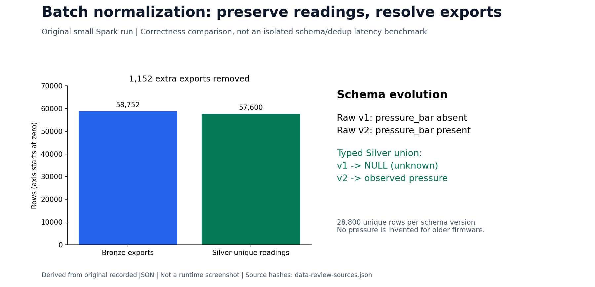

The figure derives from the existing source and Spark reports. The later [100 GB ingest](#full-scale-ingest) separately processed 323,136,000 exports into 316,800,000 unique readings; those counts must not be substituted for this small run.

The native Spark History Server now renders the original `iot-batch-day2-final` application, ID `local-1792662805607`. Its unchanged 270,045,539-byte event log belongs to 22 October; restoring the viewer did not rerun the batch. Query 26 shows 58,752 cached telemetry exports entering the window plan and 57,600 rows after `WindowGroupLimit`, followed by the final rank filter. [Original plan text](../evidence/data-platform-review/spark/query-26.txt) retains the declared parser, including `pressure_bar`, and the `created_ts` ordering.

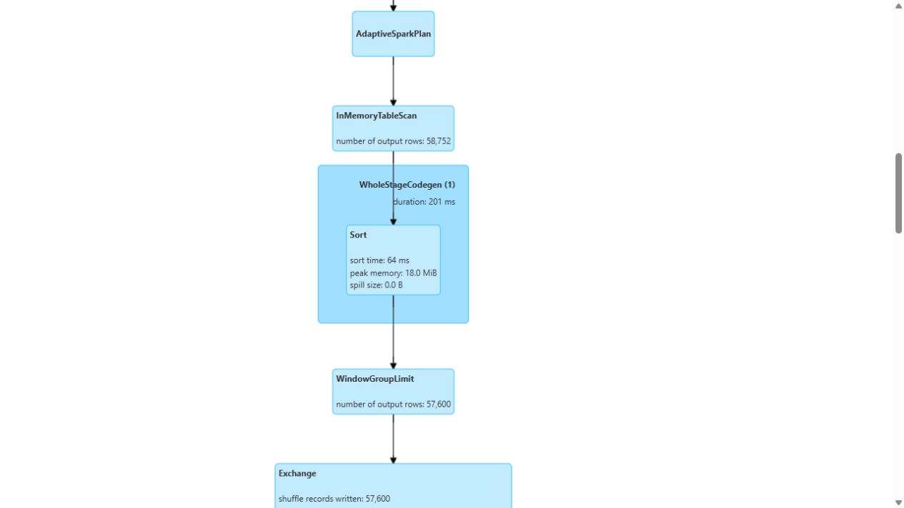

[The complete unedited query capture](../evidence/data-platform-review/screenshots/spark-dedup-query26.jpg) includes the application/query header and full plan. [Native SQL notebook captures](data_storage.md#schema-design-native-table-and-relationship-inspection) independently read the persisted schema/duplicate results. This is one correctness transformation viewed before and after its operators, not two independent timing benchmarks.

Schema evolution and deduplication in those original receipts are **correctness transformations**. A later [controlled timing study](#batch-corrections) now compares equivalent schema readers and deterministic winner selectors, with full-result equality and three measured pairs. Its separate experimental source does not change the original DP2 implementation or its receipts.

### Follow the review questions

| Question | Direct answer and evidence |
|---|---|
| Which columns are skewed or high-cardinality? | [Generator measurements and exact denominators](../../generator/README.md#observed-data-characteristics) |
| Which schema changed, and how are duplicates resolved? | [Offline comparison above](#offline-normalization), [schema design](data_storage.md#schema-design) |
| What did the unoptimized stream get wrong? | [Same-fixture baseline and correction](#streaming-baseline-problems-and-corrected-results) |
| Where are the original Spark before/after screenshots? | [Sort/merge versus broadcast](#skew-benchmark-before-and-after-on-the-same-input) |
| Where are DP1–DP3 in Airflow? | [All three original native DAG screenshots](#orchestration-airflow-integration-each-pipeline-in-the-ui) |
| Are schema/dedup timings and the skew query executed through Airflow? | [Five-task native benchmark run](#orchestration-measured-benchmark-dag), [all paired measurements](#batch-corrections-results) |
| Which DataHub screenshots establish each stage? | [Stage-specific coverage and gaps](#orchestration-datahub-lineage-and-validation-evidence-by-stage) |
| Does Redis hold historical training data? | No: [Redis is online; DuckDB reads Parquet offline](data_storage.md#feast-feature-store-what-redis-stores-and-where-the-offline-store-lives) |
| How do features reach KFP? | [Mounted input paths, native Feast lookup and typed cohort descriptor](training_notebook.md#how-features-reach-kubeflow) |
| Do all three agents use LLM inference? | Yes: [shared ModelConfig and generation route](../edai-2/gpu_agent_routing.md); the earlier representative arrow omitted two visible role connections |
| Where is the Docker size reduction? | [Controlled full/slim comparison](docker.md#controlled-native-comparison): 1,495,600,805 → 216,150,820 bytes, identical 32-sample HTTP responses |

### Native review and remaining limits

The CPU-session review added a controlled Docker measurement, paired native Flink fixture images, original Spark query inspection and a genuinely executed schema notebook. [The review capsule](../evidence/data-platform-review/review.json) records their identities, source files and failed predecessors. No GPU, large-source generation or model training was needed.

The three previously missing DataHub views are now [captured directly](#orchestration-dp1-and-dp2-native-captures): original DP1 task lineage, original DP2 task lineage, and Silver telemetry Quality with evaluation history. They show retained metadata, including the later CI evaluation date; taking a screenshot is not a new validation run.

The [schema captures](data_storage.md#schema-design) show real SQL joins and table records, rather than a graphical foreign-key editor. The skew query now also runs as a real task in the separately admitted [benchmark DAG](#orchestration-measured-benchmark-dag); it remains a distinct workload from DP1–DP3 and the 100 GB ingest.

The [new three-pair study](#batch-corrections) records schema medians of 0.927→0.764 seconds, warmed-input dedup medians of 0.581→0.603 seconds, and a separate skew median of 14.258→9.170 seconds. The aggregate dedup candidate was slower by its median, so the production window selector is retained. These are scoped experiments, not an end-to-end or 100 GB speedup. Original evidence, failures and measurement scopes remain unchanged.

### Verify the review artifacts

```bash
python scripts/verify-data-platform-review.py --output outputs/data-review-check.json
python scripts/verify-batch-benchmarks.py --output outputs/batch-benchmarks-check.json
```

These standard-library checks need no live VM. The review check authenticates actual HTTP responses against all 32 Spark golden samples, retained SQLite windows and executed notebook tables. The benchmark check additionally regenerates the small source, independently reproduces every full-result checksum and recomputes task metrics from complete event logs. They verify recorded evidence, not current service health or a rubric grade.

## Chunk ingest

The adapter binds the successful source receipt, manifest, catalog and every part checksum before Spark reads the five offline tables. Typed Bronze Parquet retains stored rows, source paths, manifest identity and ingestion time. Silver deduplicates by event ID/latest export time and rejects conflicting immutable payloads.

The recorded intermediate benchmark uses 1,117,608,156 offline bytes and 3,456,000 unique readings. It passed 84 host tests and 13 Spark checks per setting, including exact multiset readback, empty metadata boundaries and schema/duplicate handling. Spark event logs and History UI are genuine run artifacts.

The baseline and optimized configuration use the same workload and verify the same output. Format sizes, query measurements, spill and scratch placement are recorded separately rather than inferred from compression ratios.

This adapter does not reinterpret export or ingestion time as first arrival. The small day 2/day 3 loaders do not automatically support the chunked layout. Full-scale source ingestion and downstream features have separate evidence.

### Chunk ingest: Commands and recorded examples

Run commands from the repository root unless the example explicitly changes the working directory. Use a fresh output/run name and check the linked runbook before starting platform services. Examples belong to the recorded workload on this page.

```powershell
./scripts/run-chunk-ingest.ps1 -RunName practice-ingest -SourcePath data/source/chunked-release/pilot
Get-Content outputs/practice-ingest/ingest-report.json
```

```powershell
docker compose -f infra/ingest.compose.yaml --profile history up -d history
docker compose -f infra/ingest.compose.yaml stop history
```

```powershell
./.venv/Scripts/python.exe -m generator.chunked generate --config generator/configs/ingest-medium.json --output data/source/medium-practice --offline-only
./scripts/run-chunk-ingest.ps1 -RunName medium-practice -SourcePath data/source/medium-practice -SkipBuild
```

### Chunk ingest: Implementation and evidence

- [Source: pipelines/chunk_source.py](../../pipelines/chunk_source.py)
- [Source: pipelines/chunk_ingest.py](../../pipelines/chunk_ingest.py)
- [Source: pipelines/ingest_metrics.py](../../pipelines/ingest_metrics.py)
- [Recorded artifact: chunk-ingest-small/ingest-report.json](../evidence/chunk-ingest-small/ingest-report.json)
- [Recorded artifact: chunk-ingest-medium/ingest-report.json](../evidence/chunk-ingest-medium/ingest-report.json)
- [Recorded artifact: chunk-ingest-boundary/ingest-report.json](../evidence/chunk-ingest-boundary/ingest-report.json)
- [Recorded artifact: chunk-ingest-medium/spark-metrics.json](../evidence/chunk-ingest-medium/spark-metrics.json)
- [Recorded artifact: chunk-ingest-medium/run-context.json](../evidence/chunk-ingest-medium/run-context.json)
- [Recorded artifact: chunk-ingest-verification.json](../evidence/chunk-ingest-verification.json)
- [Recorded artifact: chunk-ingest-medium/history-applications.json](../evidence/chunk-ingest-medium/history-applications.json)
- [Recorded artifact: chunk-ingest-medium/history-query-44.json](../evidence/chunk-ingest-medium/history-query-44.json)
- [Recorded artifact: chunk-ingest-medium/history-query-45.json](../evidence/chunk-ingest-medium/history-query-45.json)
- [Source: generator/configs/ingest-medium.json](../../generator/configs/ingest-medium.json)
- [Recorded artifact: chunk-ingest-medium/100gb-current-plan.json](../evidence/chunk-ingest-medium/100gb-current-plan.json)
- [spark.apache.org / sql-data-sources-json.html](https://spark.apache.org/docs/3.5.9/sql-data-sources-json.html)
- [spark.apache.org / sql-data-sources-parquet.html](https://spark.apache.org/docs/3.5.9/sql-data-sources-parquet.html)
- [github.com / WebUI.scala](https://github.com/apache/spark/blob/v3.5.9/core/src/main/scala/org/apache/spark/ui/WebUI.scala)
- [spark.apache.org / monitoring.html](https://spark.apache.org/docs/3.5.9/monitoring.html)
- [docs.kernel.org / cgroup-v2.html](https://docs.kernel.org/admin-guide/cgroup-v2.html)

### Chunk ingest: Recorded interface views

These are original captures from the runs described above. Their timestamps, model identities and visible states belong to those runs.


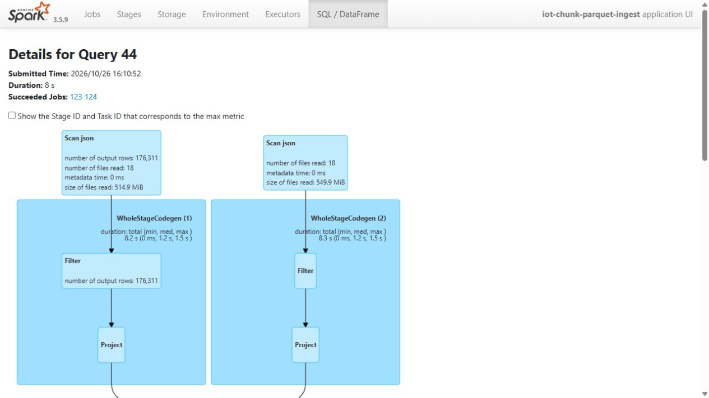

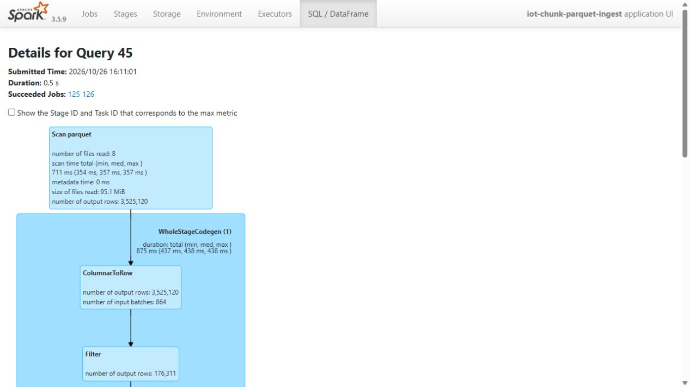


### Chunk ingest: Related documentation

[Current architecture](architecture.md) · [Demo and recovery](operations.md) · [Rubric index](rubric_overview.md)

[Original run notes](https://github.com/anle0429/iot-maintenance-platform/blob/a395c4ea47b8f8e235556ab93de3d699ed9df18b/docs/chunk-ingest.md) retain the full historical narrative. Raw evidence files have not been translated or rewritten.

## Full-scale ingest

The full Spark workload read 102,447,847,856 bytes of uncompressed offline JSONL. Bronze retained 323.136 million stored readings; Silver contains 316.8 millionunique readings after the contract-defined deduplication.

All 13 Spark checks passed. The recorded event logs contain 45,852 tasks with zero failed task attempts, and source checksums before/after agree. Fourteen semantic source rules and actual file/catalog measurements establish the input, rather than a size projection.

A matched JSONL/Parquet query experiment used three paired runs with equal results. The recorded medians are 1,740.35 seconds for JSONL and 124.69 seconds for Parquet. Cache state and shared-host interference are documented limits; this is not a universal speedup guarantee.

The scale claim covers source ingestion through Bronze/Silver. Gold, offline/online features and model training use separately measured sources. The full Spark runner and smaller Airflow DP1–DP3 pilot have different execution receipts.

### Full-scale ingest: Implementation and evidence

- [Recorded artifact: full-ingest/controller/verification.json](../evidence/full-ingest/controller/verification.json)
- [Recorded artifact: full-ingest/controller/ingest-report.json](../evidence/full-ingest/controller/ingest-report.json)
- [Recorded artifact: full-ingest/controller/_RUN_SUCCESS.json](../evidence/full-ingest/controller/_RUN_SUCCESS.json)
- [Recorded artifact: full-ingest/capture/lakehouse-_RUN_SUCCESS.json](../evidence/full-ingest/capture/lakehouse-_RUN_SUCCESS.json)
- [Recorded artifact: full-ingest/capture/evidence-map.json](../evidence/full-ingest/capture/evidence-map.json)
- [Recorded artifact: full-ingest/capture/capture-state.json](../evidence/full-ingest/capture/capture-state.json)
- [Recorded artifact: full-ingest/controller/unit-tests.txt](../evidence/full-ingest/controller/unit-tests.txt)
- [Recorded artifact: full-ingest/controller/spark-metrics.json](../evidence/full-ingest/controller/spark-metrics.json)
- [Recorded artifact: full-ingest/capture/history-application.json](../evidence/full-ingest/capture/history-application.json)
- [Recorded artifact: full-ingest/controller/container-limits.json](../evidence/full-ingest/controller/container-limits.json)
- [Recorded artifact: full-ingest/controller/preflight.json](../evidence/full-ingest/controller/preflight.json)
- [Recorded artifact: full-ingest/controller/resource-samples.json](../evidence/full-ingest/controller/resource-samples.json)
- [Recorded artifact: full-ingest/capture/history-query-44.json](../evidence/full-ingest/capture/history-query-44.json)
- [Recorded artifact: full-ingest/screenshots/capture.json](../evidence/full-ingest/screenshots/capture.json)

### Full-scale ingest: Recorded interface views

These are original captures from the runs described above. Their timestamps, model identities and visible states belong to those runs.

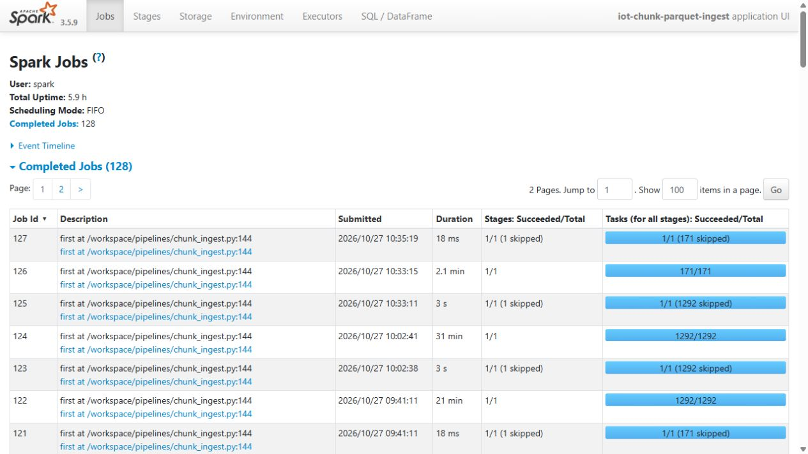

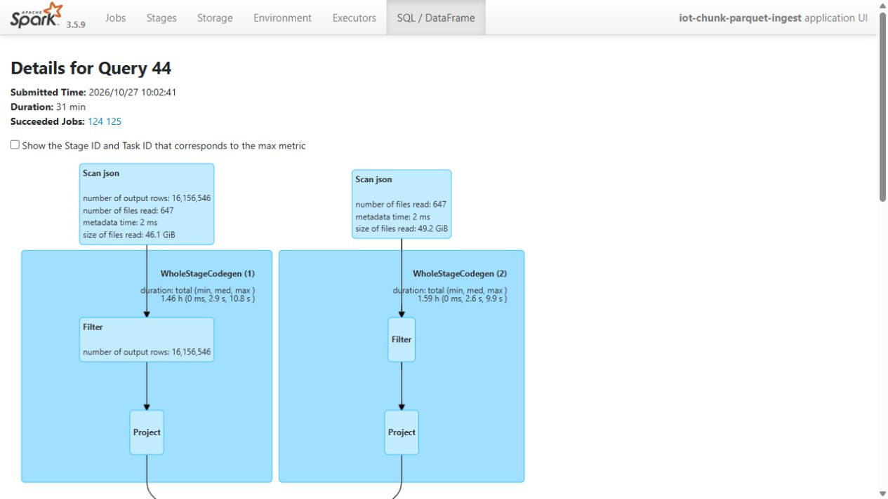

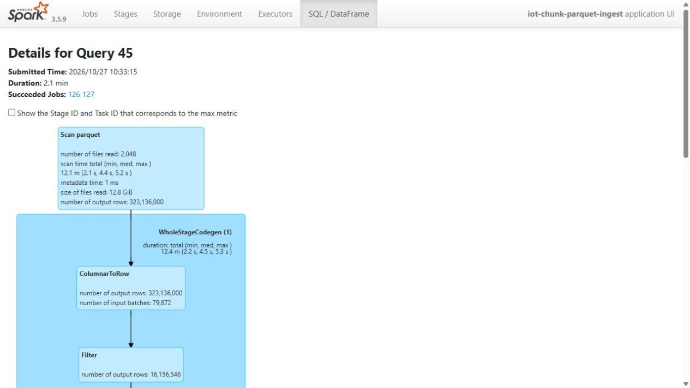


### Full-scale ingest: Related documentation

[Current architecture](architecture.md) · [Demo and recovery](operations.md) · [Rubric index](rubric_overview.md)

[Original run notes](https://github.com/anle0429/iot-maintenance-platform/blob/a395c4ea47b8f8e235556ab93de3d699ed9df18b/docs/full-scale-ingest.md) retain the full historical narrative. Raw evidence files have not been translated or rewritten.

## Large ingest runner

The Linux runner verifies the retained source and actual session/resources before submitting the large Spark workload. It keeps source code and inputs read-only, places scratch according to the checked disk budget and records image/container/command identities.

Two checksum observations, completed Spark application state and exact output validation bind the result. Long-running progress and resource records are retained separately from the final success receipt. A process exit or partial Parquet directory is not enough to mark ingestion complete.

The admitted full-source workload uses HDD scratch where the SSD budget is insufficient. Pilot speed and remaining auto-STOP time are checked with reserve rather than bypassing a failed guard. This runner does not automatically execute the full feature/ML pipeline or turn the pilot Airflow DAG into a 100 GB orchestration run.

### Large ingest runner: Commands and recorded examples

Run commands from the repository root unless the example explicitly changes the working directory. Use a fresh output/run name and check the linked runbook before starting platform services. Examples belong to the recorded workload on this page.

```bash
data/runtime/scale-venv/bin/python scripts/run-large-ingest.py \
  --run-name my-hdd-pilot --source data/source/scale-intermediate-26 \
  --receipt outputs/scale-intermediate-26/receipt.json --partitions 128 \
  --deadline-utc "$VM_STOP_UTC" --base-commit "$RELEASE_COMMIT"
```

### Large ingest runner: Implementation and evidence

- [spark.apache.org / configuration.html](https://spark.apache.org/docs/3.5.9/configuration.html)
- [spark.apache.org / sql-performance-tuning.html](https://spark.apache.org/docs/3.5.9/sql-performance-tuning.html)
- [Recorded artifact: large-ingest-runner/ingest-report.json](../evidence/large-ingest-runner/ingest-report.json)
- [Recorded artifact: large-ingest-runner/verification.json](../evidence/large-ingest-runner/verification.json)
- [Recorded artifact: large-ingest-runner/_RUN_SUCCESS.json](../evidence/large-ingest-runner/_RUN_SUCCESS.json)
- [Recorded artifact: large-ingest-runner/lakehouse-_RUN_SUCCESS.json](../evidence/large-ingest-runner/lakehouse-_RUN_SUCCESS.json)
- [Recorded artifact: large-ingest-runner/container-limits.json](../evidence/large-ingest-runner/container-limits.json)
- [Recorded artifact: large-ingest-runner/preflight.json](../evidence/large-ingest-runner/preflight.json)
- [Recorded artifact: large-ingest-runner/calibration-v3/resource-samples.json](../evidence/large-ingest-runner/calibration-v3/resource-samples.json)
- [Recorded artifact: large-ingest-runner/admission/plan.json](../evidence/large-ingest-runner/admission/plan.json)
- [Recorded artifact: large-ingest-runner/admission/rejected.json](../evidence/large-ingest-runner/admission/rejected.json)
- [Recorded artifact: large-ingest-runner/admission/next-session-estimate.json](../evidence/large-ingest-runner/admission/next-session-estimate.json)
- [cloud.google.com / general-purpose?hl=en](https://cloud.google.com/products/compute/pricing/general-purpose?hl=en)
- [cloud.google.com / disks-image-pricing](https://cloud.google.com/compute/disks-image-pricing)
- [cloud.google.com / pricing](https://cloud.google.com/vpc/pricing)
- [Recorded artifact: large-ingest-runner/release.json](../evidence/large-ingest-runner/release.json)

### Large ingest runner: Related documentation

[Current architecture](architecture.md) · [Demo and recovery](operations.md) · [Rubric index](rubric_overview.md)

[Original run notes](https://github.com/anle0429/iot-maintenance-platform/blob/a395c4ea47b8f8e235556ab93de3d699ed9df18b/docs/large-ingest-runner.md) retain the full historical narrative. Raw evidence files have not been translated or rewritten.

## Batch corrections

This study measures two separate implementation choices on the same bounded telemetry source. Schema parsing compares full-input inference with a declared union schema. Deduplication compares the existing window ordering with a deterministic aggregate candidate. Each comparison requires equivalent complete results before its timings are accepted.

The [benchmark module](../../pipelines/data_corrections_benchmark.py) is separate from [production DP2 transformations](../../pipelines/transforms.py). It does not replace DP2's parser or deduplication method. The aggregate selector is a measured candidate, not an already deployed optimization.

### Batch corrections: Input and scope

The input is the original development cohort: 20 machines over 48 hours, stored in two immutable JSONL partitions. It contains 58,752 exports for 57,600 unique readings, including 1,152 extra exports. Each schema version has 28,800 unique readings; export counts differ because retries are distributed across the partitions.

The source manifest pins each partition's bytes, SHA-256 and row count. The benchmark verifies these before and after execution. It rejects inputs above 100,000 exports or 200 MB and does not regenerate the source. These bounds deliberately separate this study from the retained 100 GB ingest and the 17.28-million-row [skew benchmark](#skew-benchmark).

Version 1 omits `pressure_bar`; version 2 supplies it. Both versions must normalize to the same twelve-column contract, with a nullable double for pressure. Unknown v1 pressure remains NULL. Neither reader may replace it with zero or discard v2 pressure.

### Batch corrections: Schema evolution: correctness and timing

There are three reader configurations, serving two different purposes:

| Configuration | Behavior | Role in the study |
|---|---|---|
| Schema inferred only from the v1 partition, then reused for both partitions | Omits `pressure_bar` from the schema and loses the v2 field | Separate demonstration of the original problem; not an equivalent performance baseline |
| Full-source inference | Infers from both partitions with `samplingRatio=1.0`, then casts every output column to the declared contract | Correct baseline for the timing comparison |
| Declared union schema | Reads the same two files using the explicit production field declaration, followed by the same typed projection | Candidate for avoiding the inference pass |

Both timed readers use `FAILFAST`. Timestamp inference is disabled in the inferred reader; its strings are explicitly cast to timestamps. The declared reader parses timestamps using the declared types. The resulting values, types, missing-pressure behavior and complete row multiplicities must agree with the independent source oracle.

Timing starts before constructing the reader DataFrame, so the inferred reader's schema-discovery action is included. It ends after materializing a summary that consumes every output column. Timing only a later `count()` would miss inference performed during reader construction and could allow Spark to prune sensor columns.

The v1-only demonstration records how many v2 exports lose pressure. It is not labeled a Spark execution failure: a reader can finish successfully while producing an incomplete schema. Its result is not compared as though it were equivalent to the corrected readers.

### Batch corrections: Deduplication: equivalent winner selection

Each `event_id` identifies one immutable reading. A retry may have a later `created_ts`; changing the reading's other payload fields is a conflict and must be rejected.

Untimed preparation wraps the original JSON lines with their actual relative `source_path` and one-based physical `source_line`. Spark parses these envelopes through the unchanged production parser. The resulting normalized frame is materialized once into a shared `MEMORY_AND_DISK` cache. Both selectors read this same warmed input after the same null-key and immutable-payload conflict gate.

The winner contract is:

1. Latest `created_ts`.
2. Ascending `source_path` when creation times tie.
3. Descending `source_line` when both preceding keys tie.

| Selector | Implementation |
|---|---|
| Window baseline | `row_number()` partitioned by event ID with the three ordering rules above; retain rank 1 |
| Aggregate candidate | `min_by(struct(all output columns), struct(-unix_micros(created_ts), source_path, -source_line))` grouped by event ID |

The aggregate order preserves timestamp microseconds and the same path/line tie breaks. Ordering keys must be non-null, and source lines must be positive. A complete ordering tie refers to identical payload and provenance after conflict validation; choosing either copy cannot change the returned row.

The timed section includes selector construction and full-column materialization. It excludes JSON parsing, cache preparation and the shared conflict check. These are **winner-selection timings on a warmed normalized input**, not end-to-end Bronze-to-Silver timings. The benchmark does not compare a validated baseline with an unvalidated candidate.

Hand-computed fixtures check a later export, microsecond ordering, both provenance tie breaks, immutable conflicts, null ordering keys and pressure semantics. Both selectors must also match the unchanged production deduplication function on the fixture.

### Batch corrections: Measurement and equivalence gates

For the correction experiments, each strategy receives one unmeasured warmup. The final study runs three paired repetitions per experiment, reversing strategy order on the second pair. All twelve measured executions are retained; medians use all three observations for each strategy. The separate skew job performs its known-answer checks and factory-partition diagnostic before six measured queries; it does not add these four correction warmups. A one-pair pilot checks integration and is not substituted for the final three-pair result.

Each timed action serializes every output column, computes row SHA-256 values and collects one bounded aggregate containing the row count, hash extrema and four hash-component sums. This forces full-column work without returning the dataset to the driver. The summary is a diagnostic, not a proof that two multisets are identical.

A separate Python implementation reads the authenticated original JSON lines, normalizes values and independently resolves the latest export and tie breaks. After every measured execution, Spark checks both `actual.exceptAll(expected)` and `expected.exceptAll(actual)` over every result column. Both differences must be empty, preserving multiplicity as well as values. These validation actions run outside the timer and measured job group.

The report retains each duration, strategy, repetition, result summary and exact comparison outcome. Its `physical_plan` comes from the same materialization query object that performed the timed action; the selector's own plan is retained separately. Explicit Spark job groups connect measured executions to completed event-log task metrics. The success marker binds the final report bytes and is written only after all source and correctness gates pass.

### Batch corrections: Airflow execution and evidence

[The benchmark DAG](../../airflow/dags/iot_data_benchmarks.py) defines a serial chain:

`preflight → schema_dedup_pairs → validate_corrections → skew_pairs → validate_skew`

The [task adapter](../../pipelines/benchmark_airflow.py) launches bounded sibling Spark containers and validates completed task metrics. The [launcher](../../scripts/run-data-benchmarks.py) prepares a fresh run with source bindings and the existing CPU-session descriptor. All tasks use the shared single-slot `spark_jobs` pool. The correction and skew experiments retain separate inputs, resource settings, application IDs and reports.

The final run, `bench-paired-20261101a`, completed all five tasks on 1 November 2026, from 20:40:27 to 20:43:58 UTC. The [native API snapshot](../evidence/batch-benchmarks/final/airflow.json) records their actual states and times. The correction application is `local-1793565635088`; the separate skew application is `local-1793565724983`. The successful one-pair pilot, `bench-pilot-20261101d`, is retained separately and contributes no observations to the final medians.

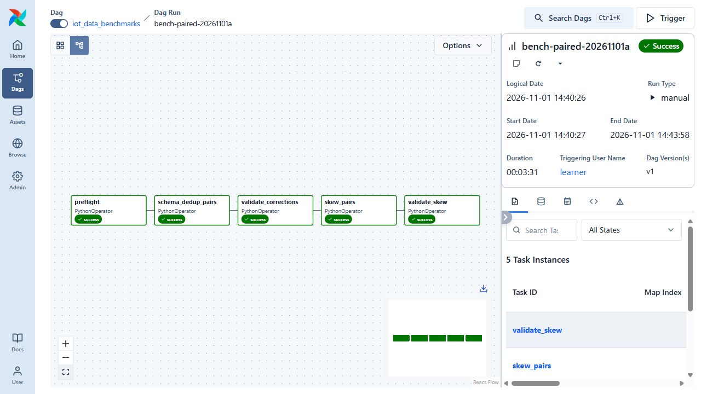

The [input specification](../evidence/batch-benchmarks/final/input-spec.json) binds sixteen runtime files and 72 input files, including the generated skew binding. The source packet also retains both test files. The correction container uses 4 CPUs, 10 GiB and a 7 GiB driver heap with eight shuffle partitions; the skew container uses 6 CPUs, 28 GiB and a 20 GiB heap with 32 partitions. Resources stay fixed within each comparison. The adapter checks actual host disk mounts through a bounded read-only probe and keeps a finish reserve before the existing eight-hour VM auto-STOP deadline.

The [native archive](../evidence/batch-benchmarks/native.tar.gz) contains real container exits, all reports, completed task metrics, Airflow task logs and both failed predecessors. Pilot B failed preflight when Docker SDK returned no captured stdout with the default local logging driver; [the original error capture](../evidence/batch-benchmarks/screenshots/airflow-pilot-b-preflight-failed.jpg) shows the resulting TypeError, and no Spark task ran. Pilot C completed correction measurements and validation, then failed loading Snappy JNI from a noexec temporary mount. The final adapter gives only the resource probe an explicit JSON log driver, and directs JVM temporary files to its own scratch mount while `/tmp` remains noexec. The failed runs were not cleared or marked successful.

### Batch corrections: Results

The [correction report](../evidence/batch-benchmarks/final/corrections.json) and [skew report](../evidence/batch-benchmarks/final/skew.json) retain every observation. Values below are seconds measured by the Python action timer, including the boundaries defined above.

| Experiment / pair | Baseline | Candidate |
|---|---:|---:|
| Schema 1: inferred / declared | 1.141795 | 0.764024 |
| Schema 2 | 0.926981 | 0.715816 |
| Schema 3 | 0.862027 | 0.807974 |
| **Schema median** | **0.926981** | **0.764024** |
| Dedup 1: window / aggregate | 0.635606 | 0.727420 |
| Dedup 2 | 0.576567 | 0.577089 |
| Dedup 3 | 0.581427 | 0.602638 |
| **Dedup median** | **0.581427** | **0.602638** |
| Skew 1: sort merge / broadcast | 16.807852 | 9.215180 |
| Skew 2 | 14.258209 | 8.507135 |
| Skew 3 | 14.249135 | 9.169817 |
| **Skew median** | **14.258209** | **9.169817** |

Each comparison is shown at full page width so its labels and all three measured pairs remain readable.

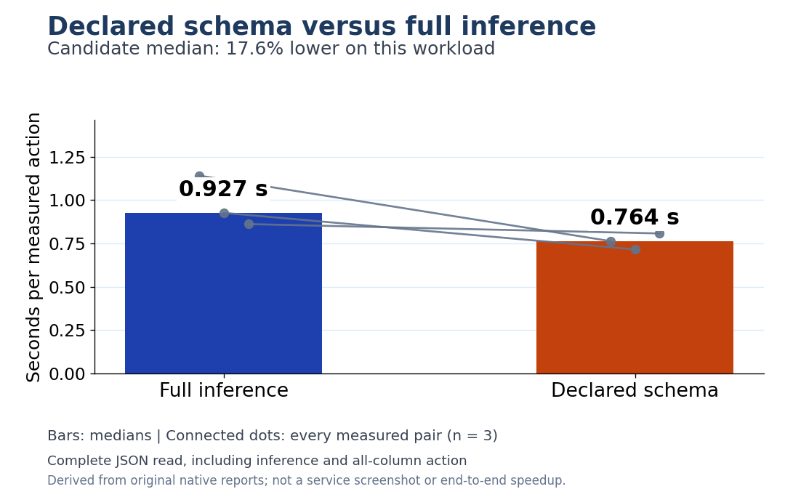

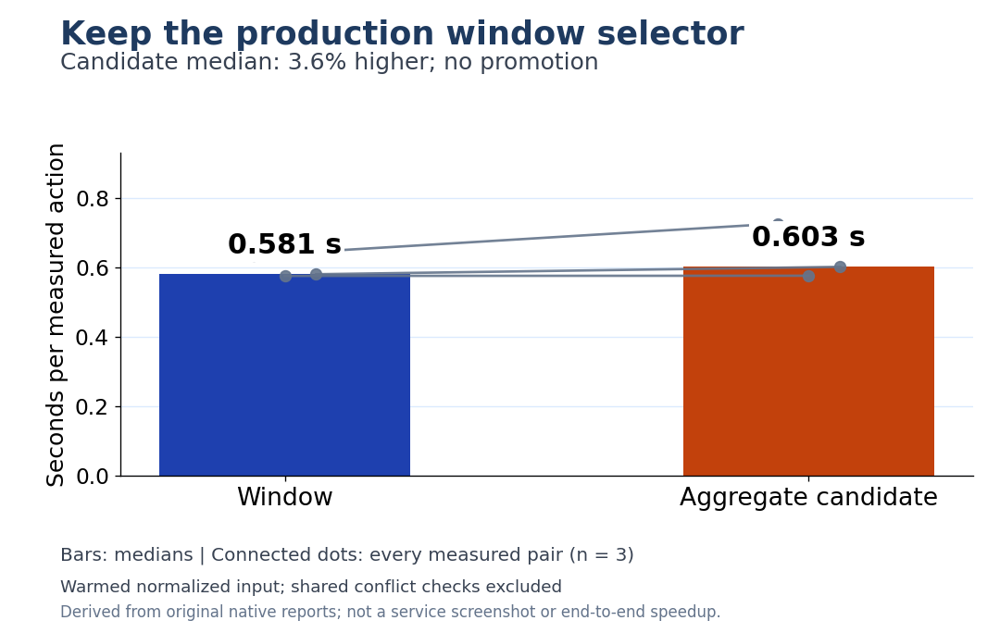

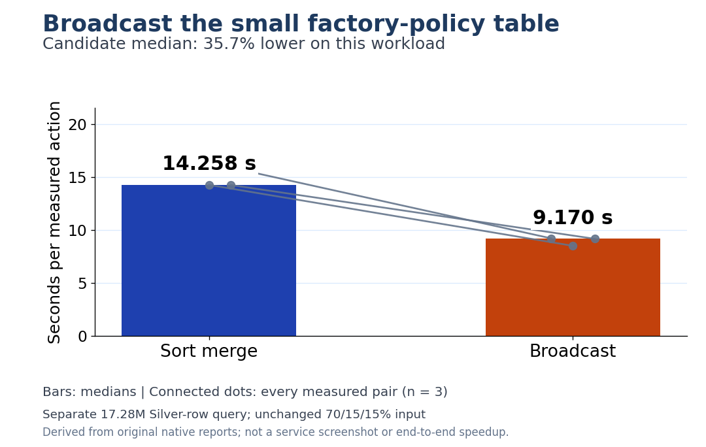

[Original combined plot](../images/batch-benchmark-pairs.png) · [Panel source identities](../images/benchmark-detail-sources.json)

The declared reader's median is 17.6% lower than full inference. Both preserve all 58,752 exports and the same typed values. The separate v1-only demonstration loses pressure for 29,359 v2 exports; the corrected readers preserve those values and leave pressure NULL for all 29,393 v1 exports.

Both dedup selectors return the same 57,600 complete winning rows, removing 1,152 extra exports. The aggregate candidate's median is **3.6% higher**, so this study supplies no reason to replace production DP2's window selector. The plans still contain sorting in both methods; using an aggregate API does not by itself demonstrate a faster physical plan.

The separate skew comparison reduces the median by 35.7% on its 17.28-million-row input, with all six executions returning identical 4,320 factory-hour aggregates. This is a new Airflow execution; the earlier standalone skew measurements remain unchanged in [their own report](#skew-benchmark-before-and-after-on-the-same-input).

#### Batch corrections: Native Spark plan captures

These original full-page captures show the first measured pair. Query durations displayed by Spark are not the Python medians above. In particular, schema inference also performs a discovery job before the pictured materialization query. Input/output counters inside a plan describe that operator's grain: the global checksum aggregate returns one row, not one reading.

<details>
<summary>Schema readers: native queries 25 and 28</summary>


**Full-source inference — Native inferred reader, query 25**

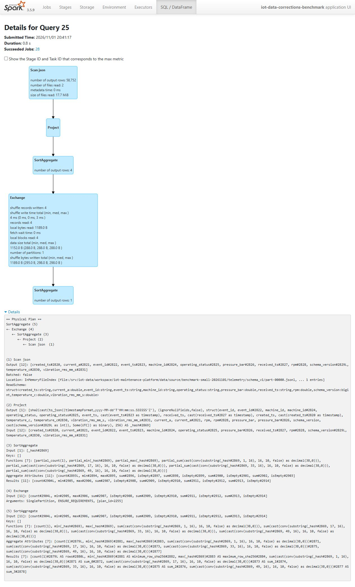

[Open the original capture at full resolution](../evidence/batch-benchmarks/screenshots/schema-inferred-query25-full.jpg).


**Declared union schema — Native declared reader, query 28**

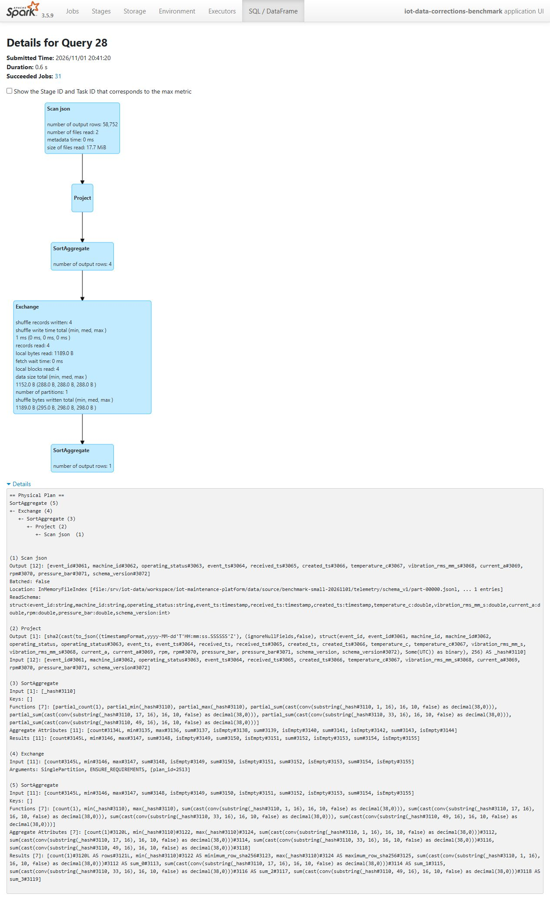

[Open the original capture at full resolution](../evidence/batch-benchmarks/screenshots/schema-declared-full.jpg).


</details>

<details>
<summary>Dedup selectors: native queries 49 and 52</summary>


**Window baseline — Native window selector, query 49**

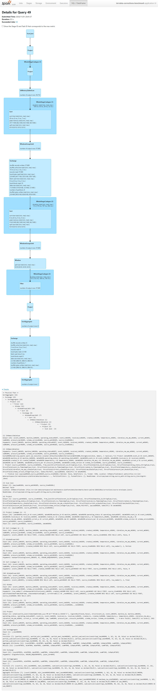

[Open the original capture at full resolution](../evidence/batch-benchmarks/screenshots/dedup-window-full.jpg).


**Aggregate candidate — Native aggregate selector, query 52**

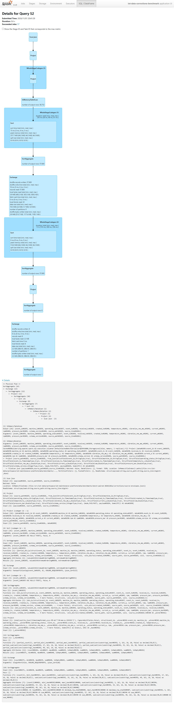

[Open the original capture at full resolution](../evidence/batch-benchmarks/screenshots/dedup-aggregate-full.jpg).


</details>

The [capture identities](../evidence/batch-benchmarks/spark-capture.json) link each image to its actual application and measured job group. [The two completed applications](../evidence/batch-benchmarks/screenshots/spark-final-applications.jpg) are loaded from the full original event logs in the existing History Server. Opening those pages did not rerun Spark.

### Batch corrections: Reproduce and verify

The standard-library verifier needs Python and a local clone, without a live VM or Spark installation:

```bash
python scripts/verify-batch-benchmarks.py --output outputs/batch-benchmarks-check.json
```

It regenerates the bounded source in a fresh temporary directory under `outputs/`, authenticates every original file, independently recomputes the complete schema/dedup checksums and compares all skew aggregate rows. It also decompresses and hashes both complete event logs and recomputes their task metrics. The two [stage verification receipts](../evidence/batch-benchmarks/final/correction-verification.json) and [skew receipt](../evidence/batch-benchmarks/final/skew-verification.json) remain native outputs, rather than replacements for these independent checks.

To execute again on the approved reference VM, first deploy the new DAG and its source files. The original small source and validated `scale-ingest-medium-26` Silver/machine inputs must already exist. Use a new run ID and a fresh descriptor of the currently authorized CPU session:

```bash
sudo python3 scripts/run-data-benchmarks.py \
  --run-id benchmark-demo-new \
  --source data/source/benchmark-small-20261101 \
  --source-manifest docs/evidence/batch-benchmarks/runtime-source.json \
  --descriptor /private/path/to/current-instance.json
```

The launcher hashes the installed code against the [recorded source manifest](../evidence/batch-benchmarks/runtime-source.json), checks mounted volumes/session limits, prepares new directories and triggers `iot_data_benchmarks`. Use `--repetitions 1` for a separate pilot. A queued API response is not completion: inspect all five actual task states and both validation reports. A clone contains the evidence and code, not the bulk Silver source, credentials or running Airflow services.

### Batch corrections: Interpretation limits

There is no minimum speedup required for success. A slower candidate remains a valid measurement and must be reported. The small dataset, shared VM services, JVM warmup and uncontrolled OS/file caches limit any performance conclusion. The two experiments measure different boundaries, so their elapsed times must not be added into an end-to-end pipeline speedup.

The study does not establish 100 GB schema/dedup performance, a production DP2 rollout or general cluster behavior. It complements the earlier persisted-data correctness checks and the separate factory-policy join benchmark.

The relevant Spark APIs are documented in [JSON data sources](https://spark.apache.org/docs/3.5.9/sql-data-sources-json.html), [min_by](https://spark.apache.org/docs/3.5.9/api/python/reference/pyspark.sql/api/pyspark.sql.functions.min_by.html), [unix_micros](https://spark.apache.org/docs/3.5.9/api/python/reference/pyspark.sql/api/pyspark.sql.functions.unix_micros.html) and [exceptAll](https://spark.apache.org/docs/3.5.9/api/python/reference/pyspark.sql/api/pyspark.sql.DataFrame.exceptAll.html).

## Skew benchmark

The benchmark compares baseline and optimized versions of the same factory-policy join on 17.28 millionSilver rows. Three paired runs check equal results and preserve the same source, machine and workload.

Broadcasting the small factory-policy relation reduced the recorded median from 15.339 to 8.577 seconds. Query plans, task/partition metrics and genuine Spark UI captures explain the changed execution strategy.

The synthetic factory distribution is skewed by construction, but that alone is not optimization evidence. Only this measured query/workload supports the comparison. The result does not establish the same speedup for all joins,100 GB feature engineering or an otherwise different cluster.

### Skew benchmark: Before and after on the same input

The input has 17,280,000 unique readings: F-01 has 12,096,000 (70%), while F-02 and F-03 have 2,592,000 each. A factory-key partition diagnostic placed all 12,096,000 F-01 rows in partition 22. The baseline sorts/shuffles the large relation for a `SortMergeJoin`; the optimized query broadcasts the **three-row policy relation** and uses `BroadcastHashJoin`. It does not rebalance factories or remove data.

| Same-input pair | Baseline, seconds | Broadcast, seconds |
|---|---:|---:|
| 1 | 18.243 | 9.115 |
| 2 | 15.338 | 8.444 |
| 3 | 15.339 | 8.577 |
| Median | 15.339 | 8.577 |

The median reduction is 44.1% (1.788× observed speedup). Each execution returns the same 4,320 rows and SHA-256 `7709e19ad539bcff7eeab3c17925c9a18d406dd9f9b69af0c01822d9ca41f877`. Across each run's recorded jobs, shuffle-read bytes change from 302,603,711 to 1,076,691; both strategies have 47 task attempts, zero failed attempts and zero disk spill. These are [event-log measurements](../evidence/skew-benchmark/task-metrics.json), not estimates from the picture.

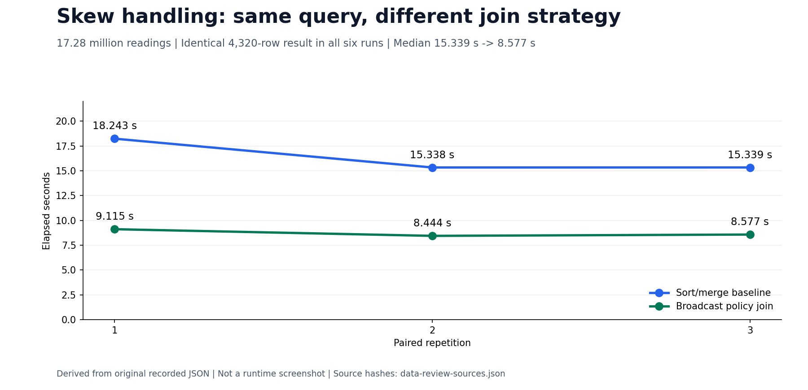

The plot derives from the original receipt. The following are **original Spark UI screenshots**, with the before and after identified explicitly:


**Before: sort/merge strategy and hot tasks — Baseline physical plan**

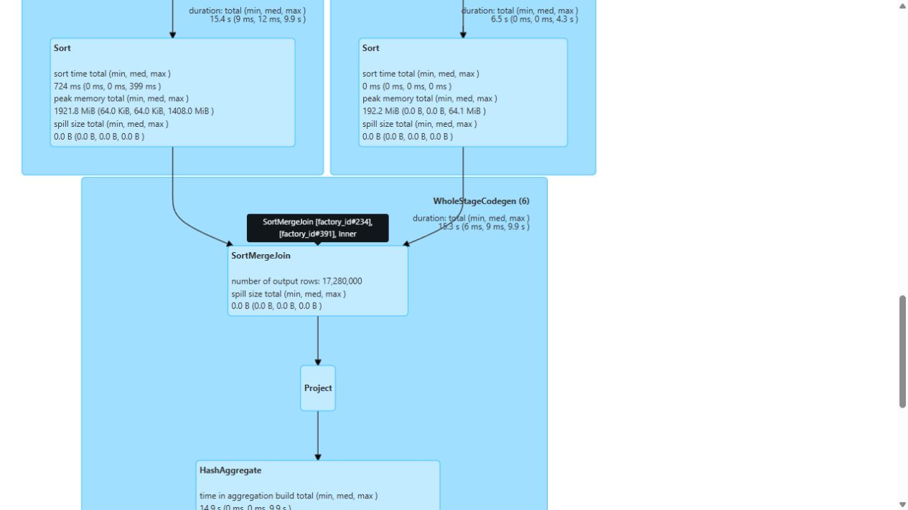

[Open the original capture at full resolution](../evidence/skew-benchmark/screenshots/baseline-sql-18.png).


**After: broadcast strategy — Optimized physical plan**

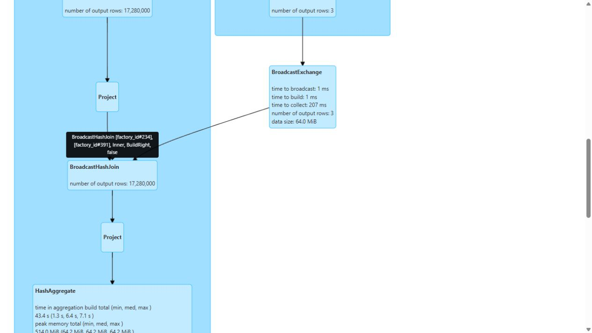

[Open the original capture at full resolution](../evidence/skew-benchmark/screenshots/broadcast-sql-19.png).


**Before: sort/merge strategy and hot tasks — Baseline hot tasks**

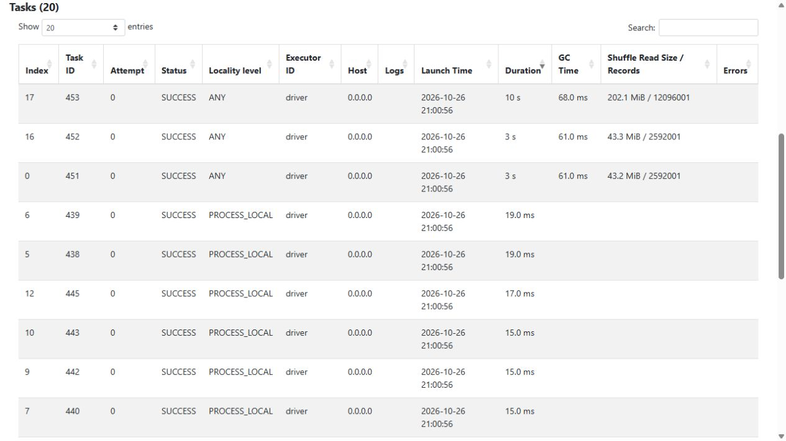

[Open the original capture at full resolution](../evidence/skew-benchmark/screenshots/baseline-hot-tasks.png).


**After: broadcast strategy — Broadcast stage tasks**

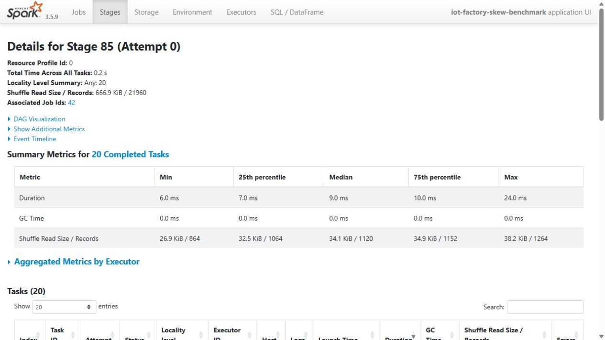

[Open the original capture at full resolution](../evidence/skew-benchmark/screenshots/broadcast-stage-85.png).


Both settings disable AQE and automatic broadcasting to isolate the explicit join change; shuffle partitions remain 32. OS caches and other VM services were not isolated. These original measurements came from a standalone analytical job. The same query now also has a separately recorded [native Airflow execution](#skew-benchmark-airflow-benchmark-execution); the original result above has not been replaced.

### Skew benchmark: Airflow benchmark execution

The new [iot_data_benchmarks DAG](../../airflow/dags/iot_data_benchmarks.py) runs source/resource admission, schema/dedup pairs and their validation before executing `skew_pairs → validate_skew`. Both skew tasks occupy the existing single-slot `spark_jobs` pool. [The adapter](../../pipelines/benchmark_airflow.py) calls the unchanged `skew_job.py` in a real 6-CPU / 28-GiB Spark container, with a 20-GiB driver heap and 32 shuffle partitions.

Run `bench-paired-20261101a` completed all five tasks on 1 November, after a separate successful pilot. Its skew application is `local-1793565724983`. The [actual Airflow snapshot](../evidence/batch-benchmarks/final/airflow.json), [native benchmark report](../evidence/batch-benchmarks/final/skew.json) and [validation receipt](../evidence/batch-benchmarks/final/skew-verification.json) identify the execution. Original failed pilots remain in the same evidence capsule.


| New Airflow pair | Sort-merge baseline, seconds | Broadcast, seconds |
|---|---:|---:|
| 1 | 16.807852 | 9.215180 |
| 2 | 14.258209 | 8.507135 |
| 3 | 14.249135 | 9.169817 |
| Median | 14.258209 | 9.169817 |

The median is 35.7% lower (1.555× baseline/candidate ratio) for this new execution. All six complete results again contain the same 4,320 rows and the same SHA-256 as the original experiment. The source remains 17,280,000 Silver rows with the same 70% / 15% / 15% factory distribution. [Source bindings](../evidence/batch-benchmarks/final/input-spec.json) and complete event logs support independent readback; the old and new medians describe separate executions with uncontrolled OS caches and shared VM services.

<details>
<summary>Native final Spark plans: policy SortMergeJoin versus BroadcastHashJoin</summary>


**Baseline: query 18 — Native final policy sort-merge plan**

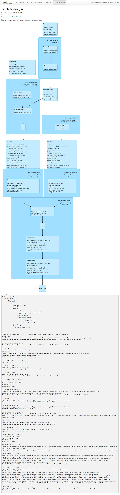

[Open the original capture at full resolution](../evidence/batch-benchmarks/screenshots/skew-baseline-full.jpg).


**Broadcast: query 19 — Native final policy broadcast plan**

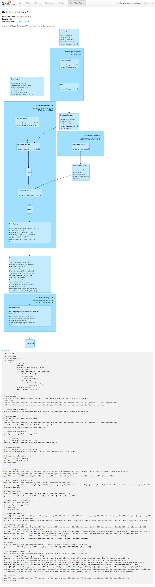

[Open the original capture at full resolution](../evidence/batch-benchmarks/screenshots/skew-broadcast-full.jpg).


</details>

Both plans also broadcast the shared 200-row machine snapshot. The changed join is the **three-row factory policy**: the baseline shuffles/sorts that join, while the candidate broadcasts it. The factory imbalance is preserved, not removed. See the [combined experiment methodology and offline verifier](#batch-corrections) for timing boundaries, all observations and source reproduction.

### Skew benchmark: Commands and recorded examples

Run commands from the repository root unless the example explicitly changes the working directory. Use a fresh output/run name and check the linked runbook before starting platform services. Examples belong to the recorded workload on this page.

```bash
data/runtime/scale-venv/bin/python scripts/run-skew-benchmark.py \
  --run-name my-skew-check \
  --deadline-utc "$VM_STOP_UTC" --base-commit "$RELEASE_COMMIT"
```

### Skew benchmark: Implementation and evidence

- [Source: pipelines/configs/factory-risk-policies.json](../../pipelines/configs/factory-risk-policies.json)
- [Recorded artifact: skew-benchmark/screenshots/baseline-hot-tasks.png](../evidence/skew-benchmark/screenshots/baseline-hot-tasks.png)
- [Recorded artifact: skew-benchmark/screenshots/baseline-sql-18.png](../evidence/skew-benchmark/screenshots/baseline-sql-18.png)
- [Recorded artifact: skew-benchmark/screenshots/broadcast-stage-85.png](../evidence/skew-benchmark/screenshots/broadcast-stage-85.png)
- [Source: pipelines/skew_metrics.py](../../pipelines/skew_metrics.py)
- [Recorded artifact: skew-benchmark/screenshots/paired-sql-runs.png](../evidence/skew-benchmark/screenshots/paired-sql-runs.png)
- [Recorded artifact: skew-benchmark/benchmark.json](../evidence/skew-benchmark/benchmark.json)
- [Recorded artifact: skew-benchmark/input-binding.json](../evidence/skew-benchmark/input-binding.json)
- [Recorded artifact: skew-benchmark/verification.json](../evidence/skew-benchmark/verification.json)
- [Recorded artifact: skew-benchmark/_RUN_SUCCESS.json](../evidence/skew-benchmark/_RUN_SUCCESS.json)
- [Recorded artifact: skew-benchmark/resource-samples.json](../evidence/skew-benchmark/resource-samples.json)
- [Recorded artifact: skew-benchmark/preflight.json](../evidence/skew-benchmark/preflight.json)
- [Recorded artifact: skew-benchmark/screenshots.json](../evidence/skew-benchmark/screenshots.json)
- [spark.apache.org / sql-performance-tuning.html](https://spark.apache.org/docs/3.5.9/sql-performance-tuning.html)
- [spark.apache.org / monitoring.html](https://spark.apache.org/docs/3.5.9/monitoring.html)

### Skew benchmark: Recorded interface views

These are original captures from the runs described above. Their timestamps, model identities and visible states belong to those runs.

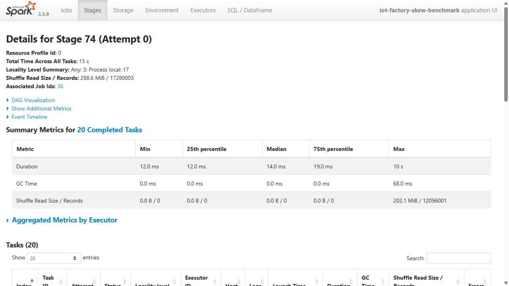


### Skew benchmark: Related documentation

[Current architecture](architecture.md) · [Demo and recovery](operations.md) · [Rubric index](rubric_overview.md)

[Original run notes](https://github.com/anle0429/iot-maintenance-platform/blob/a395c4ea47b8f8e235556ab93de3d699ed9df18b/docs/skew-benchmark.md) retain the full historical narrative. Raw evidence files have not been translated or rewritten.

## Bounded features

A machine snapshot at t needs only readings in `(t−10 minutes, t]`. Joining on machine ID alone can consider an entire history before filtering. The bucketed implementation narrows candidates and then reapplies the exact temporal and availability predicates.

| Calculation | Bucket width | Candidate buckets | Exact rule retained |
|---|---:|---|---|
| Past telemetry | 600 seconds | Current and previous | `t−600s < event_ts <= t`, arrival no later than t |
| Recorded failures | 86,400 seconds | Current and previous | Past 24 hours and recorded by t |
| Future label/intervention | 3,600 seconds | Current and next | `t < start_ts <= t+1h` |

Each event belongs to one bucket, and each snapshot expands to two distinct buckets. A valid event therefore contributes once. Empty left joins collapse back to one snapshot: count zero, mean/max NULL and the contract-defined standard deviation. Deduplicated inputs and unique machine/snapshot keys are prerequisites.

The independent Python oracle compares range and bucketed implementations on exact boundaries, one-microsecond offsets, midnight and pre-epoch times, unavailable arrivals/failures, missing readings, stopped machines and censored horizons. The isolated native fixture passed eight checks over nine snapshots, 168 readings, 192 failure rows and four maintenance rows. Its 34.059-second duration includes startup and both strategies; it is a correctness fixture, not a speed benchmark.

### Bounded features: Commands and recorded examples

Run commands from the repository root unless the example explicitly changes the working directory. Use a fresh output/run name and check the linked runbook before starting platform services. Examples belong to the recorded workload on this page.

```bash
/opt/spark/bin/spark-submit --master 'local[2]' --driver-memory 2g \
  --conf spark.sql.shuffle.partitions=4 --conf spark.default.parallelism=2 \
  --conf spark.sql.adaptive.enabled=false \
  /workspace/pipelines/feature_checks.py --output /workspace/outputs/feature-check-local-01
```

### Bounded features: Implementation and evidence

- [Source: pipelines/bounded_features.py](../../pipelines/bounded_features.py)
- [spark.apache.org / pyspark.sql.functions.unix_micros.html](https://spark.apache.org/docs/3.5.9/api/python/reference/pyspark.sql/api/pyspark.sql.functions.unix_micros.html)
- [Source: pipelines/feature_checks.py](../../pipelines/feature_checks.py)
- [Recorded artifact: feature-buckets/report.json](../evidence/feature-buckets/report.json)
- [Recorded artifact: feature-buckets/verification.json](../evidence/feature-buckets/verification.json)
- [Recorded artifact: feature-buckets/range_features-plan.txt](../evidence/feature-buckets/range_features-plan.txt)
- [Recorded artifact: feature-buckets/bucketed_features-plan.txt](../evidence/feature-buckets/bucketed_features-plan.txt)
- [Recorded artifact: feature-buckets/range_labels-plan.txt](../evidence/feature-buckets/range_labels-plan.txt)
- [Recorded artifact: feature-buckets/bucketed_labels-plan.txt](../evidence/feature-buckets/bucketed_labels-plan.txt)

### Bounded features: Related documentation

[Current architecture](architecture.md) · [Demo and recovery](operations.md) · [Rubric index](rubric_overview.md)

[Original run notes](https://github.com/anle0429/iot-maintenance-platform/blob/a395c4ea47b8f8e235556ab93de3d699ed9df18b/docs/bounded-features.md) retain the full historical narrative. Raw evidence files have not been translated or rewritten.

## Medium feature dataset

The Spark feature job builds five-minute snapshots from the verified Silver source under the fixed `medium-60d-v1` protocol. It reuses the 200-machine, 60-day source rather than regenerating data or treating the 100 GB ingest as a feature benchmark.

The recorded `feature-medium-27-v2` run produced 3,456,000 snapshots and 3,132,184 eligible training-table rows after censoring, feature-quality exclusions and purging. Event and arrival time are simulated; `created` is the actual build clock.

| Partition | Eligible rows | Positive | Negative | Distinct failure episodes |
|---|---:|---:|---:|---:|
| Train | 2,195,668 | 93,603 | 2,102,065 | 7,870 |
| Validation | 468,132 | 19,828 | 448,304 | 1,677 |
| Test | 468,384 | 19,957 | 448,427 | 1,687 |

Eight features, separate labels and exclusion/audit records are written. The job reports exclusions in a fixed priority order to avoid double counting. Known-answer checks cover arrivals, horizon boundaries and split purging; multiset readback and input/output hashes bind the full result.

The native run used the existing 8-vCPU/64-GiB VM, with a 6-CPU/28-GiB container, 20-GiB Spark heap, 128 shuffle partitions and HDD scratch. Those limits describe this run, not the unrelated full-source ingestion. Passing cohort-support gates establishes that evaluation is possible; it does not by itself establish model quality.

### Medium feature dataset: Commands and recorded examples

Run commands from the repository root unless the example explicitly changes the working directory. Use a fresh output/run name and check the linked runbook before starting platform services. Examples belong to the recorded workload on this page.

```bash
data/runtime/scale-venv/bin/python scripts/run-feature-dataset.py \
  --run-name feature-medium-check-01 --deadline-utc "$ACTUAL_STOP_DEADLINE_UTC"
```

### Medium feature dataset: Implementation and evidence

- [Source: pipelines/feature_dataset.py](../../pipelines/feature_dataset.py)
- [Source: ml/protocol.py](../../ml/protocol.py)
- [Recorded artifact: feature-medium-60d/preflight.json](../evidence/feature-medium-60d/preflight.json)
- [Recorded artifact: feature-medium-60d/container-limits.json](../evidence/feature-medium-60d/container-limits.json)
- [Recorded artifact: feature-medium-60d/feature-dataset-vm-unit-tests.txt](../evidence/feature-medium-60d/feature-dataset-vm-unit-tests.txt)
- [Recorded artifact: feature-medium-60d/input-binding.json](../evidence/feature-medium-60d/input-binding.json)
- [Recorded artifact: feature-medium-60d/spark-metrics.json](../evidence/feature-medium-60d/spark-metrics.json)
- [Recorded artifact: feature-medium-60d/feature-report.json](../evidence/feature-medium-60d/feature-report.json)
- [Recorded artifact: feature-medium-60d/verification.json](../evidence/feature-medium-60d/verification.json)
- [Recorded artifact: feature-medium-60d/_RUN_SUCCESS.json](../evidence/feature-medium-60d/_RUN_SUCCESS.json)
- [Recorded artifact: feature-medium-60d/features-_FEATURES_SUCCESS.json](../evidence/feature-medium-60d/features-_FEATURES_SUCCESS.json)
- [Recorded artifact: feature-medium-60d/feature-dataset-code-v3-deployed.json](../evidence/feature-medium-60d/feature-dataset-code-v3-deployed.json)
- [Source: scripts/run-feature-dataset.py](../../scripts/run-feature-dataset.py)

### Medium feature dataset: Related documentation

[Current architecture](architecture.md) · [Demo and recovery](operations.md) · [Rubric index](rubric_overview.md)

[Original run notes](https://github.com/anle0429/iot-maintenance-platform/blob/a395c4ea47b8f8e235556ab93de3d699ed9df18b/docs/medium-feature-dataset.md) retain the full historical narrative. Raw evidence files have not been translated or rewritten.

## Streaming

The native small-source stream path replays telemetry in arrival order through Kafka 3.9.1 and PyFlink 1.20.3. It computes ten-minute event-time windows, routes closed-window arrivals to a late side output and writes absolute aggregates to a retained SQLite sink.

Two source passes delivered 116,928 messages. The result retained 57,600 unique readings and rejected 59,328 duplicates; all 5,760 windows matched an independent oracle. The recorded validation contains 55 unit tests and 10 integration checks, with actual Flink UI captures.

A fifteen-minute watermark delay and zero allowed lateness define when a window becomes final. The processing-time cache can expire while the scenario-lifetime event ledger still prevents old IDs from being counted again. Cache TTL is not a complete ledger-retention or crash-recovery design.

This original workload predates the Feast push integration. Later small CI and full-cohort store checks reuse retained outputs with their own receipts. A successful replay does not prove exactly-once behavior for every failure or an indefinitely running live stream.

### Streaming: Baseline problems and corrected results

The [same 22-message fixture](../../pipelines/stream_contract.py) ran through two native Flink jobs. The baseline uses zero watermark delay and no deduplication. The corrected job uses a fifteen-minute delay, an event-ID cache/ledger and absolute sink upserts. Changing these together establishes the combined correction; it does not isolate the performance contribution of each change.

| Observable issue | Baseline | Corrected |
|---|---|---|
| P-001, window `[00:00,00:10)` | Count 6; temperature sum 100; mean 16.666667 | Count 3; sum 60; mean 20, matching A + B + D |
| P-001, window `[00:10,00:20)` | Count 2; sum 80 | Count 1; sum 40, matching C at the half-open boundary |
| P-002, window `[00:00,00:10)` | Count 2; sum 200 | Count 1; sum 100; machines remain isolated |
| Within-policy late event D | Not included after the zero-delay window closes | Included before the delayed watermark closes the window |
| Too-late event E | No correct final-window reconciliation | Exactly one E in the late-event audit; excluded from finalized aggregates |
| Retry/replay handling | Repeated measurements inflate counts | 13 deliveries classified as duplicates; six unique IDs recorded, including quarantined E |
| Replay after cache expiry | Not protected by the baseline | Separate 1.5-second-retention probe: two expirations, one ledger duplicate, final count remains 1 |

The baseline records six late **delivery occurrences**, while the corrected audit records one distinct late **event**; these counters have different grains and should not be presented as a 6→1 rate improvement. The useful comparison is event D's acceptance, E's quarantine and the exact final window values.

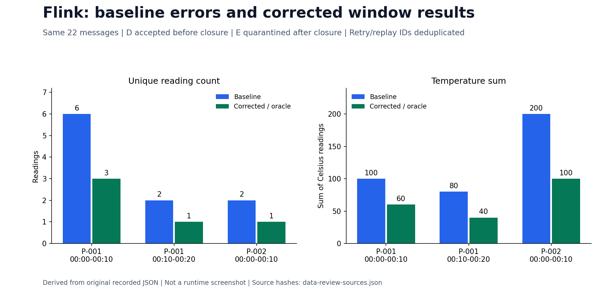

This plot is reconstructed from [the original native report](../evidence/day3/stream-report.json), not a Flink UI capture. Its original runtime IDs are baseline `55f14b1c63a03492e0bb84e6045fd8a2` and corrected `206335d5a738cc7b7525da05a371d3bb`. Their [REST snapshots](../evidence/day3/baseline-rest-overview.json) and [corrected snapshots](../evidence/day3/corrected-rest-overview.json) remain unchanged.

#### Streaming: Fresh paired native UI verification

The same 22-message fixture ran again on the CPU VM on 1 November. Final windows, 13 duplicate deliveries, quarantine of E and the retention probe passed [independent readback checks](../evidence/data-platform-review/stream/verification.json). These images belong to that new pair:

| Variant | Native job ID | Configuration |
|---|---|---|
| Baseline | `e0e358f997c43629c4124d0d9e4af4bc` | Delay 0; dedup disabled |
| Corrected | `70e00b2bf3b1a737ae3491e1f26f3021` | Delay 15 minutes; event-ID cache plus retained ledger |


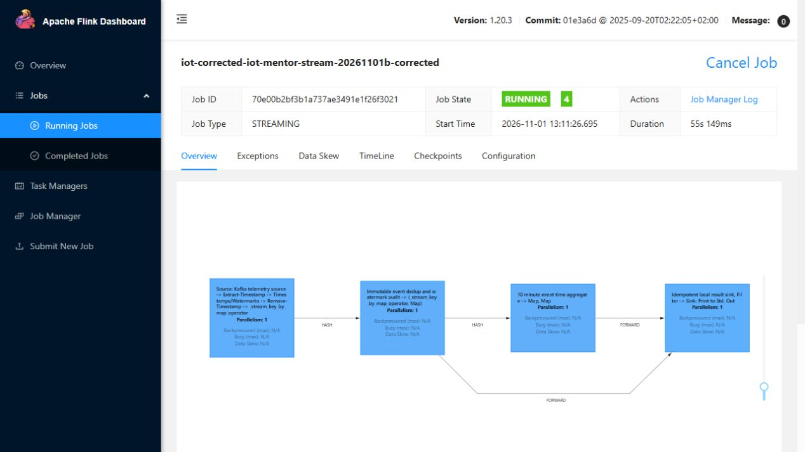

Both captures show RUNNING jobs paused after the second real watermark barrier, before the final phase. They establish job identity and topology; displayed partial counts and N/A metrics are not final outputs or throughput measurements. The baseline retains the operator's generic dedup name even though dedup is disabled. The final JSON/SQLite readback supplies the before/after values above.

The [original archive](../evidence/data-platform-review/stream/native.tar.gz) retains failures: A could not create checkpoint storage in root-owned new directories; B completed both jobs but its subsequent provenance lookup called Git in a deployment workspace with no Git checkout. A fresh recovery verified B's retained outputs without replaying those jobs, then ran only the missing retention probe.

The maintained Linux entry point is [run-stream-review.py](../../scripts/run-stream-review.py). It assigns only the two fresh run directories to the image's actual non-root UID/GID, then composes the unchanged runner and oracle. It uses an explicit source-file manifest and the actual CPU-session descriptor; the VM does not need a Git checkout. The CI-pinned core runner remains byte-identical to its recorded fixture. Existing files are not recursively changed.

A subsequent complete run, `mentor-stream-20261101d`, passed the pair and retention probe through this entry point at 19:53 UTC on 1 November. Its [original report](../evidence/data-platform-review/stream-entrypoint/verification.json), [eleven-file source manifest](../evidence/data-platform-review/stream-entrypoint/source-manifest.json) and [native archive](../evidence/data-platform-review/stream-entrypoint/native.tar.gz) bind the actual implementation and SQLite snapshots. This is a new execution with its own job IDs; the images above remain captures of pair B. The dedicated review broker was stopped afterward. The offline review verifier checks both sets of retained results.

```bash
sudo --preserve-env=COMPOSE_PROJECT_NAME python3 scripts/run-stream-review.py \
  --run-id stream-review-new \
  --source-manifest docs/evidence/data-platform-review/stream-entrypoint/source-manifest.json \
  --descriptor /private/path/to/current-instance.json --ui-pause-seconds 60
```

Start Kafka in a separate Compose project first and use that same `COMPOSE_PROJECT_NAME` for the entry point. The generated-source UI captures further below remain a separate workload.

On the generated-source replay, 58,464 deliveries per pass × two passes = 116,928 messages. The job accepts 57,600 unique readings and rejects 59,328 duplicate deliveries; all 5,760 finalized windows match the independent source oracle. This demonstrates replay idempotency for that bounded workload, rather than general crash-safe exactly-once delivery.

### Streaming: Final-output inspection

[Notebook 05](../../notebooks/05_data_review.ipynb) reads the complete run D snapshots directly from the retained native archive, opens SQLite read-only and checks its final rows against the native report. On 1 November its kernel was restarted and all seven code cells ran in Jupyter. The [executed notebook](../evidence/data-review-audit/executed.ipynb) and [capture receipt](../evidence/data-review-audit/capture.json) preserve that inspection. This did not rerun Flink or relabel the pair B topology images above.

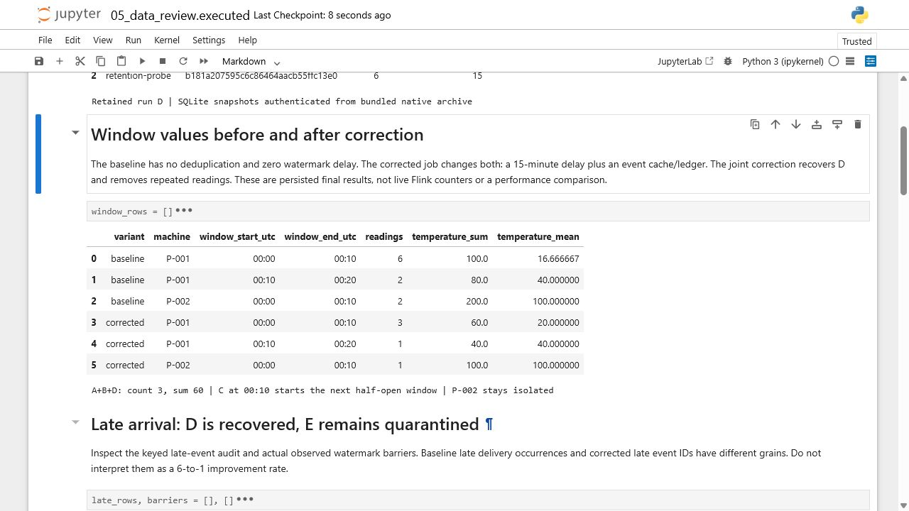

All six displayed rows are finalized sink values. The first window changes from count 6 / sum 100 to count 3 / sum 60. C remains in the next half-open window, and P-002 remains a separate key.

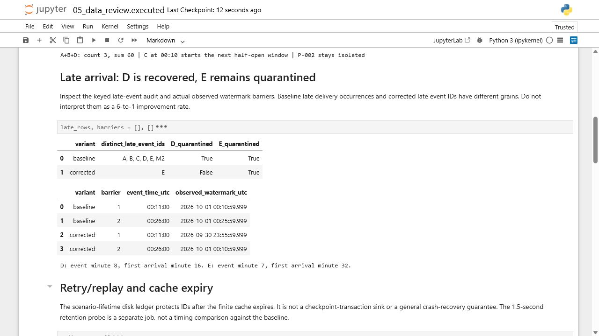

D is quarantined by the baseline and accepted by the corrected job; E is quarantined by both. The first corrected watermark is **30 September 23:55:59.999 UTC**, before the fixture's start on 1 October. Full dates avoid mistaking that barrier for a later time on the same day. The baseline report counts late delivery occurrences; the displayed keyed audit lists distinct late event IDs.

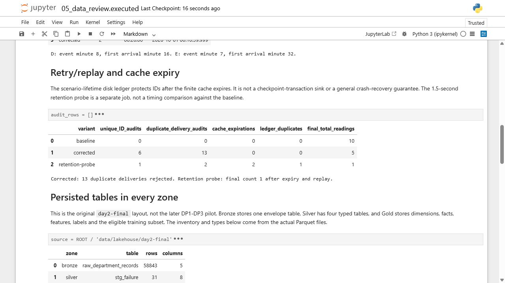

The corrected job records six unique-ID audits, thirteen duplicate deliveries and five accepted readings across the three windows; E is the sixth unique ID and is excluded. Baseline zero unique-ID audits means that tracking is disabled, not that no unique readings arrived. The separate retention probe has two cache expirations, one disk-ledger duplicate and final count 1. These results establish the bounded correctness fix; no isolated Flink latency or throughput improvement is claimed.

### Streaming: Commands and recorded examples

Run commands from the repository root unless the example explicitly changes the working directory. Use a fresh output/run name and check the linked runbook before starting platform services. Examples belong to the recorded workload on this page.

```powershell
./scripts/run-day3.ps1 -RunName practice3
Get-Content outputs/practice3/stream-report.json
```

### Streaming: Implementation and evidence

- [Source: pipelines/stream_verification.py](../../pipelines/stream_verification.py)
- [Source: pipelines/stream_job.py](../../pipelines/stream_job.py)
- [Recorded artifact: day3/native-ttl-failure.txt](../evidence/day3/native-ttl-failure.txt)
- [Source: pipelines/stream_contract.py](../../pipelines/stream_contract.py)
- [Recorded artifact: day3/finalization-diagnostic.json](../evidence/day3/finalization-diagnostic.json)
- [Recorded artifact: day3/stream-report.json](../evidence/day3/stream-report.json)
- [Recorded artifact: day3/commands.json](../evidence/day3/commands.json)
- [Recorded artifact: day3/unit-tests.txt](../evidence/day3/unit-tests.txt)
- [Recorded artifact: day3/run-context.json](../evidence/day3/run-context.json)
- [Recorded artifact: day3/final-verification.json](../evidence/day3/final-verification.json)
- [Recorded artifact: day3/generated-jvm.txt](../evidence/day3/generated-jvm.txt)
- [Source: infra/flink/Dockerfile](../../infra/flink/Dockerfile)
- [Source: infra/streaming.compose.yaml](../../infra/streaming.compose.yaml)
- [Recorded artifact: day3/flink-python-packages.txt](../evidence/day3/flink-python-packages.txt)
- [Recorded artifact: day3/java-version.txt](../evidence/day3/java-version.txt)
- [nightlies.apache.org / installation](https://nightlies.apache.org/flink/flink-docs-release-1.20/docs/dev/python/installation/)
- [nightlies.apache.org / kafka](https://nightlies.apache.org/flink/flink-docs-release-1.20/docs/connectors/datastream/kafka/)
- [nightlies.apache.org / windows](https://nightlies.apache.org/flink/flink-docs-release-1.20/docs/dev/datastream/operators/windows/)
- [kafka.apache.org / docker](https://kafka.apache.org/39/getting-started/docker/)
- [nightlies.apache.org / state_backends](https://nightlies.apache.org/flink/flink-docs-release-1.20/docs/ops/state/state_backends/)

### Streaming: Recorded interface views

These are original captures from the runs described above. Their timestamps, model identities and visible states belong to those runs.

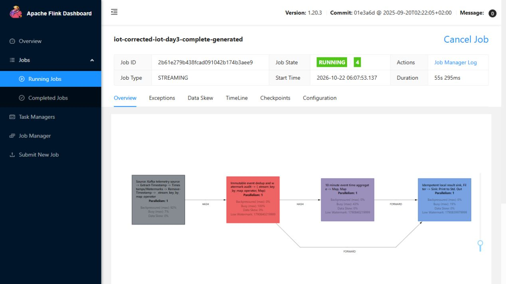

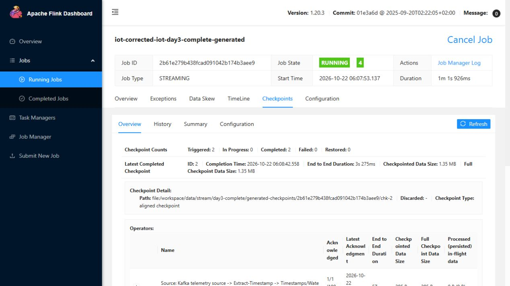


### Streaming: Related documentation

[Current architecture](architecture.md) · [Demo and recovery](operations.md) · [Rubric index](rubric_overview.md)

[Source history and recorded evidence](history_rewrite.md) explain the filtered commit identities. Original native receipts retain their captured bytes and outcomes.

## Orchestration

The native pilot runs DP1 Bronze→DP2 Silver/Gold→DP3 features/labels through Airflow 3.1.7. Each stage ingests, validates and publishes metadata before triggering the next. Spark 3.5.9 jobs run through a one-slot pool with explicit resource limits.

Two clean batches passed 64 rules across 14 outputtables. A separate batch with a null machine key was rejected, blocking downstream DP2/DP3 publication; recovery preserved the failure history. The gate included 91 unit tests and 11 known-answer Spark fixtures.

DataHub receives schemas, producing jobs, table lineage and external assertions through its SDK. GMS/UI readbacks establish that metadata was actually indexed. Images and source/config identities are recorded, and database/broker/search ports remain private.

This pilot uses Parquet Gold and a bounded source. It does not establish a 100 GB full-feature Airflow run or a SQL warehouse deployment. The full-scale Bronze/Silver runner, later feature stores and DataHub restoration are separate workloads.

### Orchestration: Airflow integration: each pipeline in the UI

[iot_data_pipelines.py](../../airflow/dags/iot_data_pipelines.py) defines three DAGs. The [task adapter](../../pipelines/airflow_tasks.py) invokes the Spark stage, checks the persisted outputs and publishes metadata; the downstream stage is triggered only after the preceding gate succeeds.

| DAG | Input → persisted output | Native successful run capture |
|---|---|---|
| DP1 | Immutable source JSONL → four Bronze tables | [Original DP1 screenshot](../evidence/orchestration/screenshots/airflow-dp1-success.jpg) |
| DP2 | Bronze → three Silver tables and five Gold tables | [Original DP2 screenshot](../evidence/orchestration/screenshots/airflow-dp2-success.jpg) |
| DP3 | Silver/Gold history → separate feature and label tables | [Original DP3 screenshot](../evidence/orchestration/screenshots/airflow-dp3-success.jpg) |

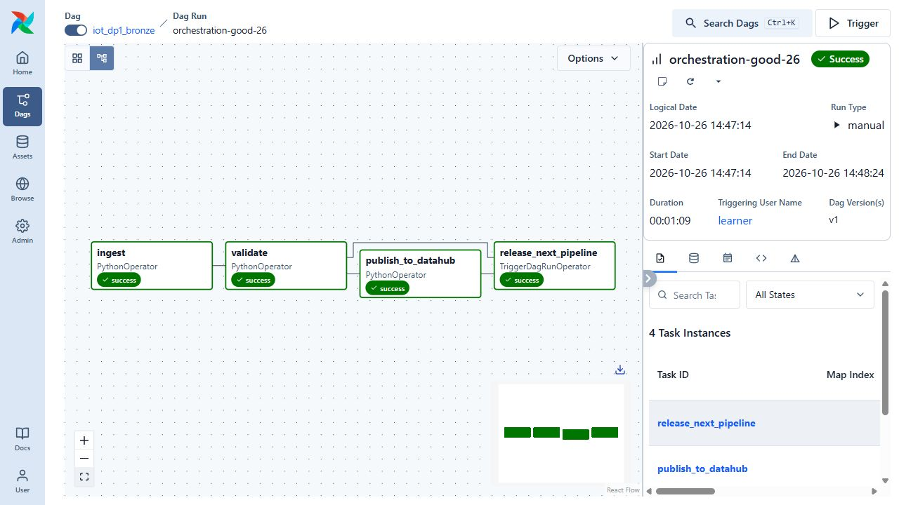

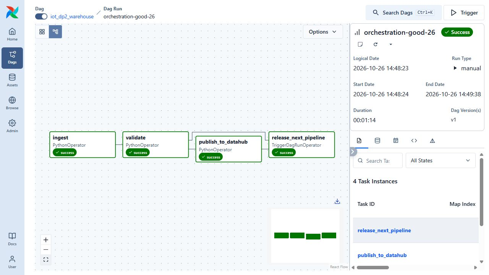

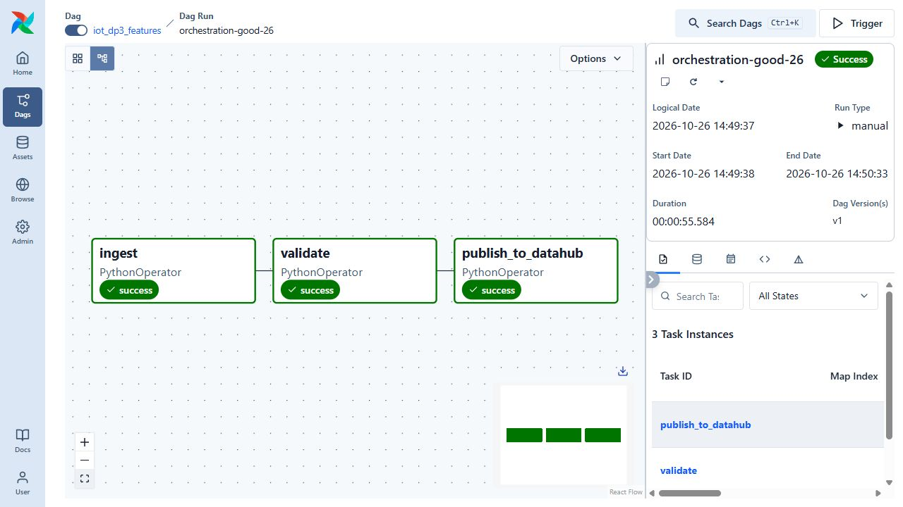

For `orchestration-recovery-26`, [the original readback](../evidence/orchestration/verification.json) records DP1 **17 checks / 4 outputs**, DP2 **32 checks / 8 outputs**, and DP3 **15 checks / 2 outputs**. The pilot uses 58,752 Bronze telemetry rows and 57,600 unique Silver/fact rows. These counts belong to this pilot, not the 60-day ML cohort or the 100 GB ingest.

### Orchestration: DataHub lineage and validation: evidence by stage

| Stage | Indexed metadata evidence | Native screenshot coverage |
|---|---|---|
| DP1 lineage | [DP1 publication](../evidence/orchestration/orchestration-recovery-26/dp1/datahub-publication.json); [GMS/GraphQL readback](../evidence/orchestration/orchestration-recovery-26-datahub.json) | [Original DP1 task: four raw inputs → four Bronze outputs](../evidence/data-platform-review/screenshots/datahub-dp1-lineage-all-tables.jpg) |
| DP1 validation | [17 persisted-data rules](../evidence/orchestration/orchestration-recovery-26/dp1/validation.json); injected null-machine failure and blocked downstream DAGs | [Original pass→fail→pass history](../evidence/orchestration/screenshots/datahub-validation-pass-fail-pass.jpg) |
| DP2 lineage | [DP2 publication](../evidence/orchestration/orchestration-recovery-26/dp2/datahub-publication.json); same indexed readback | [Original DP2 task: four Bronze inputs → eight Silver/Gold outputs](../evidence/data-platform-review/screenshots/datahub-dp2-lineage.jpg) |
| DP2 validation | [32 persisted-data rules](../evidence/orchestration/orchestration-recovery-26/dp2/validation.json), definitions and indexed results | [Silver telemetry Quality](../evidence/data-platform-review/screenshots/datahub-dp2-quality.jpg): seven assertions on this dataset; [unique-event history](../evidence/data-platform-review/screenshots/datahub-dp2-quality-history.jpg) |
| DP3 lineage/validation | [DP3 publication](../evidence/orchestration/orchestration-recovery-26/dp3/datahub-publication.json), fifteen rules | Original feature lineage/Quality screenshots below |

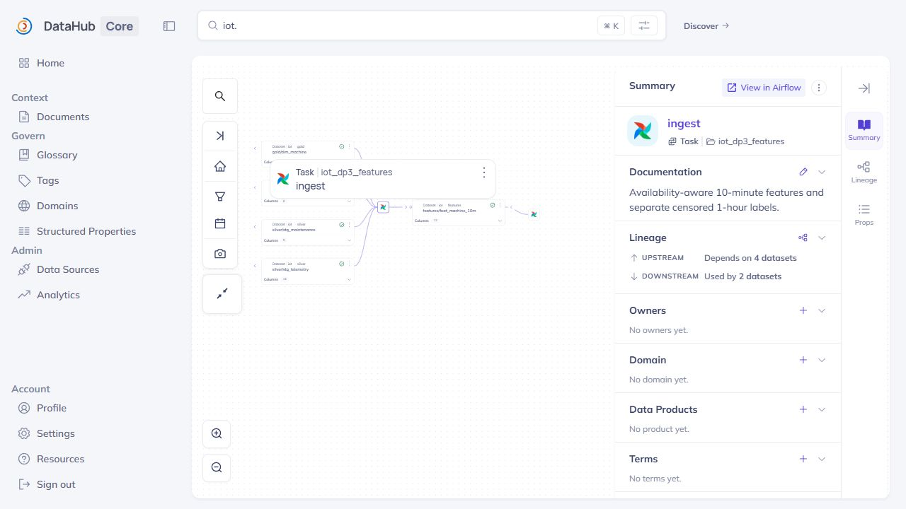

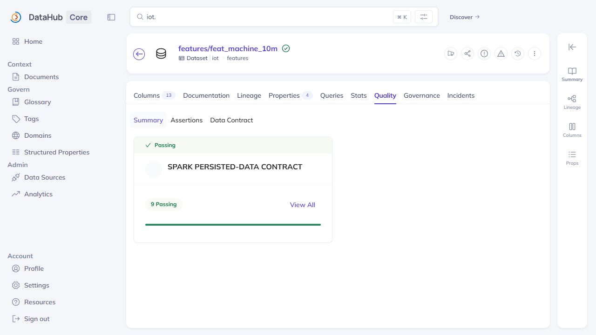

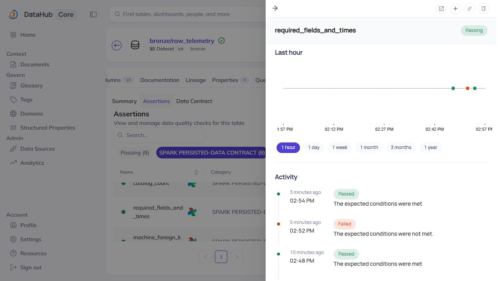

#### Orchestration: DP1 and DP2 native captures

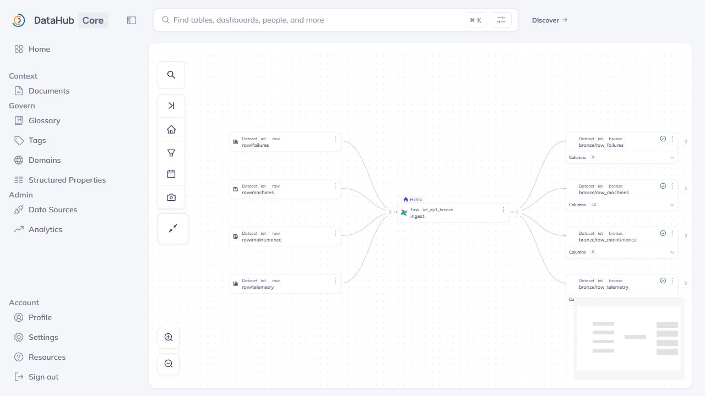

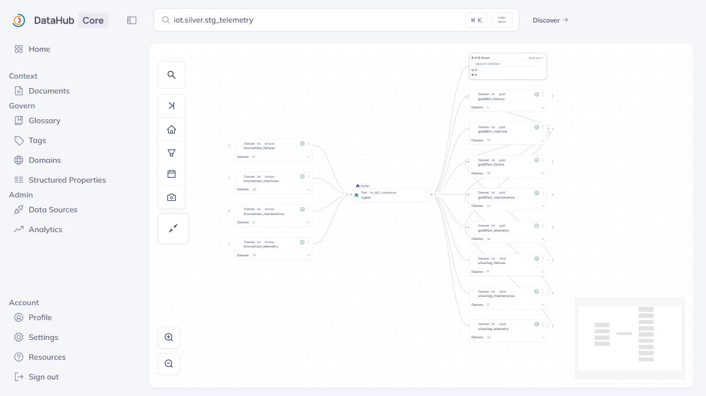

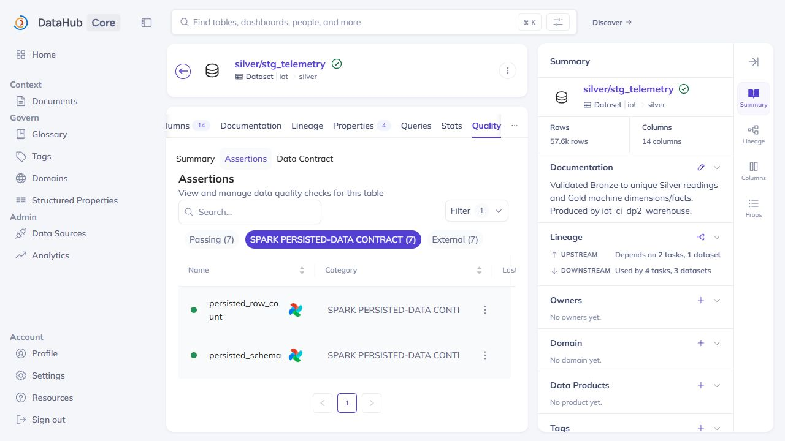

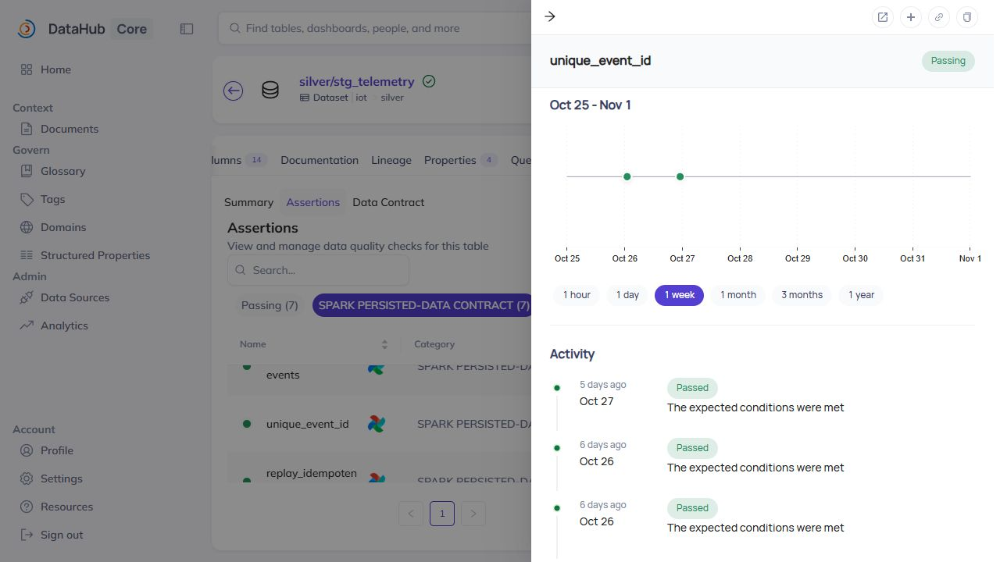

These captures were taken on 1 November from retained indexed metadata. The selected lineage tasks are `iot_dp1_bronze/ingest` and `iot_dp2_warehouse/ingest`, whose external run links identify `orchestration-recovery-26`. The catalog also contains CI DAGs. Dataset properties and the latest Quality links identify the later `iot_ci_dp2_warehouse` run `jenkins-2-1`, evaluated on 27 October. That is seven assertions on **one dataset**, not all 32 stage rules. The [capture receipt and native DOM records](../evidence/data-platform-review/datahub/capture.json) preserve these distinctions. No metadata was republished and no new validation run was claimed for taking the images.

The original standalone skew benchmark and full-scale runner remain distinct from these three pilot DAGs. The later benchmark DAG below gives the skew query its own actual Airflow execution. [The data review](#review-summary) separates correctness transformations, measured alternatives and their workload sizes.

### Orchestration: Measured benchmark DAG

[iot_data_benchmarks.py](../../airflow/dags/iot_data_benchmarks.py) adds a separate serial experimental workflow, using the same one-slot Spark pool:

| Task | Actual work in the final run | State |
|---|---|---|
| `preflight` | Verify code/input hashes, session deadline and host RAM/disk reserves | Success |
| `schema_dedup_pairs` | Execute three equivalent pairs per experiment in a bounded Spark container | Success |
| `validate_corrections` | Check report/marker binding and completed event-log task metrics | Success |
| `skew_pairs` | Execute three sort-merge/broadcast pairs on the retained 17.28M Silver rows | Success |
| `validate_skew` | Verify full aggregate equality, unchanged inputs and actual task metrics | Success |


The final run is `bench-paired-20261101a`, with actual scheduler times 20:40:27–20:43:58 UTC on 1 November. Its [API snapshot](../evidence/batch-benchmarks/final/airflow.json), task logs and distinct real container IDs are retained. A one-pair pilot passed first; two failed predecessors remain visible and were not cleared. [The comparison report](#batch-corrections) explains the measured boundaries and why the slower aggregate dedup candidate was not promoted into production DP2.

The benchmark workflow is manually triggered after admission. It measures experimental alternatives separately from normal DP1–DP3 publication and the full-scale ingest. The native capture establishes Airflow execution; output equality and completed event logs establish the measured results.

### Orchestration: Commands and recorded examples

Run commands from the repository root unless the example explicitly changes the working directory. Use a fresh output/run name and check the linked runbook before starting platform services. Examples belong to the recorded workload on this page.

```bash
docker build -t iot-coursework-spark:3.5.9 -f infra/spark/Dockerfile .
sudo python3 scripts/start-orchestration.py
sudo python3 scripts/verify-orchestration.py prepare
sudo python3 scripts/verify-orchestration.py health
sudo python3 scripts/verify-orchestration.py trigger --batch my-good-run
sudo python3 scripts/verify-orchestration.py snapshot --batch my-good-run
sudo python3 scripts/verify-orchestration.py metadata --batch my-good-run
```

```bash
sudo python3 scripts/verify-orchestration.py trigger --batch fixture-null-machine --fault null_machine
sudo python3 scripts/verify-orchestration.py snapshot --batch fixture-null-machine
```

```powershell
gcloud compute ssh iot-cw-vm --project=$projectId --zone=us-central1-a --tunnel-through-iap --quiet `
  --ssh-flag=-N --ssh-flag=-L --ssh-flag=127.0.0.1:18480:127.0.0.1:18480 `
  --ssh-flag=-L --ssh-flag=127.0.0.1:19002:127.0.0.1:19002
```

### Orchestration: Implementation and evidence

- [Recorded artifact: orchestration/verification.json](../evidence/orchestration/verification.json)
- [Recorded artifact: orchestration/runtime.json](../evidence/orchestration/runtime.json)
- [Recorded artifact: orchestration/screenshots/airflow-three-dags-recovered.jpg](../evidence/orchestration/screenshots/airflow-three-dags-recovered.jpg)
- [Recorded artifact: orchestration/orchestration-recovery-26-airflow.json](../evidence/orchestration/orchestration-recovery-26-airflow.json)
- [Recorded artifact: orchestration/orchestration-recovery-26-datahub.json](../evidence/orchestration/orchestration-recovery-26-datahub.json)
- [Recorded artifact: orchestration/fixture-null-machine-26-airflow.json](../evidence/orchestration/fixture-null-machine-26-airflow.json)
- [Recorded artifact: orchestration/screenshots/airflow-dp1-success.jpg](../evidence/orchestration/screenshots/airflow-dp1-success.jpg)
- [Recorded artifact: orchestration/screenshots/airflow-dp2-success.jpg](../evidence/orchestration/screenshots/airflow-dp2-success.jpg)
- [Recorded artifact: orchestration/screenshots/airflow-dp3-success.jpg](../evidence/orchestration/screenshots/airflow-dp3-success.jpg)
- [Recorded artifact: orchestration/screenshots/airflow-validation-blocked.jpg](../evidence/orchestration/screenshots/airflow-validation-blocked.jpg)
- [Recorded artifact: orchestration/screenshots/datahub-feature-schema.jpg](../evidence/orchestration/screenshots/datahub-feature-schema.jpg)
- [Recorded artifact: orchestration/screenshots/datahub-feature-lineage.jpg](../evidence/orchestration/screenshots/datahub-feature-lineage.jpg)
- [Recorded artifact: orchestration/screenshots/datahub-feature-quality.jpg](../evidence/orchestration/screenshots/datahub-feature-quality.jpg)
- [Recorded artifact: orchestration/screenshots/datahub-validation-pass-fail-pass.jpg](../evidence/orchestration/screenshots/datahub-validation-pass-fail-pass.jpg)
- [Recorded artifact: orchestration/screenshots/datahub-catalog.jpg](../evidence/orchestration/screenshots/datahub-catalog.jpg)
- [Recorded artifact: orchestration/git-source-mapping.json](../evidence/orchestration/git-source-mapping.json)
- [airflow.apache.org / upgrading_to_airflow3.html](https://airflow.apache.org/docs/apache-airflow/3.1.7/installation/upgrading_to_airflow3.html)
- [github.com / docker-compose.quickstart-profile.yml](https://github.com/datahub-project/datahub/blob/v1.6.0.3/docker/quickstart/docker-compose.quickstart-profile.yml)
- [github.com / v1.6.0.3](https://github.com/datahub-project/datahub/releases/tag/v1.6.0.3)
- [Source: infra/datahub/UPSTREAM_LICENSE](../../infra/datahub/UPSTREAM_LICENSE)
- [github.com / assertions.md](https://github.com/datahub-project/datahub/blob/v1.6.0/docs/api/tutorials/assertions.md)

### Orchestration: Related documentation

[Current architecture](architecture.md) · [Demo and recovery](operations.md) · [Rubric index](rubric_overview.md)

[Original run notes](https://github.com/anle0429/iot-maintenance-platform/blob/a395c4ea47b8f8e235556ab93de3d699ed9df18b/docs/orchestration.md) retain the full historical narrative. Raw evidence files have not been translated or rewritten.

## CI data pipelines

The data-pipeline Jenkins job runs tests, builds its controller image and deploys three Airflow DAGs for Bronze ingestion, Silver/Gold preparation and feature/label output. Successful publication requires validation and DataHub readback rather than only a process exit.

The recorded build 2 succeeded. The three native DAG runs and their task order are retained with source/image identities, API responses, validation artifacts and UI captures. A deliberately invalid batch was blocked instead of being published as a successful downstream dataset.

This is the CI pilot workload. The 102.45 GB Spark run was submitted and verified separately; a successful pilot DAG does not mean that Airflow has executed the entire full-scale workload. Credentials remain in runtime/Jenkins, outside source and evidence.

### CI data pipelines: Implementation and evidence

- [Source: infra/ci/Jenkinsfile](../../infra/ci/Jenkinsfile)
- [Source: infra/ci/iot_ci_data_pipelines.py](../../infra/ci/iot_ci_data_pipelines.py)
- [Source: scripts/ci-data-pipelines.py](../../scripts/ci-data-pipelines.py)
- [Source: infra/ci/Jenkins.Dockerfile](../../infra/ci/Jenkins.Dockerfile)
- [Source: infra/ci/jenkins-bootstrap.groovy](../../infra/ci/jenkins-bootstrap.groovy)
- [www.jenkins.io / docker](https://www.jenkins.io/doc/book/installing/docker/)
- [www.jenkins.io / pipeline](https://www.jenkins.io/doc/book/pipeline/)
- [plugins.jenkins.io / credentials-binding](https://plugins.jenkins.io/credentials-binding/)
- [Recorded artifact: ci-data-pipelines/native/verification.json](../evidence/ci-data-pipelines/native/verification.json)
- [Recorded artifact: ci-data-pipelines/capture/stage-view.json](../evidence/ci-data-pipelines/capture/stage-view.json)
- [Recorded artifact: ci-data-pipelines/screenshots/jenkins-build2-source-commit.jpg](../evidence/ci-data-pipelines/screenshots/jenkins-build2-source-commit.jpg)
- [Recorded artifact: ci-data-pipelines/reports/dp1-verification.json](../evidence/ci-data-pipelines/reports/dp1-verification.json)
- [Recorded artifact: ci-data-pipelines/reports/dp2-verification.json](../evidence/ci-data-pipelines/reports/dp2-verification.json)
- [Recorded artifact: ci-data-pipelines/reports/dp3-verification.json](../evidence/ci-data-pipelines/reports/dp3-verification.json)
- [Recorded artifact: ci-data-pipelines/reports/build.json](../evidence/ci-data-pipelines/reports/build.json)
- [Recorded artifact: ci-data-pipelines/reports/source-receipt.json](../evidence/ci-data-pipelines/reports/source-receipt.json)
- [Recorded artifact: ci-data-pipelines/native/console.txt](../evidence/ci-data-pipelines/native/console.txt)
- [Recorded artifact: ci-data-pipelines/indexed/datahub.json](../evidence/ci-data-pipelines/indexed/datahub.json)
- [Source: pipelines/ci_metadata.py](../../pipelines/ci_metadata.py)
- [Recorded artifact: ci-data-pipelines/screenshots/dp1-native-verification.jpg](../evidence/ci-data-pipelines/screenshots/dp1-native-verification.jpg)
- [Recorded artifact: ci-data-pipelines/screenshots/dp2-native-verification.jpg](../evidence/ci-data-pipelines/screenshots/dp2-native-verification.jpg)
- [Recorded artifact: ci-data-pipelines/screenshots/dp3-native-verification.jpg](../evidence/ci-data-pipelines/screenshots/dp3-native-verification.jpg)
- [Recorded artifact: ci-data-pipelines/screenshots/capture.json](../evidence/ci-data-pipelines/screenshots/capture.json)
- [Recorded artifact: ci-data-pipelines/capture/evidence-map.json](../evidence/ci-data-pipelines/capture/evidence-map.json)
- [Recorded artifact: ci-data-pipelines/capture/manifest.json](../evidence/ci-data-pipelines/capture/manifest.json)
- [Recorded artifact: ci-data-pipelines/capture/source-commit.json](../evidence/ci-data-pipelines/capture/source-commit.json)
- [Recorded artifact: ci-data-pipelines/failed-build/console.txt](../evidence/ci-data-pipelines/failed-build/console.txt)
- [Recorded artifact: ci-data-pipelines/python-temp-repair/verification.json](../evidence/ci-data-pipelines/python-temp-repair/verification.json)
- [Recorded artifact: ci-data-pipelines/capture/controller-runtime.json](../evidence/ci-data-pipelines/capture/controller-runtime.json)

### CI data pipelines: Recorded interface views

These are original captures from the runs described above. Their timestamps, model identities and visible states belong to those runs.

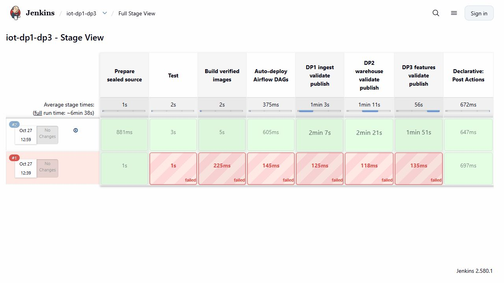


### CI data pipelines: Related documentation

[Current architecture](architecture.md) · [Demo and recovery](operations.md) · [Rubric index](rubric_overview.md)

[Original run notes](https://github.com/anle0429/iot-maintenance-platform/blob/a395c4ea47b8f8e235556ab93de3d699ed9df18b/docs/ci-data-pipelines.md) retain the full historical narrative. Raw evidence files have not been translated or rewritten.
