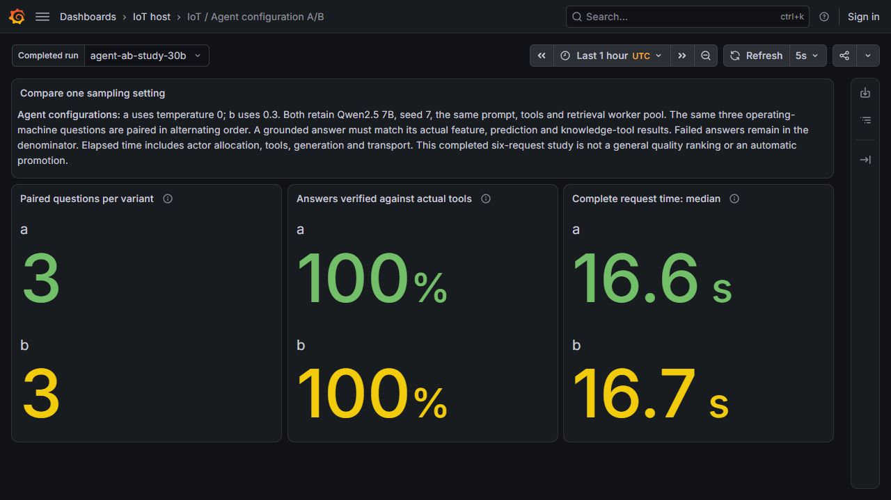
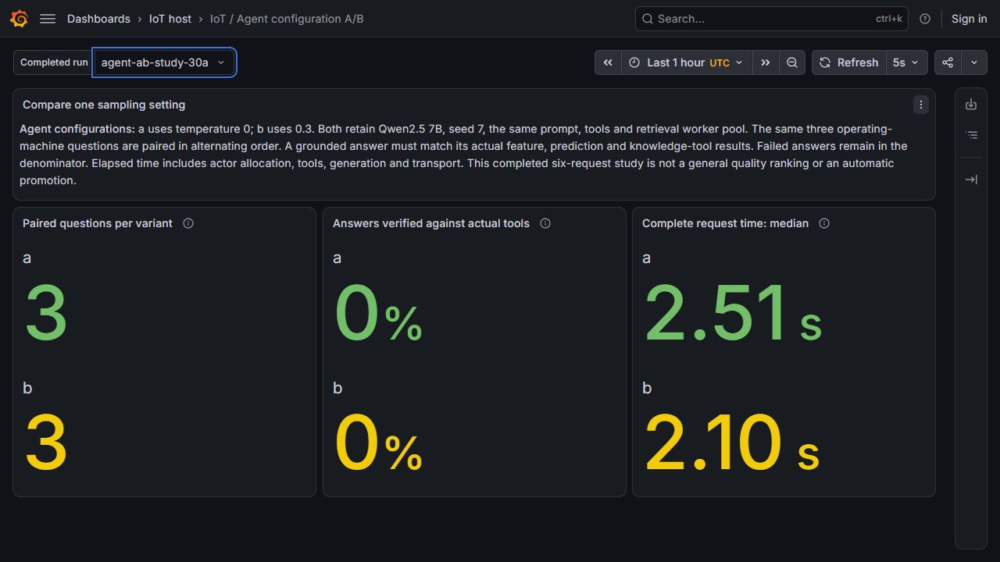

# Comparing agent configurations

Both retained retrieval variants were migrated to the selected private Agentgateway on **8 November 2026**. A fresh six-request replay verified their operator ingress, model calls and MCP tool calls through that gateway. Each variant answered the same three machine questions correctly against its actual tool results. Their median complete-request times in this replay were **8.464 s** and **7.291 s**.

This is a compatibility replay of the agent configuration experiment for L56. The original **30 October** experiment remains below, with its own results and screenshots. The two runs are separate observations, not a controlled gateway speed comparison. The [1.5B/7B model-artifact comparison](llm_model_ab.md) addresses L57 separately.

## The two variants

| Variant | SandboxAgent | ModelConfig | Temperature |
|---|---|---|---:|
| a | `iot-ab-retrieval-a` | `iot-ab-model-a` | 0 |
| b | `iot-ab-retrieval-b` | `iot-ab-model-b` | 0.3 |

Both use the same 7B model, seed 7, 768-token generation budget, response policy 0.2.2 and retrieval worker pool. Temperature remains the experiment's only sampling difference. The gateway migration changes endpoint references and the sandbox domain allowlist; it preserves both prompts, all three permitted tool names and the four original resource UIDs. The three production agents, shared ModelConfig, selected MCP resource and WorkerPool specs remain unchanged.

## Gateway compatibility replay

The original pair used the direct EPP model URL and `iot-retrieval-tools`. Those references were unsuitable for the controller's selected global proxy: its MCP rewrite would send the old `/mcp` path to listener `18083`, where the selected retrieval alias is `/mcp/retrieval`. The [migration planner](../../agents/ab_gateway.py) therefore handles both model and tool routing.

| Retained resources | Original direct profile | Selected gateway profile |
|---|---|---|
| `iot-ab-model-a`, `iot-ab-model-b` | `http://iot-router-epp.iot-llm.svc.cluster.local:8081/v1` | `http://iot-agentgateway-candidate.iot-agents.svc.cluster.local:18080/v1` |
| Both SandboxAgents: MCP reference | `iot-retrieval-tools` | `iot-gateway-retrieval-tools` → `:18083/mcp/retrieval` |
| Both SandboxAgents: tool domain | `iot-retrieval-mcp.iot-agents.svc.cluster.local` | `iot-agentgateway-candidate.iot-agents.svc.cluster.local` |
| Authenticated operator ingress | Direct controller endpoint in the original study | Two explicit A/B routes on gateway `:18083` |

The resulting paths are:

```text
Operator → Agentgateway :18083
  /api/a2a-sandboxes/iot-agents/iot-ab-retrieval-a/
  /api/a2a-sandboxes/iot-agents/iot-ab-retrieval-b/
  → kagent controller → the selected retrieval actor → result to operator

A/B actor → its own ModelConfig → Agentgateway :18080/v1
  → llm-d / EPP → observation and model-control path → private GPU model

A/B actor → iot-gateway-retrieval-tools → Agentgateway :18083/mcp/retrieval
  → Retrieval MCP → get_machine_features / predict_failure / search_knowledge
  → actual tool results returned to that actor
```

The gateway additions retain the existing four listeners and production/delegation routes. They add only the two named A/B operator paths, including their card and trailing-slash forms, under the existing operator credential. They do not grant the Coordinator access to the experimental agents. These are controlled experiment resources, outside the three-agent production CI admission cohort; the production OPA/Jenkins proof is not presented as admission of this A/B pair.

The [gateway renderer](../../infra/agentgateway/candidate.py) enables these routes explicitly with `ab_operator_routes=True`; its default remains `False`. A future gateway render for this retained A/B profile must keep that option, otherwise it will remove the A/B ingress paths while leaving the agent resources in place. The selected configuration persists on the retained cluster disks. Endpoint availability still requires the VMs and their services to be running; this is not an always-on deployment.

### Native migration checks

The [operator](../../scripts/migrate-agent-ab-gateway.py) authenticates a sealed source packet, checks the authorized session reserve, and requires the complete retained five-agent/three-model cohort. Each mutation tests the resource UID, resourceVersion and entire prior spec before replacing the reviewed spec. A retry must build another plan from fresh readbacks. It does not recreate the four resources or change their temperature settings.

Acceptance requires current-generation ModelConfig acceptance and SandboxAgent readiness, plus the owned gVisor ActorTemplate for that exact desired generation with an actual Ready golden snapshot. An older Ready snapshot cannot satisfy this check. Only the verified model URL, temperature, seed, token limit, MCP URL and tool names are projected from the generated Secrets; credentials and full Secret bodies remain excluded.

The accepted migration used source `1e883f4c68ea27f973f9191f4e187e0438a9437c`. The replay recorder used `f70eacbe553682b0f5412fa48ceae94f8d158860`. These are the recorded commands on the retained CPU VM:

```bash
R=/srv/iot-data/workspace/iot-maintenance-platform
M="$R/data/llm-source/ab-gateway-1e883f4"
S="$R/data/llm-source/ab-gateway-study-f70eacb"

sudo python3 -B "$M/tree/scripts/migrate-agent-ab-gateway.py" \
  --runtime-root "$R" \
  --source-manifest "$M/manifest.json" \
  --output "$R/outputs/ab-gateway-20261108/migration-b"

sudo python3 -B "$S/tree/scripts/run-agent-ab-gateway.py" \
  --runtime-root "$R" \
  --source-manifest "$S/manifest.json" \
  --migration "$R/outputs/ab-gateway-20261108/migration-b" \
  --feature-lease "$R/outputs/ab-gateway-20261108/features" \
  --output "$R/outputs/ab-gateway-20261108/study-b"
```

These output paths identify immutable recorded runs. A new authorized replay needs fresh output directories, recovered services and a newly prepared feature lease; it must not overwrite these receipts or extend old timestamps. The recorded 200-machine lease ran from **09:23:11.632 to 10:23:11.632 UTC**. The second cohort completed at **09:32:46.755 UTC**, within that lease.

### Recorded gateway result

| Quantity | a: temperature 0 | b: temperature 0.3 |
|---|---:|---:|
| Distinct machine questions | 3 | 3 |
| Answers verified against tools | 3/3 | 3/3 |
| Successful MCP tool calls | 9 | 9 |
| MCP tool errors | 0 | 0 |
| Actor-attributed model requests through gateway | 12 | 12 |
| Median complete-request time | 8.464 s | 7.291 s |

The workload uses P-001, P-002 and P-003 in alternating a/b, b/a, a/b order. Each answer is joined to its native task history, Running Substrate actor, actual retrieval worker Pod UID/IP and complete appended gateway logs. All **18** tool executions and **24** model requests were verified. The six predictions were independently recomputed from the pinned model 6 artifact, with a maximum score difference of **0.0**. The [verification report](../evidence/agent-ab-gateway-20261108/verification.json) and [original native archive](../evidence/agent-ab-gateway-20261108/native-receipts.tar.gz) retain the detailed identities, clocks and source packets.

The recorder measures request latency separately from the gateway capture interval. MCP GET streams can close after the HTTP answer has returned, so their actual close records need their own measured wire bounds. The first 8 November cohort produced six content-accepted answers, but its recorder lacked that separate interval; it remains in the archive and is not substituted for the second cohort's wire proof.

The second cohort's `2-a` window also contains **16 controller discovery/protocol records**. They remain in the original logs and are identified through the actual controller Pod. They are not counted as agent tool executions or model requests. The independent checker retains these records instead of filtering them from the capture.

Three paired questions do not establish a general quality ranking, a causal effect of temperature or a gateway speedup over 30 October. The feature preparation, worker/cache state and observation time differ between runs. Neither variant is promoted automatically, and these results do not establish whole-platform readiness.

## Original direct-profile experiment — 30 October

The [original configuration planner](../../agents/ab_configuration.py) created four separate resources. Both ModelConfigs were accepted, both SandboxAgents had current-generation Ready conditions, and their gVisor ActorTemplates had actual golden snapshots. A narrow projection of each generated runtime Secret confirmed `/model/temperature` was 0 or 0.3. The original prompts, tool declarations, sandbox network rules and retrieval pool were identical between variants, and the three production agents and shared ModelConfig were unchanged. No new VM or worker pool was added for that experiment.

### Workload and answer checks

The measured cohort used P-001, P-002 and P-003, selected from actual operating-machine responses in the refreshed feature API. The order alternated a/b, b/a, a/b. Every question asks for features, failure prediction and a vibration reference. Each request has a distinct context, message and task identity.

An answer passes only when its machine ID, event timestamp, model version, score and document IDs match its own native MCP history. The cited passage must also match the authored source bytes. All six prediction scores were independently recomputed from the pinned model 6 coefficients; the maximum difference was **0.0**. These are simulated, uncalibrated model scores, as declared in every accepted answer.

The feature preparation was performed at 01:01:53 UTC on 30 October 2026, with a real one-hour cache lease. The accepted comparison finished at 01:42:04 UTC, within that lease. Its receipts include the original zero-key observation, actual SDK materialization, 200 populated keys and the resumed deployment of the same prepared state. No timestamp or TTL was extended to make the test pass.

### Recorded result

| Quantity | a: temperature 0 | b: temperature 0.3 |
|---|---:|---:|
| Distinct machine questions | 3 | 3 |
| Answers verified against tools | 3/3 | 3/3 |
| Successful MCP events | 9 | 9 |
| MCP tool errors | 0 | 0 |
| Median complete-request time | 16.591 s | 16.677 s |



The duration includes actor allocation, tool calls, generation and A2A transport. It is different from the short direct-model latency measured in L57. There is no separate per-agent TTFT or token-attribution claim here; the existing proxy cannot reliably assign every model request to an agent role.

Three paired questions cannot establish a general quality ranking or the effect of sampling across a wider workload. Temperature 0.3 is not promoted automatically. The dashboard describes a completed batch, rather than live throughput or production accuracy.

### Keep the failed predecessor visible

The first six requests received HTTP 200 envelopes containing **failed A2A tasks**. The retrieval MCP connection was refused before tool results or final answers were available. Both variants therefore had zero verified answers. Their roughly two-second response times describe failure handling, not successful agent performance.



The runner completed the failed-outcome inventory and exited normally; that exit does not mean the tasks succeeded. The [original diagnosis](../evidence/llm-agent-ab/failed-task-diagnosis.json) and full task responses are retained. The two unavailable MCP Pods were then recovered with the same application image, arguments, environment and mounts. The next cohort added explicit deployment and ready-endpoint checks before making any question. The two cohorts remain separate.

The earlier [restart recovery](agent_restart_recovery.md) also preserves its failed attempts, automatic Valkey failover and temporary scaling maintenance. These failures explain the guards now used by the demo.

## Verify and present

From a clone, without contacting the VM:

```powershell
python -B -S scripts/verify-llm-agent-ab.py
python -B -S scripts/verify-agent-ab-gateway.py
python -B -m unittest tests.test_agent_ab_configuration tests.test_agent_ab_gateway tests.test_agent_ab_gateway_operator tests.test_agent_ab_gateway_acceptance -v
```

The original verifier authenticates 1,044 native payloads from 30 October, rechecks all six accepted answers and 18 MCP events, recomputes prediction arithmetic, checks three independent Grafana/Prometheus vectors and retains all six failed predecessor tasks. It also checks that maintenance pause annotations were removed and native Paused conditions returned to False. The gateway verifier authenticates the separate 8 November capsule and rechecks the in-place migration, retained UIDs, generated projections and six actor-attributed operator/MCP/model paths.

The [private monitoring viewers](llm_monitoring_demo.md) expose the historical `/d/iot-agent-ab` dashboard when its services are running. Select `agent-ab-study-30b` for the accepted 30 October run or `agent-ab-study-30a` for its failed predecessor. Those screenshots and vectors do not depict the 8 November replay. The [original configuration receipt](../evidence/llm-agent-ab/configuration-verification.json), [original accepted result](../evidence/llm-agent-ab/comparison-verification.json) and [original dashboard receipt](../evidence/llm-agent-ab/dashboard-verification.json) identify their exact native sources.
