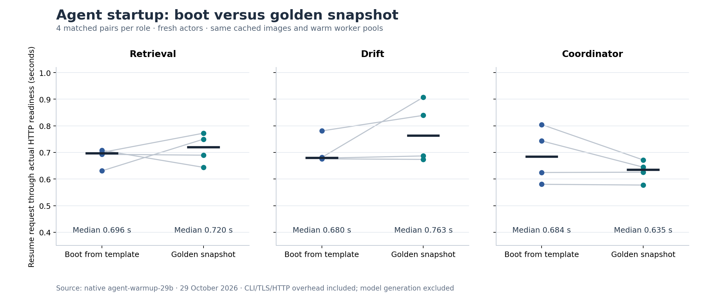
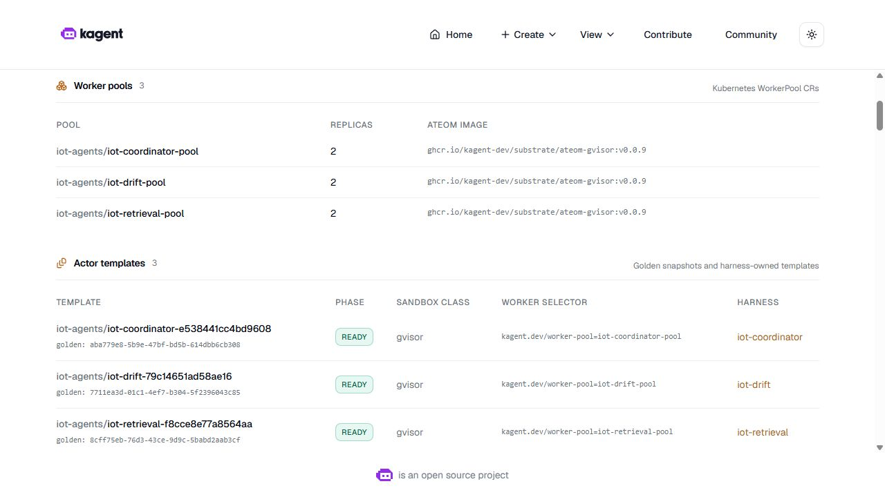

# Agent warm-up and worker capacity

Agent Substrate provides a reusable pool of gVisor workers and two ways to start a fresh actor. It can boot the actor from its template or restore the template's golden snapshot. In `agent-warmup-29b`, all 24 fresh actors reached their HTTP agent-card endpoint and returned to the suspended state. Restoring the coordinator reduced its median time to readiness by **49 ms (7.1%)** in this run. Retrieval and drift took longer with restoration. [Native run report](../evidence/agent-warmup/verification.json)

In the separate `agent-burst-29c` run, KEDA scaled the Substrate worker pools from six to twelve Pods and back to six. Scale-in removed **300 millicores and 1.5 GiB of configured worker resource requests** from the peak. Both experiments ran with Substrate active. A comparison against a deployment without Substrate would be needed to isolate its effect on startup, resource use, or cost. [Original scaling receipts](../evidence/agent-scaling/native-receipts.tar.gz)



[Original measurements](../evidence/agent-warmup/measurements.json) · [Native report](../evidence/agent-warmup/verification.json) · [Plot source](../diagrams/agent_warmup.py) · [SVG](../images/agent-startup-pairs.svg)

## Substrate configuration

Substrate assigns each agent role to a separate gVisor worker pool. The Helm values set two replicas per role and define the worker image and resource budget. The worker pool template passes those values into the Kubernetes custom resource. The native pool readback for all three roles reported two desired and two observed replicas.

```yaml
workerImage: ghcr.io/kagent-dev/substrate/ateom-gvisor:v0.0.9
workerReplicas: 2
workerResources:
  requests: {cpu: 50m, memory: 256Mi}
  limits: {cpu: '2', memory: 3Gi}
```

[Helm values](../../infra/charts/iot-agents/values.yaml) · [WorkerPool template](../../infra/charts/iot-agents/templates/pools.yaml) · [Native pool and ActorTemplate readbacks](../evidence/agent-warmup/native-receipts.tar.gz)

The benchmark read all three native ActorTemplates and required a Ready golden snapshot, the `gvisor` sandbox class, and this readiness probe on each container.

```yaml
readyz:
  httpGet:
    path: /.well-known/agent-card.json
    port: 80
```

Each matched sample creates a separate actor with no private snapshot. The benchmark switches between boot and restoration using the native resume call, then verifies the same actor UID, HTTP status 200 and the correct agent card.

```python
resumed, seconds = grpc(prefix + '/resume', 'ResumeActor', {'actor':reference,'boot':mode=='cold'})
```

[Native readback and benchmark code](../../scripts/benchmark-agent-warmup.py#L89-L150)

## What was compared

Each role used its same current template, immutable image, golden snapshot and two-worker pool on the control VM. Every sample created a new actor with no private snapshot. The native `ResumeActor` request used `boot=true` for a boot from the template and `boot=false` for golden-snapshot restoration. Four pairs per role alternated which mode ran first.

The templates declare an HTTP readiness probe for `/.well-known/agent-card.json` on port 80. Native Run/Restore waits for that probe. The benchmark also retrieved the actual card through the assigned worker, checked its role URL/version, and recorded the worker Pod UID and actor UID. The clock runs from the resume request through the completed HTTP card, including CLI/TLS/HTTP and small receipt-writing overhead.

This is an actor-startup comparison on an already-running lab. Both modes retain cached images and warm worker Pods. It excludes image download, initial VM/Pod startup, model loading, LLM generation and TTFT. A Go agent whose HTTP endpoint starts quickly need not benefit from restoring a process snapshot.

| Role | Pairs | Boot median | Golden median | Change from boot |
|---|---:|---:|---:|---|
| Retrieval | 4 | 0.696 s | 0.720 s | +23 ms (+3.3%) |
| Drift | 4 | 0.680 s | 0.763 s | +83 ms (+12.2%) |
| Coordinator | 4 | 0.684 s | 0.635 s | −49 ms (−7.1%) |

Changes use the full-precision medians before rounding. Positive values mean the actor took longer to reach its HTTP card. [Individual timings and actor identities](../evidence/agent-warmup/measurements.json)

<details>
<summary>All twelve matched pairs in seconds</summary>

| Role | Pair | Mode run first | Boot | Golden |
|---|---:|---|---:|---:|
| Retrieval | 1 | Boot | 0.708076 | 0.643920 |
| Retrieval | 2 | Golden | 0.692918 | 0.689684 |
| Retrieval | 3 | Boot | 0.630770 | 0.749807 |
| Retrieval | 4 | Golden | 0.700053 | 0.772355 |
| Drift | 1 | Boot | 0.780954 | 0.839364 |
| Drift | 2 | Golden | 0.681281 | 0.907540 |
| Drift | 3 | Boot | 0.678425 | 0.686858 |
| Drift | 4 | Golden | 0.675993 | 0.673769 |
| Coordinator | 1 | Boot | 0.580240 | 0.577339 |
| Coordinator | 2 | Golden | 0.624600 | 0.625715 |
| Coordinator | 3 | Boot | 0.804686 | 0.671657 |
| Coordinator | 4 | Golden | 0.743322 | 0.644555 |

[Full precision and actor identities](../evidence/agent-warmup/measurements.json)

</details>

All individual values are shown in the plot; the black marks are medians. Four pairs are a small sample, and the measured differences do not justify a general speed guarantee. The benchmark retains the unfavorable results. It does not rerun until every role appears faster. GPU offload has a separate [model-inference experiment](gpu_inference.md) and should not be credited to agent warm-up.

Warm capacity also has a cost: worker Pods reserve resources while idle, and snapshots consume retained storage. This experiment measures elapsed startup time, not a reduction in cloud charges. The existing pool configuration remains in place; no VM, disk or public endpoint was added for this test.

## L26 evidence boundary

| Requirement aspect | Recorded evidence | Limit |
|---|---|---|
| Warm-up configuration | Golden templates and two idle workers per role; native identities and readbacks retained | Configuration alone does not measure a benefit |
| Startup benchmark | 24 fresh actors, four alternating boot/golden pairs per role | Retrieval and drift were slower with golden restoration; coordinator was slightly faster on this small sample |
| Capacity under load | Six worker Pods before the burst, twelve at peak and six after scale-in | Resource requests describe scheduling capacity. This run did not measure utilization or cloud charges |
| HA explanation | Worker-pool replicas and their scaling are documented | Workers share a control VM; host-level failover was not demonstrated |

The evidence establishes the configuration and this bounded comparison. It does not establish a general startup or cost improvement. The [LLM tracker](rubric_tracker.md) retains that qualification; these measurements cannot support a universal performance claim.

## Replicas and HA

Each role has two idle worker slots and can [scale to four](agent_scaling.md) when demand increases. Idle actors suspend and release their slots. More than one worker provides spare process capacity; the recorded scaling experiment establishes elasticity under its workload.

| Phase in `agent-burst-29c` | Workers per role | Total workers | CPU requests | Memory requests |
|---|---:|---:|---:|---:|
| Before load | 2 | 6 | 300 mCPU | 1.5 GiB |
| At peak | 4 | 12 | 600 mCPU | 3 GiB |
| After scale-in | 2 | 6 | 300 mCPU | 1.5 GiB |

The totals multiply the observed replica counts by each worker container's requests of 50 mCPU and 256 MiB. They exclude the other services. The configured per-worker limits are two CPU cores and 3 GiB of memory. The RustFS claim provides 16 GiB of snapshot storage capacity. [Worker resources](../../infra/charts/iot-agents/values.yaml) · [Snapshot storage configuration](../../infra/agents/substrate-values.yaml)

### Native lifecycle and scaling results

For one example in `agent-warmup-29b`, the first retrieval boot sample has UID `b1e46f10-afdb-4f34-bce0-80f37ba4056f` throughout. The create response reports `STATUS_SUSPENDED`. The resume response reports `STATUS_RUNNING`, and the actual agent-card request returns HTTP 200 in 0.708076 seconds from resume. After the explicit `SuspendActor` call, the final `GetActor` readback reports `STATUS_SUSPENDED`. The verifier checks the same lifecycle for all 24 samples. The archive entries for this example are under `native/agent-warmup-29b/retrieval/0-cold/` inside the capture directory. [Original RPC and HTTP receipts](../evidence/agent-warmup/native-receipts.tar.gz) · [Lifecycle verifier](../../scripts/verify-agent-warmup.py)

The separate `agent-burst-29c` experiment used KEDA to scale each role from two to four workers, then return to two. It completed 18 coordinator requests and checked 36 child sessions. The load client retried 14 explicit capacity rejections. A Ready worker can still be occupied while a finished actor saves its snapshot, which accounts for the distinction between a Ready Pod and a free slot. The run measured the scaling behavior with Substrate active. The startup comparison above held Substrate and its worker pools fixed while changing the resume mode.

**Peak at 15:39 UTC on 29 October 2026.** The original Substrate UI shows four workers for each role.


**After scale-in at 15:46 UTC.** The same UI shows two workers for each role.



[Native scaling observations](../evidence/agent-scaling/native-receipts.tar.gz) · [Screenshot identities](../evidence/agent-scaling/ui/index.json)

All agent workers share the same physical control VM. The control plane, local snapshot storage and other retained services also depend on that host. A separate GPU worker serves the model, with one GPU and one model backend. Consequently, these replicas do not establish host-level failover or uninterrupted service after a VM/GPU failure. Worker-failure recovery during an active user request was not tested here. A suspended snapshot is also not a guarantee of exactly-once external side effects; the current agents expose read-only data tools and no actuator tool.

## Evidence and limitations

The accepted run `agent-warmup-29b` finished at 16:41:10 UTC on 29 October 2026. Its [exact native archive](../evidence/agent-warmup/native-receipts.tar.gz) retains 740 original payloads: every lifecycle request/response/timing, actual HTTP card, worker identity, template and pool readbacks, source packets and process journals. All 24 owned actors were left suspended. Existing sessions, templates, golden snapshots and pool replicas were preserved.

The first pilot stopped after its cold request because its checker expected a hyphenated card name. The actual ADK card uses `iot_retrieval`; its role URL and version were correct. The corrected checker requires the native name, expected role URL and deployed version 0.2.2. The failed original and its successful suspension remain in the archive. It is not included as a matched pair.

The [offline verifier](../../scripts/verify-agent-warmup.py) checks every original byte, fresh actor identity, boot flag, readiness result, matching template, balanced order, measurement and cleanup. It explicitly reports that a general startup gain and cross-node HA were not established.

```powershell
python -S scripts/verify-agent-warmup.py
python -m unittest discover -s tests -p test_agent_warmup.py
```

To repeat the experiment on the retained VM, use a new run/output name and a source-sealed copy of [the benchmark](../../scripts/benchmark-agent-warmup.py). Require idle existing actors, 30 minutes in the approved session, adequate RAM/SSD and the retained trusted gRPC client/CA. Start with one role and one pair before the full four-pair comparison. The operator uses a ten-minute credential held only in its subprocess environment. Never reset an existing actor's state to obtain a convenient cold sample.

References: [Substrate v0.0.9 resume selection](https://github.com/kagent-dev/substrate/blob/v0.0.9/cmd/ateapi/internal/controlapi/workflow_resume.go), [HTTP readiness contract](https://github.com/kagent-dev/substrate/blob/v0.0.9/pkg/api/v1alpha1/actortemplate_types.go), [golden-snapshot initialization](https://github.com/kagent-dev/substrate/blob/v0.0.9/cmd/atecontroller/internal/controllers/actortemplate_controller.go). These pinned sources explain the API behavior; the linked native artifacts supply the measurements.
