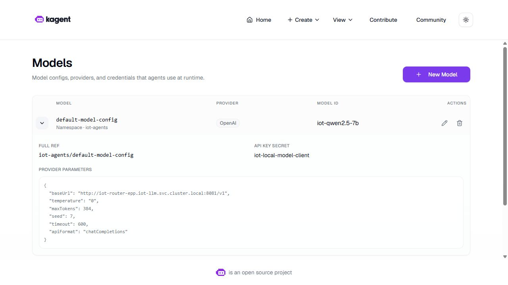

# Shared model configuration

Retrieval, drift and coordinator reference the same `default-model-config`. It selects a model through the private llm-d route; model weights, MCP execution and role-specific tool permissions remain separate. `OpenAI` names the compatible API protocol here, rather than an external paid model.

## Declared settings

[The kagent values](../../infra/agents/kagent-values.yaml) declare the provider. [The agent chart](../../infra/charts/iot-agents/templates/agents.yaml) references `.Values.modelConfig` for all three roles; [its values](../../infra/charts/iot-agents/values.yaml) select `default-model-config`.

| Setting | Source value |
|---|---|
| Model alias | `iot-qwen2.5-7b` |
| Endpoint | `http://iot-router-epp.iot-llm.svc.cluster.local:8081/v1` |
| API format | `chatCompletions` |
| Maximum output tokens | 384 |
| Temperature / seed | 0 / 7 |
| Request timeout | 600 seconds |
| Authentication reference | Secret `iot-local-model-client`, key `API_KEY`; its value remains outside Git |

These are declared settings, not current endpoint readiness. Role prompts and tools belong to the individual SandboxAgent specifications. Every role uses model generations; coordinator delegation and specialist MCP calls are distinct operations.

```yaml
# The same value is rendered in the retrieval, drift and coordinator SandboxAgent specs.
declarative:
  runtime: go
  modelConfig: {{ .Values.modelConfig }}
```

## Recorded deployment and refinements



This foundation capture predates the later GPU/tool-budget refinements. Its visible settings belong to that deployment. [The original inference platform](llm_inference_platform.md), [shared GPU route](gpu_agent_routing.md) and [platform foundation](agent_platform.md) preserve their separate identities.

The later model-control adapter bounds retrieval to three MCP calls and drift to one, with an absolute eight-call history limit. This is separate from `maxTokens`; MCP executes the tools. Answer acceptance checks actual paired tool/child histories. [The coordinator trace](observability.md#trace-an-actual-coordinator-request) records nine model generations and four MCP calls.

[Model A/B](llm_model_ab.md) compares pinned weight artifacts. [Agent A/B](agent_configuration_ab.md) changes agent configuration under its fixed model/tool boundary. Neither experiment changes every production agent. Live operation requires the approved VM sessions, pinned weights, ready private route and fresh feature lease described in [operations](../edai-1/operations.md); the linked offline verifiers authenticate recorded evidence without making a model request.

## Native agentgateway integration

The retained configuration above uses the direct llm-d route. The controlled K3s run temporarily routed the shared ModelConfig through Agentgateway and restored the original client configuration afterward. NGINX continues to serve the existing private UI.

[The candidate configuration](../../infra/agentgateway/candidate.py) pins the official `agentgateway` v1.7.0 amd64 image. It keeps llm-d as the inference router and introduces four private, authenticated ports on one ClusterIP:

| Port | Client and path | Backend |
|---:|---|---|
| 18080 | Shared OpenAI-compatible `ModelConfig`; `/v1/chat/completions` and `/v1/models` | Existing llm-d Service, preserving the observer and model-control path |
| 18081 | Retrieval `RemoteMCPServer`; `/mcp` | Retrieval MCP only, with its own mounted backend token |
| 18082 | Drift `RemoteMCPServer`; `/mcp` | Drift MCP only, with a different mounted backend token |
| 18083 | Scoped A2A operator; three exact `/api/a2a-sandboxes/iot-agents/iot-*` routes and agent cards | Existing kagent controller, using the lab's A2A v0.3 protocol |

The LLM listener authenticates the caller and forwards to a fixed llm-d backend using its mounted upstream credential. The two MCP listeners use native agentgateway streamable-HTTP targets, and preserve tool names with `prefixMode: never`. The A2A routes set a fixed single-operator identity after authentication and reject arbitrary controller paths. Inbound A2A is separate from the coordinator's internal controller-routed delegation, which this candidate does not replace.

The [local protocol test](../../tests/test_agentgateway_candidate.py) passed using the actual checksum-verified Windows `agentgateway` release: completion transport, both MCP sessions with their original tool names, a v0.3 A2A card and task, unknown-path rejection and missing/cross-role credential denial. The local run used loopback fixtures. The K3s results below use the retained model and agent services.

### Native results

The [applied ModelConfig](../evidence/agentgateway-native/applied-model.json) selected Agentgateway for the retrieval, drift and coordinator roles. One completed coordinator task entered through the A2A gateway and produced two independently checked child histories. Both specialists reached their assigned MCP routes. The original coordinator-to-child delegation ran through the kagent controller.

| Evidence | Observed result |
|---|---|
| Shared generation | 4 retrieval, 2 drift and 3 coordinator requests matched by observer request ID and worker Pod IP |
| MCP tool execution | Retrieval features, prediction and knowledge search plus one 32-machine drift assessment |
| A2A | Three discovery cards and one accepted coordinator task with both child results |
| Access control | Missing and cross-role credentials returned HTTP 401. An unlabelled Pod could not connect to the gateway port and an admitted Pod could. |
| Recovery | Original ModelConfig and production agent specs restored. Temporary MCP clones and egress policies removed. |

[Route correlation](../evidence/agentgateway-native/route-evidence.json) · [Task and child acceptance](../evidence/agentgateway-native/acceptance.json) · [Native TCP check](../evidence/agentgateway-native/network.json) · [Rollback receipt](../evidence/agentgateway-native/rollback.json).

The observer labelled these model requests `unknown`. The first verifier rejected that label even though the native task and children passed. The retained-log check matched exact response IDs to the originating worker Pods and kept the original labels. Two model requests returned 503 during the accepted conversation. Earlier attempts include a 502 and an A2A task that failed when llm-d had no eligible endpoint. The accepted run followed a scoped observer readiness change from five to fifteen seconds for both period and timeout, with the original health check. A later attempt to restore that readiness setting was rejected by Kubernetes. The observer setting is separate from the verified ModelConfig rollback.

The [native archive](../evidence/agentgateway-native/native-receipts.tar.gz) contains the original task bodies, logs and failed attempts. The published route projection omits MCP session headers. [Manifest](../evidence/agentgateway-native/manifest.json).

### Repeat the controlled check

1. Resume the retained CPU and GPU cluster and prepare a fresh feature lease. Use the approved CPU and GPU session deadlines. Check both MCP deployments, the controller, the llm-d route and the observer before making model requests. [Operations](../edai-1/operations.md).
2. On the CPU VM, run the gateway driver from the source tree. It checks the existing Secret bindings in memory, reviews the four new resources with a server dry run, and probes through loopback. A2A discovery validates the JSON-RPC 0.3 supported interface. The probe normalizes the trailing slash before sending the task.

   ```bash
   sudo python3 -B scripts/native-gateway-driver.py --source "$SOURCE" --runtime-root "$LAB_ROOT" \
     --output "$LAB_ROOT/outputs/agw-smoke-new" --run agw-smoke-new
   ```

3. Run the cutover with the sealed accepted agent source. It clones the two MCP resources for the production specialists, preserving the A/B agents’ shared original tool resource. It adds scoped egress for the already isolated workers and controller, checks the live resource versions, and switches the shared ModelConfig. It restores the original client route by default after verification.

   ```bash
   sudo python3 -B scripts/native-gateway-cutover.py --source "$SOURCE" --runtime-root "$LAB_ROOT" \
     --agent-source "$SEALED_AGENT_SOURCE" --smoke "$LAB_ROOT/outputs/agw-smoke-new" \
     --output "$LAB_ROOT/outputs/agw-cutover-new" --run agw-cutovernew
   ```

   `SOURCE` is the uploaded repository source directory. `LAB_ROOT` is the retained VM workspace. The agent source tree needs its original parent manifest. Keep the generated A2A credential and any private manifests on the VM. [Smoke driver](../../scripts/native-gateway-driver.py) · [Cutover driver](../../scripts/native-gateway-cutover.py).

Implementation references: [agentgateway A2A route policy](https://agentgateway.dev/docs/standalone/latest/documentation/agent/a2a/), [streamable HTTP MCP support](https://agentgateway.dev/docs/standalone/latest/documentation/quickstart/mcp/), [official v1.7.0 release](https://github.com/agentgateway/agentgateway/releases/tag/v1.7.0).
