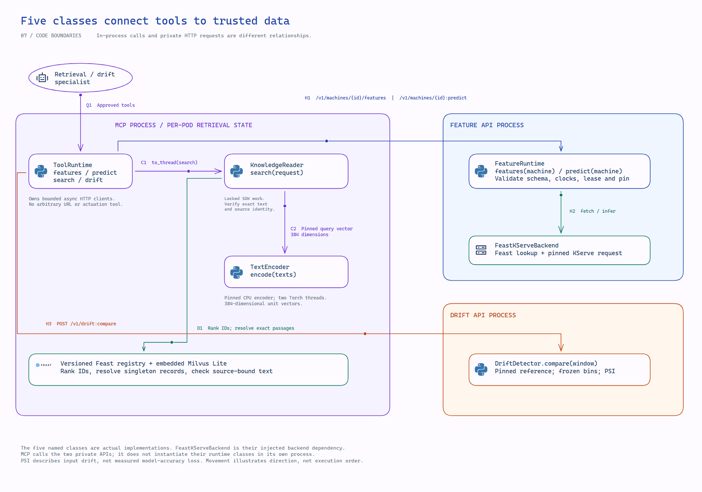

# Five classes behind the assistant's data and answers

The assistant obtains structured machine data and source-bound reference passages through a small set of implemented classes. These responsibilities connect the LLM to the existing ML platform: retrieve the right document, preserve data identity, enforce prediction eligibility and describe drift without inventing a diagnosis.

## Class responsibilities

| Class and source | Main methods | Responsibility | Important boundary |
|---|---|---|---|
| [`TextEncoder`](../../rag/embeddings.py) | `__init__(config)`, `encode(texts)` | Encode document chunks and queries with the same pinned model revision; return normalized 384-dimensional vectors. | Empty, oversized or over-token-limit text is rejected. Each vector must be finite and have the configured dimension and unit length. |
| [`KnowledgeReader`](../../services/rag_search/reader.py) | `__init__(state, source_root)`, `search(request)` | Load the Search Pod's verified knowledge snapshot, retrieve ranked IDs and check their exact passages and provenance. | Duplicate chunk IDs, a different catalog hash or a mismatched returned passage prevent a successful result. A lock protects its synchronous SDK and encoder work. |
| [`ToolRuntime`](../../services/mcp_tools/runtime.py) | `start()`, `close()`, `features(request)`, `predict(request)`, `search(request)`, `drift(request)` | Manage the MCP services' asynchronous clients and call the Feature, RAG Search and Drift APIs. | Validate the backend response for each tool and return a safe failure on bad identity, invalid data or unavailable services. |
| [`FeatureRuntime`](../../services/feature_api/runtime.py) | `features(machine)`, `predict(machine)` | Check both the simulation clock and real snapshot lease, read eligible features and call the deployed ML model through its backend adapter. | Unknown, expired, future, inconsistent or stopped machine states cannot produce an ordinary successful prediction. A returned score must match its model pin and decision threshold. |
| [`DriftDetector`](../../services/drift_api/detector.py) | `__init__(bundle)`, `compare(window)` | Validate the trusted reference, freeze bins and compare the eight numeric features using the declared PSI policy. | Input drift does not prove degraded predictive accuracy or an imminent pump failure. Reference identity and the policy are part of the result. |

`TextEncoder` uses the [pinned CPU embedding model](../../infra/rag/embedding.lock.json), with two Torch threads. The chat model is served separately on the GPU. These are different workloads; moving every validation or retrieval step onto the GPU is not required for a working assistant.

## How they collaborate

The diagram below records the earlier design with the knowledge reader inside Retrieval MCP. The current layout shows RAG Search API hosting that reader in its own Deployment. [Current architecture viewer](../architecture/ml-llm-platform-v19-notes.md)

<picture>
  <source media="(prefers-reduced-motion: reduce)" srcset="../images/assistant-classes.png">
  
</picture>

[Editable Excalidraw](../diagrams/assistant-classes.excalidraw) · [Full-resolution PNG](../images/assistant-classes.png) · [Interactive viewer](../diagrams/architecture.html)

Moving markers illustrate direction with arbitrary timing. Reduced-motion visitors receive a static image.

In the current design, `ToolRuntime` uses private HTTP calls for features, prediction, drift and document search. The Feature API owns `FeatureRuntime`, Drift API owns `DriftDetector`, and RAG Search API owns `KnowledgeReader`. The LLM composes its answer from the tools' returned data and references.

For a risk-and-reference question, follow this sequence:

1. `ToolRuntime.features()` obtains the machine snapshot from the Feature API. `FeatureRuntime` validates time, schema and operating context.
2. `ToolRuntime.predict()` follows the same eligibility checks before the backend calls KServe. Returned model identity and numeric decision are checked.
3. `ToolRuntime.search()` sends the question to RAG Search API. Search admits a bounded number of requests and runs `KnowledgeReader` in a worker thread. `TextEncoder` encodes the question, and the reader checks the ranked passages against the source records.
4. The retrieval agent cites those actual tool results. The coordinator can separately delegate a drift question to the drift specialist, whose tool reaches `DriftDetector`.

The [native agent comparison](agent_configuration_ab.md) checks six risk/reference answers against 18 actual tool events and independent model arithmetic. The [MCP quality report](mcp_quality.md) records API behavior, malformed backend responses, boundary/property tests and strict mutation evidence. The [measured coordinator trace](observability.md#trace-an-actual-coordinator-request) records cross-process execution. These provide different kinds of evidence; a class diagram alone does not establish runtime correctness.

## Keep the original rubric wording

Source cell C60 asks for five key classes representing the main focus and offers these illustrative training interfaces:

```python
class TrainingDataService:
    def read_training_table(self) -> DataFrame: ...
    def validate_schema(self, df: DataFrame) -> None: ...
    def dedup_by_created_ts(self, df: DataFrame) -> DataFrame: ...

class SplitService:
    def get_split_boundaries(self, df: DataFrame) -> dict: ...
    def split_by_time(self, df: DataFrame) -> tuple[DataFrame, DataFrame, DataFrame]: ...
```

The [original cell snapshot](../evidence/rubric-llm/source.json) preserves that wording and the D60 deliverable, “Document 5 key classes.” The table above documents five actual classes used by the assistant and its ML backends. The separate [ML lifecycle design](../edai-1/ml_class_design.md) covers dataset versioning, registry publication and portable inference. The example interface names do not imply that additional classes with those names have been implemented.

For a presentation, explain one responsibility per class, then trace one answer across them. Be ready to show where data validation ends and answer composition begins.
